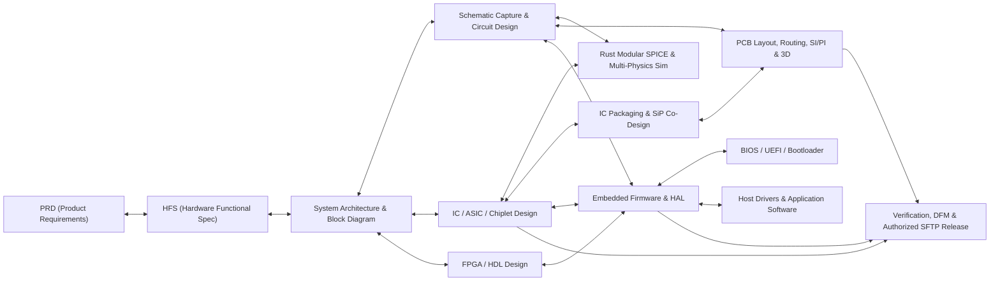

# 01 — Product Vision & Complete EDA Feature Catalog

> **Scope:** Defines everything Signal must deliver as a complete, industry-grade, **AI-Agent-First Cloud EDA Platform** spanning IC/chip design, PCB design, simulation, verification, firmware/FPGA/BIOS co-design, and product specification management inside a single unified application.

---

## 1. Product Philosophy: Unified Hardware-Software Product Engineering

In modern hardware companies, designing a single electronic product (e.g., an EV inverter, AI accelerator board, medical wearable, or satellite payload) currently requires stitching together disjoint tools:
- Requirements in Jira / Confluence / Polarion
- Hardware Functional Specs (HFS) in Google Docs / Word / PDF
- Schematics & PCB in Altium / Cadence OrCAD-Allegro / Siemens Xpedition / KiCad
- IC / ASIC design in Cadence Virtuoso / Synopsys Custom Compiler / Innovus / Calibre
- FPGA in Vivado / Quartus
- Firmware & BIOS/UEFI in VS Code / IAR / Keil / EDK2
- Simulation in LTspice / Spectre / HSPICE / Ansys HFSS-SIwave / ModelSim

This fragmentation causes pinout mismatches, stale specifications, manual register-map transcription bugs, BOM obsolescence surprises, and uncontrolled copies of proprietary design files scattered across engineer laptops.

**Signal eliminates fragmentation completely.** Every product artifact lives inside **one encrypted cloud Project**, backed by **one live semantic Design Graph**, manipulated by **humans and AI Agents collaboratively** in a single web application.

---

## 2. Unified Project Workspace, Metadata & Templates

### 2.1 Multi-Type Hierarchical Projects
- A **Project** represents a product, subsystem, or silicon tape-out.
- **Rich Extensible Metadata:** Project code, revision/version, lifecycle stage (`Concept`, `EVT`, `DVT`, `PVT`, `Tape-Out`, `Production`, `Deprecated`), target compliance standards (`AEC-Q100`, `ISO 26262`, `IEC 60601`, `DO-254`, `FCC/CE`, `RoHS/REACH`), cost targets, thermal envelope, custom enterprise key-value metadata schemas.
- **Multi-Type Composition:** When creating a project, users select a primary Project Type **and can add multiple Sub-Project Types under the same parent Project**:
  - `PRD` — Product Requirements Document (structured requirements with unique IDs, acceptance criteria, traceability)
  - `HFS` — Hardware Functional Specification (power tree, clock tree, reset sequencing, interface budgets, memory maps)
  - `SCHEMATIC` — Analog, Digital, Mixed-Signal, Power, and RF Schematics
  - `PCB` — Single/Multi-Board PCB Layout, Rigid-Flex, HDI, Harness/Interconnect
  - `IC_ANALOG` — Custom Analog/RF/Mixed-Signal IC Design (Transistor-level schematic + custom mask layout)
  - `IC_DIGITAL` — Digital ASIC / SoC Design (RTL-to-GDSII flow)
  - `IC_PACKAGE` — BGA/Flip-Chip/2.5D/3D Interposer & SiP Packaging
  - `FPGA` — RTL (SystemVerilog/Verilog/VHDL), Constraints (XDC/SDC), Synthesis, Timing & Pin Planning
  - `FIRMWARE` — Embedded C/C++/Rust firmware, RTOS, HAL, Register Maps, Pinmux
  - `BIOS` — Bootloader, UEFI/BIOS, ACPI tables, Device Trees (DTS), Bring-Up Diagnostics
  - `SOFTWARE` — Kernel drivers, SDKs, Test-bench & ATE automation scripts
  - `VERIFICATION` — Simulation suites, formal properties, compliance matrices, hardware test plans
  - `MECHANICAL_REF` — Enclosure keep-outs, mounting holes, thermal heatsink STEP references (view-only / co-design bounds)

### 2.2 Bi-Directional Cross-Domain Traceability
- **Requirement → Circuit → Layout → Firmware → Verification:**
  - Highlighting requirement `REQ-PWR-014 ("3.3V rail ripple < 15mVpp at 5A load")` jumps directly to the Buck Regulator schematic block, its PCB power polygon, the Rust transient simulation proving `11.2mVpp`, and the firmware PMIC telemetry monitor.
- **Live Netlist ↔ Firmware/FPGA Sync:**
  - Moving `I2C1_SDA` from pin `PA9` to `PB7` on the schematic automatically proposes synchronized updates to the FPGA pin constraint file, MCU pinmux C/Rust header, Linux Device Tree (`.dts`), and HFS pinout table—eliminating bring-up bugs before manufacturing.

### 2.3 Project Templates
- Users (personal scope) and Enterprise Admins (org/team scope) can author versioned **Project Templates**.
- A template pre-packages:
  - Default multi-type sub-project hierarchy (e.g., `"Automotive ECU Template"` = PRD + HFS + 2 Schematics + 8-Layer HDI PCB + AUTOSAR Firmware + Bootloader + ISO-26262 Compliance Matrix).
  - Pre-configured PCB stackups, impedance profiles, DRC/ERC rule decks, and approved foundry PDKs.
  - Approved component vendor lists (AVL) and preferred parts library filters.
  - Structured PRD/HFS section scaffolds.
  - AI Agent Guardrail Policies (e.g., mandatory derating margins: capacitor voltage rating ≥ 2× operating voltage, resistor power ≤ 50% rated).

---

## 3. Complete EDA Feature Suite

### 3.1 Schematic Capture & System Architecture
- **Block-Level System Capture:** Interactive system block diagrams, automated Power Tree designer (cascaded efficiency, current budget, sequencing diagram), and Clock Tree designer (PLL jitter, skew, fanout).
- **Hierarchical Multi-Sheet Schematics:** Multi-channel/repeated blocks, parameterized subcircuits, bus/bundle routing, net classes, differential pair directives, and design variants (DNP / alternate BOM stuffing options).
- **Live Electrical Rules Check (ERC):** Continuous real-time validation (unconnected pins, power-pin contention, voltage-domain crossings without level shifters, missing pull-ups on open-drain buses, exceeding datasheet AbsMax ratings).
- **Live Inline Simulation Probes:** Hover or pin live voltage, current, power dissipation, and junction-temperature badges directly onto schematic wires and component symbols.
- **Datasheet-Backed Component Placement:** Search and drop parts directly from the Universal Datasheet DB with real tolerances, parasitics, footprints, 3D models, and verified Rust behavioral modules pre-attached.

### 3.2 Simulation & Multi-Physics Verification (Rust Engine Core)
Every component is a composable **Rust Module** (detailed in [`03-rust-eda-engine.md`](./03-rust-eda-engine.md)), enabling unprecedented transparency, speed, and control over component physics.

| Domain | Simulation & Analysis Capabilities |
|---|---|
| **Analog & SPICE** | DC Operating Point, DC Sweep, AC Small-Signal (Bode, Nyquist, Stability/Phase Margin), Transient (nonlinear time-domain), Harmonic Balance / PSS (RF), Noise (thermal/flicker/shot/integrated SNR), Pole-Zero, Sensitivity, Transfer Function. |
| **Statistical & Reliability** | Monte Carlo (tolerance + mismatch distributions), PVT Corner Analysis (Process, Voltage, Temperature), Worst-Case Analysis (EVA/RSS), Component Stress / SOA / Derating Audit, Fault Injection (open, short, parameter drift, ESD pulse, FMEA/FMEDA automation). |
| **RF & High-Speed SI/PI** | S-Parameter (Touchstone `.sNp`), Smith Chart, TDR/TDT impedance profiling, Eye Diagram & BER with IBIS/IBIS-AMI models, Crosstalk (NEXT/FEXT), Power Delivery Network (PDN) target impedance & decoupling capacitor optimization, IR Drop & DC Current Density. |
| **Thermal & EMI/EMC** | Coupled Electro-Thermal simulation (component self-heating feeding back into temperature-dependent resistance/Vbe/Rds_on), PCB copper thermal spreading, near-field EMI hotspot estimation, return-path discontinuity checks. |
| **Digital & Mixed-Signal (AMS)** | Event-driven IEEE 1164 digital logic simulation, Verilog/SystemVerilog/VHDL behavioral & RTL simulation, True Analog-Digital Mixed-Signal co-simulation (ADC/DAC, PLL, PWM motor drive). |
| **Hardware-Firmware Co-Sim** | Virtual MCU/RISC-V/ARM execution coupled to live schematic/SPICE peripherals (verify SPI/I2C/CAN/PWM firmware against real analog circuit dynamics before tape-out or board spin!). |
| **Waveform & Post-Processing** | GPU-accelerated interactive waveform viewer (billion-sample pan/zoom), FFT/spectrum analyzer, custom measurement expressions, automated Pass/Fail assertions linked directly back to PRD/HFS requirements. |

### 3.3 PCB Design, Layout & Manufacturing Preparation
- **Layer Stackup & Material Manager:** Multi-layer rigid, rigid-flex, flex, metal-core (MCPCB), HDI microvia/stacked/staggered via builds, dielectric loss (`Dk`/`Df`) models, built-in 2D field-solver impedance calculator (microstrip, stripline, coplanar waveguide, single-ended & differential).
- **Floorplanning & Component Placement:** Cross-probing with schematics, thermal/EMI zoning, room/channel replication, automated placement proposals by AI Layout Agent, 3D collision & enclosure keep-out checks.
- **Interactive & Constraint-Driven Routing:**
  - Push-and-shove, hug-and-push, walkaround, glossing/teardrops.
  - High-speed differential pair routing, phase/skew tuning, serpentine/trombone length matching (DDR4/5, PCIe Gen4/5/6, USB4, Ethernet, MIPI).
  - BGA escape/fanout automation, via-in-pad, back-drilling, via stitching & shielding fences.
  - Dynamic copper pours, split planes, thermal reliefs, creepage & clearance enforcement (IPC-2221 / IEC 62368 high-voltage rules).
- **Multi-Board & Cable/Harness Co-Design:** Stackable mezzanines, backplanes, board-to-board connector mate verification, wire harness pin-to-pin continuity.
- **3D ECAD/MCAD Visualization:** Real-time GPU-rendered 3D PCB with realistic copper, solder mask, silkscreen, component STEP geometry, thermal heatmaps, and mechanical enclosure clearance inspection.
- **DRC, DFM, DFA, DFT Sign-Off:** Real-time + batch geometric/electrical DRC, acid traps, slivers, annular rings, solder mask bridges, tombstone risk, pick-and-place nozzle clearance, test-point coverage (ICT/flying probe).
- **Manufacturing Package Generation (SFTP-Only Delivery):** Gerber X2/X3, Excellon/NC Drill, ODB++, IPC-2581, IPC-D-356 netlist, Pick-and-Place (CPL), Structured BOM, Fabrication & Assembly drawings—generated inside the encrypted Rust pod and transmitted exclusively to an **Authorized SFTP Server**.

### 3.4 Integrated Circuit (IC), Chip & Chiplet Design Suite
Signal supports both **Custom Analog/Mixed-Signal IC** and **Digital RTL-to-GDSII** flows:
- **PDK & Foundry Management:** Encrypted tenant-scoped Process Design Kits (PDKs), technology files, layer maps, BSIM4/BSIM-CMG/PSP/EKV compact transistor models (compiled into native Rust component modules), standard cell libraries (Liberty `.lib`, LEF/DEF), and DRM/DRC/LVS rule decks.
- **Analog & Custom IC Design:**
  - Transistor-level schematic capture with parameterized MOSFET/FinFET/BJT/MOM-cap/spiral-inductor Rust modules.
  - Automated analog sizing & corner optimization (gm/Id methodology powered by AI + Rust SPICE).
  - Parameterized Layout Generators (**PCELLs**), common-centroid / interdigitated matching, guard rings, dummy fills, electromigration (EM) wire sizing.
- **Digital IC / SoC RTL-to-GDSII Flow:**
  - RTL authoring (SystemVerilog/Verilog/Chisel/VHDL), linting, CDC/RDC (Clock/Reset Domain Crossing) checks, formal equivalence checking.
  - Logic synthesis, Design-for-Test (DFT: scan chain insertion, BIST, ATPG).
  - Physical implementation: Floorplanning, macro placement, power grid synthesis, standard-cell placement, Clock Tree Synthesis (CTS), global & detailed routing, Static Timing Analysis (STA — setup/hold/OCV/POCV), dynamic IR drop.
- **Physical Verification & Sign-Off:**
  - **DRC** (Design Rule Check), **LVS** (Layout vs. Schematic), **ERC**, **Antenna checks**, **PEX** (Parasitic R/C/CC extraction back-annotated directly into the Rust SPICE engine for post-layout simulation), CMP dummy metal fill.
- **Packaging & Chiplet (2.5D/3D-IC) Co-Design:**
  - Die bump/pad-ring planning, wirebond/flip-chip RDL routing, silicon interposer routing, UCIe die-to-die link verification, chip-package-board unified SI/PI/thermal co-simulation.
- **Tape-Out Delivery (SFTP-Only):** Stream-out of verified GDSII / OASIS + mask-prep checklists directly to foundry/enterprise **Authorized SFTP**.

### 3.5 FPGA, Embedded Firmware, BIOS & Software Co-Design
- **FPGA Workspace:** Integrated HDL editor, IP integrator, live pin-planner bidirectionally linked to PCB symbols, timing constraint editor (SDC/XDC), RTL simulation, synthesis/P&R orchestration hooks (open-source Yosys/nextpnr built-in + enterprise vendor toolchain runners in isolated K8s worker pods).
- **Register Map & Hardware-Software Interface (HSI) Generator:** Single canonical SystemRDL / JSON register map auto-generating RTL CSRs, CMSIS-SVD, C/C++/Rust register headers, Linux Device Tree (`.dts`), UEFI/ACPI tables, and HFS documentation tables.
- **Firmware & BIOS IDE:** Embedded C/C++/Rust & UEFI/EDK2 code editor inside Signal, hardware-aware code intelligence (hovering a GPIO macro highlights the exact net and LED/sensor on the schematic!), cloud cross-compilation in sandboxed K8s build pods, and virtual hardware-in-the-loop testing against the Rust circuit simulator.

### 3.6 BOM, Component Intelligence & Compliance
- **Live Parametric BOM:** Real-time roll-up across multi-board/multi-subproject hierarchies, variant diffing, cost breakdown, lifecycle status (`Active`, `NRND`, `EOL`, `Obsolete`), dual-source alternate recommendations via Datasheet RAG, RoHS/REACH/Conflict-Minerals tracking.
- **Compliance & Audit Trails:** Automated requirements verification matrix (RVM), design review checklists, electronic sign-off gates, and immutable revision history suitable for ISO 26262, DO-254, IEC 62304, and AS9100 workflows.

---

## 4. AI-Agent-First Capabilities ("The Agent Does the Heavy Lifting")

Unlike traditional tools with a passive sidebar chatbot, Signal is architected as an **Agent-Native Engineering Environment**:

1. **Specification-to-Architecture Generation:** Upload or draft a PRD → AI Agent generates a structured HFS, power budget, clock tree, interface matrix, and initial block diagram with datasheet-backed IC selections and engineering trade-off tables.
2. **Autonomous Circuit Synthesis & Closed-Loop Verification:** Ask *"Design a 24V-to-5V 4A synchronous buck converter with <20mV ripple, >92% efficiency, AEC-Q100 qualified parts"* → Agent queries Universal Datasheet RAG, places real Rust component modules, calculates inductor/compensation/FET sizing, runs Rust DC/AC/Transient/Monte-Carlo/Thermal simulations, sees phase margin is 41°, automatically adjusts compensation network to hit 62°, proves compliance across `-40°C to +125°C`, and presents the verified circuit with waveforms and citations.
3. **Interactive Canvas-Aware Co-Design:** Highlight any subcircuit, PCB region, IC block, or waveform anomaly and ask *"Why is this gate-drive ringing at 85MHz?"* → Agent inspects parasitic inductances in the live Rust graph, runs sensitivity analysis, and proposes exact gate resistor + snubber + layout loop-area fixes.
4. **AI-Assisted Placement, Routing & DRC Auto-Healing:** Agent groups schematic functional blocks into optimal thermal/EMI PCB floorplans, proposes high-speed routing topologies, and iteratively resolves DRC/SI/LVS violations using deterministic engine feedback.
5. **Automated Analog IC Sizing & RTL Generation:** Agent explores transistor `(W/L)` design space across PVT corners via parallel Rust SPICE sweeps; generates SystemVerilog RTL + UVM/SVA testbenches from HFS state machines.
6. **Hardware-Aware Firmware & Bring-Up Generator:** Agent reads the live schematic netlist, IC datasheets (via RAG), and register maps to generate complete initialization drivers, I2C/SPI/PMIC bring-up code, power-on self-test (POST) sequences, and BIOS/Device-Tree tables.
7. **Continuous Background Design Guardian:** Silently monitors edits across all collaborators for subtle issues—unterminated clock lines, missing decoupling caps near IC power pins, voltage rating margin violations, ESD vulnerability, or requirement regressions—surfacing actionable one-click fixes.

---

## 5. Security, Governance & Zero-Exfiltration Experience

Every product feature operates strictly inside Signal's Zero-Trust security boundary (detailed in [`07-security-encryption-dlp-and-sftp.md`](./07-security-encryption-dlp-and-sftp.md)):
- **100% Cloud Web Platform:** Zero local installation, zero local design files.
- **End-to-End Encrypted Persistence:** All project files, specs, schematics, layouts, firmware, and simulation results encrypted at rest (AES-256-GCM + KMS/BYOK) and in transit.
- **No Export, No Print, No Screenshot:** Zero download buttons or APIs; printing disabled; Enterprise Zero-Leak mode renders designs on server GPUs and streams dynamically watermarked frames so raw IP never touches browser memory.
- **2FA-Gated Authorized SFTP Delivery:** Enterprises (after approval-based onboarding) and Individuals configure authorized SFTP endpoints protected by mandatory 2FA. Manufacturing/release bundles leave Signal *only* through audited, encrypted SFTP pushes.
- **Local Development Mode:** Supports instant Mac development with a local LLM default and local `Guest` user under `Signal Design, Inc.` (strictly compile-guarded out of production).
