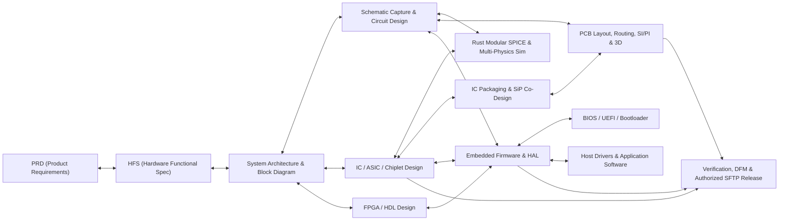

# 01 — Product Vision & Complete EDA Feature Catalog

> **Scope:** Defines everything Signal must deliver as a complete, industry-grade, **AI-Agent-First Cloud EDA Platform** spanning IC/chip design, PCB design, simulation, verification, firmware/FPGA/BIOS co-design, and product specification management inside a single unified application.

---

## 1. Product Philosophy: Unified Hardware-Software Product Engineering

In modern hardware companies, designing a single electronic product (e.g., an EV inverter, AI accelerator board, medical wearable, or satellite payload) currently requires stitching together disjoint tools:
- Requirements in Jira / Confluence / Polarion
- Hardware Functional Specs (HFS) in Google Docs / Word / PDF
- Schematics & PCB in Altium / Cadence OrCAD-Allegro / Siemens Xpedition / KiCad
- IC / ASIC design in Cadence Virtuoso / Synopsys Custom Compiler / Innovus / Calibre
- FPGA in Vivado / Quartus
- Firmware & BIOS/UEFI in VS Code / IAR / Keil / EDK2
- Simulation in LTspice / Spectre / HSPICE / Ansys HFSS-SIwave / ModelSim

This fragmentation causes pinout mismatches, stale specifications, manual register-map transcription bugs, BOM obsolescence surprises, and uncontrolled copies of proprietary design files scattered across engineer laptops.

**Signal eliminates fragmentation completely.** Every product artifact lives inside **one encrypted cloud Project**, backed by **one live semantic Design Graph**, manipulated by **humans and AI Agents collaboratively** in a single web application.

---

## 2. Unified Project Workspace, Metadata & Templates

### 2.1 Multi-Type Hierarchical Projects
- A **Project** represents a product, subsystem, or silicon tape-out.
- **Rich Extensible Metadata:** Project code, revision/version, lifecycle stage (`Concept`, `EVT`, `DVT`, `PVT`, `Tape-Out`, `Production`, `Deprecated`), target compliance standards (`AEC-Q100`, `ISO 26262`, `IEC 60601`, `DO-254`, `FCC/CE`, `RoHS/REACH`), cost targets, thermal envelope, custom enterprise key-value metadata schemas.
- **Multi-Type Composition:** When creating a project, users select a primary Project Type **and can add multiple Sub-Project Types under the same parent Project**:
  - `PRD` — Product Requirements Document (structured requirements with unique IDs, acceptance criteria, traceability)
  - `HFS` — Hardware Functional Specification (power tree, clock tree, reset sequencing, interface budgets, memory maps)
  - `SCHEMATIC` — Analog, Digital, Mixed-Signal, Power, and RF Schematics
  - `PCB` — Single/Multi-Board PCB Layout, Rigid-Flex, HDI, Harness/Interconnect
  - `IC_ANALOG` — Custom Analog/RF/Mixed-Signal IC Design (Transistor-level schematic + custom mask layout)
  - `IC_DIGITAL` — Digital ASIC / SoC Design (RTL-to-GDSII flow)
  - `IC_PACKAGE` — BGA/Flip-Chip/2.5D/3D Interposer & SiP Packaging
  - `FPGA` — RTL (SystemVerilog/Verilog/VHDL), Constraints (XDC/SDC), Synthesis, Timing & Pin Planning
  - `FIRMWARE` — Embedded C/C++/Rust firmware, RTOS, HAL, Register Maps, Pinmux
  - `BIOS` — Bootloader, UEFI/BIOS, ACPI tables, Device Trees (DTS), Bring-Up Diagnostics
  - `SOFTWARE` — Kernel drivers, SDKs, Test-bench & ATE automation scripts
  - `VERIFICATION` — Simulation suites, formal properties, compliance matrices, hardware test plans
  - `CAD_MCAD` — Parametric 3D Mechanical CAD (enclosures, heatsinks, chassis, sheet metal, assemblies, kinematic mates, GD&T drawings) linked live to PCB & thermal domains
  - `CAM_CNC` — Subtractive CNC CAM (2.5D/3/5-axis milling, laser/waterjet cutting, tool cribs, fixture collision, stock removal, signed post-processors)
  - `PRINT_3D` — Additive Manufacturing & 3D Printing (FDM/SLA/SLS/MJF/DMLS direct-B-Rep slicing, orientation, supports, infill, embedded-PCB pause layers)
  - `PLM_OPS` — Native PLM, Multi-View BOM (`eBOM`/`mBOM`/`sBOM`), Change Control (`ECR`/`ECO`/`ECN`, `MCN`, `PCN`/`PDN`, `Deviation`/`Waiver`, `NCR`/`CAPA`), Clear-to-Build (`CTB`) Supply-Chain & Factory Operations
  - `MECHANICAL_REF` — External read-only enclosure/heatsink STEP references when full `CAD_MCAD` authoring is not required

### 2.2 Bi-Directional Cross-Domain Traceability
- **Requirement → Circuit → Layout → Firmware → Verification:**
  - Highlighting requirement `REQ-PWR-014 ("3.3V rail ripple < 15mVpp at 5A load")` jumps directly to the Buck Regulator schematic block, its PCB power polygon, the Rust transient simulation proving `11.2mVpp`, and the firmware PMIC telemetry monitor.
- **Live Netlist ↔ Firmware/FPGA Sync:**
  - Moving `I2C1_SDA` from pin `PA9` to `PB7` on the schematic automatically proposes synchronized updates to the FPGA pin constraint file, MCU pinmux C/Rust header, Linux Device Tree (`.dts`), and HFS pinout table—eliminating bring-up bugs before manufacturing.

### 2.3 Project Templates
- Users (personal scope) and Enterprise Admins (org/team scope) can author versioned **Project Templates**.
- A template pre-packages:
  - Default multi-type sub-project hierarchy (e.g., `"Automotive ECU Template"` = PRD + HFS + 2 Schematics + 8-Layer HDI PCB + AUTOSAR Firmware + Bootloader + ISO-26262 Compliance Matrix).
  - Pre-configured PCB stackups, impedance profiles, DRC/ERC rule decks, and approved foundry PDKs.
  - Approved component vendor lists (AVL) and preferred parts library filters.
  - Structured PRD/HFS section scaffolds.
  - AI Agent Guardrail Policies (e.g., mandatory derating margins: capacitor voltage rating ≥ 2× operating voltage, resistor power ≤ 50% rated).

---

## 3. Complete EDA Feature Suite

### 3.1 Schematic Capture & System Architecture
- **Block-Level System Capture:** Interactive system block diagrams, automated Power Tree designer (cascaded efficiency, current budget, sequencing diagram), and Clock Tree designer (PLL jitter, skew, fanout).
- **Hierarchical Multi-Sheet Schematics:** Multi-channel/repeated blocks, parameterized subcircuits, bus/bundle routing, net classes, differential pair directives, and design variants (DNP / alternate BOM stuffing options).
- **Live Electrical Rules Check (ERC):** Continuous real-time validation (unconnected pins, power-pin contention, voltage-domain crossings without level shifters, missing pull-ups on open-drain buses, exceeding datasheet AbsMax ratings).
- **Live Inline Simulation Probes:** Hover or pin live voltage, current, power dissipation, and junction-temperature badges directly onto schematic wires and component symbols.
- **Datasheet-Backed Component Placement:** Search and drop parts directly from the Universal Datasheet DB with real tolerances, parasitics, footprints, 3D models, and verified Rust behavioral modules pre-attached.

### 3.2 Simulation & Multi-Physics Verification (Rust Engine Core)
Every component is a composable **Rust Module** (detailed in [`03-rust-eda-engine.md`](./03-rust-eda-engine.md)), enabling unprecedented transparency, speed, and control over component physics.

| Domain | Simulation & Analysis Capabilities |
|---|---|
| **Analog, SPICE & Differentiable Physics** | DC Operating Point, DC Sweep, AC Small-Signal (Bode, Nyquist, Stability/Phase Margin), Transient (charge/flux-conserving nonlinear time-domain), Harmonic Balance / PSS (RF), Noise (thermal/flicker/shot/SNR), Pole-Zero, Transfer Function, and **End-to-End Adjoint Differentiable Physics (`signal-diff-sim`)** computing exact gradients across 1,000+ parameters in one transpose solve. |
| **Physics-Informed Neural Surrogates** | **GPU Neural Operators (`signal-surrogate`)** delivering `< 50 ms` interactive field, thermal, IR-drop, and eye-diagram previews during live editing—always paired with **mandatory exact Rust MNA/FEM sign-off** before commit or release. |
| **Statistical, Aging & Reliability** | Monte Carlo (tolerance + correlated IC mismatch), PVT Corner Analysis, Worst-Case (EVA/RSS), Component Stress / SOA / Derating Audit, **10–15 Year Mission-Profile Aging (`signal-aging`: NBTI/PBTI, HCI, TDDB, Electromigration & passive wear-out)**, and Fault Injection (open, short, drift, ESD, automated ISO-26262 FMEDA). |
| **RF, 3D Full-Wave EM & 224G SI/PI** | S-Parameters (Touchstone `.sNp` with passive/causal Vector-Fitting macromodels), Smith Chart, **GPU 3D Full-Wave PEEC/FDTD/FEM (`signal-em3d`)** for vias/BGAs/antennas, TDR/TDT, IBIS-AMI 112G/224G PAM4 SerDes Eye/BER, Crosstalk, PDN decap optimization, IR Drop, and **Co-Packaged Optics (CPO) electro-optical co-simulation**. |
| **Thermal, Mechanical & EMI/EMC** | Multi-rate coupled Electro-Thermal simulation (self-heating leapfrog feedback into `T_j`), PCB copper spreading, chip-package-board thermal warpage bounds, near-field EMI hotspots, and return-path discontinuity checks. |
| **Digital, Mixed-Signal & Formal Proofs** | Event-driven IEEE 1164 logic, SystemVerilog/VHDL RTL simulation, True Analog-Digital Mixed-Signal (AMS), and **Neuro-Symbolic Formal Verification (`signal-formal`: SAT/SMT/IC3 property proving, RTL-to-Gate LEC, CDC/RDC, and IEEE 1801 UPF low-power state verification)**. |
| **3-Speed Hardware-Firmware Co-Sim** | Variable-fidelity virtual MCU/RISC-V/ARM execution (`100+ MIPS` fast Rust ISS for RTOS/UEFI boot → cycle-accurate RTL → full lock-step analog SPICE on peripheral triggers). |
| **Post-Silicon Digital Twin & Waveforms** | GPU billion-sample waveform studio, FFT, assertions linked to `REQ-xxx`, and **Lab Bench / Post-Silicon Digital Twin Bridge (`signal-twin`)** overlaying real oscilloscope/VNA/ATE silicon measurements directly against simulated curves to auto-calibrate Rev B parasitics. |

### 3.3 PCB Design, Layout & Manufacturing Preparation
- **Layer Stackup & Material Manager:** Multi-layer rigid, rigid-flex (with 3D dynamic bend-radius & copper-strain checks), flex, metal-core (MCPCB), HDI microvia/stacked/staggered via builds, frequency-dependent `Dk`/`Df` models, instant 2DBEM stackup impedance calculator + 3D via transition extraction.
- **Floorplanning, Placement & Spatial Review:** Cross-probing with schematics, thermal/EMI zoning, room/channel replication, AI electro-thermal placement proposals, 3D enclosure collision checks, and **Canvas-Anchored Spatial Review Redlining & Live Review Huddles** (eliminating screenshot-based Slack/slide reviews).
- **Interactive & Constraint-Driven Routing:**
  - Push-and-shove, hug-and-push, walkaround, any-angle/arc RF routing, glossing/teardrops.
  - High-speed differential pair routing, phase/skew tuning, serpentine/trombone length matching (DDR4/5, PCIe Gen4/5/6, USB4, 224G Ethernet, MIPI).
  - BGA escape/fanout automation, via-in-pad, back-drilling, via stitching & shielding fences.
  - Dynamic copper pours, split planes, thermal reliefs, creepage & clearance enforcement (IPC-2221 / IEC 62368 high-voltage rules).
- **Multi-Board, Backplane & Cable/Harness Co-Design:** Stackable mezzanines, backplanes, connector mate pin-swap verification, wire harness topology, 3D bundle routing, and harness voltage-drop/weight calculation.
- **3D ECAD/MCAD Visualization:** Real-time GPU-rendered 3D PCB with realistic copper, solder mask, silkscreen, component STEP geometry (with automated 3-way Symbol ↔ IPC-7351 Footprint ↔ 3D STEP pin-pad intersection check), and thermal heatmaps.
- **DRC, DFM, Fab Capability Profiles, DFT & JTAG Sign-Off:** Real-time + batch geometric/electrical DRC, **Signed Fab Capability Profiles (`*.fabprofile.toml` — exact drill aspect ratios, annular rings, vendor dielectric catalogs such as Megtron/Tachyon, panelization/impedance coupons, and copper-thieving balance)**, acid traps, tombstone risk, **Minimal-Perturbation Incremental PCB ECO** (swapping pins/footprints without ripping up unaffected high-speed buses), **IEEE 1149.1 / 1687 IJTAG boundary-scan chain synthesis**, and automated ICT/flying-probe nail-bed coverage.
- **Manufacturing, MCAD & Regulatory Package Generation (SFTP-Only Delivery):** Gerber X2/X3, Excellon/NC Drill, ODB++, IPC-2581, IPC-D-356 netlist, Pick-and-Place (CPL), Structured BOM, Fabrication & Assembly drawings, **IDF/IDX/STEP ECAD-MCAD Co-Design Baselines**, and **Watermarked/PQC-Signed Regulatory Lab Evidence Packages**—generated strictly in volatile Pod RAM and transmitted *exclusively* to **2FA-gated Authorized SFTP Servers** (zero browser downloads!).

### 3.4 Integrated Circuit (IC), Chip & Chiplet Design Suite
Signal supports both **Custom Analog/Mixed-Signal IC** and **Digital RTL-to-GDSII** flows:
- **PDK, IEEE 1735 Commercial IP & Foundry Management:** Encrypted tenant-scoped Process Design Kits (PDKs) plus built-in Open-Silicon PDKs (`Sky130`, `GF180`, `IHP SG13G2`), **HSM-backed IEEE 1735 v2/v3 commercial encrypted IP support + isolated `OSDI`/`IBIS-AMI` binary sandboxes**, BSIM4/BSIM-CMG/PSP/EKV compact transistor models, standard cell libraries (Liberty `.lib`/`.db` with **LVF/POCV statistical variation**, LEF/DEF), and DRM/DRC/LVS rule decks.
- **Analog & Custom IC Design:**
  - Transistor-level schematic capture with parameterized MOSFET/FinFET/GAAFET/BJT/MOM-cap/spiral-inductor Rust modules.
  - Automated analog sizing & multi-corner optimization (`gm/Id` + **Adjoint Differentiable Sizing** across PVT, **layout-extracted Pelgrom spatial mismatch**, & 15-year BTI/HCI aging corners).
  - Parameterized Layout Generators (**PCELLs**), common-centroid / interdigitated matching, guard rings, dummy fills, electromigration (EM) wire sizing.
- **Digital IC / SoC RTL-to-GDSII, Low-Power (UPF) & Metal-Only ECO Flow:**
  - RTL authoring (SystemVerilog/Verilog/Chisel/VHDL), linting, formal CDC/RDC checks, **IEEE 1801 UPF multi-voltage power-island/retention/isolation intent**, and formal Logic Equivalence Checking (LEC).
  - Logic synthesis, **Design-for-Test (DFT: scan chain insertion, MBIST/LBIST, JTAG/IJTAG, compression & ATPG vector generation)**, and **Post-Mask Spare-Cell / Metal-Only Functional & Timing ECO synthesis** (avoiding multi-million-dollar base-layer mask respins!).
  - Physical implementation: Hierarchical floorplanning, macro placement, power grid synthesis, standard-cell placement, Clock Tree Synthesis (CTS), global & detailed routing, MMMC Static Timing Analysis (LVF/POCV), dynamic EM/IR drop, and lithography/CMP hotspot awareness.
- **Physical Verification & Sign-Off:**
  - **DRC**, **LVS**, **ERC**, **Antenna checks**, **PEX** (parasitic R/L/C/CC extraction back-annotated directly into `signal-sim`), and CMP dummy metal fill.
- **Packaging & Chiplet (2.5D/3D-IC) Co-Design:**
  - Die bump/pad-ring planning, wirebond/flip-chip RDL routing, silicon interposer routing, UCIe / BoW die-to-die link verification, Co-Packaged Optics (CPO), and unified chip-package-board SI/PI/thermal/warpage co-simulation.
- **Tape-Out Delivery (SFTP-Only):** Stream-out of verified GDSII / OASIS + cryptographic mask-prep manifests directly to foundry/enterprise **Authorized SFTP**.

### 3.5 FPGA, Embedded Firmware, BIOS & Software Co-Design
- **FPGA Workspace:** Integrated HDL editor, IP integrator, live pin-planner & bank-voltage rules bidirectionally synced to PCB symbols, timing constraints (SDC/XDC), RTL simulation, and synthesis/P&R orchestration (built-in Yosys/nextpnr + isolated enterprise vendor runners).
- **Register Map & Hardware-Software Interface (HSI) Generator:** Single canonical SystemRDL / JSON register map auto-generating glitch-free RTL CSRs, CMSIS-SVD, C/C++/Rust safe register crates, Linux Device Tree (`.dts`), UEFI/ACPI tables, and HFS documentation tables.
- **Firmware, BIOS & Factory Bring-Up IDE:** Embedded C/C++/Rust & UEFI/EDK2 editor with schematic-aware LSP (hovering a GPIO macro highlights the exact schematic net and PCB trace!), cloud cross-compilation in zero-egress build pods, automated **Factory Bring-Up POST / Boundary-Scan Diagnostic Generator**, and 3-speed virtual HIL testing.

### 3.6 BOM, ECN Governance, Supply-Chain Intelligence, Sustainability & Legacy Migration
- **Live Parametric & Privacy-Preserving Supply-Chain BOM:** Real-time roll-up across multi-board hierarchies, variant diffing, lifecycle (`Active`, `NRND`, `EOL`, `Obsolete`), PCN alerts, **Signal-mirrored bulk distributor stock/lead-time/pricing + chaff-padded k-anonymous live checks**, geographic fab-concentration risk, and instant **AI "Zero-Spin BOM Rescue"** drop-in alternates via Datasheet RAG.
- **Sustainability & Digital Product Passport:** Real-time calculation of embodied carbon ($\text{kgCO}_2\text{e}$), 5-year active energy footprint, RoHS/REACH/PFAS-free/Conflict-Minerals compliance, and EU Digital Product Passport readiness.
- **Sandboxed Clean-Room Legacy CAD & Sketch Migration (`signal-import`):** Inbound-only zero-network sandboxed importers converting legacy Altium, KiCad, OrCAD, Eagle, LTspice, GDSII/OASIS, LEF/DEF, and whiteboard block-diagram photos into native Signal `ElectronicModule` projects (outbound sharing remains strictly 2FA SFTP!).
- **Engineering Change Orders (`ECN`/`ECO`) & Regulated Electronic Signatures:** Formal **ECN Impact-Analysis & BOM-Freeze Workflow** plus automated Requirements Verification Matrix (RVM) and **FDA 21 CFR Part 11 / ISO 26262 / DO-254 cryptographic sign-off gates** (`ML-DSA/Ed25519` + Step-Up 2FA).

### 3.7 Extended Next-Generation Feature Suite (`FEAT-001`–`FEAT-120`)
Above and beyond the baseline capabilities in Sections 3.1–3.6, **[`17-extended-feature-specifications-ui-and-rust.md`](./17-extended-feature-specifications-ui-and-rust.md)** dual-specifies **120 additional advanced features (`FEAT-001`–`FEAT-120`)** across both the **Angular 19+ UI (`web/libs/*`)** and **Pure-Rust Engine (`engine/crates/*`)** spanning 12 specialized domains:
- **Schematic Ergonomics & Smart Capture (`FEAT-001`–`FEAT-010`):** Auto-beautifier, typed protocol bus ribbons, live on-canvas potentiometers/switches, animated current rivers, cross-sheet portals, multi-channel `Repeat(N)`, variant curtains, pin/gate-swap negotiator, geographical re-annotation, and live KaTeX math-linked equation blocks.
- **High-Speed PCB, HDI, RF & Rigid-Flex (`FEAT-011`–`FEAT-020`):** Glass-weave skew zig-zag routing, curved-arc phase meanders, back-drill stub tuner, copper-island/acid-trap healer, die-to-ball package `ps` flight-time compensation, return-path split guardian, elastic bus-trunk routing, HDI microvia reliability, planar RF filter/antenna synthesis, and 3D rigid-flex bend-strain folding.
- **Power Electronics, Magnetics, PDN & Thermal (`FEAT-021`–`FEAT-030`):** Bobbin/planar `iGSE` magnetics studio, multi-rail PDN `Z_target(f)` decoupling optimizer, 3D geodesic creepage/clearance, heavy-copper IR-drop, SiC/GaN hot-loop inductance, Bode pole-zero compensator synthesizer, BMS thermal-runaway pack co-sim, FOC motor drive co-sim, heatsink/CFM thermal studio, and power-sequencing Gantt verifier.
- **EMC/EMI Pre-Compliance, Safety & Reliability (`FEAT-031`–`FEAT-040`):** `CISPR`/`FCC`/`MIL-STD-461` emissions simulator, Middlebrook EMI filter synthesizer, `IEC 61000-4-2/-4/-5` ESD/surge clamping tracer, shield-can resonance, automated ISO 26262 FMEDA (`SPFM`/`LFM`/`PMHF`) & Fault-Tree cut-sets, adjoint WCCA, Rad-Hard SEU/SET injection, MLCC piezo-singing acoustic detector, and org derating policy engine.
- **Advanced IC, 3D-IC & Hardware Security (`FEAT-041`–`FEAT-050`):** `gm/Id` lookup explorer, automated common-centroid analog layout, custom cell-to-Liberty `.lib` characterizer, Backside Power (`BSPDN`/PowerVia), interactive SoC/NoC floorplanner, CTS skew/mesh studio, interactive STA critical-path waterfall, chiplet bump/RDL negotiator, OPC/CMP hotspot visualizer, and DPA/TVLA + RTL IFT hardware security auditor.
- **FPGA Studio, Firmware/BIOS, Harness, DFM, Library, Lab, AI & Academy (`FEAT-051`–`FEAT-120`):** FPGA SLR/SSO die floorplan, SAT pinmux solver, live bus protocol decoders, firmware battery-life profiler, 1:1 wire-harness formboards, multi-up panelization + MLCC flex-crack guard, solder-joint fatigue, live DFM should-cost HUD, IPC-7351 parametric footprint+STEP generator, virtual bench instruments, TDR-to-trace-mm mapper, Shmoo plots, Multi-Monitor Zero-Leak pop-outs, SpaceMouse WebHID, AI Pareto/breaking-point/red-team agents, Breadboard↔Schematic↔PCB twin, safe visual smoke sandbox, `TinyTapeout` wizard, and `Signal Campus Edge`.

### 3.8 Integrated Mechanical CAD/CAM, 3D Printing, 3D Visualization & Native PLM / Operations
Detailed in **[`19-cad-cam-3d-printing-and-plm-operations.md`](./19-cad-cam-3d-printing-and-plm-operations.md)**, Signal embeds full mechanical product realization and factory change governance directly inside every Project:
- **Parametric Mechanical CAD (`CAD_MCAD`), CNC CAM (`CAM_CNC`) & Direct-B-Rep 3D Printing (`PRINT_3D`):** Pure-Rust parametric B-Rep modeling, sheet-metal unfolding, assembly kinematics, live ECAD↔MCAD hole/connector sync, 2.5D/3/5-axis adaptive CNC toolpaths + gouge/fixture collision sim, FDM/SLA/SLS/DMLS 3D slicing with embedded-PCB pause layers, and one unified `wgpu` 3D visualization viewport (Zero-Leak SFTP egress for `STEP AP242`/`DXF`/`G-code`/`3MF`).
- **Native PLM, Change Governance & Supply-Chain Operations (`PLM_OPS`):** Automatic multi-view `eBOM`/`mBOM`/`sBOM`/`Costed BOM` compilation, signed CCB state machines for **`ECR`/`ECO`/`ECN`**, **`MCN`**, **`PCN`/`PDN`** (with cross-project Where-Used blast radius), time- and quantity-bounded **`Deviation`/`Waiver`** release gates, **`NCR`/`CAPA`** quality loops, live **Clear-to-Build (`CTB`)** supply-chain shortage cockpit, interactive 3D assembly work instructions, and `signal-egress-proxy` ERP/MES sync.

### 3.9 Built-In Cross-Team Collaboration Space, Project Status & Automated Reviews
Detailed in **[`21-collaboration-space-project-status-and-automated-reviews.md`](./21-collaboration-space-project-status-and-automated-reviews.md)**, Signal replaces external IP-leaking chat and status tools (Slack, Microsoft Teams, ad-hoc spreadsheets, and manual slide decks) directly inside the encrypted platform:
- **Zero-Leak 5-Team Collaboration Hub (`services/collab-hub` + `web/libs/collab-hub`):** RBAC-scoped channels uniting **Design, Development/Bring-Up, Software/Firmware, Manufacturing, and Operations/Supply-Chain** with live `@entity` deep-link anchors (`@net:`, `@pcb:`, `@cad:`, `@ecn:`, `@bom:`, `@commit:`), spatial viewport thread sync, encrypted self-hosted WebRTC audio/video + **"Follow My Viewport"** huddles (`signal-huddle-sfu`), and zero raw file upload/download leaks.
- **Native Project Status & Automated Review Generation:** Tracks stage gates (`CONCEPT -> EVT -> DVT -> PVT -> MP`), RAG health, cross-team dependencies, action items, and Engineering Decisions (`ADR`/`EDR`), and directly generates **Weekly Reviews**, **Monthly Executive Reviews**, and **Stage-Gate Project Status Reviews** from 100% deterministic Rust/PLM/Git ground-truth telemetry + quarantined AI narrative synthesis—archived signed inside `<project>-ops/reviews/`.

---

## 4. AI-Agent-First Capabilities ("The Agent Does the Heavy Lifting")

Unlike traditional tools with a passive sidebar chatbot, Signal is architected as a **Neuro-Symbolic, Physics-Grounded Engineering Environment**:

1. **Specification-to-Architecture & Whiteboard Ingestion:** Draft a PRD or snap a whiteboard block diagram → AI Agent generates a structured HFS, UPF power tree, clock tree, interface matrix, and initial schematic block diagram with `SILVER`/`GOLD`-verified datasheet IC selections and trade-off tables.
2. **Autonomous Neuro-Symbolic Circuit Synthesis & Adjoint Sizing:** Ask *"Design a 24V-to-5V 4A synchronous buck converter with <20mV ripple, >92% efficiency, AEC-Q100 qualified parts"* → Agent queries Universal Datasheet RAG (checking stock & errata), wires real Rust component modules on a speculative CoW branch, invokes **`signal-diff-sim` Adjoint / Pareto optimization** to tune compensation & inductor/MLCC sizing in milliseconds, proves compliance across `-40°C to +125°C` + 15-year aging corners, and presents waveforms + verbatim citations.
3. **Interactive Canvas-Aware Co-Design & Neural Previews:** Highlight any subcircuit, PCB region, IC block, or waveform anomaly and ask *"Why is this gate-drive ringing at 85MHz?"* → Agent inspects parasitic inductances in the live graph, runs adjoint sensitivity + `< 50 ms` PINN field preview, and proposes exact gate resistor + snubber + return-path layout fixes.
4. **Multimodal Placement, Routing & DRC Auto-Healing:** Agent combines Vision-Canvas inspection with deterministic Rust electro-thermal placement and negotiated-congestion routing tools to iteratively clear DRC/SI/LVS/EM violations.
5. **Automated Analog IC Sizing, Formal SVA & RTL Generation:** Agent optimizes transistor `(W/L)` across PVT/aging corners; synthesizes SystemVerilog RTL + formal SVA properties proven mathematically by `signal-formal`.
6. **Hardware-Aware Firmware, BIOS & Post-Silicon Bring-Up:** Agent generates HAL drivers, PMIC sequencing, UEFI/Device-Tree tables, and factory self-tests—and correlates real lab oscilloscope captures against `signal-twin` during board bring-up.
7. **Quiescent-State Background Design Guardian:** Runs silently on idle/commit boundaries (interrupting immediately *only* on catastrophic short-circuit/AbsMax hazards to avoid alert fatigue)—catching missing level shifters, MLCC DC-bias derating shortfalls, unterminated clocks, or requirement regressions with one-click fixes.

---

## 5. Security, Multi-Repo BYO-Git & Complete Project Isolation

Every product feature operates strictly inside Signal's Zero-Trust & Complete Project Isolation boundary ([`07`](./07-security-encryption-dlp-and-sftp.md), [`08`](./08-identity-enterprise-and-project-model.md), [`13`](./13-vcs-git-server-and-storage-analysis.md), [`15`](./15-application-security-and-project-isolation.md)):
- **100% Cloud Web Platform & Complete Project Isolation:** Zero local design files; every Project runs in a dedicated, hardware-isolated Kubernetes Security Cell (Kata/gVisor MicroVM + Cilium eBPF default-deny + PostgreSQL RLS + per-project KMS DEK & SPIFFE SVID).
- **Customer-Owned Multi-Repo BYO-Git + Provider Auth:** 1 Project provisions `<project>-meta` + neatly prefixed `<project>-<type>` repos in the customer's GitHub, GitLab, or Bitbucket namespace (`ENCRYPTED_VAULT` default for Enterprise, audited periodically by `services/vcs-auditor`), visible strictly to authorized Org/Repo users and reviewable by Org & Project Admins.
- **Hybrid Post-Quantum Encryption, No Export/Print/Screenshot & 2FA SFTP-Only Egress:** Hybrid PQC (`ML-KEM-768` / `ML-DSA-65`) + AES-256-GCM encryption; Enterprise Zero-Leak GPU streaming with collusion-resistant forensic watermarks; manufacturing releases egress *exclusively* via **2FA-gated Authorized SFTP**.
- **Local Development Mode:** Supports instant Mac Apple Silicon development with a default Local LLM and hard-guarded `Guest` user under `Signal Design, Inc.`.
