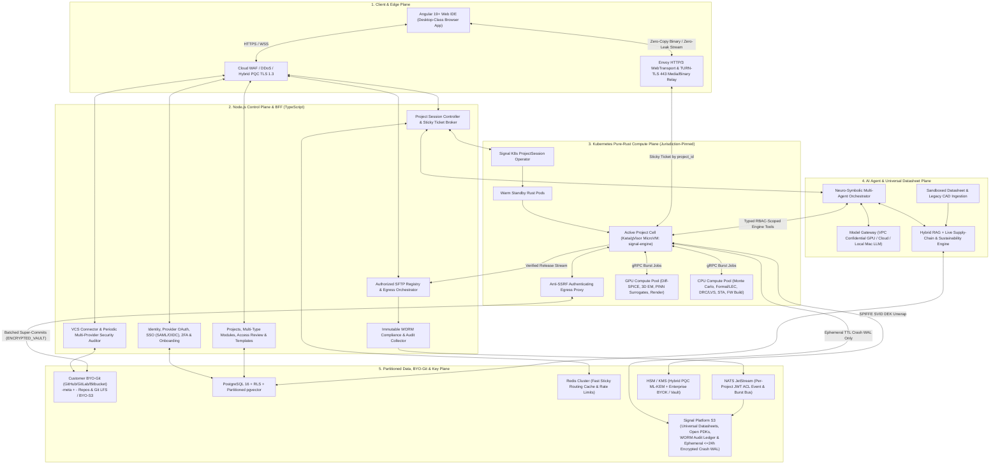
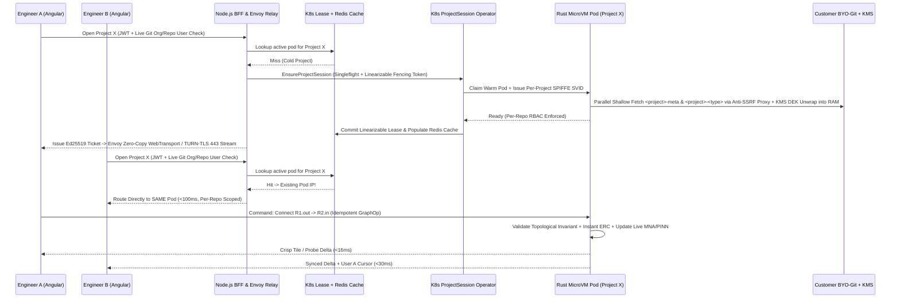

# 02 — System Architecture & Cloud Topology

> **Scope:** Defines the end-to-end distributed architecture of **Signal**, technology stack decisions, service boundaries, data flows, monorepo organization, and non-functional targets.

---

## 1. High-Level System Architecture

Signal separates concerns cleanly into **five architectural planes**, allowing the pure-Rust physics engine, the Node.js/Angular web platform, the Kubernetes stateful runtime, the AI Agent/RAG plane, and the Zero-Trust persistence layer to scale and evolve independently.



---

## 2. Technology Stack Matrix

| Layer | Chosen Technology | Architectural Rationale |
|---|---|---|
| **Core EDA & Physics Engine** | **Rust** (stable workspace, `tokio`, `tonic` gRPC, `rayon`, `faer`/KLU sparse MNA + `f128` iterative refinement, `wgpu`, `wasmtime`) | Memory safety without GC pauses, deterministic numerical precision, Differentiable SPICE, Formal/3D-EM kernels, strict `ElectronicModule` traits. |
| **Web Frontend UI** | **Angular 19+** (TypeScript, Standalone Components, Signals, CDK Virtual Scroll, Tailwind/Tokens, WebGPU / WebRTC / WebTransport) | Enterprise-grade architecture, zero zone-thrashing on 60–120 FPS viewports, modular lazy-loaded domain workbenches, WCAG 2.2 AA & color-blind safe. |
| **Web BFF & Control Plane** | **Node.js 22 LTS** (TypeScript, Fastify/NestJS) + **Envoy HTTP/3 Gateway** | Node.js handles SaaS control plane, auth, Access Review, BYO-Git & SFTP orchestration; Envoy handles zero-copy high-rate binary viewport/pointer pass-through without JS GC jitter. |
| **AI Agent Orchestrator** | **Rust / TypeScript** (`ai/orchestrator` with grammar-constrained `GBNF` tool decoding; sandboxed Python workers strictly for PDF/VLM datasheet extraction) | Enforces typed Protobuf tool contracts + Neuro-Symbolic delegation to Rust's Differentiable & Formal solvers. |
| **GPU Acceleration** | **Vulkan / `wgpu` + CUDA (Hardware-Isolated MIG / Confidential H100-B200) + Metal (Mac)** | Server-side lossless-tile + video viewport rendering, 3D EM/PINN surrogates, multi-GPU sparse solvers, and VPC LLM inference. |
| **Orchestration & Isolation** | **Kubernetes + Rust Operator (`kube-rs`) + Kata/gVisor MicroVMs + Cilium eBPF + Karpenter** | Dedicated MicroVM security cell per loaded Project, linearizable Kubernetes Lease fencing, zero east-west pod traffic, jurisdiction node pinning. |
| **Primary Database** | **PostgreSQL 16 + Row-Level Security (`NOBYPASSRLS`) + Partitioned `pgvector`** | ACID relational integrity for accounts, Access Review, parametric datasheets, and physically partitioned Global vs. Tenant-Private NDA vector indexes. |
| **Cache & Session Directory** | **Redis Cluster / Valkey** | Sub-millisecond read-through sticky routing cache (backed by linearizable K8s Leases), TOTP replay burn-list, and rate-limit buckets. |
| **Event & Job Backbone** | **NATS JetStream** (Per-Project JWT/NKey Subject ACLs) | Tenant-isolated work queues with hierarchical cancellation tokens for simulation bursts, datasheet ingestion, and audit log shipping. |
| **Storage Partitioning** | **(1) Customer BYO-Git (GitHub/GitLab/Bitbucket + Git LFS / BYO-S3)** + **(2) Signal Platform S3** | **Zero permanent customer design file custody on Signal** (all project repos live in customer BYO-Git); Signal Platform S3 stores *only* Global Datasheets, Open PDKs, WORM Audit Logs, and ephemeral `<= 72h` (default `24h`) BYOK-encrypted crash/Git-outage continuity WAL. |
| **Secrets & Post-Quantum Crypto** | **Cloud KMS / HSM + Vault + Enterprise BYOK/HYOK + Hybrid PQC (`ML-KEM-768` / `ML-DSA-65`)** | FIPS 140-3 + NIST Post-Quantum protection against "Harvest Now, Decrypt Later", SPIFFE/SPIRE per-project SVIDs, and Confidential VM attestation. |
| **Interface Contracts** | **Protobuf v3 (`Buf`) + Apache Arrow Binary Framing + OpenAPI 3.1 + JSON Schema** | SI-unit-suffixed (`_nm`, `_ps`, `_uv`), build-time code-generated contracts + golden conformance fixtures enabling deadlock-free Antigravity + Cursor parallelism. |

---

## 3. Architectural Separation of Responsibilities

A strict boundary keeps the system clean, secure, and maintainable:

- **Rust (`engine/`) Owns 100% of Engineering Truth:**
  - Design graph (PRD/HFS links, UPF power intent, schematics, netlists, PCB geometry, IC masks, register maps).
  - Every electronic component's behavioral, aging, thermal, and differentiable Rust module.
  - All simulation & verification kernels (MNA SPICE, Differentiable Adjoint, PINN Surrogates, 3D EM, Formal/LEC, ERC/DRC/LVS/PEX/STA, Digital Twin correlation, Clean-Room Legacy Importers).
  - Multi-repo RAM-only Git sync (`signal-git-sync` Two-Phase `Super-Commit` + `ENCRYPTED_VAULT` convergent cipher), GPU rendering + forensic watermarks, and in-RAM Gerber/ODB++/IPC-2581/GDSII generation piped to SFTP egress.
- **Node.js (`services/`) Owns SaaS Control Plane, Governance & Security Auditing:**
  - Provider OAuth/OIDC + Enterprise SAML SSO, mandatory Step-Up 2FA, approval-based Enterprise onboarding, Org & Project Admin Access Review Console.
  - 2FA-gated BYO-Git (`vcs-connector`) & Periodic Multi-Provider Security Auditor (`vcs-auditor`).
  - Session ticket issuance (`session-broker` + Envoy zero-copy stream relay) and 2FA-gated Authorized SFTP orchestration (`sftp-egress`).
- **Angular (`web/`) Owns Rich Human Interaction (Zero Local Storage of IP):**
  - Unified multi-domain IDE shell, Progressive UI Profiles (`EXPLORER` / `MAKER` / `PRO` / `SILICON_SCALE`), spatial review redlining, visual semantic diffing, and 120 FPS client-side predictive cursor overlay.
- **AI Plane (`ai/`) Owns Neuro-Symbolic Reasoning, Datasheet RAG & Supply-Chain Intelligence:**
  - Dual-VLM verified Universal Datasheet ingestion, k-anonymous live supply-chain/sustainability RAG, and multi-agent orchestration operating strictly inside non-elevated speculative CoW branches.

---

## 4. Core End-to-End Data Flows

### 4.1 Multi-User Project Open & Real-Time Edit


### 4.2 AI Agent Closed-Loop Neuro-Symbolic Design & Verification
1. Engineer prompts: *"Design and verify a 3.3V ultra-low-noise LDO stage for the 16-bit ADC reference."*
2. **Schematic Agent** queries **Hybrid RAG** (`SILVER`/`GOLD` verified datasheets + live stock + errata) and forks an anonymous `jj` / CoW speculative branch inside the active **Rust Project Pod**.
3. Agent places real Rust `ElectronicModule`s (LDO + DC-bias-derated MLCCs + ferrite bead) and invokes **`signal-diff-sim` Adjoint / Pareto Optimizer** + **Rust SPICE AC/Noise/Transient/Thermal/Aging** simulations.
4. Once all `REQ-xxx` specs and SOA margins pass, Agent generates an **Immutable Design Proof Bundle** (equations, Bode/noise plots, worst-case margins, verbatim page/bbox citations) for human **Approve & Merge**.

### 4.3 Authorized SFTP Manufacturing Release (Atomic & PQC-Signed)
1. Lead Engineer initiates Release → Node.js BFF enforces **Step-Up 2FA** (+ optional 4-eyes QA/Security sign-off & 21 CFR Part 11 signature) and runs a pre-release `vcs-auditor` check.
2. Rust Project Pod verifies `Super-Commit` lockstep consistency across `<project>-*` repos, runs final DRC/ERC/LVS/SOA sign-off, generates Gerber/ODB++/IPC-2581/GDSII/BOM **strictly in encrypted RAM**, signs a hybrid **`ML-DSA-65 + Ed25519` manifest**, and streams ciphertext over mTLS to `signal-sftp-egress`.
3. Disposable egress worker uploads via pinned SSH host key + HSM `ED25519` key to `.tmp.<release_id>.part`, verifies remote SHA-256 read-back, atomically renames to final target, zeroizes RAM, and logs to the WORM Merkle Audit Ledger.

---

## 5. Planned Monorepo Blueprint (Designed for Parallel AI IDE Development)

```text
signal/
├── architecture/              # Master design, security, 148-flaw, 120-feature, Universal Parts & CAD/CAM/PLM (01..19)
├── contracts/                 # Source of truth: Protobuf (.proto), OpenAPI, JSON Schemas, Golden Fixtures
│   ├── proto/signal/v1/       # SI-unit-suffixed gRPC (int64 -> bigint) + Arrow binary framing contracts
│   ├── openapi/               # Control-plane REST APIs
│   ├── schemas/               # Datasheet, Universal Parts, MCAD/CAM/3D-Print, BOM/ECO/MCN/PCN/Deviation & SFTP
│   ├── fixtures/              # Cross-language golden conformance vectors (Antigravity <-> Cursor)
│   └── transcripts/           # Stateful multi-step gRPC/WebTransport conformance transcripts (*.jsonl)
├── engine/                    # Pure Rust Workspace (Cargo workspace — shared build-time proto codegen)
│   ├── crates/
│   │   ├── signal-proto/      # Single shared build-time Protobuf/gRPC codegen crate (< 2s incr builds)
│   │   ├── signal-core/       # IDs, strongly-typed SI units, SecretBox, Hybrid PQC + 2-level HKDF, zeroize
│   │   ├── signal-graph/      # Multi-domain ECS graph, UPF power intent, dependency-aware CRDT & undo
│   │   ├── signal-component/  # ElectronicModule trait, charge/flux ports, Pelgrom mismatch, SOA, faults
│   │   ├── signal-parts/      # Universal 3-Tier Part/Datasheet/Pin/Symbol/Padstack/3D-STEP resolver & verifier
│   │   ├── signal-lib-*/      # Modular component crates (passive, semi, analog-ic, rf, digital, fw-bridge)
│   │   ├── signal-module-sdk/ # Multi-dialect SPICE, AOT OpenVAF/Cranelift WASM-SIMD, LM curve-fitter & SDK
│   │   ├── signal-sim/        # Equilibrated f64/f128 MNA SPICE (CPU KLU/CKTSO + GPU cuDSS), PSS/HB, Cryo
│   │   ├── signal-diff-sim/   # Saltation-exact + Revolve Adjoint Differentiable SPICE/thermal/STA optimizer
│   │   ├── signal-surrogate/  # Physics-Informed Neural Operators (PINN) fast preview engine
│   │   ├── signal-formal/     # SAT/SMT/IC3 formal property prover, LEC & CDC/RDC/UPF verifier
│   │   ├── signal-em3d/       # GPU 3D Full-Wave PEEC/FDTD/FEM, 224G SerDes & Baseband Envelope CPO solver
│   │   ├── signal-aging/      # 10-15 yr NBTI/PBTI, HCI, TDDB & Electromigration reliability engine
│   │   ├── signal-twin/       # Post-silicon & lab oscilloscope/VNA/ATE Digital Twin calibration bridge
│   │   ├── signal-import/     # Zero-network clean-room legacy CAD (KiCad/Altium/OrCAD/GDSII) & sketch importer
│   │   ├── signal-geom/       # i64 nm storage + exact i128/Shewchuk predicates, arcs/Beziers, R-tree DRC
│   │   ├── signal-pcb/        # Stackup, 2D BEM, glass-weave/meander/backdrill, Incremental ECO, IPC-2581
│   │   ├── signal-ic/         # PDK, IEEE 1735, gm/Id, BSPDN, CTS, LVF STA, Metal ECO, 20um Halo, GDSII/OASIS
│   │   ├── signal-magnetics/  # Planar/bobbin transformer iGSE core-loss, Dowell winding & leakage kernel
│   │   ├── signal-power-integrity/ # PDN Z_target opt, 3D geodesic creepage, IR-drop, hot-loop, BMS/FOC/thermal
│   │   ├── signal-emc/        # CISPR/FCC pre-compliance, ESD/surge, ISO 26262 FMEDA/FTA, WCCA, Rad-Hard, piezo
│   │   ├── signal-dfm/        # Panelization, MLCC flex-crack, reflow/tombstone DFA, fatigue, should-cost, ICT
│   │   ├── signal-harness/    # Multi-board 3D BVH clearance, 1:1 wire-harness formboard, rigid-flex bend strain
│   │   ├── signal-mcad/       # Parametric 2D sketcher, B-Rep 3D solids, sheet-metal unfold, assemblies, STEP AP242
│   │   ├── signal-cam/        # 2.5D/3/5-axis CNC CAM toolpaths + native direct-B-Rep 3D-printing slicer
│   │   ├── signal-plm/        # Multi-view eBOM/mBOM/sBOM compiler, change blast-radius & cryptographic CCB ledger
│   │   ├── signal-fpga/       # FPGA SLR/SSO floorplan, SAT pinmux, protocol decoders, battery/FSM/DSP co-sim
│   │   ├── signal-security-hw/# Hardware DPA/TVLA side-channel, laser fault injection & RTL IFT Trojan audit
│   │   ├── signal-render/     # Unified wgpu PBR 3D + Zstd-QOI/WebP dirty-tile + HEVC/Dual-Luma & watermarks
│   │   ├── signal-git-sync/   # Multi-repo gitoxide + jj-lib, Dual-Fenced 2PC Super-Commit & Padme GCM-SIV
│   │   ├── signal-cell-wasm/  # < 8 MB Wasmtime EXPLORER isolate cell runtime (auto-promotes to Kata MicroVM)
│   │   ├── signal-pod/        # MicroVM project pod daemon, child OSDI/AMI sandbox, BYOK continuity WAL
│   │   └── signal-operator/   # K8s Operator (Host-Aggregated Node Leases, Pre-Copy < 150ms Live Migration)
├── services/                  # Node.js 22 / TypeScript Control Plane & BFF
│   ├── api-gateway/           # Auth, CSRF/CSP nonces, rate limiting, fail-closed policy enforcement
│   ├── identity-org/          # Provider OAuth + SAML dual-binding, 2FA, Enterprise onboarding, Access Review
│   ├── project-catalog/       # Multi-repo Projects, metadata, SPDX license gate, Templates, Portfolio DAG
│   ├── parts-registry/        # Universal Parts search, BLAKE3 CAS gateway, Org AVL overlays & Where-Used scans
│   ├── plm-ops/               # Native ECN/ECO, MCN, PCN, Deviation/Waiver, NCR/CAPA, CTB supply-chain & ERP sync
│   ├── vcs-connector/         # 2FA BYO-Git settings (GitHub/GitLab/Bitbucket), GraphQL/ETag sync
│   ├── vcs-auditor/           # Periodic multi-provider security posture, drift, CVE & contractor-expiry auditor
│   ├── session-broker/        # Sticky pod resolution, Ed25519 stream tickets, FinOps metering & cloud clipboard
│   ├── sftp-egress/           # 2FA Authorized SFTP registry & disposable atomic russh transfer workers
│   └── audit-service/         # Fail-closed 3x Quorum Outbox -> Pseudonymous RFC-3161 + ML-DSA Merkle WORM
├── ai/                        # AI Agent Orchestration & Universal Datasheet RAG
│   ├── orchestrator/          # Neuro-symbolic supervisor, domain specialists, Multimodal + Dual-LLM quarantine
│   ├── llm-gateway/           # Grammar-constrained (GBNF) router (Confidential GPU / Cloud / Local Mac / Mock)
│   ├── datasheet-ingest/      # Dual-VLM consensus parser, curve digitizer, rev differ & SPICE sanity verifier
│   └── rag-service/           # 3-Tier Sharded Hybrid RAG + Bulk-Mirrored/Chaff-Padded supply-chain & carbon
├── web/                       # Angular 19+ Web Platform
│   ├── apps/signal-web/       # Main IDE shell, Omni-Palette, Radial Menu, Multi-Monitor & 120 FPS HUD overlay
│   └── libs/                  # Core + Extended Workbenches (schematic, pcb, ic, sim-viewer, code-ide, specs,
│                              #   visual-diff, review, admin, magnetics, power-studio, emc-lab, safety-wcca,
│                              #   fpga-studio, harness-3d, dfm-panel, library-studio, bringup-lab, academy,
│                              #   mcad-studio, cam-print, plm-ops)
├── benchmarks/                # Continuous NGSPICE parity, Sky130 DRC/LVS, IPC-2581 & SignalBench-AI suites
├── infra/                     # Helm charts, Kata/Cilium/Kyverno policies, Anti-SSRF Egress Proxy, Campus Edge
└── coordination/              # Multi-AI-IDE task board & single-writer per-agent journals
```

---

## 6. Non-Functional Requirements & Scale Targets

| Metric | Target SLA | Architectural Mechanism |
|---|---|---|
| **Interactive Viewport Frame Time** | ≤ 16.6 ms (60–120 FPS) + crisp lossless settle ≤ 80 ms | Dual-Plane `wgpu` Compositor (**`Zstd-QOI` / Lossless `WebP` `RGBA8` dirty tiles** + hardware `HEVC 4:4:4` / Dual-Luma `AV1/H.264` motion stream) + 120 FPS client crosshair prediction via Envoy WebTransport / `turns:443`. |
| **Warm Project Open Latency** | `< 5 ms` (`EXPLORER` WASM Isolate), `< 1.5 s` (PCB Pod), `< 4 s` (federated SoC) | Dedicated `< 8 MB` `signal-cell-wasm` isolates (auto-promoting to Kata MicroVMs) + pre-warmed CPU standby pods + parallel **blobless partial clone (`--filter=blob:none`)** `gitoxide` fetch into RAM. |
| **Second User Join Latency** | < 100 ms | Redis read-through cache backed by host-aggregated K8s Node Leases + sharded linearizable project epochs directly attaching to the active Project Cell. |
| **Multi-User Edit Propagation** | < 50 ms p95 (regional), zero head-of-line stall on 3G | Dependency-aware topological CRDT sequencer + per-subscriber conflating ring buffers. |
| **Design Scale — PCB & Harness** | 100,000+ nets, 64+ layers, multi-board + harness | Arena ECS graph + `i64` nm storage (`i128` exact predicates) + R*-tree spatial index + Signed Fab Capability Profiles. |
| **Design Scale — IC / GPU** | 100B+ transistor hierarchical SoC / 3D-IC | Instanced cell DAGs, signed `20 µm` boundary-halo views (`*.halo.gds.sig`) across federated IP pods (zero lateral pod sockets), spatially-tiled MapReduce DRC/LVS & `cuDSS` multi-GPU solvers. |
| **Security & Complete Isolation** | 0 permanent customer IP bytes on Signal; 0 lateral paths | Kata MicroVM / Exclusive `H100 CC` / Blackwell `B200 TEE-I/O` Confidential MIG, Cilium eBPF default-deny, Postgres RLS, Padmé-blinded Hybrid PQC (`ML-KEM`/`ML-DSA`), 2FA fail-closed SFTP egress. |
| **Continuity & Sovereign DR** | 99.99% Control Plane; `< 500 ms` RPO; 0 cross-border DR spill | **Strictly In-Jurisdiction Paired-Region DR** (`Frankfurt<->Paris`, `GovCloud-W<->E`, `Mumbai<->Hyderabad`) + Dual-Fenced Two-Phase BYO-Git `Super-Commit` + BYOK-wrapped Continuity WAL. |
| **Local Dev Startup (Mac)** | `< 30 s` (`dev:lite` `< 1.5 GB` RAM, `< 2 s` incr Rust build) | Shared `signal-proto` crate + `sccache`/`lld` + ARM64 Metal `wgpu` + `GBNF` Local Ollama/MLX (with `deterministic_mock` offline fallback) + MockGit/MockSFTP. |
