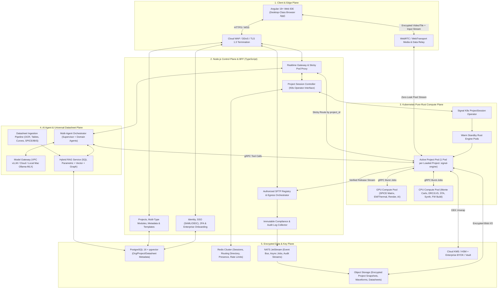
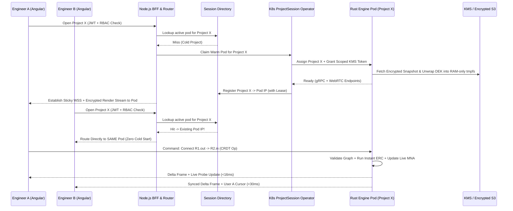

# 02 — System Architecture & Cloud Topology

> **Scope:** Defines the end-to-end distributed architecture of **Signal**, technology stack decisions, service boundaries, data flows, monorepo organization, and non-functional targets.

---

## 1. High-Level System Architecture

Signal separates concerns cleanly into **five architectural planes**, allowing the pure-Rust physics engine, the Node.js/Angular web platform, the Kubernetes stateful runtime, the AI Agent/RAG plane, and the Zero-Trust persistence layer to scale and evolve independently.



---

## 2. Technology Stack Matrix

| Layer | Chosen Technology | Architectural Rationale |
|---|---|---|
| **Core EDA & Physics Engine** | **Rust** (stable, workspace of modular crates, `tokio`, `tonic` gRPC, `rayon`, `faer`/sparse MNA solvers, `wgpu`) | Memory safety without GC pauses, C/C++-class numerical performance, fearless concurrency, strict trait-based modular electronic components, deterministic behavior. |
| **Web Frontend UI** | **Angular 19+** (TypeScript, Standalone Components, Signals, RxJS where streaming helps, Tailwind/Design Tokens, WebGPU / WebRTC client) | Enterprise-grade architecture, strong DI & strict typing, modular lazy-loaded domain workbenches, ideal for massive complex IDE applications. |
| **Web BFF & Control Plane** | **Node.js 22 LTS** (TypeScript, Fastify or NestJS, gRPC client, WebSocket/WebTransport gateway) | Unified TypeScript language with Angular frontend, high-concurrency async I/O for auth/SSO/catalog/streaming proxy, rich ecosystem for enterprise SaaS integrations. |
| **AI Agent Orchestrator** | **Rust / TypeScript** (or Python sidecar strictly for ML/PDF parsing & model tooling; core tool-calling runtime in TypeScript or Rust) | Keeps latency low and strictly enforces typed JSON/Protobuf contracts between LLM tool calls and the Rust engine. Python reserved for PDF/OCR/ML ingestion workers where ML libraries excel. |
| **GPU Acceleration** | **Vulkan / `wgpu` (Rust) + CUDA / Metal (local Mac)** | Cross-platform server-side GPU viewport rendering (`wgpu`), GPU-accelerated sparse SPICE/FEM solvers, and GPU-hosted LLM inference (vLLM / TensorRT-LLM). |
| **Orchestration** | **Kubernetes (EKS/GKE/AKS) + Custom Operator (Rust `kube-rs`) + Cilium eBPF + Envoy/Gateway API** | Native pod-per-project lifecycle management, custom sticky routing, fine-grained zero-trust network policies, GPU node pool auto-scaling (`Karpenter`). |
| **Primary Database** | **PostgreSQL 16 + `pgvector`** | ACID relational integrity for accounts, enterprise approvals, multi-type projects, parametric datasheet tables, AND unified vector similarity search in one battle-tested store (with optional Qdrant scale-out when vectors exceed 100M+). |
| **Cache & Session Directory** | **Redis Cluster / Valkey** | Sub-millisecond `project_id -> pod_ip` sticky routing table, lease coordination, rate limiting, and session metadata. |
| **Event & Job Backbone** | **NATS JetStream** | Ultra-low-latency pub/sub and durable work queues for simulation bursts, datasheet ingestion, and immutable audit log shipping. |
| **Encrypted Artifact Storage** | **S3-compatible Object Store (AWS S3 / GCS / MinIO locally)** | Infinite durable storage for encrypted project event logs, snapshots, waveforms, PDKs, and datasheets. |
| **Secrets & Encryption** | **Cloud KMS / HSM + HashiCorp Vault (Enterprise BYOK)** | FIPS 140-3 key management, envelope encryption, SSH SFTP key custody, and short-lived mTLS workload certificates (SPIFFE/SPIRE). |
| **Interface Contracts** | **Protobuf v3 (Buf) + OpenAPI 3.1 + JSON Schema** | Language-agnostic, code-generated strict contracts connecting Rust, Node.js, Angular, and AI Agents—also enabling deadlock-free parallel AI IDE development. |

---

## 3. Architectural Separation of Responsibilities

A strict boundary keeps the system clean, secure, and maintainable:

- **Rust (`engine/`) Owns 100% of Engineering Truth:**
  - Design graph (PRD/HFS links, schematics, netlists, PCB geometry, IC masks, register maps).
  - Every electronic component's behavioral/physics Rust module.
  - All simulation solvers (SPICE MNA, mixed-signal, thermal, SI/PI, Monte Carlo).
  - All verification engines (ERC, DRC, LVS, PEX, STA).
  - All rendering (server-side GPU tile/video streaming + watermark burn-in).
  - All manufacturing output generation (Gerber/ODB++/IPC-2581/GDSII/BOM) inside encrypted RAM before streaming to the SFTP egress service.
- **Node.js (`services/`) Owns SaaS Control Plane & Identity:**
  - User registration, Enterprise onboarding approval workflows, SSO (SAML/OIDC), mandatory 2FA.
  - Organization/workspace/project metadata catalog, search, and template registry.
  - Session lifecycle orchestration (telling the K8s Operator to boot/attach a Project Pod and proxying authenticated streams).
  - Authorized SFTP server registry (2FA-verified) and release approval workflows.
- **Angular (`web/`) Owns Rich Human Interaction (Zero Local Storage of IP):**
  - Unified multi-domain IDE layout, docking, shortcuts, command palette.
  - Viewport display (Zero-Leak WebRTC/WebTransport stream or WebGPU canvas) and pointer/keyboard intent forwarding.
  - AI Agent conversational & canvas-anchored UI, waveform inspection controls, spec/code editors, admin portals.
- **AI Plane (`ai/`) Owns Reasoning & Datasheet Intelligence:**
  - Universal Datasheet ingestion, normalization, and Hybrid RAG retrieval.
  - Multi-agent planning, closed-loop design iteration, and LLM gateway routing (Cloud / VPC / Local Mac LLM).
  - **Crucial invariant:** The AI plane NEVER directly modifies storage or bypasses the Rust engine; it connects to the active Project Pod as a typed, audited client subject to the exact same validation, simulation, and RBAC rules as human engineers.

---

## 4. Core End-to-End Data Flows

### 4.1 Multi-User Project Open & Real-Time Edit


### 4.2 AI Agent Closed-Loop Design & Simulation
1. Engineer selects a region or prompt in Angular: *"Design and verify a 3.3V LDO stage with low noise for the ADC reference."*
2. Node.js BFF forwards request with session context and RBAC token to **AI Agent Orchestrator**.
3. **Schematic Agent** queries **Hybrid RAG** (`Universal Datasheet DB`) for ultra-low-noise 3.3V LDOs matching voltage/current/PSRR/thermal constraints.
4. Agent opens a **speculative in-memory branch** inside the active **Rust Engine Pod** via gRPC.
5. Agent instantiates real Rust component modules (LDO + input/output ceramic caps with DC-bias derating + ferrite bead + load model), connects ports, and triggers **Rust SPICE AC/Noise/Transient/Thermal simulation**.
6. Engine returns deterministic waveform metrics + SOA margin report. If noise exceeds spec, Agent iterates autonomously on its speculative branch.
7. Once verified, Agent presents a **visual diff + waveform proof + datasheet citations** in the Angular UI. Engineer clicks **Approve**, committing the atomic transaction into the shared live Project graph.

### 4.3 Authorized SFTP Manufacturing Release
1. Lead Engineer initiates Release (`Rev B Fabrication Package`) inside Signal UI.
2. Node.js BFF enforces **Step-Up 2FA** (WebAuthn/TOTP) and, for Enterprise orgs, optional **Dual-Control Approval** (second authorized reviewer).
3. Rust Project Pod runs final DRC/ERC/DFM sign-off checks, generates Gerber/ODB++/IPC-2581/GDSII/BOM **strictly in encrypted RAM**, signs SHA-256 manifest, and streams encrypted archive over mTLS gRPC directly to `signal-sftp-egress`.
4. `signal-sftp-egress` connects using pinned SSH host key + HSM-custodied SSH key to the Enterprise's pre-approved SFTP server, delivers the payload, verifies remote checksum, zeroizes memory buffers, and writes an immutable entry to the **Audit Ledger**.

---

## 5. Planned Monorepo Blueprint (Designed for Parallel AI IDE Development)

To maximize modularity and enable deadlock-free parallel work by **Antigravity** and **Cursor** (see [`12-multi-ide-collaboration.md`](./12-multi-ide-collaboration.md)), the repository will be organized into strictly bounded top-level directories:

```text
signal/
├── architecture/              # Master design & planning specs (current phase)
├── contracts/                 # Source of truth: Protobuf (.proto), OpenAPI, JSON Schemas
│   ├── proto/                 # Engine gRPC, Simulation, Render, Agent Tooling contracts
│   ├── openapi/               # Control-plane REST APIs
│   └── schemas/               # Project metadata, Datasheet records, SFTP manifests
├── engine/                    # Pure Rust Workspace (Cargo workspace)
│   ├── crates/
│   │   ├── signal-core/       # IDs, units, errors, crypto, memory zeroization
│   │   ├── signal-graph/      # Unified multi-domain design graph + CRDT/event store
│   │   ├── signal-component/  # ElectronicModule trait, ports, tolerance, SOA framework
│   │   ├── signal-lib-*/      # Modular component crates (passive, semi, ic, rf, digital)
│   │   ├── signal-sim/        # MNA SPICE, mixed-signal, thermal, SI/PI, Monte Carlo
│   │   ├── signal-geom/       # Spatial indexing, exact geometry, polygon booleans, DRC
│   │   ├── signal-pcb/        # Stackup, impedance, router, Gerber/ODB++/IPC-2581
│   │   ├── signal-ic/         # PDK, PCELL, LVS, PEX, STA, GDSII/OASIS
│   │   ├── signal-render/     # Server-side GPU renderer (wgpu) + forensic watermarking
│   │   ├── signal-pod/        # Stateful project pod daemon (gRPC + WebRTC + KMS/S3)
│   │   └── signal-operator/   # Kubernetes ProjectSession Operator (kube-rs)
├── services/                  # Node.js / TypeScript Control Plane & BFF
│   ├── api-gateway/           # Auth, SSO, 2FA, rate limiting, routing
│   ├── identity-org/          # Users, Enterprise onboarding approvals, RBAC/ABAC
│   ├── project-catalog/       # Projects, multi-type modules, metadata, templates
│   ├── session-broker/        # Sticky routing proxy to K8s Rust pods
│   ├── sftp-egress/           # 2FA-gated authorized SFTP registry & transfer engine
│   └── audit-service/         # Immutable cryptographic audit pipeline
├── ai/                        # AI Agent Orchestration & Universal Datasheet RAG
│   ├── orchestrator/          # Multi-agent supervisor, domain specialists, engine tools
│   ├── llm-gateway/           # Unified router (VPC vLLM, Cloud, Local Mac Ollama/MLX)
│   ├── datasheet-ingest/      # PDF/table/graph extraction, SPICE/IBIS normalization
│   └── rag-service/           # Hybrid RAG (SQL parametric + pgvector + knowledge graph)
├── web/                       # Angular 19+ Web Platform
│   ├── apps/signal-web/       # Main IDE shell & routing
│   └── libs/                  # Feature workbenches (schematic, pcb, ic, sim, fw, specs, admin)
├── infra/                     # Kubernetes Helm charts, Terraform, Cilium policies, local dev
│   ├── k8s/                   # CRDs, ProjectPod templates, GPU pools, network policies
│   └── local/                 # Mac Apple Silicon dev stack (Docker Compose / k3d / local LLM)
└── coordination/              # Multi-AI-IDE task board & per-agent journals (Phase 0+)
```

---

## 6. Non-Functional Requirements & Scale Targets

| Metric | Target SLA | Architectural Mechanism |
|---|---|---|
| **Interactive Viewport Frame Time** | ≤ 16.6 ms (60 FPS) | Rust `wgpu` GPU rendering + incremental spatial dirty-rect tiles + WebRTC/WebTransport low-latency transport. |
| **Warm Project Open Latency** | < 1.5 s (small/med PCB), < 5 s (large SoC) | Pre-warmed standby pod pool + streaming chunked decryption from regional S3. |
| **Second User Join Latency** | < 100 ms | Redis sticky session lookup directly attaching to live Project Pod. |
| **Multi-User Edit Propagation** | < 50 ms p95 (same region) | In-pod authoritative CRDT sequencer broadcasting binary deltas over WebSocket/WebTransport. |
| **Design Scale — PCB** | Up to 100,000+ nets, 64+ layers, 50,000+ components | Arena-allocated Rust ECS graph + R-tree spatial indexing + GPU instanced rendering. |
| **Design Scale — IC** | Multi-million transistor blocks / full-chip hierarchical views | Hierarchical cell instancing, level-of-detail (LOD) GPU culling, distributed K8s worker bursts for DRC/LVS/STA. |
| **Security & Zero Leakage** | 0 plaintext bytes on client disk or pod persistent volume | RAM-only tmpfs, envelope AES-256-GCM encryption, Enterprise pixel streaming, 2FA SFTP-only egress. |
| **Availability & Durability** | 99.99% Control Plane; 11-nines encrypted snapshot durability | Multi-AZ control plane + continuous encrypted WAL checkpointing to cross-AZ object storage. |
| **Local Dev Startup (Mac)** | < 60 s cold start, offline-capable | Native Mac Rust engine + local Ollama/MLX LLM + local MinIO/Postgres/Mock-SFTP. |
