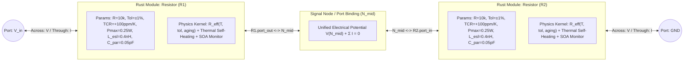
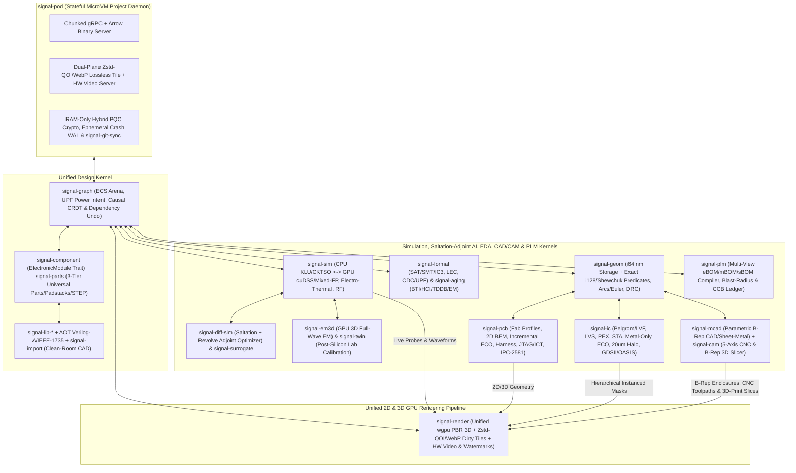

# 03 — Core Rust EDA & Modular Physics Engine (`signal-engine`)

> **Scope:** Deep technical architecture of Signal's pure-Rust heart—covering the **Component-as-a-Rust-Module** paradigm, the hybrid **Acausal MNA SPICE + Event-Driven Signal-Flow** simulation kernel, the unified multi-domain in-memory design graph, PCB/IC geometry & verification engines, and server-side GPU rendering.

---

## 1. Core Architectural Philosophy: Every Electronic Component Is a Composable Rust Module

Traditional SPICE simulators hard-code ~15 primitive models in 1970s C/Fortran and rely on opaque text `.subckt` decks where tolerances, parasitics, thermal self-heating, failure modes, and Safe Operating Area (SOA) limits are disconnected afterthoughts.

**Signal takes a fundamentally superior, Rust-native modular approach:**
Every passive, active, IC, RF element, digital gate, and hierarchical subcircuit is a **first-class, strongly typed, self-contained Rust Module** implementing a unified `ElectronicModule` trait.

### 1.1 Connecting Two Resistors in Series — How Modular Composition Meets Real Circuit Physics

Consider the user's foundational mental model:
> *"Imagine every electronic passive and active component is a Rust module that takes input values, tolerance, etc. If I connect 2 resistors in series, the output of resistor module R1 is fed into the input of resistor module R2—giving us complete control over every component's behavior."*

In real electrical physics, connecting `R1` and `R2` in series creates a **bidirectional physical coupling**:
- The voltage at the junction node `N_mid` and the current flowing through `R1` depend simultaneously on `R1`'s effective impedance, `R2`'s effective impedance, and whatever load is connected after `R2` (Kirchhoff's Current & Voltage Laws: KCL/KVL).
- Meanwhile, in digital, control-loop, and DSP stages (e.g., an ADC driving an FIR filter driving a PWM gate), information flows directionally as **events or discrete signals**.

Signal unifies **both** worlds cleanly through a **Dual-Mode Port-Based Module Architecture**:

How this works inside `signal-engine`:
1. **Explicit Module Ports (`PinPort`):** Each Rust component module declares typed ports (`in` / `out` / `anode` / `cathode` / `gate` / `drain` / `source` / `thermal_j` / `clk` / `rf_port`). Connecting `R1.port_out` to `R2.port_in` binds both ports to shared net node `N_mid` in the **Signal Connection Graph**.
2. **Acausal Stamping (Exact Analog Physics via MNA):** During analog simulation, the solver asks every connected Rust module to **stamp its own constitutive equations** directly into the global Modified Nodal Analysis (MNA) sparse matrix (`G·x + C·dx/dt + f(x) = u(t)`):
   - `R1` computes its exact effective resistance `R_eff = R_nom * (1 + sample_tolerance) * (1 + TCR * (T_j - T_ref)) * (1 + aging_drift)` plus optional parasitic series inductance (`L_esl`) and parallel capacitance (`C_par`), and stamps its conductance & thermal power dissipation equations across `(V_in, N_mid)`.
   - `R2` does the exact same independently across `(N_mid, GND)`.
   - Because each module stamps its own equations and analytical Jacobian into the shared nodes, **arbitrary topologies**—series chains, voltage dividers, Wheatstone bridges, op-amp feedback loops, nonlinear MOSFET switching stages—solve with full SPICE accuracy while every component remains a cleanly isolated Rust module!
3. **Directed Signal-Flow Mode (Digital / Behavioral / Interactive Fast-Eval):** For digital gates, logic blocks, ADC/DAC converters, PLL control loops, firmware peripherals, and real-time schematic tooltips, modules also expose **directed event/signal-flow evaluation** (`on_input_change(port, signal_value) -> Vec<PortEvent>`), enabling true **Mixed-Signal Co-Simulation** inside the same graph.
4. **Per-Module Autonomous State, Faults & Diagnostics:** Because each component is a live Rust object, it owns:
   - **Tolerance & Monte Carlo Sampler:** Gaussian, Uniform, Bimodal, Correlated Mismatch (critical for IC differential pairs!).
   - **Environmental & Derating Physics:** Temperature (`T_j`), DC-bias capacitance drop (e.g., MLCC Class II X5R/X7R voltage derating!), core saturation in inductors, voltage-dependent resistance, frequency-dependent skin/proximity loss.
   - **Self-Heating Thermal Port:** Power dissipated `P = V * I` feeds into the component's thermal RC network (`R_theta_ja`, `C_th`), dynamically updating `T_j` and feeding back into electrical behavior!
   - **Live SOA & Stress Watchdog:** Every simulation step, each module checks `|V| <= V_max`, `|I| <= I_max`, `P <= P_derated(T_amb)`, `T_j <= T_j_max`. Violations immediately emit typed diagnostic alerts to the UI and AI Agent.
   - **Fault Injection Hook:** Any module can be toggled into `Open`, `Short`, `ParametricDrift(+20%)`, `Leakage`, or `ESDStrike` for automated FMEA / ISO-26262 safety analysis.
5. **Infinite Hierarchical Composition:** A connected network of Rust modules (e.g., 20 transistors forming an Op-Amp, or a Buck Converter schematic sheet, or an entire SoC) compiles into a single composite `SubcircuitModule` implementing the exact same `ElectronicModule` trait—enabling seamless composition from **atomistic transistor → logic gate → IP block → SoC → PCB → multi-board system**.

---

## 2. Rust Component Module Ecosystem

| Crate | Component Families & Engine Capabilities Covered |
|---|---|
| `signal-lib-passive` | Resistor (ideal, thick/thin-film, wirewound, NTC/PTC thermistor, varistor, potentiometer), Capacitor (ideal, **charge-conserving** MLCC with DC-bias & ESR/ESL, electrolytic, film, variable), Inductor (air-core, **flux-conserving** ferrite with nonlinear B-H saturation & core loss), Transformer / Coupled Inductors, Ferrite Bead, Fuse / eFuse, Crystal / Resonator, Transmission Line (lossless, RLGC lossy, passive Vector-Fitted S-parameter macromodel). |
| `signal-lib-semiconductor` | PN Diode, Schottky, Zener, TVS, LED/Photodiode, BJT (Gummel-Poon, VBIC), JFET, Power MOSFET (VDMOS, SiC, GaN HEMT with nonlinear charge-based `Ciss/Coss/Crss`), IGBT, IC CMOS/FinFET/GAAFET Compact Models (**BSIM4, BSIM-CMG, PSP, EKV**). |
| `signal-lib-analog-ic` | Op-Amp (macro & transistor-level), Comparator, Instrumentation Amp, Voltage Reference, LDO, Buck/Boost/Buck-Boost/Flyback Controllers, Gate Drivers, Current-Sense Amps, PLLs, Oscillators, Analog Switches/Muxes. |
| `signal-lib-digital` | IEEE 1164 Logic Gates (9-value logic with propagation delay, rise/fall, setup/hold), Flip-Flops, Counters, Shift Registers, Buffers/Level Shifters, UPF Power Switches/Isolation/Retention cells, Memory Arrays (SRAM/Flash/DDR behavioral), ADC/DAC Mixed-Signal Bridges. |
| `signal-lib-rf` | Multi-port Touchstone `.sNp` Vector-Fitted causal/passive blocks, **Isolated Child-MicroVM `IBIS-AMI` SerDes Executables**, Mixers, LNAs, PAs, Baluns, Phased-Array Antennas, **Complex Baseband Envelope (`100,000×` faster than carrier-stepped) Co-Packaged Optics (CPO)** modulators/photodetectors. |
| `signal-lib-firmware-bridge` | **3-Speed Variable-Fidelity Co-Sim Bridge:** (1) `100+ MIPS` pure-Rust Instruction-Set Simulator (ARM/RISC-V/AVR) for sub-second RTOS/UEFI boot, seamlessly switching to (2) Cycle-Accurate RTL, and (3) Analog SPICE Lock-Step on GPIO/PWM/ADC/SPI/I2C/CAN peripheral windows. |
| `signal-module-sdk` | **Extensibility, IEEE 1735 & AOT Verilog-A Layer:** (1) **Multi-Dialect SPICE Parser** + **HSM-Backed IEEE 1735 v2/v3 Encrypted IP Unwrapper**; (2) **Ahead-of-Time (AOT) OpenVAF/Cranelift Verilog-A → `WASM-SIMD` / Isolated-IPC `OSDI` Compiler** running in `signal-verify-worker` (keeping `signal-pod` 100% LLVM-free and `#![forbid(unsafe_code)]`!); (3) Strongly-typed SI unit parser (`m` vs `Meg` safe); (4) Custom Multi-Physics Domain Plugin SDK. |

---

## 3. Engine Internal Architecture (Crate Breakdown)

### 3.1 `signal-graph`: Unified Multi-Domain Design Graph, UPF & Dependency-Aware Causal CRDT
- **Data-Oriented Storage:** Generational slot-maps and ECS Struct-of-Arrays keep 100,000+ nets and instanced multi-million-polygon hierarchies cache-resident with zero GC stalls.
- **Cross-Domain Semantic & UPF Power Links:** Stable `SignalEntityId` (UUIDv7) links `RequirementNode (PRD)` ↔ `SpecConstraint (HFS)` ↔ `UPFPowerDomain` ↔ `ComponentInstance (Schematic)` ↔ `Footprint/Traces (PCB)` ↔ `CellInstance/Polygons (IC)` ↔ `BRepSolid/Enclosure (CAD_MCAD)` ↔ `CncToolpath/PrintSlice (CAM_CNC/PRINT_3D)` ↔ `BomLine/ChangeOrder (PLM_OPS)` ↔ `PinConstraint (FPGA)` ↔ `Register/GPIO (Firmware/BIOS)` ↔ `SimAssertion / FormalProof (Verification)`.
- **Dependency-Aware Topological CRDT & Safe Selective Undo:**
  - **Delete-vs-Wire & Power-Short Guards:** Concurrent `Delete(U1)` + `Wire(U1.pin4)` deterministically converts the wire end to a **Floating Junction Marker**; concurrent merges of distinct power/ground-tagged nets (`VCC` + `GND`) insert a **Contention Bridge Marker** rather than silently shorting rails! Overlapping component drags resolve deterministically by `actor_id` with instant spatial DRC collision halos.
  - **Read-After-Write Safe Selective Undo (`Cmd+Z`):** Reverses *only* that engineer's last transaction after checking the **Causal Dependency DAG**—if a teammate's subsequent edit wired onto `R1`, `Cmd+Z` safely prompts to detach dependent wires into Floating Markers instead of corrupting downstream state.
  - Supports zero-copy **Copy-on-Write (CoW) speculative branches** with live port-boundary rebasing, synced via `signal-git-sync` Dual-Fenced Two-Phase `Super-Commit`s + `< 500 ms` RPO BYOK-encrypted Continuity WAL.

### 3.2 `signal-sim`, `signal-diff-sim`, `signal-surrogate`, `signal-formal` & `signal-aging`
1. **Numerically Hardened & Workload-Dispatched MNA SPICE (`signal-sim`):**
   - **Ill-Conditioned Matrix Immunity:** Combines **Ruiz row/column equilibration**, **Neumaier compensated KCL summation**, rook threshold pivoting, and automatic **Extended-Precision `f128` / quad-double iterative residual refinement** when condition numbers exceed `10^12`.
   - **CPU `KLU`/`CKTSO` ↔ GPU `cuDSS` / Mixed-Precision Crossover Dispatcher:** Hyper-sparse circuits `< 25k` nodes solve in Pod RAM via pure-Rust **Left-Looking Block-BTF Sparse LU (`KLU`/`CKTSO`-style symbolic-once + SIMD refactor)** (`< 0.5 ms`/step, avoiding GPU warp-divergence overhead!); `25k–5M+` post-layout networks dispatch **batched GPU BSIM-CMG evaluation + `cuDSS` (`FP64` on H100/B200, or `FP32` preconditioner + `f64`/`f128` iterative refinement on lower-cost GPUs)**.
   - **Exact Charge/Flux Conservation, Switching Stability & Cryo/Optical Multi-Physics:** Stamps exact `q(v)` and `Φ(i)` states (`dq/dt`, `dΦ/dt`), `C^2`-smooth limiting (`pnjlim`/`fetlim`) + **TR-BDF2** + **Zero-Crossing Root-Finding Breakpoints**, **Vector-Fitted + Hamiltonian-passive `.sNp` macromodels (`signal-rf-macromodel`)**, **Multi-Rate Electro-Thermal Leapfrog** (coupled to actual routed PCB copper area!), **Complex Baseband Optical Envelope (`E_env(t)`)** for CPO photonics (`GHz` envelope steps instead of `193 THz` optical carrier!), and **`4 K–10 mK` Cryo-CMOS band-tail thermal-voltage regularization**.
2. **Hybrid Saltation-Matrix & `Revolve`-Checkpointed Differentiable Physics (`signal-diff-sim`) + PINNs (`signal-surrogate`):**
   - **Mathematically Exact Hybrid Switching Gradients:** Across PWM MOSFET/comparator switching surfaces $\sigma(x, t, p) = 0$, `signal-diff-sim` multiplies backward sensitivities by exact **Filippov Saltation (Event-Jump) Matrices** and supports **Two-Stage Periodic Steady-State (PSS / Harmonic-Balance `TFHA`) Adjoint Warm-Start → Cycle-Accurate Saltation Refinement**, paired with **Binomial / `Revolve` Multistage Trajectory Checkpointing** capping reverse-mode transient RAM from $O(N_t)$ (`~800 GB`) down to $O(\log N_t)$ (`< 64 MB`)!
   - `signal-surrogate` runs GPU **Physics-Informed Neural Operators (PINNs)** for `< 50 ms` interactive thermal, IR-drop, and 3D EM previews on canvas, backed by mandatory exact Rust solver sign-off before commit or release.
3. **Formal (`signal-formal`), Aging (`signal-aging`), 3D EM (`signal-em3d`) & Digital Twin (`signal-twin`):**
   - `signal-formal`: SAT/SMT/IC3 formal property proving, RTL-to-Gate LEC, CDC/RDC, and IEEE 1801 UPF power-state verification.
   - `signal-aging`: Evaluates 10–15 year mission-profile degradation (NBTI/PBTI, HCI, TDDB, Black's law Electromigration) directly inside `ElectronicModule`.
   - `signal-em3d` & `signal-twin`: GPU 3D PEEC/FDTD/FEM extraction for vias/BGAs/224G SerDes/CPO, plus sandboxed lab oscilloscope/VNA/ATE Digital Twin calibration.

### 3.3 `signal-geom`, `signal-pcb`, `signal-ic`, and `signal-import`
- **`signal-geom` (Overflow-Proof Exact Geometry + Curves):** Compact `i64` nm storage with **exact `i128` + Shewchuk adaptive geometric predicates** (zero overflow on `> 3 m` backplanes/harnesses!), native **Circular Arc + Cubic Bézier + Adiabatic Euler-Bend** primitives, and lazy instanced DAG depth caps (`<= 64`).
- **`signal-pcb` & `signal-ic` (Fab-Aware DFM, Pelgrom/LVF Variation & Metal-Only/Incremental ECO):**
  - Automated **3-Way Symbol ↔ IPC-7351 Footprint ↔ Datasheet Pin-Table + 3D STEP Pin Intersection Verifier** + **Signed Fab Capability Profiles (`*.fabprofile.toml`)** & **Minimal-Perturbation Incremental PCB ECO**.
  - **Layout-Extracted Pelgrom Spatial Mismatch (`A_VT / √(W·L)` + centroid distance)**, **3-Sigma LVF/POCV Statistical STA**, **Post-Mask Spare-Cell Metal-Only IC ECO**, **`20 µm` Signed Boundary-Halo Shell Views (`*.halo.gds.sig`)** for 100B-transistor hierarchical block stitching, IEEE 1149.1/1687 JTAG/ICT synthesis, and RAM-only Gerber/ODB++/IPC-2581/GDSII/STEP/Compliance SFTP streaming.
- **`signal-import` (Zero-Network Clean-Room Legacy CAD Importer):** Sandboxed WASM/MicroVM parsers converting legacy KiCad, Altium, OrCAD, Eagle, LTspice, GDSII/OASIS, LEF/DEF, and Liberty files into native Signal graphs (inbound-only!).

### 3.4 `signal-render`: Capability-Probed Dual-Plane Compositor & Geometric Constellation Watermarks
- **Universal Zero-Blur CAD Clarity (No Unaccelerated `AV1 4:4:4` Trap!):** Because most client GPUs & M1/M2 Safari lack hardware `AV1 YUV 4:4:4` video decode, `signal-render` uses a **Two-Plane Compositor**:
  - **Plane 1 (Precision Static & `80 ms` Settling Tiles):** Lossless **`Zstd + QOI` (`> 400 MB/s` GPU shader decode on 100% of browsers!) / Lossless `WebP` `RGBA8` dirty-rect tiles** at native HiDPI—keeping 1px schematic wires and pin text 100% razor-sharp with near-zero battery/CPU cost.
  - **Plane 2 (60–120 FPS Continuous 3D Orbit/Pan):** Probes `WebCodecs` hardware support (`HEVC 4:4:4` on Apple Silicon → **Dual-Luma Hardware `AV1/H.264 4:2:0` Plane Split** reconstructing exact `4:4:4` on standard NVDEC/Intel GPUs!), snapping back to Plane 1 within `80 ms` of motion stop.
- **AI-Stripper-Resistant Geometric Constellation + Tardos Watermarks:** Combines translucent overlays and frequency-domain **Tardos codes** with **per-session Topological/Geometric Constellation Micro-Perturbations** (`±1–2 px` wire-jog knee positions, resistor zig-zag phase, label kerning, via-stitch phase)—**surviving even AI diffusion denoising, B&W thresholding, or vector re-tracing of smartphone photos!**

### 3.5 Extended Specialized Rust Kernel Crates (`17-*`, `18-*`, `19-*`)
Full dual UI+Rust specifications live in [`17-extended-feature-specifications-ui-and-rust.md`](./17-extended-feature-specifications-ui-and-rust.md), [`18-universal-component-and-datasheet-repository.md`](./18-universal-component-and-datasheet-repository.md), and [`19-cad-cam-3d-printing-and-plm-operations.md`](./19-cad-cam-3d-printing-and-plm-operations.md). Every extended Rust crate plugs directly into `signal-graph`'s read-only ECS snapshots or CoW transaction arenas under `#![forbid(unsafe_code)]`, `i64`/`i128` exact geometry, and `0.5-ULP` cross-ISA determinism:
1. **`signal-magnetics` (`FEAT-021`):** Bobbin & planar transformer geometry synthesizer solving nonlinear `iGSE` non-sinusoidal core loss, Dowell/Ferreira AC skin/proximity winding loss, and 2D axisymmetric leakage inductance/capacitance—emitting native coupled `ElectronicModule` instances directly into `signal-sim`.
2. **`signal-power-integrity` (`FEAT-022`–`030`):** Multi-rail PDN `Z_target(f)` MILP/gradient decoupling optimizer, 3D triangulated Dijkstra/Fast-Marching geodesic surface creepage & Paschen clearance solver, coupled `ρ(T)` DC IR-drop/Joule-heating FVM solver, SiC/GaN hot-loop PEEC inductance extractor, Type-II/III & digital `2p2z`/`3p3z` compensator kernel, multi-cell BMS thermal-runaway stack, `d-q` FOC motor drive coupler, heatsink/airflow compact thermal network, and power-sequencing/back-powering transient verifier.
3. **`signal-emc` (`FEAT-031`–`040`):** `CISPR 11/25/32` / `FCC` / `MIL-STD-461` RBW quasi-peak & 3m/10m radiated pre-compliance kernel, Middlebrook-stable EMI filter synthesizer, `IEC 61000-4-2/-4/-5` ESD/EFT/surge clamping tracer, shield-can cavity resonance solver, burst-dispatched ISO 26262 FMEDA (`SPFM`/`LFM`/`PMHF`) & BDD/SAT Fault-Tree minimal cut-set solver, adjoint extreme-value WCCA (`O(1)` corner discovery), Rad-Hard double-exponential SEU/SET injector, MLCC piezo-singing acoustic checker, and org stress-derating engine.
4. **`signal-dfm` & `signal-harness` (`FEAT-020`, `FEAT-061`–`070`):** Multi-board 3D BVH collision & connector mate verifier, rigid-flex cylindrical neutral-axis copper-strain kinematics, 1:1 wire-harness formboard & ampacity engine, multi-up panelizer with MLCC V-score flex-crack halos, DFA reflow-shadow/tombstone/IPC-7525 stencil checker, Engelmaier/Coffin-Manson solder fatigue & plate modal frequency solver, parametric GD&T fabrication drawing engine, real-time should-cost/yield HUD model, and ICT/flying-probe coverage optimizer.
5. **`signal-fpga` & `signal-security-hw` (`FEAT-050`–`060`):** FPGA SLR/clock-region/SSO tile model, formally cross-checked SDC/XDC verifier, zero-allocation Arrow bus-protocol decoders (`AXI4`/`SPI`/`I2C`/`CAN-FD`/`USB`/`PCIe`), MaxSAT MCU pinmux solver, ISS-coupled firmware battery-life energy profiler, formal graphical FSM & Parks-McClellan fixed-point DSP generators, plus **`signal-security-hw`** computing Welch `t`-test DPA/TVLA side-channel power leakage, optical/laser fault-injection exposure maps, and formal GLIFT RTL information-flow Trojan proofs!
6. **`signal-parts` (`18-*`):** Universal 3-Tier Component, Datasheet, Master Pin Table (`pins.json`), Dual-Standard IEEE/IEC Symbol, Parametric Padstack (`PadstackDef`), IPC-7351 Footprint, and 3D STEP Alignment Resolver & 5-Gate Verifier (`BRONZE`/`SILVER`/`GOLD`, Org BYO-Git AVL overlays, and Project `parts.lock.json` pinning).
7. **`signal-mcad`, `signal-cam` & `signal-plm` (`19-*`):** Pure-Rust parametric 2D constraint sketcher + B-Rep 3D solids + sheet-metal K-factor unfold + live `signal-pcb` anchor bindings (`signal-mcad`); 2.5D/3/5-axis adaptive CNC toolpaths, voxel/dexel gouge & fixture BVH collision verification, signed post-processors, and direct-B-Rep FDM/SLA/SLS/DMLS 3D-printing slicer (`signal-cam`); and multi-view `eBOM`/`mBOM`/`sBOM`/`Costed BOM` compiler, cross-domain blast-radius analyzer, and cryptographic CCB state-machine verifier (`signal-plm`).
8. **Core-Crate Interactive Extensions (`signal-graph`, `signal-pcb`, `signal-ic`, `signal-sim`, `signal-module-sdk`):** Sugiyama schematic auto-beautifier, typed protocol bus bundles, `< 0.5 ms` interactive potentiometer/switch incremental LU re-stamping, dimensional-analysis KaTeX math AST engine, glass-weave `Dk(x,y)` zig-zag skew planner, curved-arc meanders, back-drill stub optimizer, `gm/Id` Chebyshev lookup tensors, automated common-centroid analog PCELLs, BSPDN negative-Z backside layers, incremental MMMC STA path-slacking, SOCS aerial-image OPC/CMP dummy fill, Levenberg-Marquardt curve-fitter, Arrow SIMD waveform DSL (`RMS`/`THD`/`EYEW`), TDR-to-trace-mm mapper, deterministic CLI parser, and `BreadboardTopologyMapper` / `DeterministicLabGrader`.

---

## 4. Performance, Cross-Platform Bitwise Determinism & Foreign-Binary Sandboxing

1. **True Cross-Architecture Bitwise Determinism (`ARM64 Mac == x86_64 Linux`):** Pure-Rust **`0.5-ULP` rounded transcendental math (`core_math`)**, `fp-contract=off`, canonical CSR ordering, deterministic `rayon` tree-reductions, and per-`SignalEntityId` `ChaCha20Rng`.
2. **Memory Safety & Zeroization:** `#![forbid(unsafe_code)]` across core crates; all DEKs, tokens, PDKs, and sensitive arenas wrap `SecretBox<T>` + `zeroize::ZeroizeOnDrop`.
3. **Two-Tier Sandbox for Custom Modules & Vendor Binaries:** User/OpenVAF `.wasm` modules run inside zero-WASI, fuel-metered **`wasmtime`**; untrusted vendor binary `IBIS-AMI` `.so` / legacy `OSDI` shared objects execute strictly out-of-process inside a **zero-network, seccomp-locked child `Firecracker`/`gVisor` IPC micro-sandbox** over zeroized shared-memory rings—never entering `signal-pod`'s address space!
