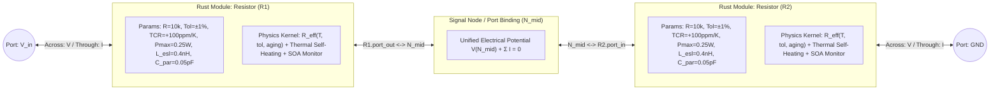
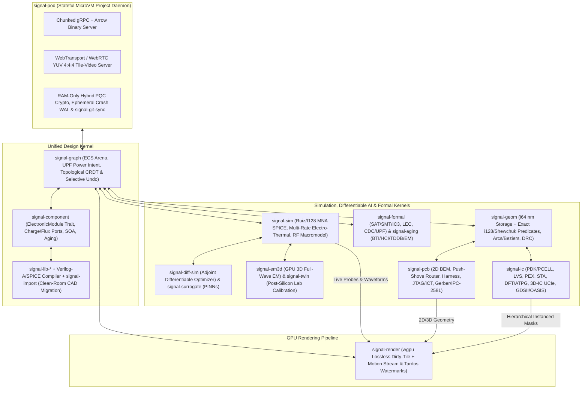

# 03 — Core Rust EDA & Modular Physics Engine (`signal-engine`)

> **Scope:** Deep technical architecture of Signal's pure-Rust heart—covering the **Component-as-a-Rust-Module** paradigm, the hybrid **Acausal MNA SPICE + Event-Driven Signal-Flow** simulation kernel, the unified multi-domain in-memory design graph, PCB/IC geometry & verification engines, and server-side GPU rendering.

---

## 1. Core Architectural Philosophy: Every Electronic Component Is a Composable Rust Module

Traditional SPICE simulators hard-code ~15 primitive models in 1970s C/Fortran and rely on opaque text `.subckt` decks where tolerances, parasitics, thermal self-heating, failure modes, and Safe Operating Area (SOA) limits are disconnected afterthoughts.

**Signal takes a fundamentally superior, Rust-native modular approach:**
Every passive, active, IC, RF element, digital gate, and hierarchical subcircuit is a **first-class, strongly typed, self-contained Rust Module** implementing a unified `ElectronicModule` trait.

### 1.1 Connecting Two Resistors in Series — How Modular Composition Meets Real Circuit Physics

Consider the user's foundational mental model:
> *"Imagine every electronic passive and active component is a Rust module that takes input values, tolerance, etc. If I connect 2 resistors in series, the output of resistor module R1 is fed into the input of resistor module R2—giving us complete control over every component's behavior."*

In real electrical physics, connecting `R1` and `R2` in series creates a **bidirectional physical coupling**:
- The voltage at the junction node `N_mid` and the current flowing through `R1` depend simultaneously on `R1`'s effective impedance, `R2`'s effective impedance, and whatever load is connected after `R2` (Kirchhoff's Current & Voltage Laws: KCL/KVL).
- Meanwhile, in digital, control-loop, and DSP stages (e.g., an ADC driving an FIR filter driving a PWM gate), information flows directionally as **events or discrete signals**.

Signal unifies **both** worlds cleanly through a **Dual-Mode Port-Based Module Architecture**:

How this works inside `signal-engine`:
1. **Explicit Module Ports (`PinPort`):** Each Rust component module declares typed ports (`in` / `out` / `anode` / `cathode` / `gate` / `drain` / `source` / `thermal_j` / `clk` / `rf_port`). Connecting `R1.port_out` to `R2.port_in` binds both ports to shared net node `N_mid` in the **Signal Connection Graph**.
2. **Acausal Stamping (Exact Analog Physics via MNA):** During analog simulation, the solver asks every connected Rust module to **stamp its own constitutive equations** directly into the global Modified Nodal Analysis (MNA) sparse matrix (`G·x + C·dx/dt + f(x) = u(t)`):
   - `R1` computes its exact effective resistance `R_eff = R_nom * (1 + sample_tolerance) * (1 + TCR * (T_j - T_ref)) * (1 + aging_drift)` plus optional parasitic series inductance (`L_esl`) and parallel capacitance (`C_par`), and stamps its conductance & thermal power dissipation equations across `(V_in, N_mid)`.
   - `R2` does the exact same independently across `(N_mid, GND)`.
   - Because each module stamps its own equations and analytical Jacobian into the shared nodes, **arbitrary topologies**—series chains, voltage dividers, Wheatstone bridges, op-amp feedback loops, nonlinear MOSFET switching stages—solve with full SPICE accuracy while every component remains a cleanly isolated Rust module!
3. **Directed Signal-Flow Mode (Digital / Behavioral / Interactive Fast-Eval):** For digital gates, logic blocks, ADC/DAC converters, PLL control loops, firmware peripherals, and real-time schematic tooltips, modules also expose **directed event/signal-flow evaluation** (`on_input_change(port, signal_value) -> Vec<PortEvent>`), enabling true **Mixed-Signal Co-Simulation** inside the same graph.
4. **Per-Module Autonomous State, Faults & Diagnostics:** Because each component is a live Rust object, it owns:
   - **Tolerance & Monte Carlo Sampler:** Gaussian, Uniform, Bimodal, Correlated Mismatch (critical for IC differential pairs!).
   - **Environmental & Derating Physics:** Temperature (`T_j`), DC-bias capacitance drop (e.g., MLCC Class II X5R/X7R voltage derating!), core saturation in inductors, voltage-dependent resistance, frequency-dependent skin/proximity loss.
   - **Self-Heating Thermal Port:** Power dissipated `P = V * I` feeds into the component's thermal RC network (`R_theta_ja`, `C_th`), dynamically updating `T_j` and feeding back into electrical behavior!
   - **Live SOA & Stress Watchdog:** Every simulation step, each module checks `|V| <= V_max`, `|I| <= I_max`, `P <= P_derated(T_amb)`, `T_j <= T_j_max`. Violations immediately emit typed diagnostic alerts to the UI and AI Agent.
   - **Fault Injection Hook:** Any module can be toggled into `Open`, `Short`, `ParametricDrift(+20%)`, `Leakage`, or `ESDStrike` for automated FMEA / ISO-26262 safety analysis.
5. **Infinite Hierarchical Composition:** A connected network of Rust modules (e.g., 20 transistors forming an Op-Amp, or a Buck Converter schematic sheet, or an entire SoC) compiles into a single composite `SubcircuitModule` implementing the exact same `ElectronicModule` trait—enabling seamless composition from **atomistic transistor → logic gate → IP block → SoC → PCB → multi-board system**.

---

## 2. Rust Component Module Ecosystem

| Crate | Component Families & Engine Capabilities Covered |
|---|---|
| `signal-lib-passive` | Resistor (ideal, thick/thin-film, wirewound, NTC/PTC thermistor, varistor, potentiometer), Capacitor (ideal, **charge-conserving** MLCC with DC-bias & ESR/ESL, electrolytic, film, variable), Inductor (air-core, **flux-conserving** ferrite with nonlinear B-H saturation & core loss), Transformer / Coupled Inductors, Ferrite Bead, Fuse / eFuse, Crystal / Resonator, Transmission Line (lossless, RLGC lossy, passive Vector-Fitted S-parameter macromodel). |
| `signal-lib-semiconductor` | PN Diode, Schottky, Zener, TVS, LED/Photodiode, BJT (Gummel-Poon, VBIC), JFET, Power MOSFET (VDMOS, SiC, GaN HEMT with nonlinear charge-based `Ciss/Coss/Crss`), IGBT, IC CMOS/FinFET/GAAFET Compact Models (**BSIM4, BSIM-CMG, PSP, EKV**). |
| `signal-lib-analog-ic` | Op-Amp (macro & transistor-level), Comparator, Instrumentation Amp, Voltage Reference, LDO, Buck/Boost/Buck-Boost/Flyback Controllers, Gate Drivers, Current-Sense Amps, PLLs, Oscillators, Analog Switches/Muxes. |
| `signal-lib-digital` | IEEE 1164 Logic Gates (9-value logic with propagation delay, rise/fall, setup/hold), Flip-Flops, Counters, Shift Registers, Buffers/Level Shifters, UPF Power Switches/Isolation/Retention cells, Memory Arrays (SRAM/Flash/DDR behavioral), ADC/DAC Mixed-Signal Bridges. |
| `signal-lib-rf` | Multi-port Touchstone `.sNp` Vector-Fitted causal/passive blocks, Mixers, LNAs, PAs, Attenuators, Couplers, Baluns, Phased-Array Antennas, Co-Packaged Optics (CPO) electro-optical modulators/photodetectors. |
| `signal-lib-firmware-bridge` | **3-Speed Variable-Fidelity Co-Sim Bridge:** (1) `100+ MIPS` pure-Rust Instruction-Set Simulator (ARM/RISC-V/AVR) for sub-second RTOS/UEFI boot, seamlessly switching to (2) Cycle-Accurate RTL, and (3) Analog SPICE Lock-Step on GPIO/PWM/ADC/SPI/I2C/CAN peripheral windows. |
| `signal-module-sdk` | **Extensibility & Compatibility Layer:** (1) **Multi-Dialect SPICE Parser** (LTspice/PSPICE/Spectre/HSPICE) + **OpenVAF-inspired Rust Verilog-A Compiler** emitting analytical-Jacobian native Rust / fuel-metered `wasmtime` `ElectronicModule`s; (2) Strongly-typed SI unit parser (`m` vs `Meg` disambiguation); (3) Custom Multi-Physics Domain Plugin SDK. |

---

## 3. Engine Internal Architecture (Crate Breakdown)

### 3.1 `signal-graph`: Unified Multi-Domain Design Graph, UPF & Topological CRDT
- **Data-Oriented Storage:** Generational slot-maps and ECS Struct-of-Arrays keep 100,000+ nets and instanced multi-million-polygon hierarchies cache-resident with zero GC stalls.
- **Cross-Domain Semantic & UPF Power Links:** Stable `SignalEntityId` (UUIDv7) links `RequirementNode (PRD)` ↔ `SpecConstraint (HFS)` ↔ `UPFPowerDomain` ↔ `ComponentInstance (Schematic)` ↔ `Footprint/Traces (PCB)` ↔ `CellInstance/Polygons (IC)` ↔ `PinConstraint (FPGA)` ↔ `Register/GPIO (Firmware/BIOS)` ↔ `SimAssertion / FormalProof (Verification)`.
- **Topological-Invariant CRDT & Per-Actor Selective Undo:**
  - Every human or AI mutation is an idempotent `DesignTransaction`. If Engineer A deletes `U1` concurrently while Engineer B wires `U1.pin4`, the authoritative sequencer deterministically converts the wire end into a **Floating Junction Marker** (zero dangling pointers, instant visual ERC badge).
  - Pressing `Cmd+Z` executes **Per-Actor Selective Causal Undo** (reversing only *that engineer's* last non-conflicting transaction rather than clobbering a teammate's edit!).
  - Supports zero-copy **Copy-on-Write (CoW) speculative branches** with live port-boundary rebasing, synced via `signal-git-sync` Two-Phase `Super-Commit`s to `<project>-<type>` repos + `< 500 ms` RPO ephemeral encrypted crash WAL.

### 3.2 `signal-sim`, `signal-diff-sim`, `signal-surrogate`, `signal-formal` & `signal-aging`
1. **Numerically Hardened MNA SPICE (`signal-sim`):**
   - **Ill-Conditioned Matrix Immunity:** Combines **Ruiz row/column equilibration**, **Neumaier compensated KCL summation**, rook threshold pivoting, and automatic **Extended-Precision `f128` / quad-double iterative residual refinement** when condition numbers exceed `10^12` (eliminating precision collapse when `1e-15 F` IC parasitics meet `1e12 Ω` leakage and `1e-4 Ω` busbars).
   - **Exact Charge & Flux Conservation:** Nonlinear capacitors and inductors stamp exact `q(v)` charge and `Φ(i)` flux state variables (`dq/dt`, `dΦ/dt`) with analytical chain-rule Jacobians, eliminating artificial DC/energy drift.
   - **Discontinuity & Switching Stability:** `C^2`-continuous smooth device limiting (`pnjlim`/`fetlim`), automatic **TR-BDF2 / Gear-2** damping on trapezoidal ringing detection, and **Zero-Crossing Root-Finding Breakpoints** for multi-MHz SiC/GaN PWM switching.
   - **Passive/Causal RF Macromodeling (`signal-rf-macromodel`):** Converts Touchstone `.sNp` tables via **Vector-Fitting + Hamiltonian Passivity Enforcement** into guaranteed-stable linear state-space MNA stamps (preventing time-domain IFFT blow-up).
   - **Multi-Rate Electro-Thermal Leapfrog:** Bridges `10^-9 s` electrical switching and `10^+2 s` board/package heating via periodic steady-state / envelope power extraction coupled to 3D thermal RC/FEM macro-steps.
2. **End-to-End Differentiable Physics (`signal-diff-sim`) & Neural Surrogates (`signal-surrogate`):**
   - `signal-diff-sim` solves the discrete/continuous **Adjoint Sensitivity Equations** alongside DC, AC, Transient, and Elmore/STA timing—returning exact gradients $\partial \text{Metric} / \partial p_i$ across 1,000+ parameters in one transpose solve so AI Agents optimize circuits mathematically in milliseconds.
   - `signal-surrogate` runs GPU **Physics-Informed Neural Operators (PINNs)** for `< 50 ms` interactive thermal, IR-drop, and 3D EM previews on canvas, while enforcing **exact Rust solver verification** prior to any merge or SFTP release.
3. **Formal Verification (`signal-formal`), Aging (`signal-aging`), 3D EM (`signal-em3d`) & Digital Twin (`signal-twin`):**
   - `signal-formal`: SAT/SMT/IC3 formal property proving, RTL-to-Gate LEC, CDC/RDC, and IEEE 1801 UPF power-state verification.
   - `signal-aging`: Evaluates 10–15 year mission-profile degradation (NBTI/PBTI, HCI, TDDB, Black's law Electromigration) directly inside `ElectronicModule` parameters.
   - `signal-em3d` & `signal-twin`: GPU 3D PEEC/FDTD/FEM extraction for vias/BGAs/224G SerDes/CPO, plus sandboxed ingestion of lab oscilloscope/VNA/ATE captures to overlay & calibrate simulated Digital Twins against real silicon.

### 3.3 `signal-geom`, `signal-pcb`, `signal-ic`, and `signal-import`
- **`signal-geom` (Overflow-Proof Exact Geometry + Curves):**
  - Stores compact `i64` nanometer coordinates (`±9.2e9 m`) while mandating **exact `i128` arithmetic + Shewchuk adaptive geometric predicates** for all cross-products, squared distances, and boolean intersections (completely eliminating `i64` overflow on `> 3 m` backplanes/harnesses!), plus native **Exact Circular Arc + Cubic Bézier / Euler-Bend primitives** for RF, flex, and silicon photonics.
  - Enforces lazy instanced DAG hierarchy depth caps (`<= 64`) to defeat GDSII/ODB++ amplification bombs.
- **`signal-pcb` & `signal-ic`:**
  - Automated **3-Way Symbol ↔ IPC-7351 Footprint ↔ Datasheet Pin-Table + 3D STEP Pin Intersection Verifier** eliminating pin-pad swap respins.
  - Built-in 2D BEM stackup solver + 3D EM breakout hooks, push-and-shove/any-angle router, multi-board harness engine, **IEEE 1149.1/1687 JTAG & ICT nail synthesis**, hierarchical IC DRC/LVS/PEX, MMMC STA, DFT/ATPG, UCIe 3D-IC, and RAM-only Gerber/ODB++/IPC-2581/GDSII SFTP streaming.
- **`signal-import` (Zero-Network Clean-Room Legacy CAD Importer):**
  - Sandboxed WASM/MicroVM parsers converting legacy KiCad, Altium, OrCAD, Eagle, LTspice, GDSII/OASIS, LEF/DEF, and Liberty files into native Signal graphs (inbound-only!).

### 3.4 `signal-render`: Crisp Lossless-Tile + Motion GPU Streamer & Tardos Watermarks
- Built on Rust **`wgpu`** (Vulkan on Linux K8s hardware-isolated MIG / Confidential GPUs; Metal natively on macOS).
- **Zero-Blur CAD Clarity (`YUV 4:4:4` Hybrid):** Static/precision CAD frames transmit **lossless `AV1-SCC` / Lossless WebP dirty-rect tiles at native HiDPI (`YUV 4:4:4`)** so 1px wires and tiny pin labels stay razor-sharp; continuous 3D orbit/pan switches smoothly to 60–120 FPS low-latency video and snaps to a **crisp lossless settling frame within `80 ms`** of motion stop.
- **Collusion-Resistant Forensic Watermarks:** Burns both translucent session overlays and **Tardos-code spread-spectrum steganography + sub-pixel electrically-invariant layout/label micro-jitter** into every GPU frame before encoding.

---

## 4. Performance, Cross-Platform Bitwise Determinism & Safety Guarantees

1. **True Cross-Architecture Bitwise Determinism (ARM64 Mac == x86_64 Linux):** Sign-off and golden simulation modes use pure-Rust **`0.5-ULP` correctly-rounded transcendental math (`core_math`)**, explicit FMA contraction disabled (`fp-contract=off`), deterministic parallel tree-reductions in `rayon`, and per-`SignalEntityId` seeded `ChaCha20Rng`—guaranteeing identical bit-for-bit results across Apple Silicon laptops and Linux x86/ARM K8s pods.
2. **Memory Safety & Zeroization:** `#![forbid(unsafe_code)]` across core crates; all DEKs, Git tokens, PDKs, and decrypted graph arenas implement `zeroize::ZeroizeOnDrop` (`SecretBox<T>`).
3. **Sandboxed Custom Modules & Parsers:** Custom behavioral modules, PCELLs, and legacy CAD importers run inside **zero-WASI, fuel-metered, memory-capped `wasmtime` sandboxes**.
