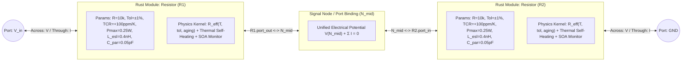
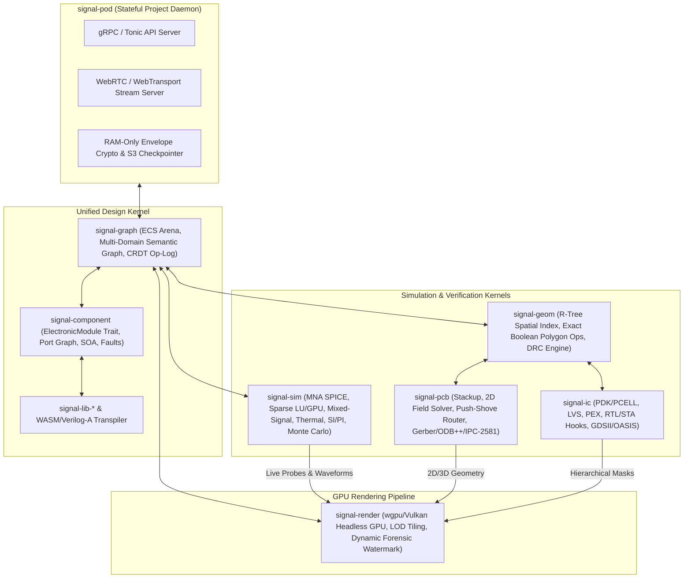

# 03 — Core Rust EDA & Modular Physics Engine (`signal-engine`)

> **Scope:** Deep technical architecture of Signal's pure-Rust heart—covering the **Component-as-a-Rust-Module** paradigm, the hybrid **Acausal MNA SPICE + Event-Driven Signal-Flow** simulation kernel, the unified multi-domain in-memory design graph, PCB/IC geometry & verification engines, and server-side GPU rendering.

---

## 1. Core Architectural Philosophy: Every Electronic Component Is a Composable Rust Module

Traditional SPICE simulators hard-code ~15 primitive models in 1970s C/Fortran and rely on opaque text `.subckt` decks where tolerances, parasitics, thermal self-heating, failure modes, and Safe Operating Area (SOA) limits are disconnected afterthoughts.

**Signal takes a fundamentally superior, Rust-native modular approach:**
Every passive, active, IC, RF element, digital gate, and hierarchical subcircuit is a **first-class, strongly typed, self-contained Rust Module** implementing a unified `ElectronicModule` trait.

### 1.1 Connecting Two Resistors in Series — How Modular Composition Meets Real Circuit Physics

Consider the user's foundational mental model:
> *"Imagine every electronic passive and active component is a Rust module that takes input values, tolerance, etc. If I connect 2 resistors in series, the output of resistor module R1 is fed into the input of resistor module R2—giving us complete control over every component's behavior."*

In real electrical physics, connecting `R1` and `R2` in series creates a **bidirectional physical coupling**:
- The voltage at the junction node `N_mid` and the current flowing through `R1` depend simultaneously on `R1`'s effective impedance, `R2`'s effective impedance, and whatever load is connected after `R2` (Kirchhoff's Current & Voltage Laws: KCL/KVL).
- Meanwhile, in digital, control-loop, and DSP stages (e.g., an ADC driving an FIR filter driving a PWM gate), information flows directionally as **events or discrete signals**.

Signal unifies **both** worlds cleanly through a **Dual-Mode Port-Based Module Architecture**:

How this works inside `signal-engine`:
1. **Explicit Module Ports (`PinPort`):** Each Rust component module declares typed ports (`in` / `out` / `anode` / `cathode` / `gate` / `drain` / `source` / `thermal_j` / `clk` / `rf_port`). Connecting `R1.port_out` to `R2.port_in` binds both ports to shared net node `N_mid` in the **Signal Connection Graph**.
2. **Acausal Stamping (Exact Analog Physics via MNA):** During analog simulation, the solver asks every connected Rust module to **stamp its own constitutive equations** directly into the global Modified Nodal Analysis (MNA) sparse matrix (`G·x + C·dx/dt + f(x) = u(t)`):
   - `R1` computes its exact effective resistance `R_eff = R_nom * (1 + sample_tolerance) * (1 + TCR * (T_j - T_ref)) * (1 + aging_drift)` plus optional parasitic series inductance (`L_esl`) and parallel capacitance (`C_par`), and stamps its conductance & thermal power dissipation equations across `(V_in, N_mid)`.
   - `R2` does the exact same independently across `(N_mid, GND)`.
   - Because each module stamps its own equations and analytical Jacobian into the shared nodes, **arbitrary topologies**—series chains, voltage dividers, Wheatstone bridges, op-amp feedback loops, nonlinear MOSFET switching stages—solve with full SPICE accuracy while every component remains a cleanly isolated Rust module!
3. **Directed Signal-Flow Mode (Digital / Behavioral / Interactive Fast-Eval):** For digital gates, logic blocks, ADC/DAC converters, PLL control loops, firmware peripherals, and real-time schematic tooltips, modules also expose **directed event/signal-flow evaluation** (`on_input_change(port, signal_value) -> Vec<PortEvent>`), enabling true **Mixed-Signal Co-Simulation** inside the same graph.
4. **Per-Module Autonomous State, Faults & Diagnostics:** Because each component is a live Rust object, it owns:
   - **Tolerance & Monte Carlo Sampler:** Gaussian, Uniform, Bimodal, Correlated Mismatch (critical for IC differential pairs!).
   - **Environmental & Derating Physics:** Temperature (`T_j`), DC-bias capacitance drop (e.g., MLCC Class II X5R/X7R voltage derating!), core saturation in inductors, voltage-dependent resistance, frequency-dependent skin/proximity loss.
   - **Self-Heating Thermal Port:** Power dissipated `P = V * I` feeds into the component's thermal RC network (`R_theta_ja`, `C_th`), dynamically updating `T_j` and feeding back into electrical behavior!
   - **Live SOA & Stress Watchdog:** Every simulation step, each module checks `|V| <= V_max`, `|I| <= I_max`, `P <= P_derated(T_amb)`, `T_j <= T_j_max`. Violations immediately emit typed diagnostic alerts to the UI and AI Agent.
   - **Fault Injection Hook:** Any module can be toggled into `Open`, `Short`, `ParametricDrift(+20%)`, `Leakage`, or `ESDStrike` for automated FMEA / ISO-26262 safety analysis.
5. **Infinite Hierarchical Composition:** A connected network of Rust modules (e.g., 20 transistors forming an Op-Amp, or a Buck Converter schematic sheet, or an entire SoC) compiles into a single composite `SubcircuitModule` implementing the exact same `ElectronicModule` trait—enabling seamless composition from **atomistic transistor → logic gate → IP block → SoC → PCB → multi-board system**.

---

## 2. Rust Component Module Ecosystem

| Crate | Component Families Covered |
|---|---|
| `signal-lib-passive` | Resistor (ideal, thick/thin-film, wirewound, NTC/PTC thermistor, varistor, potentiometer), Capacitor (ideal, MLCC with DC-bias & ESR/ESL, electrolytic, film, variable), Inductor (air-core, ferrite with nonlinear B-H saturation & core loss), Transformer / Coupled Inductors, Ferrite Bead, Fuse / eFuse, Crystal / Resonator, Transmission Line (lossless, RLGC lossy, S-parameter Touchstone block). |
| `signal-lib-semiconductor` | PN Diode, Schottky, Zener, TVS, LED/Photodiode, BJT (Gummel-Poon, VBIC), JFET, Power MOSFET (VDMOS, SiC, GaN HEMT with nonlinear `Ciss/Coss/Crss`), IGBT, IC CMOS/FinFET Compact Models (**BSIM4, BSIM-CMG, PSP, EKV**). |
| `signal-lib-analog-ic` | Op-Amp (macro & transistor-level), Comparator, Instrumentation Amp, Voltage Reference, LDO, Buck/Boost/Buck-Boost/Flyback Controllers, Gate Drivers, Current-Sense Amps, PLLs, Oscillators, Analog Switches/Muxes. |
| `signal-lib-digital` | IEEE 1164 Logic Gates (9-value logic with propagation delay, rise/fall, setup/hold), Flip-Flops, Counters, Shift Registers, Buffers/Level Shifters, Memory Arrays (SRAM/Flash/DDR behavioral), ADC/DAC Mixed-Signal Bridges. |
| `signal-lib-rf` | Multi-port S-parameter black-box modules, Mixers, LNAs, PAs, Attenuators, Couplers, Baluns, Antennas, Stripline/Microstrip discontinuities. |
| `signal-lib-firmware-bridge` | Virtual MCU/SoC Pin Bridges connecting Rust circuit nodes directly to emulated ARM/RISC-V/AVR firmware peripherals (GPIO, PWM, ADC, SPI, I2C, UART, CAN). |
| `signal-module-sdk` | **Extensibility Layer:** (1) Automatic transpiler converting industry **SPICE `.model`/`.subckt`, IBIS, Touchstone, and Verilog-A** files from the Universal Datasheet DB into optimized native Rust / sandboxed WebAssembly (`wasmtime`) component modules; (2) Enterprise Custom Component SDK for proprietary IP modules. |

---

## 3. Engine Internal Architecture (Crate Breakdown)

### 3.1 `signal-graph`: Unified Multi-Domain Design Graph & CRDT Engine
- **Data-Oriented Storage:** Uses arena allocation and generational slot-maps (`slotmap` / ECS-style Struct-of-Arrays) so traversing 100,000 nets or millions of layout polygons achieves optimal CPU L1/L2 cache locality with zero garbage-collection stalls.
- **Cross-Domain Semantic Links:** Every object has a globally stable `SignalEntityId` (UUIDv7 / Ulid) linking:
  - `RequirementNode (PRD)` ↔ `SpecConstraint (HFS)` ↔ `ComponentInstance (Schematic)` ↔ `Footprint/Traces (PCB)` ↔ `CellInstance/Polygons (IC)` ↔ `PinConstraint (FPGA)` ↔ `Register/GPIO (Firmware/BIOS)` ↔ `SimAssertion (Verification)`.
- **Event-Sourced Transactional Command Engine:**
  - Every mutation (by a human engineer OR an AI Agent) is an atomic, schema-validated `DesignTransaction` composed of deterministic `GraphOp`s.
  - Supports **instant Undo/Redo**, **zero-copy in-memory Copy-on-Write (CoW) branching** (critical for AI Agents testing speculative circuit edits without disturbing live collaborators!), Git-like semantic merge/diff, and continuous encrypted Write-Ahead Log (WAL) checkpointing to S3.
  - **Conflict-Free Multi-User Sync:** Authoritative CRDT/OT sequencing inside the Project Pod guarantees all connected users see byte-for-byte identical state.

### 3.2 `signal-sim`: Hybrid Multi-Physics Simulation Kernel
1. **Circuit Compilation Pipeline:**
   - Traverses `signal-graph` → flattens or preserves hierarchy → instantiates Rust `ElectronicModule` instances with parameter/tolerance realizations → performs topological checks (floating nodes, voltage-source loops, singular cutsets) → builds sparse adjacency pattern (symbolic factorization cached across timesteps!).
2. **Analog MNA SPICE Engine:**
   - **DC Operating Point:** Damped Newton-Raphson with automatic convergence aids (Gmin stepping, source stepping, pseudo-transient continuation, homotopy).
   - **AC & Noise:** Complex frequency-domain sparse linear solve (`G + jωC`), adjoint noise sensitivity accumulation.
   - **Transient:** Adaptive step-size integration (BDF-1/2/3, Gear, Trapezoidal with ringing detection), local truncation error (LTE) control, breakpoint scheduling for switching converters & clocks.
   - **Harmonic Balance / RF:** Multi-tone frequency/time-domain Newton-Krylov solver for RF circuits.
   - **Linear Algebra Backends:**
     - Small/Medium circuits (< 5,000 nodes): Pure-Rust KLU-inspired Gilbert-Peierls sparse LU solver with AMD/COLAMD ordering (runs directly in the Project Pod with microsecond solve times).
     - Large post-layout IC / PDN circuits (10k – 10M+ nodes): Parallel multi-threaded sparse direct/iterative solvers + **GPU offload** (cuDSS / Vulkan compute shaders on K8s GPU burst workers).
3. **Hybrid Analog-Digital-Firmware Co-Simulation:**
   - Lock-step event-driven digital scheduler synchronized with the analog transient time-stepper via automatic **A2D / D2A bridge modules** (with configurable thresholds, hysteresis, drive strength, and input capacitance).
   - Optional virtual CPU/MCU peripheral bridge executing compiled embedded firmware directly against live simulated analog sensors, power rails, and actuators.
4. **Statistical & Batch Orchestration:**
   - Parallel Monte Carlo, PVT Corner matrices, and parameter sweeps seamlessly fan out across `rayon` cores locally OR across dozens of ephemeral K8s CPU/GPU worker pods in the cloud, streaming live histogram/scatter results back to the UI.

### 3.3 `signal-geom`, `signal-pcb`, and `signal-ic`: Physical Design & Verification
- **`signal-geom` (Exact Computational Geometry):**
  - Integer-nanometer fixed-point coordinates (`i64`, 1 nm precision covering ±9.2 meters — zero floating-point rounding drift across both IC nanometer features and meter-scale backplanes!).
  - R*-tree / BVH spatial indices for sub-millisecond hit-testing, clearance queries, and incremental real-time DRC.
  - Robust polygon boolean algebra (union, intersection, difference, offset/Minkowski sum for copper pours, solder mask expansion, IC sizing/DRC).
- **`signal-pcb`:**
  - Built-in 2D Quasi-Static BEM/FEM Field Solver for real-time trace impedance (`Z0`, `Zdiff`), propagation delay, and coupling matrices from the stackup definition.
  - Topological & geometric **Push-and-Shove Router**, differential pair router, length/phase accordion tuner, BGA fanout engine.
  - In-memory **Manufacturing Writers** (Gerber X2/X3, Excellon, ODB++, IPC-2581, Pick-and-Place, BOM) — strictly piped to the **Authorized SFTP Egress** pipeline (never saved to local disk or HTTP download).
- **`signal-ic`:**
  - Encrypted PDK ingestion & technology rule engine; sandboxed Rust/WASM PCELL evaluator.
  - Hierarchical **DRC**, graph-isomorphism **LVS** (layout connectivity extraction matched against schematic graph), and 2.5D/3D **PEX** parasitic R/C extraction feeding directly back into `signal-sim`.
  - RTL-to-GDSII integration layer orchestrating synthesis, floorplanning, placement, CTS, routing, and STA across burst worker pods, plus in-memory **GDSII / OASIS** stream-out to Authorized SFTP.

### 3.4 `signal-render`: Server-Side GPU Headless Renderer & Watermarking
- Built on Rust **`wgpu`** (Vulkan on Linux K8s GPU nodes; Metal natively on local macOS dev laptops).
- Renders:
  - Anti-aliased vector schematics with live probe overlays.
  - Multi-layer 2D PCB & 3D PBR PCB/enclosure views.
  - Hierarchical multi-million-polygon IC layouts with automatic Level-of-Detail (LOD) mip-tiling.
  - Billion-point waveform plots (GPU min-max envelope decimation so zooming is always 60 FPS).
- **Zero-Leak Enterprise Mode:** Encodes dirty viewport frames directly on GPU (NVENC/VAAPI H.264/AV1 low-latency lossless/near-lossless tile stream) with **both visible dynamic session watermarks and invisible forensic steganographic watermarks** burned into every frame *before* leaving the Kubernetes pod.

---

## 4. Performance, Determinism & Safety Guarantees

1. **Bitwise Determinism:** Given identical design state, tolerances seed, and solver settings, `signal-engine` produces deterministic simulation results across local macOS and cloud Linux K8s pods—essential for regression testing, compliance sign-off, and AI agent reproducibility.
2. **Memory Safety & Zeroization:** Pure safe Rust across graph, protocol, and solver orchestration; all decrypted project buffers, PDKs, and DEKs implement `zeroize::ZeroizeOnDrop` so sensitive IP is scrubbed from RAM immediately upon pod release or hibernation.
3. **Sandboxed Custom Modules:** User/vendor-imported behavioral modules compile to **WebAssembly (WASM)** executed via `wasmtime` with strict CPU-fuel and memory limits—preventing infinite loops or memory corruption from destabilizing a Project Pod.
