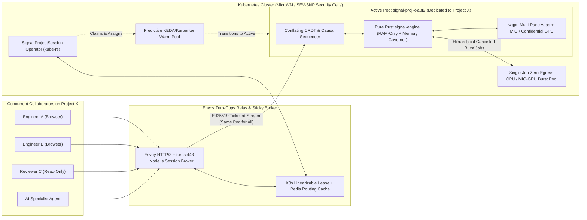
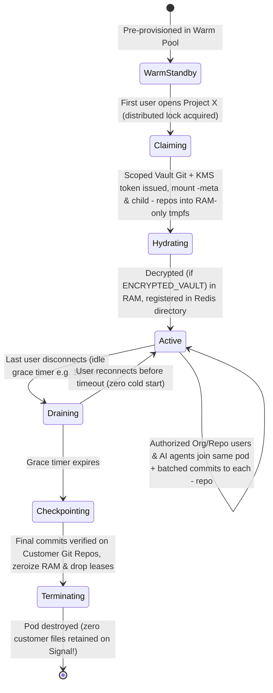

# 04 — Kubernetes Runtime & Multi-User Collaboration

> **Scope:** Defines how Signal deploys its pure-Rust engine inside Kubernetes pods—guaranteeing a dedicated engine instance per loaded project, **deterministic sticky routing of multiple concurrent users (and AI agents) to the exact same pod**, real-time collaboration, elastic GPU/CPU bursting, and zero-trust pod hardening.

---

## 1. Core Runtime Principle: One Active Rust Engine Pod per Loaded Project

Because an EDA project can hold gigabytes of live hierarchical schematic, PCB, IC mask, and simulation state—and multiple engineers plus AI Agents collaborate on it simultaneously—Signal uses a **Stateful Pod-per-Project** architecture:

- **1 Loaded Project = 1 Active `signal-project-pod`** running `signal-engine` in encrypted RAM.
- **N Concurrent Users + AI Agents opening Project X → ALL routed to the EXACT SAME Pod.**
- Zero conflicting local copies, zero "file locked by another user" errors, shared real-time SPICE probes, shared cursors, and instant multi-user edits.

---

## 2. Pod Lifecycle State Machine

Managed by a custom pure-Rust Kubernetes Operator (`signal-operator` built with `kube-rs`) reconciling a `ProjectSession` Custom Resource Definition (CRD).

### Key Lifecycle & Resilience Invariants
1. **Linearizable Single-Pod Guarantee (Zero Split-Brain):**
   - Before claiming a pod for `project_id`, `signal-operator` acquires a **Kubernetes `Lease` backed by linearizable etcd Raft `resourceVersion`** (cross-checked in PostgreSQL—never relying on async-replicated Redis Redlock for safety!). Redis serves strictly as a `< 1 ms` read-through routing cache invalidated immediately on lease transitions.
   - All BYO-Git `Super-Commit` pushes and ephemeral crash-recovery WAL writes verify the monotonic `fencing_token`.
2. **Never Reuse a Pod Across Projects + Graceful Per-Repo Mount States:**
   - Warm Standby pods are clean, uninitialized binaries; once a Project Pod hibernates, **the pod is permanently destroyed** after RAM `zeroize`.
   - Each `<project>-<type>` repo mounts independently (`MOUNTED` | `SYNCING` | `UNAUTHORIZED` | `DEGRADED`)—so a transient Git outage on one sub-repo never blocks authorized engineers from working in healthy sub-projects!
3. **Sub-Second Startup, Predictive Warm Pools & Live Vertical Migration:**
   - **Predictive `KEDA` + `Karpenter` Warm Pool Autoscaler** maintains lightweight CPU warm pods (attaching GPU/render slices dynamically + P2P OCI image streaming) to absorb morning login spikes without overnight GPU waste.
   - **Zero-Downtime Live Pod Resize & Handoff:** When a project outgrows its RAM/CPU tier (or a node receives `SIGTERM` drain notice under `PodDisruptionBudget`), `signal-operator` uses **K8s In-Place Vertical Resize** or pre-hydrates a larger successor pod in the background, tails the CRDT op-log, pauses mutations for `< 150 ms`, and atomically flips `session-broker` upstream without dropping collaborators!
4. **Crash & Git-Outage Continuity (Zero Permanent Signal File Custody):**
   - Active transactions push batched commits to customer `<project>-<type>` repos AND stream `< 500 ms` RPO deltas to Signal's **Ephemeral BYOK-Encrypted Continuity Journal** (TTL `<= 72h`, default `24h`, immediately crypto-shredded once verified in customer Git—allowing uninterrupted editing even during multi-hour external GitHub/GitLab/Bitbucket outages!).

---

## 3. Sticky Multi-User Routing & Global Low-Latency Protocol

How does Signal ensure Engineer A in New York, Engineer B in Munich, Engineer C in Bangalore, and an AI Agent all hit the exact same Rust Engine Pod smoothly?

1. **Provider-Backed Authentication & Repo Authorization:** Client authenticates via Node.js BFF (`JWT` bound to immutable `provider_user_id` from GitHub / GitLab / Bitbucket) and passes live **Org + Repo membership verification** confirming exact `read`/`write`/`admin` rights on `<project>-meta` and each `<project>-<type>` repo.
2. **Singleflight Session Resolution:** Node.js `session-broker` checks the Redis routing cache (backed by linearizable K8s `Lease`), coalescing concurrent cold-open requests via singleflight so **at most one pod** ever hydrates Project X. Pods boot in the project's **Jurisdiction-Pinned / Home Region**.
3. **Zero-Copy Sticky Transport & Global Edge Prediction:**
   - `session-broker` issues short-lived **Ed25519 stream tickets** so high-frequency pointer/viewport traffic flows zero-copy through **Envoy HTTP/3 WebTransport / TURN-over-TLS 443 (`turns:`)** directly to the Pod without Node.js JSON/GC jitter.
   - Regional edge relays + **120 FPS client-side predictive crosshair/pan/ghost-wire overlays** keep distant collaborators feeling instantaneous even at `180 ms` transoceanic RTT.
   - **Per-Subscriber Conflating Ring Buffers:** Each connected user gets an isolated bounded ring buffer—a collaborator on a slow 3G link receives coalesced latest state and adaptive FPS without ever causing head-of-line stalls for fiber teammates!
4. **Per-Sub-Project Role Enforcement & Instant Eviction Inside the Pod:** Every connection carries its signed per-repo RBAC map enforced directly inside `signal-engine` (users never receive graph nodes, render layers, or AI context from unauthorized `<project>-<type>` repos). Revocation in GitHub/GitLab/Bitbucket or Signal Access Review evicts live pod streams within `< 2 s`.

---

## 4. Real-Time Multi-User & AI Collaboration Engine

Inside the Project Pod, `signal-graph` coordinates all concurrent participants safely:

- **Presence & Live Review Huddles:** Colored cursors, active sheet/layer badges, selection highlights, spatial review threads, and **"Follow Engineer"** synchronized viewport huddles.
- **Topological-Invariant CRDT + Per-Actor Selective Undo:**
  - Concurrent non-overlapping edits execute lock-free. Overlapping topological races (e.g., User A deletes `U1` while User B wires `U1.pin4`) resolve deterministically without dangling pointers by converting the wire end to a flagged **Floating Junction Marker**.
  - **Per-Actor Selective Causal Undo (`Cmd+Z`):** Reverses *only the invoking engineer's* own last non-conflicting `DesignTransaction` (never accidentally undoing a teammate's edit!).
  - **Heartbeat Soft Reservations:** Dragging/routing acquires a soft intent lease requiring 2 s pointer heartbeats (hard 15 s max TTL); tabs idle `> 5 min` automatically downgrade to low-FPS observer mode.
- **AI Agent Collaboration Modes:**
  - **Co-Pilot Branch Mode (Default):** AI Agent forks an instant Copy-on-Write (CoW) branch with live port-boundary rebasing and surfaces a visual semantic diff + proof bundle.
  - **Live Pair Mode (Opt-In):** Scoped live co-editing on an explicitly locked subcircuit region.

---

## 5. Memory Governance, Quotas & Elastic Compute Bursting

| Workload Class | Execution Target | Isolation, Cancellation & Scaling Mechanism |
|---|---|---|
| **Interactive Editing & Quick SPICE (< 1 s)** | Active `signal-project-pod` | **In-Pod Memory Admission Governor** reserves 60% RAM for graph/viewport and caps local quick-sim arena at 25% (eliminating `OOMKill` crashes); anything larger auto-spills to burst workers! |
| **Heavy Batch Sim, Differentiable Sizing & 3D EM** | Ephemeral `signal-sim-worker` pods (Spot-eligible CPU & GPU pools) | Dispatched over NATS JetStream (`signal.{org}.{proj}.>`) with **Hierarchical Distributed Cancellation Tokens** (`< 200 ms` abort when a branch/sweep is canceled) + per-org/project **Compute Quota Circuit Breakers**. |
| **Physical/Formal Verification & Builds (DRC/LVS/PEX, `signal-formal` LEC, STA, FW Build)** | Ephemeral `signal-verify-worker` pods | Single-job, single-project, zero-egress sandboxes destroyed immediately after returning signed result payloads. |
| **Server-Side Zero-Leak Rendering & Confidential Silicon** | **Hardware-Isolated NVIDIA MIG** slice or **`CONFIDENTIAL_SILICON` (AMD SEV-SNP + NVIDIA H100/B200 Confidential GPU)** | Hardware-partitioned VRAM/compute/cache mandatory for Enterprise/PRO (software GPU time-slicing restricted strictly to non-sensitive `EXPLORER` education sandboxes with Vulkan memory zeroing). |

---

## 6. Zero-Trust Kubernetes Hardening

Every `signal-project-pod` and burst worker enforces defense-in-depth isolation (full AppSec matrix in [`15-application-security-and-project-isolation.md`](./15-application-security-and-project-isolation.md)):
- **Zero Plaintext Persistent Storage:** `readOnlyRootFilesystem: true`, RAM-backed `emptyDir: { medium: Memory }`, swap disabled (`swapoff -a`), core dumps disabled (`RLIMIT_CORE = 0`).
- **MicroVM & Confidential Compute Isolation:** **Kata Containers / Firecracker MicroVM** or **gVisor** dedicated guest kernel per Project Pod (plus optional **AMD SEV-SNP / Intel TDX + Confidential GPU** hardware memory encryption).
- **Default-Deny eBPF Network Policies (Cilium):**
  - **100% of Project Pod ↔ Project Pod lateral traffic is dropped.**
  - Project Pods can ONLY talk to: (1) `session-broker` / Envoy TURN ingress via mTLS, (2) internal Vault/KMS & ephemeral crash-WAL S3, (3) project-scoped `NATS` subjects, (4) **`signal-egress-proxy`** (enforcing per-project BYO-Git domain allowlists + socket-level anti-SSRF IP pinning), and (5) `signal-sftp-egress` for 2FA-approved releases.
- **Per-Project Workload Identity (SPIFFE/SPIRE):** Short-lived X.509 SVID (`spiffe://signal/org/<org>/project/<proj>`) mathematically binding each pod to its single project's DEK and repo tokens.
