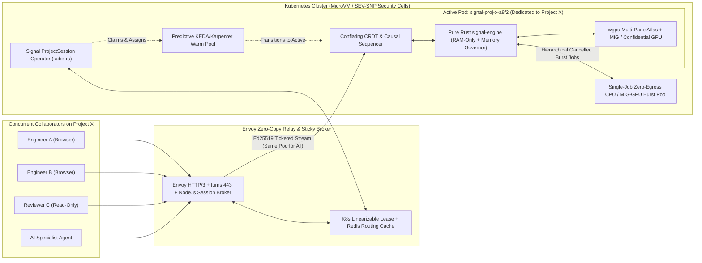
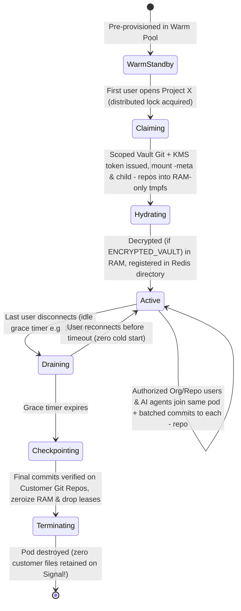

# 04 — Kubernetes Runtime & Multi-User Collaboration

> **Scope:** Defines how Signal deploys its pure-Rust engine inside Kubernetes pods—guaranteeing a dedicated engine instance per loaded project, **deterministic sticky routing of multiple concurrent users (and AI agents) to the exact same pod**, real-time collaboration, elastic GPU/CPU bursting, and zero-trust pod hardening.

---

## 1. Core Runtime Principle: One Active Rust Engine Pod per Loaded Project

Because an EDA project can hold gigabytes of live hierarchical schematic, PCB, IC mask, and simulation state—and multiple engineers plus AI Agents collaborate on it simultaneously—Signal uses a **Stateful Pod-per-Project** architecture:

- **1 Loaded Project = 1 Active `signal-project-pod`** running `signal-engine` in encrypted RAM.
- **N Concurrent Users + AI Agents opening Project X → ALL routed to the EXACT SAME Pod.**
- Zero conflicting local copies, zero "file locked by another user" errors, shared real-time SPICE probes, shared cursors, and instant multi-user edits.

---

## 2. Pod Lifecycle State Machine

Managed by a custom pure-Rust Kubernetes Operator (`signal-operator` built with `kube-rs`) reconciling a `ProjectSession` Custom Resource Definition (CRD).

### Key Lifecycle & Resilience Invariants
1. **Scalable Linearizable Fencing & Dual-Gate External Git Protection (Zero Split-Brain at `1M+` Projects):**
   - **Zero `etcd` Heartbeat Storms:** Rather than renewing `50,000` individual K8s `Lease` objects every `2 s` (`25,000` Raft writes/s!), each K8s worker node renews **one Host-Aggregated Node Lease** (`100×` fewer `etcd` writes!) paired with a sharded linearizable **`project_lease` epoch record** (`fencing_epoch`) on claim/handoff; Redis serves strictly as a `< 1 ms` read-through cache.
   - **Dual-Gate External BYO-Git Fencing:** Because external GitHub/GitLab/Bitbucket servers do not natively understand Kubernetes Lease tokens, Signal enforces two independent gates: (a) **`signal-egress-proxy` Active Epoch Gate** inspects `X-Signal-Fencing-Token: (project_id, fencing_epoch)` on every outbound Git/LFS packet and **hard-drops (`412`)** any zombie pod whose `fencing_epoch < live_epoch` before a single byte leaves Signal; and (b) `signal-git-sync` updates `.signal/repos.lock.json` on `<project>-meta` **first via strict Git `old_oid -> new_oid` CAS** embedding `fencing_epoch`!
2. **Never Reuse a Cell Across Projects + Graceful Per-Repo Mount & External-Push Rebase:**
   - Small educational `EXPLORER` circuits (`<= 200` components, zero NDA IP) boot in `< 5 ms` inside dedicated **`< 8 MB` Wasmtime Isolate Security Cells (`signal-cell-wasm` with hardware MPK + per-project DEK/RLS)** and auto-promote live into dedicated **Kata MicroVM Pods** as soon as complexity or tier increases; terminated pods/isolates `zeroize` RAM and are permanently destroyed.
   - Each `<project>-<type>` repo mounts independently (`MOUNTED` | `SYNCING` | `UNAUTHORIZED` | `DEGRADED`); external developer/CI `git push` events detected via dirty-hint webhooks fetch into a shadow ref and run **`jj-lib` 3-way structural auto-rebase** without interrupting live IDE users!
3. **3-Phase Pre-Copy Live Pod Resize & Migration (`< 150 ms` Actual Cutover Pause):**
   - Because copying `128 GB` of raw IC pod RAM over a network would take `~42 s`, `signal-operator` executes **3-Phase Pre-Copy Migration** whenever vertical pod resize or `SIGTERM` node-drain occurs: **(Phase 1)** `P_new` hydrates base blobless `<project>-*` repos & PDKs in the background while `P_old` stays 100% live (`0 ms` pause); **(Phase 2)** `P_new` tails compact `DesignTransaction` WAL ops (`kilobytes`) over NATS until lag `< 50` ops; **(Phase 3)** `P_old` freezes mutations for **`< 150 ms`**, flushes the final `< 50 KB` WAL tail + MNA state vector + `fencing_epoch` bump to `P_new`, and Envoy atomically switches upstream streams!
4. **Crash & Git-Outage Continuity + Verifiable Crypto-Shredding:**
   - Active transactions stream `< 500 ms` RPO deltas to Signal's **Ephemeral Continuity Journal** (`TTL <= 72h`, default `24h`), encrypted under a **per-session sub-DEK wrapped EXCLUSIVELY by Customer BYOK/KMS** (instantly bricked on BYOK revocation) and emitting an **`ML-DSA`-signed Crypto-Shred Receipt** to the WORM ledger immediately upon `Super-Commit` Git CAS!

---

## 3. Sticky Multi-User Routing & Global Low-Latency Protocol

How does Signal ensure Engineer A in New York, Engineer B in Munich, Engineer C in Bangalore, and an AI Agent all hit the exact same Rust Engine Pod smoothly?

1. **Provider-Backed Authentication & Repo Authorization:** Client authenticates via Node.js BFF (`JWT` bound to immutable `provider_user_id` from GitHub / GitLab / Bitbucket) and passes live **Org + Repo membership verification** confirming exact `read`/`write`/`admin` rights on `<project>-meta` and each `<project>-<type>` repo.
2. **Singleflight Session Resolution:** Node.js `session-broker` checks the Redis routing cache (backed by sharded linearizable project epochs + Host Leases), coalescing concurrent cold-open requests via singleflight so **at most one cell/pod** ever hydrates Project X in its **Jurisdiction-Pinned Region**.
3. **Zero-Copy Sticky Transport & Global Edge Prediction:**
   - `session-broker` issues short-lived **Ed25519 stream tickets** so high-frequency pointer/viewport traffic flows zero-copy through **Envoy HTTP/3 WebTransport / TURN-over-TLS 443 (`turns:`) / WSS** directly to the Pod without Node.js JSON/GC jitter.
   - Regional edge relays + **120 FPS client-side predictive crosshair/pan/ghost-wire overlays** keep distant collaborators feeling instantaneous even at `180 ms` transoceanic RTT.
   - **Per-Subscriber Conflating Ring Buffers:** Each connected user gets an isolated bounded ring buffer—a collaborator on a slow 3G link receives coalesced latest state and adaptive FPS without ever causing head-of-line stalls for fiber teammates!
4. **Per-Sub-Project Role Enforcement & Instant Eviction Inside the Pod:** Every connection carries its signed per-repo RBAC map enforced directly inside `signal-engine` (users never receive graph nodes, render layers, or AI context from unauthorized `<project>-<type>` repos). Revocation in GitHub/GitLab/Bitbucket or Signal Access Review evicts live pod streams within `< 2 s`.

---

## 4. Real-Time Multi-User & AI Collaboration Engine

Inside the Project Pod, `signal-graph` coordinates all concurrent participants safely:

- **Presence & Live Review Huddles:** Colored cursors, active sheet/layer badges, selection highlights, spatial review threads, and **"Follow Engineer"** synchronized viewport huddles.
- **Dependency-Aware Topological CRDT + Safe Causal Undo:**
  - Concurrent non-overlapping edits execute lock-free. `Delete(U1)` vs. `Wire(U1.pin4)` resolves to a **Floating Junction Marker**; concurrent merges of distinct power/ground rails (`VCC` + `GND`) insert a **Contention Bridge Marker** preventing silent power shorts!
  - **Dependency-Checked Selective Undo (`Cmd+Z`):** Checks the **Read-After-Write Causal DAG** before reversing *only* the invoking engineer's last transaction—safely detaching dependent teammate wires into Floating Markers if needed rather than corrupting state.
  - **Heartbeat Soft Reservations:** Dragging/routing acquires a soft intent lease requiring 2 s pointer heartbeats (hard 15 s max TTL); tabs idle `> 5 min` automatically downgrade to low-FPS observer mode.
- **AI Agent Collaboration Modes:**
  - **Co-Pilot Branch Mode (Default):** AI Agent forks an instant Copy-on-Write (CoW) branch with live port-boundary rebasing and surfaces a visual semantic diff + parent-hash-bound proof bundle (re-verified incrementally on merge).
  - **Live Pair Mode (Opt-In):** Scoped live co-editing on an explicitly locked subcircuit region.

---

## 5. Memory Governance, Quotas & Elastic Compute Bursting

| Workload Class | Execution Target | Isolation, Cancellation & Scaling Mechanism |
|---|---|---|
| **Interactive Editing & Quick SPICE (`< 25k` nodes)** | Active `signal-project-pod` (CPU `KLU`/`CKTSO` SIMD LU) or `signal-cell-wasm` (`EXPLORER`) | **In-Pod Memory Admission Governor** reserves 60% RAM for graph/viewport and caps local quick-sim arena at 25% (eliminating `OOMKill` crashes); anything larger auto-spills to burst workers! |
| **Heavy Batch Sim (`> 25k` nodes), Saltation-Adjoint & 3D EM** | Ephemeral `signal-sim-worker` pods (`cuDSS` `FP64` on H100/B200 or `FP32->f64` mixed-precision on L4/A10G) | Dispatched over NATS JetStream (`signal.{org}.{proj}.>`) with **Hierarchical Distributed Cancellation Tokens** (`< 200 ms` abort when a branch/sweep is canceled) + per-org/project **Compute Quota Circuit Breakers**. |
| **AOT Verilog-A Build, MapReduce DRC/LVS/PEX, `signal-formal` & FW** | Ephemeral `signal-verify-worker` pods | Single-job, single-project, zero-egress sandboxes destroyed immediately after returning `ML-DSA`-signed result payloads. |
| **Server-Side Zero-Leak Rendering & `CONFIDENTIAL_SILICON` GPUs** | Standard `PRO`/`ENTERPRISE`: **Hardware-Isolated NVIDIA MIG** (`A100`/`H100`/`L40S`/`B200` + VRAM zeroing). `CONFIDENTIAL_SILICON`: **Exclusive Whole-GPU Hopper `H100 CC`** (with FLR/CC reset) OR **Blackwell `B200`/`GB200` `TEE-I/O` Confidential MIG** (`NRAS` SPDM attested) | Reflects real GPU silicon capabilities (Hopper `H100` prohibits simultaneous `MIG + CC`, whereas Blackwell `B200` supports hardware `TEE-I/O` Confidential MIG!); software GPU time-slicing is strictly forbidden for commercial/Enterprise tenants. |

---

## 6. Zero-Trust Kubernetes Hardening

Every `signal-project-pod` and burst worker enforces defense-in-depth isolation (full AppSec matrix in [`15-application-security-and-project-isolation.md`](./15-application-security-and-project-isolation.md)):
- **Zero Plaintext Persistent Storage:** `readOnlyRootFilesystem: true`, RAM-backed `emptyDir: { medium: Memory }`, swap disabled (`swapoff -a`), core dumps disabled (`RLIMIT_CORE = 0`).
- **MicroVM & Confidential Compute Isolation:** **Kata Containers / Firecracker MicroVM** or **gVisor** dedicated guest kernel per Project Pod (plus optional **AMD SEV-SNP / Intel TDX + Confidential GPU** hardware memory encryption).
- **Default-Deny eBPF Network Policies (Cilium):**
  - **100% of Project Pod ↔ Project Pod lateral traffic is dropped.**
  - Project Pods can ONLY talk to: (1) `session-broker` / Envoy TURN ingress via mTLS, (2) internal Vault/KMS & ephemeral crash-WAL S3, (3) project-scoped `NATS` subjects, (4) **`signal-egress-proxy`** (enforcing per-project BYO-Git domain allowlists + socket-level anti-SSRF IP pinning), and (5) `signal-sftp-egress` for 2FA-approved releases.
- **Per-Project Workload Identity (SPIFFE/SPIRE):** Short-lived X.509 SVID (`spiffe://signal/org/<org>/project/<proj>`) mathematically binding each pod to its single project's DEK and repo tokens.
