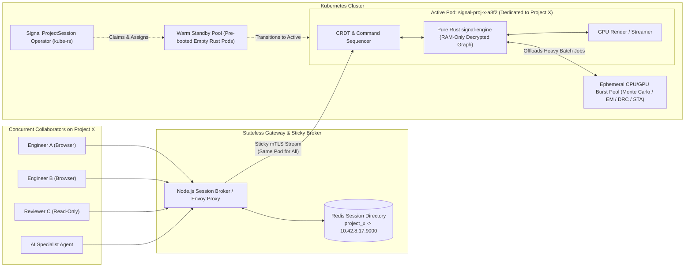
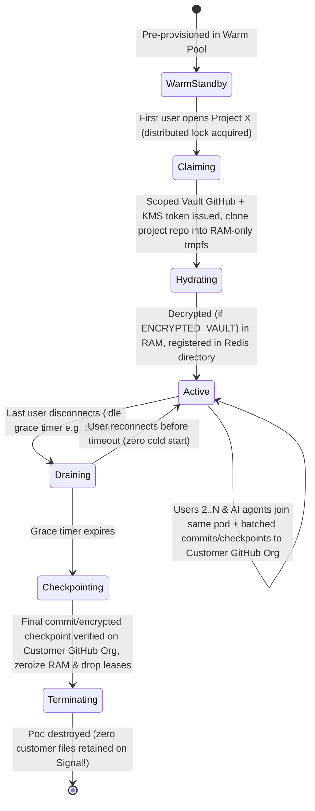

# 04 — Kubernetes Runtime & Multi-User Collaboration

> **Scope:** Defines how Signal deploys its pure-Rust engine inside Kubernetes pods—guaranteeing a dedicated engine instance per loaded project, **deterministic sticky routing of multiple concurrent users (and AI agents) to the exact same pod**, real-time collaboration, elastic GPU/CPU bursting, and zero-trust pod hardening.

---

## 1. Core Runtime Principle: One Active Rust Engine Pod per Loaded Project

Because an EDA project can hold gigabytes of live hierarchical schematic, PCB, IC mask, and simulation state—and multiple engineers plus AI Agents collaborate on it simultaneously—Signal uses a **Stateful Pod-per-Project** architecture:

- **1 Loaded Project = 1 Active `signal-project-pod`** running `signal-engine` in encrypted RAM.
- **N Concurrent Users + AI Agents opening Project X → ALL routed to the EXACT SAME Pod.**
- Zero conflicting local copies, zero "file locked by another user" errors, shared real-time SPICE probes, shared cursors, and instant multi-user edits.

---

## 2. Pod Lifecycle State Machine

Managed by a custom pure-Rust Kubernetes Operator (`signal-operator` built with `kube-rs`) reconciling a `ProjectSession` Custom Resource Definition (CRD).

### Key Lifecycle Invariants
1. **Single-Pod Guarantee (No Split-Brain):**
   - Before claiming a pod for `project_id`, `signal-operator` acquires a **fenced distributed lease** (etcd/Redis Redlock with monotonically increasing `fencing_token`).
   - Git push/checkpoint refs and ephemeral crash-recovery WAL validate `fencing_token`—making split-brain dual-writer corruption mathematically impossible even during network partitions.
2. **Never Reuse a Pod Across Different Tenants/Projects:**
   - Warm Standby pods are completely clean, uninitialized binaries waiting to be claimed. Once a pod finishes serving Project X and hibernates, **the pod is permanently destroyed** after zeroizing memory—eliminating any possibility of cross-tenant memory residue.
3. **Sub-Second Startup via Warm Pools:**
   - Maintaining a dynamically sized warm pool of pre-started `signal-pod` containers removes container image pull and Kubernetes scheduling latency (turning 15–30 s cold starts into **< 1.5 s** hydration times via shallow/sparse `gitoxide` fetch into RAM).
4. **Crash Recovery & Durability (Zero Permanent Signal Storage):**
   - Active editing transactions are pushed as clean commits to the customer's GitHub Org repository (and optionally mirrored to a short-lived encrypted checkpoint ref/ephemeral crash buffer purged immediately once pushed to GitHub).
   - If a Kubernetes node unexpectedly dies, `signal-operator` detects lease expiry within 5 seconds, claims a fresh Warm Standby pod, re-hydrates from the customer's GitHub Org repo + latest checkpoint ref, and seamlessly reconnects all active clients via automatic WebSocket/WebTransport resume.

---

## 3. Sticky Multi-User Routing Protocol

How does Signal ensure Engineer A in New York, Engineer B in Munich, and an AI Agent all hit the exact same Rust Engine Pod?

1. **Authentication & Authorization:** Client authenticates via Node.js BFF (`JWT` + RBAC check confirming `project:read` or `project:write` on `project_id`).
2. **Session Resolution:** Node.js `session-broker` queries Redis (`HGET session:active <project_id>`):
   - **Cache Hit (`Active` or `Draining`):** Immediately returns the internal mTLS endpoint (`pod_ip:port`, `fencing_token`, `pod_spiffe_id`).
   - **Cache Miss (`Cold`):** Calls `signal-operator` (`EnsureProjectSession(project_id, org_id, tier)`), which transitions a Warm Pod to `Active` and populates Redis. Concurrent requests for the same cold project coalesce onto the single in-flight activation promise (singleflight pattern) so only ONE pod is ever spawned!
3. **Sticky Transport Attachment:**
   - **Control & Graph Sync:** Client maintains a persistent WebSocket / WebTransport stream through `session-broker` (or Envoy Gateway with custom dynamic upstream filter) pinned to that Pod's IP.
   - **Zero-Leak Media Stream:** For Enterprise pixel-streaming mode, WebRTC ICE/TURN signaling pairs the browser directly with the Pod's `signal-render` WebRTC engine (authenticated via short-lived session token bound to the user's JWT + watermark identity).
4. **Role Enforcement Inside the Pod:** Every connection carries its signed RBAC claims (`viewer`, `editor`, `approver`, `ai_agent`), enforced inside the Rust engine itself (defense-in-depth).

---

## 4. Real-Time Multi-User & AI Collaboration Engine

Inside the Project Pod, `signal-graph` coordinates all concurrent participants:

- **Presence & Awareness:** Live colored cursors, active sheet/layer indicator, selection highlights, and optional **"Follow Engineer"** viewport locking for live design reviews.
- **Optimistic CRDT + Authoritative Sequencer:**
  - Because all users connect to a single authoritative Rust engine pod, ordering is deterministic and latency is minimal.
  - Non-overlapping edits (e.g., Engineer A routing DDR traces on Sheet 2 while Engineer B tunes an LDO on Sheet 5 and the AI Agent runs a power-rail simulation) execute concurrently without blocking.
  - **Soft Object Locking / Intent Reservations:** While dragging a component or routing a differential pair, the pod applies a lightweight ephemeral lease (auto-released on drop or 5 s idle) so two engineers don't tug the same trace simultaneously.
- **AI Agent Collaboration Modes:**
  - **Co-Pilot Branch Mode (Default):** AI Agent forks an instant Copy-on-Write (CoW) in-memory branch inside the pod, performs heavy circuit synthesis/simulation/routing without disrupting human editors, and surfaces a reviewable diff overlay.
  - **Live Pair Mode (Opt-In):** Engineer grants the Agent permission to edit a specific locked region live while watching its cursor work in real time.

---

## 5. Right-Sizing & Elastic Compute Bursting

EDA workloads are wildly asymmetric: interactive schematic editing needs ~2 vCPU / 4 GB RAM, whereas a 1,000-run Monte Carlo sweep, 3D EM extraction, or full-chip LVS/STA can momentarily require 64 cores or multiple GPUs.

Signal handles this with **Tiered Project Pods + Ephemeral Burst Workers**:

| Workload Class | Execution Target | Scaling Mechanism |
|---|---|---|
| **Interactive Editing & Quick SPICE (< 1 s)** | Inside the active `signal-project-pod` | Tiered pod profiles (`Small`: 2 vCPU/4 GB, `Medium`: 8 vCPU/16 GB, `Large IC`: 32 vCPU/128 GB + fractional GPU MIG slice). |
| **Heavy Batch Simulation (Monte Carlo, PVT Corners, Harmonic Balance, Post-Layout SPICE)** | Ephemeral `signal-sim-worker` pods (CPU & GPU pools) | `signal-engine` serializes an encrypted read-only snapshot slice → dispatches jobs over NATS JetStream → KEDA/Karpenter auto-scales worker pods → streams results back to Project Pod. |
| **Physical Verification & Synthesis (Full-Chip DRC/LVS/PEX, RTL Synth, STA, Firmware Build)** | Ephemeral `signal-verify-worker` pods | Isolated per-job pods with zero network egress, destroyed immediately after returning signed result payloads. |
| **Server-Side Zero-Leak Rendering** | Shared MIG GPU slice attached to `signal-project-pod` (or co-located `render-sidecar` via shared memory) | NVIDIA GPU Operator + Multi-Instance GPU (MIG) / time-slicing for high tenant density at low cost. |

---

## 6. Zero-Trust Kubernetes Hardening

Every `signal-project-pod` and burst worker enforces defense-in-depth isolation:
- **Zero Plaintext Persistent Storage:** Root filesystem is `readOnlyRootFilesystem: true`. Working memory uses RAM-backed `emptyDir: { medium: Memory }` with swap disabled on all Kubernetes nodes.
- **Strict Tenant Isolation:**
  - Standard Cloud: Dedicated namespace/security context per tenant tier, `runAsNonRoot: true`, dropped Linux capabilities (`ALL`), seccomp `RuntimeDefault`.
  - Enterprise Dedicated / Defense Tier: **gVisor** or **Kata Containers** microVM sandboxing per Project Pod, optional dedicated VPC / node pools.
- **Default-Deny eBPF Network Policies (Cilium):**
  - Project Pods can ONLY talk to: (1) `session-broker` / TURN ingress via mTLS, (2) internal `KMS` / encrypted `S3` endpoints, (3) `NATS` burst queue (tenant-scoped subjects), and (4) `signal-sftp-egress` for approved releases.
  - **Zero direct internet egress** from Project Pods—completely preventing malicious custom scripts or compromised dependencies from exfiltrating designs.
- **Workload Identity (SPIFFE/SPIRE):** Every pod receives a short-lived cryptographic X.509 identity scoped strictly to its assigned `(org_id, project_id)` so KMS will refuse decryption of any other project's keys.
