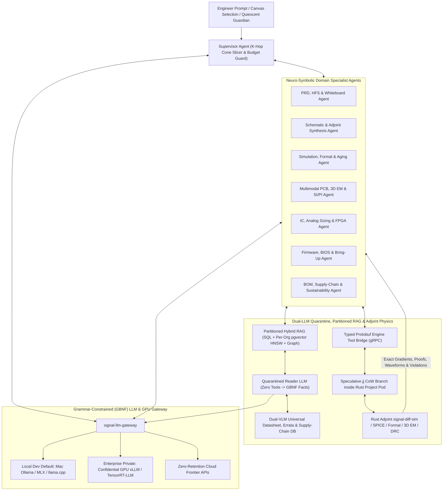
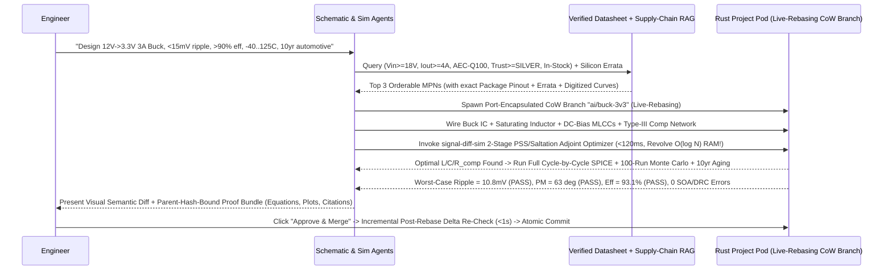

# 05 — AI-Agent-First Platform & Universal Datasheet RAG

> **Scope:** Defines Signal's multi-agent orchestration engine, deterministic closed-loop verification against the Rust physics core, the **Universal Datasheet Database & Hybrid RAG** pipeline, and the GPU/LLM routing layer (supporting Enterprise VPC GPUs, cloud frontier models, and **local Mac LLM default** for development).

---

## 1. AI-Agent-First Engineering Paradigm

Most "AI in CAD" tools fail because LLMs cannot reliably do raw electrical math, recall pinouts from memory without hallucinating, or keep schematics/layouts geometrically consistent.

**Signal solves this with a Grounded, Tool-Native, Closed-Loop Architecture:**
1. **Never Trust LLM Memory for Component Specs:** Every part number, pinout, absolute maximum rating, thermal impedance, and application circuit is retrieved from Signal's **Universal Datasheet Database via Hybrid RAG** with exact page/table citations.
2. **Never Trust LLM Math for Circuit Verification:** Every generated circuit, trace impedance, timing budget, or transistor sizing is executed through the **Rust `signal-engine`** (SPICE, ERC, DRC, LVS, Thermal, SI/PI). Physics is the final arbiter.
3. **Never Mutate Live User Work Unsafely:** Agents operate on zero-copy **in-memory speculative branches** inside the Project Pod, iterate autonomously until all PRD/HFS specs and DRC/SOA rules pass, and present reviewable visual diffs with simulation proof waveforms.

---

## 2. Multi-Agent Team & Capabilities

| Agent | Responsibilities | Core Rust Engine & RAG Tools Used |
|---|---|---|
| **Supervisor / Planner Agent** | Decomposes goals across domains, enforces org guardrails & **hard Token/Iteration/Wall-Clock budgets**, performs **K-Hop Cone-of-Influence graph slicing** (`< 16k` prompt tokens even on 100B-transistor chips), and compiles **Immutable AI Design Proof Bundles**. | `read_cone_slice`, `query_requirements`, `spawn_cow_branch`, `request_human_approval` |
| **PRD, HFS & Whiteboard Agent** | Drafts/audits requirements, parses whiteboard sketches (`signal-import`), builds UPF power trees, clock trees, pin budgets, and interface matrices; flags contradictory specs. | `create_requirement`, `link_traceability`, `build_upf_power_tree`, `ingest_whiteboard_sketch` |
| **Schematic & Neuro-Symbolic Synthesis Agent** | Selects `SILVER`/`GOLD`-verified, in-stock components via Hybrid RAG (co-checking Silicon Errata!), wires Rust `ElectronicModule`s, and delegates numerical component sizing to **`signal-diff-sim` Adjoint / Bayesian Pareto Optimizer** (eliminating LLM trial-and-error oscillation!). | `rag_parametric_parts`, `place_component_module`, `connect_ports`, `run_adjoint_pareto_opt`, `run_erc` |
| **Simulation, Formal & Aging Agent** | Runs DC/AC/Transient/Noise/Monte-Carlo/PVT/Thermal + **15-yr BTI/HCI/EM Aging (`signal-aging`)** + **Formal SVA/LEC proofs (`signal-formal`)** + `< 50 ms` PINN previews (`signal-surrogate`). | `configure_sim`, `run_simulation`, `run_formal_proof`, `check_soa_and_aging`, `correlate_digital_twin` |
| **Multimodal PCB, 3D EM & SI/PI Agent** | Combines **Vision-Canvas top/bottom/thermal snapshots** with deterministic Rust **Analytical Electro-Thermal Placer & Negotiated-Congestion Router** tools, 3D EM breakout checks (`signal-em3d`), and DRC/DFM auto-healing. | `inspect_viewport_vision`, `run_analytical_placer`, `route_critical_nets`, `run_em3d_check`, `run_drc_dfm` |
| **IC, Analog Sizing & FPGA Agent** | Performs `gm/Id` + **Adjoint Differentiable `(W/L)` sizing** across PVT/aging corners, evaluates WASM PCELLs, authors SystemVerilog/VHDL + formal SVA, verifies UPF power islands, and analyzes MMMC STA/DRC/LVS. | `size_transistors_adjoint`, `run_corner_sweep`, `generate_rtl_and_sva`, `sync_fpga_pinmux`, `run_lvs_drc_pex` |
| **Firmware, BIOS & Bring-Up Agent** | Generates pinmux configs, C/C++/Rust HALs, SystemRDL CSRs, Linux `.dts`, UEFI/ACPI tables, factory JTAG/POST diagnostics, and runs **3-Speed Variable-Fidelity Co-Sim** (`100+ MIPS` ISS → RTL → SPICE). | `read_netlist_pins`, `read_register_map`, `generate_code_patch`, `run_3speed_fw_cosim` |
| **BOM, Supply-Chain & Sustainability Agent** | Queries **k-anonymous live distributor stock/lead-time/pricing**, flags PCN/EOL & geo-fab risks, computes **Embodied Carbon ($\text{kgCO}_2\text{e}$) & PFAS/RoHS Digital Product Passports**, executes **Zero-Spin BOM Rescue**, and prepares 2FA SFTP checklists. | `audit_bom_supply_chain`, `find_dropin_alternates`, `compute_carbon_passport`, `prepare_sftp_bundle` |

---

## 3. Closed-Loop Neuro-Symbolic Design Flow (Topology by LLM + Sizing by Adjoint Physics)

---

## 4. Universal Datasheet Database & Tiered Multi-Tenant Hybrid RAG

> **Full Repository, Symbol, Padstack & 3D Asset Spec:** See [`18-universal-component-and-datasheet-repository.md`](./18-universal-component-and-datasheet-repository.md) for the complete 3-Tier Sharded Git + BLAKE3 CAS Universal Parts Repository (`signal-universal-parts`), Master Pin Table (`pins.json`), IEEE/IEC Symbols, Parametric Padstacks, IPC-7351 Footprints, Org-Private BYO-Git AVL overlays, and Project `parts.lock.json` pinning.

### 4.1 High-Assurance Condition-Parameterized Ingestion & Trust Tiers (`ai/datasheet-ingest`)
Single-pass PDF OCR can misread `1.8 V` as `18 V`, swap QFN pad numbers, or quote misleading headline ratings (`I_D = 100 A` at infinite-heatsink `25°C`, or MLCC `10 µF` at `0 V` when it derates `82%` at `12 V DC`!). Signal enforces a **Zero-Hallucination, Operating-Condition-Aware Ingestion Pipeline** inside zero-network parser sandboxes:

1. **Orderable MPN + Package + Die-Revision Normalization:** Keyed by exact **Orderable MPN + Package Code (`LQFP48` vs `TFBGA100`) + Silicon Revision**, automatically co-linking **Silicon Errata PDFs, PCNs, and App Notes**.
2. **Dual-VLM Quarantine + Mandatory Operating-Condition Curves & Copper-Coupled $R_{\theta JA}$:**
   - Two independent Vision-Language extractors (**running strictly in the Zero-Tool Quarantine Tier to defeat visual/typographic prompt injections embedded in PDFs or whiteboard photos!**) parse AbsMax Ratings, Pinouts, SystemRDL CSRs, and **Multi-Dimensional Condition-Parameterized Curves** (`C(V_bias, T, freq)`, `Rds_on(V_gs, T_j)`, `R_thetaJC / R_thetaJB` thermal networks rather than misleading JEDEC coupon `R_thetaJA`, feeding actual `signal-pcb` copper-pour area into thermal checks!).
   - Automated **3-Way Symbol ↔ IPC-7351 Footprint ↔ 3D STEP Pin Intersection Check** + SPICE curve-fit verification.
3. **Cryptographic Datasheet Trust Badges (`VerificationBadge`):**
   - `BRONZE_PARSED`: Dual-VLM consensus passed; unverified SPICE curve.
   - `SILVER_SIM_MATCHED`: Automated physics, 3D pin-pad intersection, and SPICE curve-fit verified (`< 2%` RMS error across operating conditions).
   - `GOLD_ATTESTED`: Manufacturer-signed feed or librarian sign-off (Enterprise templates can mandate `SILVER`/`GOLD` only!).
4. **Parent-Hash-Bound AI Proof Bundles & Merge-Time Delta Re-Verification:** Every AI speculative branch binds its `DesignProofBundle` to `base_graph_merkle_root`; if humans modified upstream rails/nets on `main` while the AI worked, clicking **Approve & Merge** automatically runs an **incremental cone-of-influence ERC/DRC/SOA re-verification (`< 1 s`)** on the post-rebase state before committing!

### 4.2 Tiered Multi-Tenant Hybrid RAG (Zero Postgres Catalog Bloat & Zero BOM Leakage)

| Tier | Store & Isolation Architecture | Role in Retrieval |
|---|---|---|
| **1. Parametric & Bulk-Mirrored Supply-Chain Index** | PostgreSQL (`NOBYPASSRLS`) + **Signal-Mirrored Bulk Distributor Catalog** (with `4×` **chaff-padded k-anonymous proxy batches** for any live delta lookup—defeating 40-part BOM set-intersection fingerprinting!) | Deterministic SI-normalized + test-condition filtering + live stock, lead-time, pricing, and embodied-carbon/PFAS metrics with **zero outbound BOM leakage**. |
| **2. Tiered `pgvector` HNSW Architecture (`<= 500` Partitions/Cluster)** | (a) `datasheet_chunks_global` shared read-only HNSW; (b) **Sharded Dedicated Physical Partitions (`<= 500` orgs per Postgres cluster)** for `ENTERPRISE_ISOLATED` / `CONFIDENTIAL_SILICON` NDA libraries; (c) **64 Fixed Hash-Bucket Partitions (`NOBYPASSRLS` + `hnsw.iterative_scan = strict_order` + constant-time padding)** for standard `MAKER`/`PRO` uploads | Eliminates both shared-HNSW side channels AND the `50,000`-table PostgreSQL `relcache`/planner memory explosion at planetary SaaS scale! |
| **3. Component & Equivalence Knowledge Graph** | Relational/Graph adjacency tables | Pin-compatible drop-in alternates (**Zero-Spin BOM Rescue**), complementary gate-driver/FET pairs, and verified reference subcircuits. |

---

## 5. Grammar-Constrained & Multimodal-Quarantine LLM Gateway (`ai/llm-gateway`)

| Capability Tier | Purpose | Production Cloud / Enterprise VPC | Local Mac Dev Default |
|---|---|---|---|
| **Tier 1: Fast / Zero-Tool Text & Vision Quarantine** | Autocomplete, ERC explanation, **Zero-Tool Untrusted PDF/Errata/Whiteboard-Image Quarantine Extractor** (`GBNF` JSON primitives only—defeats both text & visual prompt injections!) | Quantized fast + VLM models on VPC vLLM | Local Apple Silicon Ollama / MLX (`qwen2.5-coder:7b` / `qwen2.5-vl:7b`) + `deterministic_mock` offline fallback |
| **Tier 2: Deep Neuro-Symbolic Reasoning** | Circuit topology synthesis, multi-domain debug, RTL/SVA/firmware generation (delegating numerical sizing to `signal-diff-sim`) | VPC Frontier Open-Weights on **Confidential H100 (Exclusive CC) / B200 (`TEE-I/O` MIG)** or Zero-Retention API | Local Mac Ollama / MLX (`qwen2.5-coder:32b` or best model fitting Unified Memory) |
| **Tier 3: Spatial Canvas Critique** | Trusted internal `signal-render` PCB/IC Vision-Canvas floorplan & thermal heatmap critique | Vision-Language cluster on VPC GPUs | Local Mac Vision model (`qwen2.5-vl` / `llama3.2-vision`) |
| **Tier 4: Embeddings & Reranking** | Tiered Datasheet & Errata RAG | GPU embedding + cross-encoder reranker (`bge-m3`) | Local Ollama / MLX (`nomic-embed-text` / `bge-m3`) |

### Reliability & Enterprise AI Privacy Guarantees
- **100% Valid Tool Calls via Grammar-Constrained Decoding (`GBNF`):** `ai/llm-gateway` enforces JSON-Schema / Protobuf state-machine decoding (`Outlines` / `llama.cpp GBNF`) + **Dynamic Tool Subset Routing (5–8 tools per specialist step)** so even 7B Local Mac models emit zero syntax errors.
- **Zero Model Training, Confidential GPU Inference & Telemetry Redaction:** Customer IP and private NDA datasheets are NEVER used for model training; VPC Confidential GPUs encrypt model weights and prompts in hardware VRAM; observability spans pass through `SecretBox` netlist scrubbers.
