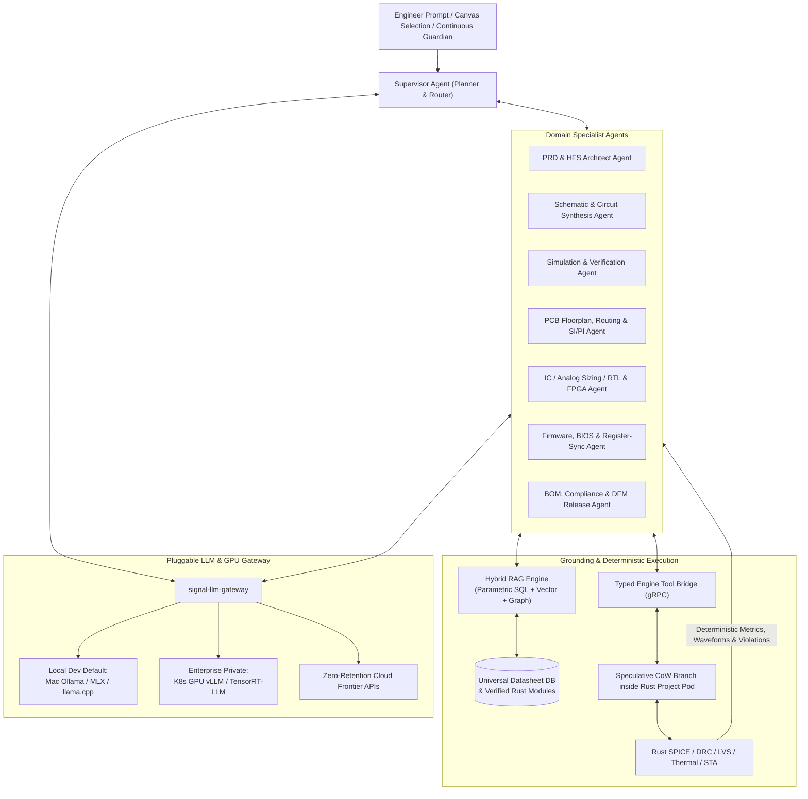
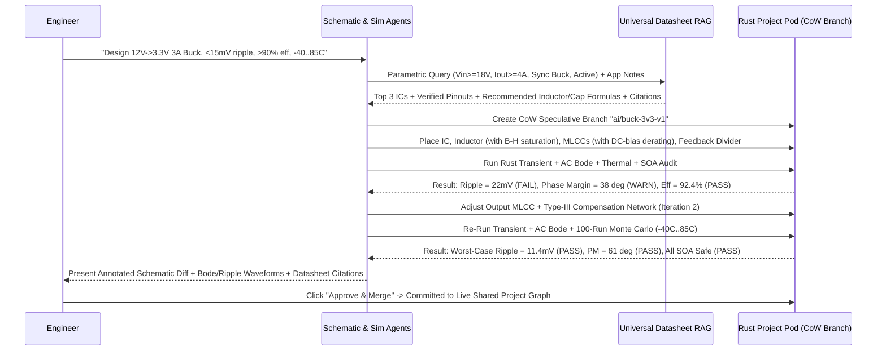

# 05 — AI-Agent-First Platform & Universal Datasheet RAG

> **Scope:** Defines Signal's multi-agent orchestration engine, deterministic closed-loop verification against the Rust physics core, the **Universal Datasheet Database & Hybrid RAG** pipeline, and the GPU/LLM routing layer (supporting Enterprise VPC GPUs, cloud frontier models, and **local Mac LLM default** for development).

---

## 1. AI-Agent-First Engineering Paradigm

Most "AI in CAD" tools fail because LLMs cannot reliably do raw electrical math, recall pinouts from memory without hallucinating, or keep schematics/layouts geometrically consistent.

**Signal solves this with a Grounded, Tool-Native, Closed-Loop Architecture:**
1. **Never Trust LLM Memory for Component Specs:** Every part number, pinout, absolute maximum rating, thermal impedance, and application circuit is retrieved from Signal's **Universal Datasheet Database via Hybrid RAG** with exact page/table citations.
2. **Never Trust LLM Math for Circuit Verification:** Every generated circuit, trace impedance, timing budget, or transistor sizing is executed through the **Rust `signal-engine`** (SPICE, ERC, DRC, LVS, Thermal, SI/PI). Physics is the final arbiter.
3. **Never Mutate Live User Work Unsafely:** Agents operate on zero-copy **in-memory speculative branches** inside the Project Pod, iterate autonomously until all PRD/HFS specs and DRC/SOA rules pass, and present reviewable visual diffs with simulation proof waveforms.

---

## 2. Multi-Agent Team & Capabilities

| Agent | Responsibilities | Core Rust Engine & RAG Tools Used |
|---|---|---|
| **Supervisor / Planner Agent** | Decomposes high-level engineering goals across domains (PRD → Schematic → PCB → Firmware), enforces org guardrail policies, manages execution budgets, coordinates specialist handoffs. | `read_project_tree`, `query_requirements`, `spawn_branch`, `request_human_approval` |
| **PRD & HFS Architect Agent** | Drafts/audits requirements, builds block diagrams, calculates system power trees, clock trees, pin budgets, and interface matrices; flags contradictory specs. | `create_requirement`, `link_traceability`, `build_power_tree`, `rag_search_architectures` |
| **Schematic & Circuit Synthesis Agent** | Selects real qualified components via Hybrid RAG, instantiates Rust component modules, wires subcircuits, calculates bias/compensation/filter/protection networks. | `rag_parametric_parts`, `place_component_module`, `connect_ports`, `run_erc`, `inspect_datasheet_pinout` |
| **Simulation & Verification Agent** | Builds DC/AC/Transient/Noise/Monte-Carlo/Corner/Thermal testbenches, executes Rust `signal-sim`, interprets waveforms (phase margin, ripple, overshoot, ringing, SOA stress), iteratively tunes component values until all requirements pass. | `configure_sim`, `run_simulation`, `measure_waveform`, `check_soa_violations`, `sweep_parameters` |
| **PCB Layout, Routing & SI/PI Agent** | Proposes thermal/EMI floorplanning zones, optimizes critical loops (buck switch node, crystal, decoupling caps), guides differential pair & length-matched routing, runs impedance/PDN checks, auto-repairs DRC/DFM issues. | `propose_placement`, `set_net_class_rules`, `route_critical_nets`, `run_field_solver`, `run_drc_dfm` |
| **IC, Analog & FPGA Agent** | Performs `gm/Id` transistor sizing across PVT corners, generates PCELL floorplans, authors SystemVerilog/VHDL + assertions, syncs FPGA pinouts with PCB symbols, analyzes STA/DRC/LVS violations. | `size_transistors`, `run_corner_sweep`, `generate_rtl`, `sync_fpga_pinmux`, `run_lvs_drc_pex` |
| **Firmware, BIOS & Driver Agent** | Generates pinmux configs, C/C++/Rust HAL drivers, register headers from canonical register maps, Linux Device Trees (`.dts`), UEFI/ACPI tables, and virtual bring-up tests executed against simulated hardware. | `read_netlist_pins`, `read_register_map`, `generate_code_patch`, `run_fw_cosim` |
| **BOM, Compliance & Release Agent** | Audits lifecycle/obsolescence, suggests pin-compatible alternates via RAG, verifies RoHS/REACH/AEC-Q/ISO-26262 derating margins, prepares DFM sign-off & SFTP release checklists. | `audit_bom_lifecycle`, `find_alternate_parts`, `generate_compliance_matrix`, `prepare_sftp_bundle` |

---

## 3. Closed-Loop Autonomous Design Example (Verify-and-Fix Loop)

---

## 4. Universal Datasheet Database & Hybrid RAG Architecture

A foundational pillar of Signal is maintaining a **Universal Electronic Component & Datasheet Knowledge Base** that serves both human search and grounded AI Agent reasoning.

### 4.1 Multi-Modal Datasheet Ingestion Pipeline (`ai/datasheet-ingest`)
Datasheets are notoriously dense—mixing multi-column prose, complex parametric tables, pinout diagrams, truth tables, register bitfields, and log-log characteristic curves. Signal's ingestion pipeline processes every component into **structured truth + semantic chunks**:

1. **Source Acquisition & Licensing:** Manufacturer feeds, authorized distributor APIs, open-source foundry PDKs, and **tenant-private uploaded datasheets** (strictly isolated in per-tenant encrypted partitions so proprietary/NDA datasheets NEVER leak across companies!).
2. **Layout-Aware Document Parsing:** Vision-Language & document-layout models extract:
   - **Absolute Maximum Ratings** (structured min/max bounds with units)
   - **Electrical & Thermal Characteristics Tables** (conditions, min/typ/max, units)
   - **Pinout & Pin-Function Tables** (pin number, name, I/O type, voltage domain, ESD rating)
   - **Register Maps** (offset, reset value, bitfields, access mode — directly usable by Firmware Agent!)
   - **Characteristic Curves Digitization** (efficiency vs. load, MLCC capacitance vs. DC bias, MOSFET `Rds_on` vs. `Tj`, SOA curves — digitized into lookup tables for the Rust component modules!)
   - **Application Notes, Typical Schematics & Errata**
3. **Model Binding & Verification:**
   - Links vendor SPICE/IBIS/S-parameter models, footprints, and 3D STEP geometry to the component record.
   - Automatically transpiles/wraps models into verified **Rust `ElectronicModule` parameters** and runs automated sanity simulations (e.g., verify simulated diode Vf or MOSFET threshold matches the extracted datasheet table; flag discrepancies for review).

### 4.2 Three-Tier Hybrid RAG Storage & Retrieval (`ai/rag-service`)

Pure vector search fails on hardware queries like *"N-channel MOSFET, Vds ≥ 80V, Rds_on ≤ 4mΩ at Vgs=4.5V, QFN-5x6, AEC-Q100"*. Signal uses **Hybrid Multi-Stage Retrieval**:

| Tier | Store | Role in Retrieval |
|---|---|---|
| **1. Structured Parametric Index** | PostgreSQL (normalized parametric tables + unit-canonicalized SI columns) | Exact deterministic filtering on voltage, current, tolerance, package, temp range, lifecycle, AEC/MIL qualification, and org Approved Vendor List (AVL). |
| **2. Dense + Sparse Semantic Index** | PostgreSQL `pgvector` (scale-out: Qdrant) + BM25 Full-Text | Semantic search over datasheet prose, design guidelines, layout recommendations, thermal notes, errata, and application circuits. |
| **3. Component Knowledge Graph** | Relational/Graph adjacency tables | Tracks pin-to-pin drop-in alternates, functional equivalents, complementary pairs (e.g., gate driver ↔ GaN FET), known incompatibilities, and verified reference subcircuits. |

**Retrieval Flow for an LLM Prompt:**
1. Query Planner extracts hard parametric predicates (SQL) + semantic intent (Vector + BM25) + tenant ACL scope (Global Universal DB + Tenant Private NDA DB).
2. Executes hard parametric filter FIRST → narrows millions of parts to valid electrical candidates.
3. Ranks candidates using semantic relevance + availability + AVL preference + cross-encoder reranker.
4. Injects **compact, structured JSON specs + verbatim table excerpts + exact `(datasheet_id, page, section)` citations** into the Agent's prompt—keeping context clean and hallucination-free.

---

## 5. LLM & GPU Infrastructure Strategy (`ai/llm-gateway`)

Signal is completely model-agnostic through an OpenAI-compatible internal **Model Gateway** that routes requests by task tier and security policy:

| Capability Tier | Purpose | Production Cloud / Enterprise VPC | Local Mac Dev Default |
|---|---|---|---|
| **Tier 1: Fast / Interactive** | Autocomplete, quick ERC explanation, query classification, UI assistance | Quantized fast model on VPC vLLM / low-latency API | Local Apple Silicon Ollama / MLX (`qwen2.5-coder:7b` / `llama3.2` / equivalent) |
| **Tier 2: Deep Engineering Reasoning** | Circuit architecture, multi-step debug, RTL/firmware generation, closed-loop sim reasoning | Enterprise VPC Frontier Open-Weights (e.g., DeepSeek/Qwen/Llama 70B+ on H100/B200) or Zero-Retention Frontier API | Local Mac Ollama / MLX (`qwen2.5-coder:32b` or best model fitting Mac Unified Memory) |
| **Tier 3: Vision / Multimodal** | Datasheet table/curve extraction, hand-drawn block diagram parsing, PCB layout visual inspection | Vision-Language model on GPU cluster | Local Mac Vision model (`llama3.2-vision` / `qwen2.5-vl` via Ollama/MLX) |
| **Tier 4: Embeddings & Reranking** | Universal Datasheet RAG indexing & retrieval | GPU embedding microservice (`bge-m3` / equivalent) | Local Ollama / MLX embedding model (`nomic-embed-text` / `bge-m3`) |

### Strict Enterprise AI Privacy Guarantees
- **Zero Model Training on Customer IP:** Customer schematics, layouts, firmware, and private NDA datasheets are NEVER used to train foundation models.
- **Data Residency & Air-Gapped / VPC Mode:** Enterprises can enforce **VPC-Only Inference** (all LLM calls remain inside the customer's/Signal's private Kubernetes GPU cluster with zero third-party API calls).
- **Prompt & Output Telemetry Scrubbing:** AI observability logs record latency, token counts, and tool success rates without leaking raw proprietary circuit netlists into third-party analytics tools.
