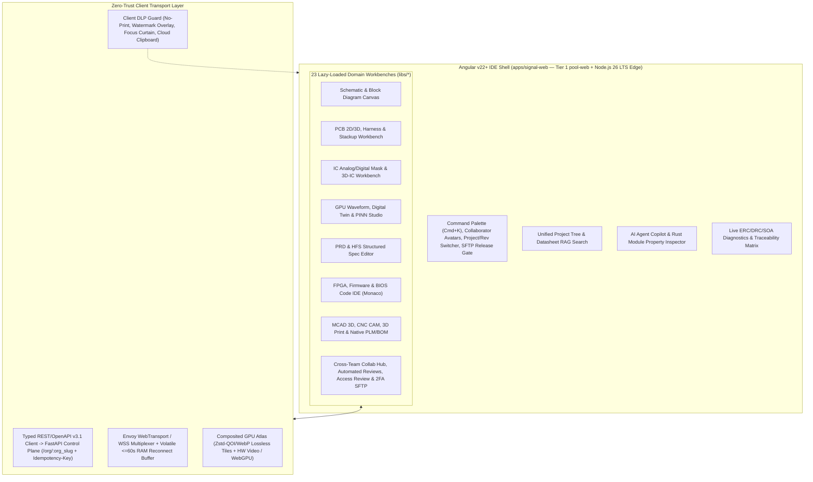

# 06 — Frontend (Angular v22+) & Python FastAPI Control-Plane Architecture

> **Scope:** Defines Signal's web frontend and Tier 2 Control-Plane API architecture—combining **Angular `v22+` ONLY** (served by a thin **Node.js `26 LTS+`** SSR/CSP-nonce edge pod in Tier 1 `pool-web`) with a clean, blazing-fast, fail-closed **Python `3.15+` + FastAPI (`0.165+`) + Rust-powered Granian (`2.8+`) + Pydantic v2 (`2.14+`)** Control Plane in Tier 2A `pool-api`, paired with **Envoy (`signal-engine-bridge`)** and **Rust `1.100+`** physics/security binaries.

---

## 1. Frontend Architecture (Angular v22+ ONLY — Tier 1 `pool-web`)

Signal's UI delivers desktop-grade EDA/MCAD/CAM/PLM/Collaboration ergonomics inside a browser with zero local file persistence, built strictly on **Angular `v22+` ONLY**, **TypeScript `6.0+`**, **Node.js `26 LTS+`** (build & thin Tier 1 SSR/CSP-nonce edge ONLY), and **`pnpm 11+`**.

### 1.1 Architectural Principles
- **Angular `v22+` Core, Clean File Separation & Centralized Design System ([`ANGULAR_UI_STYLE_GUIDE.md`](../docs/engineering/ANGULAR_UI_STYLE_GUIDE.md)):** Standalone Components ONLY, **Zoneless + `OnPush` + Stable Signal Forms + Signals-first**, strict TypeScript `6.0+` (`strict: true`), and lazy-loaded domain workbenches. Every component strictly separates `<name>.component.ts` (thin wiring `<= 120 LOC`), `<name>.component.html` (flat markup `<= 150 LOC`, max nesting `<= 2`, zero copy-pasted `@if`/`@else` sections), `<name>.logic.ts` (pure TS branching/formatting/config builders), and `<name>.model.ts`—consuming **ONE centralized `@signal/design-system` (tokens + `.sig-*` CSS primitives) and `@signal/ui-kit` shared HTML component library** with **zero per-component stylesheets** unless explicitly exempted (`@sig-style-exception`).
- **Zero-Persistence Client Rule:** Design data, schematics, netlists, layouts, waveforms, and specs are **NEVER** written to `localStorage`, `sessionStorage`, `IndexedDB`, Service Worker caches, or downloadable Blob URLs. Only non-sensitive UI preferences (dark/light theme, panel layout geometry, keyboard bindings) may persist.
- **Unified Multi-Domain IDE Shell:** One cohesive workspace shell hosting every product discipline without switching apps:
  - **Left Dock:** Unified Project Explorer (PRD, HFS, Schematics, PCB, IC, MCAD, CAM, 3D-Print, FPGA, Firmware, BIOS, PLM/BOM, Collab, Releases), Component/Datasheet Browser, Net/Hierarchy Navigator, Layer Manager.
  - **Center Multi-Tab Dockable Canvas:** Split-screen cross-probing (e.g., Schematic on left + PCB 2D/3D on right + Live Waveform on bottom + Firmware pinmux code side-by-side—clicking a net highlights it across ALL open panes simultaneously!).
  - **Right Dock:** Context-sensitive Property & Rust Module Parameter Inspector (tolerances, TCR, parasitics, SOA limits) + **AI Agent Copilot Panel** (chat, speculative diff reviewer, autonomous verification progress, datasheet citations).
  - **Bottom Dock:** Real-time ERC/DRC/LVS/SOA Diagnostics Console, Simulation Output, Traceability Matrix, and Terminal/Build logs (read-only streamed from cloud worker pods).

### 1.2 Dual-Mode High-Performance Viewport & Firewall-Resilient Transport

To satisfy both **extreme Enterprise Zero-Leak security** and **razor-sharp, 60–120 FPS desktop CAD precision**, Signal's viewport adapter supports two organization-selectable policies:

| Aspect | Mode A: Enterprise Zero-Leak Dual-Plane Stream (Default for Enterprise) | Mode B: Standard Ephemeral WebGPU (Local Dev / `EXPLORER` / `MAKER`) |
|---|---|---|
| **Where Rendering Happens** | Server-side GPU (`signal-render` `wgpu` inside the Project MicroVM) compositing all open split-screen panes into **one unified Multi-Pane GPU Atlas** (preventing encoder session exhaustion!). | Browser GPU (`WebGPU` / `WebGL2`) rendering ephemeral viewport-clipped display primitives (or ultra-compact binary vector deltas on 3G links). |
| **CAD Sharpness & Battery-Safe Decode (`Zstd-QOI` + HW Video)** | **Zero Chroma Blur & Zero Software-AV1 CPU Drain:** **Plane 1** transmits **`Zstd + QOI` (`> 400 MB/s` GPU shader decode on 100% of browsers including M1/M2 Safari & Chromebooks!) / Lossless `WebP` `RGBA8` dirty-rect tiles** so 1px wires and pin labels are pixel-perfect; **Plane 2** probes `WebCodecs` hardware support (`HEVC 4:4:4` on Mac → **Dual-Luma Hardware `AV1/H.264 4:2:0` Plane Split** on NVDEC/Intel GPUs) *only* during continuous 3D orbit/pan, snapping to Plane 1 within **`80 ms`** of motion stop! | Native crisp local vector/mesh rasterization. |
| **Firewall Traversal & Reconnect** | Automatic **HTTP/3 WebTransport (Baseline including Safari 26.4+) ↔ TURN-over-TLS 443 (`turns:`) ↔ HTTP/2 WSS Binary Tile Fallback** (100% UDP-blocked corporate proxy traversal!). Uncommitted `GraphOp`s buffer in a **volatile JS RAM ring-buffer (`<= 60 s`, zero disk/IndexedDB!)** to survive Wi-Fi micro-drops seamlessly. | WebTransport / WSS with identical volatile RAM reconnect buffer. |
| **Input Latency & Memory Caps** | **120 FPS client-side predictive crosshair, selection box, pan matrix & ghost-wire overlay** + V8 heap protection (`cdk-virtual-scroll` trees, windowed Monaco buffers, `<= 4,096`-point decimated waveform envelopes, ES2020 `bigint` for 64-bit `_nm`/`_ps` coordinates). | Native 60–120 FPS local pan/zoom with server-authoritative edits. |

### 1.3 Accessibility, Cross-Origin Isolation & Workbench Highlights
- **Route-Partitioned `COOP`/`COEP` & OAuth/SAML-Safe Cookie Upgrade:** Workspace routes (`/org/:org_slug/project/*`) enforce `Cross-Origin-Opener-Policy: same-origin` + `Cross-Origin-Embedder-Policy: require-corp` (`crossOriginIsolated = true` enabling high-res timers & `SharedArrayBuffer` workers), whereas top-level `/auth/*` PKCE/SAML redirect routes use `5 min` `SameSite=Lax` state cookies immediately upgraded on `/auth/callback` into a host-locked `__Host-signal_session` (`HttpOnly; Secure; SameSite=Strict`) cookie + `Sec-Fetch-Site` guards—eliminating `window.opener = null` popup and cross-site IdP redirect breakages!
- **Accessibility & Engineer Ergonomics:** Built-in **Color-Blind-Safe Okabe-Ito / High-Contrast Palettes + Procedural Layer Stipple/Hatch Patterns**, switchable **KiCad / Altium / Virtuoso / Vim single-key hotkey maps**, CLI coordinate bar, **unambiguous SI unit confirmation pills (`10 mΩ` vs `10 MΩ`)**, and **Server-Side Encrypted Cloud Clipboard**.
- **Visual Semantic Diff & Spatial Review (`libs/visual-diff`, `libs/review`):** Side-by-side / onion-skin graphical PR & ECO diffs across schematics, PCBs, waveforms, and register maps + **pin/coordinate-anchored review threads & live audio/cursor huddles**.
- **PRD/HFS (`libs/specs`), Waveform/Digital-Twin Studio (`libs/sim-viewer`), Embedded Code/HDL IDE (`libs/code-ide`), and Admin/Access-Review/VCS-Security Console (`libs/admin`):** All lazy-loaded inside the same unified shell with **Progressive UI Profiles (`EXPLORER` / `MAKER` / `PRO` / `SILICON_SCALE`)**.

### 1.4 Extended Angular v22+ Workbench Architecture & UI Primitives (`FEAT-001`–`FEAT-120`)
Full dual UI+Rust feature mappings live in [`17-extended-feature-specifications-ui-and-rust.md`](./17-extended-feature-specifications-ui-and-rust.md). To scale cleanly across **120+ advanced capabilities** without bloating initial bundle size (`< 250 KB` gzipped initial shell), Angular `v22+` organizes the frontend around **23 lazy-loaded domain workbench libraries** (`web/libs/*`) and **4 shared interactive UI primitives**:
- **Extended Lazy-Loaded Workbench Libraries (`web/libs/*`):**
  1. `libs/magnetics` — Bobbin/planar winding cross-section builder, core catalog picker, and `B_pk`/thermal rise gauges (`FEAT-021`).
  2. `libs/power-studio` — PDN `Z_target(f)` waterfall, 3D geodesic creepage inspector, DC IR-drop/hot-loop overlays, interactive Bode pole-zero dragger, BMS pack matrix, FOC phasor scope, thermal airflow studio, and power-sequencing Gantt (`FEAT-022`–`030`).
  3. `libs/emc-lab` & `libs/safety-wcca` — `CISPR`/`FCC` regulatory spectrum studio, EMI filter Middlebrook designer, ESD/surge click-injector, shield-can leakage map, ISO 26262 FMEDA matrix, interactive Fault-Tree canvas, WCCA margin studio, Rad-Hard pulse overlay, MLCC piezo-singing overlay, and org derating scoreboard (`FEAT-031`–`040`).
  4. `libs/fpga-studio` & `libs/bringup-lab` — Zoomable FPGA SLR/bank/SSO die floorplanner, SDC clock-matrix wizard, graphical FSM & fixed-point DSP editors, interactive Shmoo-plot margin explorer, boot-sequence/HIL fault runners, and zero-export factory board-map debugger (`FEAT-051`–`060`, `FEAT-070`, `FEAT-088`).
  5. `libs/harness-3d` & `libs/dfm-panel` — Multi-board 3D STEP mate + rigid-flex 0–100% bend-fold slider, 1:1 wire-harness nailboard canvas, multi-up panel composer with MLCC V-score flex-crack halos, DFA reflow/tombstone/coating tools, live GD&T drawing studio, should-cost/yield HUD pill, and ICT test-point coverage map (`FEAT-020`, `FEAT-061`–`069`).
  6. `libs/library-studio` & `libs/academy` — Universal 3-Tier Part/Datasheet/Master-Pin/Symbol/Padstack/IPC-7351 Footprint+3D STEP studio (`18-*`), multi-unit symbol splitter, nonlinear curve-fitter, Monaco Rust/WASM component sandbox, Golden Subcircuit snippet vault, Breadboard↔Schematic↔PCB twin, auto-graded classroom labs, safe visual smoke/over-current FX, resistor/SMD quick-calculators, and `TinyTapeout` wizard (`FEAT-071`–`080`, `FEAT-111`–`115`).
  7. `libs/mcad-studio`, `libs/cam-print` & `libs/plm-ops` (`19-*`) — Parametric 2D constraint sketcher + 3D B-Rep/sheet-metal enclosure modeler synced live to PCB anchors (`mcad-studio`); 2.5D/3/5-axis CNC CAM toolpath/gouge simulator & direct-B-Rep FDM/SLA/SLS/DMLS 3D-print build-plate slicer (`cam-print`); and native multi-view `eBOM`/`mBOM`/`sBOM` tree-grid, `ECR`/`ECO`/`ECN`, `MCN`, `PCN`, qty/time-bounded `Deviation`/`Waiver`, 8D `NCR`/`CAPA`, Clear-to-Build (`CTB`) shortage cockpit, and interactive 3D factory work instructions (`plm-ops`).
  8. `libs/collab-hub` (`21-*`) — Built-in Zero-Leak 5-Team Collaboration Space (Design, Dev/Bring-Up, Software/FW, Manufacturing, Ops channels), live `@entity`-anchored threads, encrypted WebRTC audio/video + **"Follow My Viewport"** huddles, live Project Status Control Tower (stage gates, RAG health, dependencies, action items, `ADR`/`EDR`), and Automated **Weekly / Monthly / Stage-Gate Project Status Review Studio**!
- **Four Shared High-Precision UI Primitives (`apps/signal-web`):**
  1. **Zero-Leak `HudOverlayPrimitive` Layer:** Renders crisp DOM/Canvas2D/SVG interactive overlays aligned via `bigint` nanometer screen-to-world projections over `signal-render`'s `Zstd-QOI`/WebP GPU atlas—never holding raw IP polygons in browser JS memory under Enterprise Zero-Leak mode!
  2. **Omni-Command Palette (`Cmd+K`), Radial Pie-Menu, SpaceMouse & In-App "What's New" Release Drawer (`20-*`):** Instant fuzzy search + typed parametric CLI commands (`FEAT-091`), 8-slice radial wheel (`FEAT-093`), `X`-key X-Ray layer/net focus (`FEAT-096`), topological query bulk editor (`FEAT-099`), plus automated In-App Release Notes (`GET /v1/platform/releases`) and non-disruptive **"Save & Reload"** prompts backed by `N-3` hashed chunk retention!
  3. **Zero-Leak Multi-Monitor Pop-Out & Live Review Deck:** Same-origin `BroadcastChannel` + `SharedWorker` coordinates undocked Waveform/3D/IDE monitors (`FEAT-092`) and interactive zero-export Design-Review slide decks (`FEAT-109`, `FEAT-119`) inheriting identical focus curtains, `COOP`/`COEP` isolation, and watermark streams.
  4. **WCAG 2.2 AA Keyboard-Only CAD & Live Telemetry Signals:** Full keyboard schematic wiring/nudging, ARIA netlist connectivity announcements (`FEAT-100`), virtual bench instrument skins (`FEAT-081`), what-if parameter scrubbers (`FEAT-085`), and multi-objective AI Pareto scatter clouds (`FEAT-103`).

---

## 2. Python 3.15+ FastAPI Control Plane, Envoy Bridge & ADR (FastAPI vs. Rust vs. Node.js)

Per [`20-versioning-release-monorepo-build-and-k8s-topology.md`](./20-versioning-release-monorepo-build-and-k8s-topology.md) and [`FASTAPI_ENGINEERING_GUIDE.md`](../docs/engineering/FASTAPI_ENGINEERING_GUIDE.md), Signal physically separates the **Tier 1 Web Pod (`pool-web`: Angular `v22+` + thin Node.js `26 LTS+` SSR/CSP edge)**, the **Tier 2 Dedicated HA API & Engine Bridge Tier (`pool-api`: Python `3.15+` FastAPI on Rust-powered Granian `2.8+` + native Envoy `signal-engine-bridge`)**, and the **Tier 3 `1–4` Baseline (Extensible to `N`) Rust `1.100+` Engine Worker Nodes (`pool-rust-engine`)**.

### 2.1 ADR-002: Why Python FastAPI (on Rust Granian + Pydantic v2) Beats Pure Rust or Node.js for Tier 2A Control-Plane APIs

| Criterion | Pure Rust (Axum) for `services/*` | Node.js for `services/*` | **CHOSEN: Python `3.15+` + FastAPI (`0.165+`) + Rust `Granian 2.8+` + `Pydantic v2`** |
|---|---|---|---|
| **Throughput & Tail Latency** | Highest raw CPU RPS, but I/O-bound Postgres RLS queries (`2–5 ms`) mask CPU gains (`< 1 ms` net difference). | Good I/O, but V8 GC pauses (`20–80 ms`) and duplicate backend runtime alongside Python `ai/`. | **Rust-powered `Granian` HTTP/1/2 server (`~1.5 ms` avg, `< 5 ms` p99, `~15 MB`/worker) + Rust `pydantic-core` validation + `asyncpg` binary Postgres `19+` driver**—blazing fast with zero V8 GC spikes! |
| **Cleanliness & Maintainability** | High boilerplate for 11 CRUD/PLM/RBAC/Review services; slow compile cycles for business-logic iteration. | Splits backend across 3 languages (`Rust` + `Node.js` + `Python AI`) with duplicated schemas/clients. | **Collapses `services/` + `ai/` into ONE clean `uv` Python `3.15+` workspace!** Declarative `Depends(...)` security DI, strict 4-layer layout, `ruff` + `pyright --strict`, and automatic OpenAPI 3.1 parity. |
| **Security & Zero-Trust Fit** | Strong, and **already retained** where memory/socket safety is critical (`signal-pod`, `signal-egress-proxy`, `russh` `signal-sftp-egress`, `signal-operator`). | Extra npm supply-chain surface in backend containers. | **Fail-closed startup route-introspection gate** verifies every route declares `Depends(require_*)`, `with_rls_tx()` (`NOBYPASSRLS`), `SecretStr`, and 3x Quorum Audit Outbox—while **Envoy** & **Rust `1.100+`** handle all binary streams, anti-SSRF sockets, and SFTP! |
| **CPU Hotspot Escape Hatch** | Native. | Requires N-API C++/Rust addons (breaks on Node ABI upgrades). | **Zero-rewrite `PyO3` / `maturin` bridge** exposes any existing `engine/` Rust `1.100+` crate directly in-process to FastAPI if a CPU hotspot ever appears! |

### 2.2 Service Decomposition (`services/*` — Stateless Python `3.15+` FastAPI on Granian `2.8+`)

| Service | Primary Responsibilities | Backing Stores |
|---|---|---|
| **`api-gateway` (FastAPI) + `signal-engine-bridge` (Envoy)** | Hybrid PQC TLS 1.3, CSP nonces, route-partitioned `COOP`/`COEP`, `Cache-Control: no-store`, CSRF/`Sec-Fetch-*` guards, rate limiting, fail-closed `Depends(require_*)` uniform-`404` enforcement, Platform Version & Automated Release Notes feed (`/v1/platform/releases`), and zero-copy Envoy Ed25519-ticketed WebTransport/`turns:443`/WSS stream relay to multi-version Rust `1.100+` Engine Pods. | Redis/Valkey |
| **`identity-org`** | Top-level redirect OAuth 2.0 PKCE (`GitHub`/`GitLab`/`Bitbucket`) + Enterprise SAML/OIDC dual-identity binding, approval-gated Enterprise onboarding, WebAuthn/TOTP Step-Up 2FA (Redis replay burn-list), ≥2 Super Admin 2-of-3 Quorum break-glass, and **Org & Project Admin Access Review Console** (with contractor `expires_at`). | PostgreSQL `19+` (RLS), Redis/Valkey |
| **`project-catalog`** | Multi-repo Project & Sub-Project CRUD (including `CAD_MCAD`, `CAM_CNC`, `PRINT_3D`, `PLM_OPS`), extensible metadata, per-project LTS engine version pinning (`platform.lock.json`), **Signed Fab Capability Profiles**, **SPDX license compatibility gate**, Project Templates, `signal-federation-broker`, and In-Jurisdiction Paired-Region pinning. | PostgreSQL `19+` (RLS) |
| **`parts-registry` (`18-*`)** | **3-Tier Universal Component & Datasheet Registry** (`signal-universal-parts` Sharded Global Git + BLAKE3 CAS gateway, Encrypted Org-Private BYO-Git `<org>/signal-org-parts` AVL overlays, Project `parts.lock.json` pinning, and cross-project Where-Used scans). | PostgreSQL `19+` (RLS), BLAKE3 CAS, Redis |
| **`plm-ops` (`19-*`)** | **Native PLM, Change-Control & Supply-Chain Operations:** Multi-view `eBOM`/`mBOM`/`sBOM`/`Costed BOM`, Step-Up 2FA-signed `ECR`/`ECO`/`ECN`, `MCN`, `PCN`/`PDN` triage, hard qty/time-gated `Deviation`/`Waiver`, 8D `NCR`/`CAPA`, Clear-to-Build (`CTB`) shortage analytics, 3D factory work instructions, and `signal-egress-proxy` ERP/MES webhooks. | PostgreSQL `19+` (RLS), NATS, Redis |
| **`collab-hub` + `signal-huddle-sfu` (`21-*`)** | **Zero-Leak 5-Team Collaboration & Automated Review Engine:** DEK-encrypted RBAC-scoped channels (`Design`/`Dev`/`SW`/`Mfg`/`Ops`), live `@entity` anchors, self-hosted WebRTC audio/video + viewport-follow huddles (`turns:443`), live Project Status/RAG/Dependencies/Action-Items/`ADR`, and direct deterministic **Weekly / Monthly / Stage-Gate Status Review** generation (archived signed in `<project>-ops/reviews/`). | PostgreSQL `19+` (RLS), NATS, Redis |
| **`vcs-connector`** | **2FA-gated BYO-Git settings** (`GitProviderAdapter` + custom Root CA pinning), **lazy just-in-time `<project>-<type>` repo materialization + `<= 40/min` secondary-rate-limit pacer**, GraphQL/`ETag` roster sync, and HMAC/replay-guarded dirty-hint webhooks. | PostgreSQL `19+` (RLS), Vault/HSM, Redis |
| **`vcs-auditor`** | Scheduled (6h/daily) + webhook + pre-release **Multi-Provider Security Posture & Access-Drift Auditor** (public drift, rename drift, unreviewed users, overdue contractors, 2FA/SSO, Secret Scanning, CVEs, Posture Score `0–100`, 2FA remediation). | PostgreSQL `19+` (RLS), Vault/HSM, NATS |
| **`session-broker`** | Singleflight Host-Lease/Epoch + Redis sticky cell lookup across `1–4 -> N` extensible Rust `1.100+` worker nodes, attested device-posture check (`HIGH_SECURITY`), Ed25519 stream ticket issuance (`60 s` rolling heartbeat), instant user eviction, and **RBAC-verified cross-project encrypted cloud clipboard**. | Redis, K8s Operator gRPC, Project Pod gRPC |
| **`sftp-egress`** | **2FA-gated Authorized SFTP registry**, host-key pinning, 4-eyes / 21 CFR Part 11 + active `Deviation` gate check, dispatching atomic uploads to the dedicated **Rust `1.100+` `signal-sftp-egress` (`russh`)** binary via SPIFFE mTLS + `signal-egress-proxy`. | PostgreSQL `19+` (RLS), Vault/HSM, NATS |
| **`audit-service`** | **Fail-Closed Synchronous Quorum Outbox for Tier-0 Security Events** (`503` if unlogged!) + Pseudonymous (GDPR crypto-shreddable PII) **RFC 3161 + `ML-DSA-65` Merkle-Tree Transparency Log** committed to S3 Object Lock (`COMPLIANCE` WORM) and SIEMs. | 3-Replica JetStream/Postgres Outbox, WORM S3 |

### 2.3 Hard Boundary Rules Across the 3 Tiers
- **Zero Physics Logic & Zero 120 FPS Binary Streams in FastAPI:** `signal-web` (`pool-web`, Angular `v22+` + thin Node.js `26 LTS+` SSR/CSP edge) talks ONLY to `signal-api-gateway`; Rust `1.100+` (`pool-rust-engine`, `1–4 -> N`) owns 100% of physics, CAD/CAM, slicing, PLM compilation, and rendering; Envoy (`signal-engine-bridge`) relays 120 FPS binary streams zero-copy; Python FastAPI (`services/*`) stays horizontally stateless, clean, fast, and auditable.
- **Exact 64-Bit Wire Parity Across Rust ↔ FastAPI ↔ Angular `v22+`:** Rust `i64`/`u64`, Python exact `int` (serialized as JSON strings via Pydantic v2 `[jstype = JS_STRING]` custom types), and Angular ES2020 `bigint` (`longAsBigint: true`) pass every `contracts/fixtures/` and `contracts/transcripts/` vector bit-identically!
