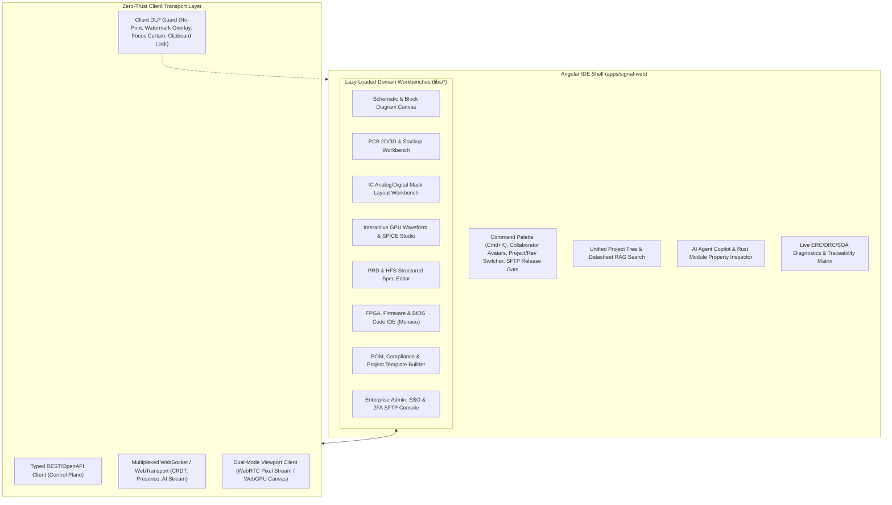

# 06 — Frontend (Angular) & Node.js Platform BFF Architecture

> **Scope:** Defines the web application architecture for Signal—built with **Angular** on the frontend and **Node.js (TypeScript)** for the Backend-for-Frontend (BFF) and SaaS Control Plane—delivering desktop-grade EDA ergonomics with zero local design files.

---

## 1. Frontend Architecture (Angular 19+ Web IDE)

Signal's UI must feel as fast, keyboard-driven, and precise as a native desktop EDA suite while running entirely inside a browser with zero local file persistence.

### 1.1 Architectural Principles
- **Modern Angular Core:** Standalone Components, **Angular Signals** for fine-grained reactive UI state (zero heavy zone-thrashing during 60 FPS cursor/probe updates), strict TypeScript (`strict: true`), and lazy-loaded domain workbench modules.
- **Zero-Persistence Client Rule:** Design data, schematics, netlists, layouts, waveforms, and specs are **NEVER** written to `localStorage`, `sessionStorage`, `IndexedDB`, Service Worker caches, or downloadable Blob URLs. Only non-sensitive UI preferences (dark/light theme, panel layout geometry, keyboard bindings) may persist.
- **Unified Multi-Domain IDE Shell:** One cohesive workspace shell hosting every product discipline without switching apps:
  - **Left Dock:** Unified Project Explorer (PRD, HFS, Schematics, PCB, IC, FPGA, Firmware, BIOS, Simulations, Releases), Component/Datasheet Browser, Net/Hierarchy Navigator, Layer Manager.
  - **Center Multi-Tab Dockable Canvas:** Split-screen cross-probing (e.g., Schematic on left + PCB 2D/3D on right + Live Waveform on bottom + Firmware pinmux code side-by-side—clicking a net highlights it across ALL open panes simultaneously!).
  - **Right Dock:** Context-sensitive Property & Rust Module Parameter Inspector (tolerances, TCR, parasitics, SOA limits) + **AI Agent Copilot Panel** (chat, speculative diff reviewer, autonomous verification progress, datasheet citations).
  - **Bottom Dock:** Real-time ERC/DRC/LVS/SOA Diagnostics Console, Simulation Output, Traceability Matrix, and Terminal/Build logs (read-only streamed from cloud worker pods).

### 1.2 Dual-Mode High-Performance Viewport Architecture

To satisfy both **extreme Enterprise Zero-Leak security** and **buttery-smooth 60 FPS CAD responsiveness**, Signal's viewport adapter supports two selectable organization policies:

| Aspect | Mode A: Enterprise Zero-Leak Stream (Default for Enterprise) | Mode B: Standard Ephemeral WebGPU (Local Dev / Optional Individual) |
|---|---|---|
| **Where Rendering Happens** | Server-side GPU (`signal-render` using `wgpu` inside the Project Pod). | Browser GPU (`WebGPU` / `WebGL2`) rendering ephemeral viewport-clipped display primitives. |
| **What Crosses the Network** | Encrypted, low-latency H.264/AV1 WebRTC video + lossless dirty-rect tiles with **server-burned visible + invisible forensic watermarks**. | Ephemeral viewport-only screen-space geometry tiles (no full netlists/models, zero browser storage). |
| **Raw IP Exposure in Browser** | **ZERO.** Inspecting DevTools Network or Browser RAM reveals only watermarked video pixels—never schematics, footprints, GDSII polygons, or netlists. | Minimal (clipped visual primitives only; no manufacturing or source models). |
| **Input Latency Optimization** | Client-side local crosshair/rubber-band cursor prediction + 120 Hz pointer intent streaming over WebRTC DataChannel / WebTransport → < 20 ms visual feedback. | Native 60–120 FPS local pan/zoom with server-authoritative edits. |

### 1.3 Domain-Specific Workbench Highlights
- **PRD & HFS Editor (`libs/specs`):** Block-structured document editor (Markdown + structured requirement tables + embedded live schematic/waveform snapshots) where every requirement gets a unique ID (`REQ-xxx`) directly linkable to circuits, tests, and firmware.
- **Interactive Waveform Studio (`libs/sim-viewer`):** Supports multi-axis Bode plots, Smith charts, eye diagrams, digital bus decoding, cursor deltas, FFT, and Monte Carlo histogram overlays—all backed by server-side GPU downsampling for instant zoom across billions of samples.
- **Embedded Code / HDL IDE (`libs/code-ide`):** Monaco-based editor for SystemVerilog, VHDL, C/C++, Rust, Device Tree, and SystemRDL, connected via Language Server Protocol (LSP) proxied over WebSocket to the Project Pod so code completion understands live schematic nets and registers!
- **Enterprise & Security Console (`libs/admin`):** Approval queue dashboard, SSO/SCIM configuration, BYOK KMS status, DLP policy switches, **2FA-gated Authorized SFTP Server management**, and tamper-evident audit log explorer.

---

## 2. Node.js Control Plane & BFF Architecture (`services/`)

Node.js (TypeScript, Node 22 LTS, **Fastify** or **NestJS** with strict schema validation via Zod/OpenAPI) acts as the web-facing control plane, cleanly decoupling SaaS workflows from the pure-Rust physics engine.

### 2.1 Service Decomposition

| Node.js Service | Primary Responsibilities | Backing Stores |
|---|---|---|
| **`api-gateway`** | TLS termination integration, JWT validation, CSRF/CSP security headers (`Cache-Control: no-store`), tenant rate limiting, request correlation IDs, strict block on any file-download MIME paths. | Redis |
| **`identity-org`** | Individual signup, **Enterprise Company Onboarding approval state machine**, corporate email domain verification, SAML 2.0 / OIDC SSO, SCIM sync, WebAuthn/FIDO2 + TOTP 2FA verification, RBAC/ABAC policy engine. | PostgreSQL, Redis |
| **`project-catalog`** | Project CRUD, multi-type Sub-Project hierarchy, extensible custom metadata schemas, Project Templates registry (official, enterprise, personal), cross-project search, revision/release tags. | PostgreSQL |
| **`session-broker`** | Stateful Project Pod lookup (`Redis`), invoking `signal-operator` on cold project open (with singleflight coalescing), **sticky WebSocket/WebTransport proxying** of all collaborators to the exact same Rust Pod, WebRTC signaling relay, AI Agent SSE/WS streaming bridge. | Redis, K8s Operator gRPC, Project Pod gRPC |
| **`sftp-egress`** | **2FA-gated Authorized SFTP destination management** (Enterprise + Individual profiles), SSH host-key fingerprint pinning, ED25519 key generation/custody via HSM/Vault, dual-approval release workflow, streaming encrypted bundles from Rust Pod directly to remote SFTP (zero local disk staging). | PostgreSQL, Vault/HSM, NATS Audit |
| **`audit-service`** | Consumes all security, identity, edit-commit, AI-approval, and SFTP-transfer events from NATS JetStream; hash-chains entries into an immutable, tamper-evident compliance ledger exportable to Enterprise SIEMs (Splunk/Datadog/Sentinel). | NATS JetStream, PostgreSQL, WORM S3 |

### 2.2 Why Node.js + Angular + Rust Is the Optimal Split
- **Shared TypeScript Contracts:** Frontend (`web/`) and Control Plane (`services/`) share auto-generated TypeScript types from `contracts/openapi/` and `contracts/proto/`, accelerating UI/SaaS iteration.
- **Zero Physics Logic in Node.js:** Node.js never parses schematics, evaluates SPICE equations, runs DRC, or touches raw unencrypted design artifacts—keeping the Node.js surface area lightweight, horizontally stateless, and easy to audit.
- **Non-Blocking Streaming Proxy:** Node.js excels at managing tens of thousands of concurrent WebSocket/SSE connections for collaboration presence, AI token streaming, and sticky routing to Rust Engine Pods.
