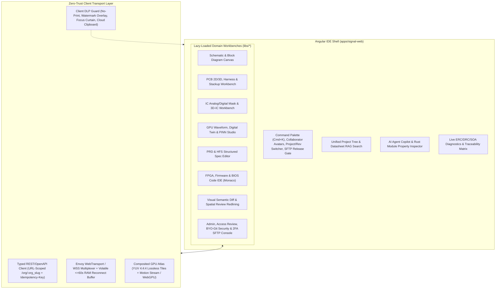

# 06 — Frontend (Angular) & Node.js Platform BFF Architecture

> **Scope:** Defines the web application architecture for Signal—built with **Angular** on the frontend and **Node.js (TypeScript)** for the Backend-for-Frontend (BFF) and SaaS Control Plane—delivering desktop-grade EDA ergonomics with zero local design files.

---

## 1. Frontend Architecture (Angular 19+ Web IDE)

Signal's UI must feel as fast, keyboard-driven, and precise as a native desktop EDA suite while running entirely inside a browser with zero local file persistence.

### 1.1 Architectural Principles
- **Modern Angular Core:** Standalone Components, **Angular Signals** for fine-grained reactive UI state (zero heavy zone-thrashing during 60 FPS cursor/probe updates), strict TypeScript (`strict: true`), and lazy-loaded domain workbench modules.
- **Zero-Persistence Client Rule:** Design data, schematics, netlists, layouts, waveforms, and specs are **NEVER** written to `localStorage`, `sessionStorage`, `IndexedDB`, Service Worker caches, or downloadable Blob URLs. Only non-sensitive UI preferences (dark/light theme, panel layout geometry, keyboard bindings) may persist.
- **Unified Multi-Domain IDE Shell:** One cohesive workspace shell hosting every product discipline without switching apps:
  - **Left Dock:** Unified Project Explorer (PRD, HFS, Schematics, PCB, IC, FPGA, Firmware, BIOS, Simulations, Releases), Component/Datasheet Browser, Net/Hierarchy Navigator, Layer Manager.
  - **Center Multi-Tab Dockable Canvas:** Split-screen cross-probing (e.g., Schematic on left + PCB 2D/3D on right + Live Waveform on bottom + Firmware pinmux code side-by-side—clicking a net highlights it across ALL open panes simultaneously!).
  - **Right Dock:** Context-sensitive Property & Rust Module Parameter Inspector (tolerances, TCR, parasitics, SOA limits) + **AI Agent Copilot Panel** (chat, speculative diff reviewer, autonomous verification progress, datasheet citations).
  - **Bottom Dock:** Real-time ERC/DRC/LVS/SOA Diagnostics Console, Simulation Output, Traceability Matrix, and Terminal/Build logs (read-only streamed from cloud worker pods).

### 1.2 Dual-Mode High-Performance Viewport & Firewall-Resilient Transport

To satisfy both **extreme Enterprise Zero-Leak security** and **razor-sharp, 60–120 FPS desktop CAD precision**, Signal's viewport adapter supports two organization-selectable policies:

| Aspect | Mode A: Enterprise Zero-Leak Hybrid Stream (Default for Enterprise) | Mode B: Standard Ephemeral WebGPU (Local Dev / `EXPLORER` / `MAKER`) |
|---|---|---|
| **Where Rendering Happens** | Server-side GPU (`signal-render` `wgpu` inside the Project MicroVM) compositing all open split-screen panes into **one unified Multi-Pane GPU Atlas** (preventing encoder session exhaustion!). | Browser GPU (`WebGPU` / `WebGL2`) rendering ephemeral viewport-clipped display primitives (or ultra-compact binary vector deltas on 3G links). |
| **CAD Sharpness (`YUV 4:4:4` Hybrid)** | **Zero Chroma Blur:** Transmits **lossless `AV1-SCC` / Lossless WebP `YUV 4:4:4` dirty-rect tiles at native HiDPI** so 1px colored wires and pin numbers are pixel-perfect; switches to 60–120 FPS motion video *only* during continuous 3D orbit/pan, snapping to a **crisp lossless settling frame within `80 ms`** of motion stop! | Native crisp local vector/mesh rasterization. |
| **Firewall Traversal & Reconnect** | Automatic **TURN-over-TLS 443 (`turns:`) → HTTP/3 WebTransport → HTTP/2 WSS Binary Tile Fallback** (works behind strict UDP-blocked corporate proxies!). Uncommitted pointer `GraphOp`s buffer in a **volatile JS RAM ring-buffer (`<= 60 s`, zero disk/IndexedDB!)** to survive Wi-Fi micro-drops seamlessly. | WebTransport / WSS with identical volatile RAM reconnect buffer. |
| **Input Latency & Memory Caps** | **120 FPS client-side predictive crosshair, selection box, pan matrix & ghost-wire overlay** + V8 heap protection (`cdk-virtual-scroll` trees, windowed Monaco buffers, `<= 4,096`-point decimated waveform envelopes). | Native 60–120 FPS local pan/zoom with server-authoritative edits. |

### 1.3 Accessibility, CAD Ergonomics & Workbench Highlights
- **Accessibility & Engineer Ergonomics:** Built-in **Color-Blind-Safe Okabe-Ito / High-Contrast Palettes + Procedural Layer Stipple/Hatch Patterns** (for deuteranopia/protanopia/tritanopia), switchable **KiCad / Altium / Virtuoso / Vim single-key hotkey maps**, CLI coordinate bar, **unambiguous SI unit confirmation pills (`10 mΩ` vs `10 MΩ`)**, **URL-scoped multi-org isolation (`/org/:org_slug/...`)**, and **Server-Side Encrypted Cloud Clipboard** (RBAC-checked copy/paste of verified subcircuits across projects without touching the OS clipboard!).
- **Visual Semantic Diff & Spatial Review (`libs/visual-diff`, `libs/review`):** Side-by-side / onion-skin graphical PR diffs across schematics, PCBs, waveforms, and register maps + **pin/coordinate-anchored review threads & live audio/cursor huddles** (eliminating screenshot-based Slack reviews).
- **PRD/HFS (`libs/specs`), Waveform/Digital-Twin Studio (`libs/sim-viewer`), Embedded Code/HDL IDE (`libs/code-ide`), and Admin/Access-Review/VCS-Security Console (`libs/admin`):** All lazy-loaded inside the same unified shell with **Progressive UI Profiles (`EXPLORER` / `MAKER` / `PRO` / `SILICON_SCALE`)**.

---

## 2. Node.js Control Plane & Envoy Zero-Copy Relay (`services/`)

Node.js (Node 22 LTS, strict TypeScript, Fastify/NestJS) owns SaaS control-plane orchestration, while **Envoy Gateway** handles zero-copy high-rate binary viewport/pointer pass-through (eliminating Node.js JSON/GC jitter on 120 Hz CAD streams).

### 2.1 Service Decomposition

| Service | Primary Responsibilities | Backing Stores |
|---|---|---|
| **`api-gateway` + `envoy`** | Hybrid PQC TLS 1.3, CSP nonces, `Cache-Control: no-store`, CSRF/CORS, rate limiting, fail-closed auth decorators, and zero-copy Ed25519-ticketed WebTransport/TURN stream relay. | Redis |
| **`identity-org`** | Provider OAuth 2.0 PKCE (`GitHub`/`GitLab`/`Bitbucket`) + Enterprise SAML/OIDC dual-identity binding, approval-gated Enterprise onboarding, WebAuthn/TOTP Step-Up 2FA (with TOTP replay burn-list), ≥2 Super Admin M-of-N break-glass recovery, and **Org & Project Admin Access Review Console** (with contractor `expires_at`). | PostgreSQL (RLS), Redis |
| **`project-catalog`** | Multi-repo Project & Sub-Project CRUD, extensible metadata, **SPDX license compatibility gate**, Project Templates, and Sovereign Jurisdiction pinning. | PostgreSQL (RLS) |
| **`vcs-connector`** | **2FA-gated BYO-Git settings** (`GitProviderAdapter` for GitHub/GitLab/Bitbucket + custom Root CA pinning), `<project>-meta` & `<project>-<type>` provisioning (bound by immutable `provider_repo_id`), GraphQL/`ETag` roster sync, and HMAC/replay-guarded webhook hints. | PostgreSQL (RLS), Vault/HSM, Redis |
| **`vcs-auditor`** | Scheduled (6h/daily) + webhook + pre-release **Multi-Provider Security Posture & Access-Drift Auditor** (public drift, unreviewed users, overdue contractors, 2FA/SSO, Secret Scanning, CVEs, Posture Score `0–100`, 2FA remediation). | PostgreSQL (RLS), Vault/HSM, NATS |
| **`session-broker`** | Singleflight K8s `Lease` + Redis sticky pod lookup, Ed25519 stream ticket issuance, instant user pod eviction, and **RBAC-verified cross-project encrypted cloud clipboard**. | Redis, K8s Operator gRPC, Project Pod gRPC |
| **`sftp-egress`** | **2FA-gated Authorized SFTP registry**, host-key pinning, socket-level anti-SSRF IP pinning, HSM `ED25519` keys, 4-eyes / 21 CFR Part 11 sign-off, and disposable `russh` atomic staging uploads (`.tmp.part` → SHA-256 verify → `rename`). | PostgreSQL (RLS), Vault/HSM, NATS |
| **`audit-service`** | Pseudonymous (GDPR crypto-shreddable PII) **RFC 3161 + `ML-DSA-65` Merkle-Tree Transparency Log** committed to S3 Object Lock (`COMPLIANCE` WORM) and streamed to Enterprise SIEMs. | NATS JetStream, PostgreSQL, WORM S3 |

### 2.2 Why Node.js + Envoy + Angular + Rust Is the Optimal Split
- **Shared TypeScript Contracts:** Frontend (`web/`) and Control Plane (`services/`) share build-time generated TypeScript types from `contracts/`, accelerating SaaS/UI iteration.
- **Zero Physics Logic & Zero Stream Bottleneck in Node.js:** Rust owns 100% of physics, geometry, and rendering; Envoy relays binary viewport streams zero-copy; Node.js stays horizontally stateless, fast, and auditable.
