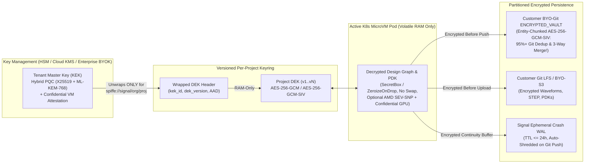
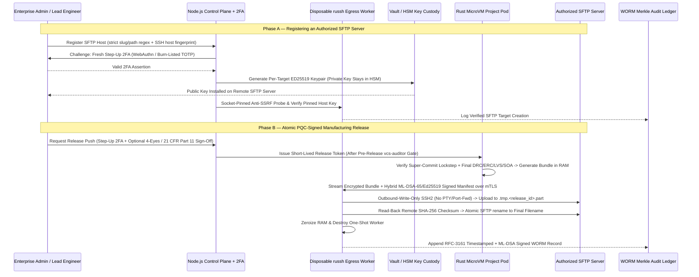

# 07 — Zero-Trust Security, Encryption, DLP & Authorized SFTP

> **Scope:** Defines Signal's end-to-end IP protection architecture—ensuring **zero local copies of design files**, **full encryption at rest and in transit**, **no export / no print / anti-screenshot controls**, and **2FA-mandatory Authorized SFTP** as the sole permitted channel to share or release design deliverables.  
> **Companion Spec:** For full OWASP ASVS L3 Application Security, MicroVM/eBPF/RLS **Complete Project Isolation**, anti-SSRF, AI prompt-injection defense, and CI security gates, see [`15-application-security-and-project-isolation.md`](./15-application-security-and-project-isolation.md).

---

## 1. Threat Model & Core Security Invariants

Hardware schematics, custom IC layouts, PDKs, firmware, and product specs are among the highest-value corporate trade secrets in the world. Signal is engineered around **five non-negotiable security invariants**:

1. **Zero Local Design Files:** No desktop client sync, no local save, no HTTP file download API, no browser storage (`IndexedDB` / `LocalStorage` / HTTP cache) of any design artifact.
2. **Encrypted Everywhere:** All persisted design snapshots, event logs, waveforms, PDKs, and specs use per-project AES-256-GCM envelope encryption backed by HSM/KMS (with Enterprise BYOK/HYOK). In-flight traffic uses TLS 1.3 externally and SPIFFE mTLS internally.
3. **RAM-Only Decryption inside Isolated Pods:** Plaintext project state exists *only* inside volatile RAM of the active Kubernetes Project Pod and is cryptographically scrubbed (`zeroize`) immediately upon session end.
4. **No Export, No Print, Anti-Screenshot DLP:** Direct browser export and printing are structurally absent; Enterprise Zero-Leak Mode renders viewports server-side on GPU with visible + invisible forensic watermarks so raw vectors/netlists never enter the browser.
5. **Authorized Secure SFTP Is the ONLY Egress:** Manufacturing files (Gerber/ODB++/IPC-2581/GDSII/BOM), firmware binaries, and spec packages can leave Signal *exclusively* via **2FA-registered, host-key-pinned Authorized SFTP servers** with an immutable cryptographic audit log.

---

## 2. Hybrid Post-Quantum & Convergent Envelope Encryption Architecture

### Cryptographic & Quantum-Safe Standards
- **Hybrid Post-Quantum Protection ("Harvest Now, Decrypt Later" Defense):** All external TLS 1.3, internal SPIFFE mTLS, and KMS key-encapsulation handshakes use **NIST FIPS 203 `ML-KEM-768` + `X25519`**; all release manifests and WORM audit roots use **NIST FIPS 204 `ML-DSA-65` + `Ed25519`**—protecting 20-year chip/defense trade secrets against future fault-tolerant quantum adversaries.
- **Convergent Chunked Vault Cipher (`AES-256-GCM-SIV`):** Inside `ENCRYPTED_VAULT` BYO-Git repositories, `signal-git-sync` encrypts canonical entities (`SignalEntityId` blocks) using `AES-256-GCM-SIV` derived from `(Project_DEK_vN, entity_id)` with `AAD = org_id || project_id || repo_id || dek_version`. Unchanged sheets/traces produce identical ciphertext chunks—**preserving 95%+ Git packfile deduplication and structural 3-way merges** while historical commits remain readable across DEK rotations via `(kek_id, dek_version)` headers!
- **`MUST_ENCRYPT` Taint Enforcement:** Foundry PDKs, IC mask layouts, and NDA component models carry an immutable `MUST_ENCRYPT` taint tag in `signal-core` that refuses plaintext serialization even if an Admin switches a repo to `PLAIN_CANONICAL`.
- **Enterprise BYOK/HYOK & Confidential Computing (`CONFIDENTIAL_SILICON`):** Supports customer-held HSM keys (< 10 s cryptographic kill switch) plus optional **AMD SEV-SNP / Intel TDX Confidential VMs + NVIDIA H100/B200 Confidential GPUs** where Vault/BYOK verifies hardware CPU/GPU memory-encryption attestation before releasing keys.

---

## 3. Anti-Export, Anti-Print & Collusion-Resistant Anti-Screenshot DLP

### 3.1 Zero Export / Zero Download & Encrypted Cloud Clipboard
- **Structural Absence:** There are **zero** HTTP endpoints returning Gerber, GDSII, schematic JSON, SPICE netlists, firmware archives, or PDF exports to a browser.
- **Provider Org/Repo User Gating + `ENCRYPTED_VAULT` Ciphertext Protection:** Only authenticated users present in the customer's GitHub Org, GitLab Group, or Bitbucket Workspace and listed on `<project>-meta` / `<project>-<type>` can view/edit them in Signal (reviewable live by Org & Project Admins). Under `ENCRYPTED_VAULT`, even an authorized repo member running `git clone` locally receives unreadable ciphertext, while `services/vcs-auditor` continuously scans for drift (see [`13-vcs-git-server-and-storage-analysis.md`](./13-vcs-git-server-and-storage-analysis.md)).
- **Clipboard Lockdown + Authorized Cloud Clipboard:** OS clipboard copy/cut/drag of CAD data is blocked in Enterprise Strict Mode; legitimate cross-project subcircuit reuse uses Signal's **Pod-to-Pod Encrypted Cloud Clipboard** (verifying `source:read` + `dest:write` RBAC + audit log—zero bytes touch the OS clipboard!).

### 3.2 Anti-Print Enforcement
- Global `@media print` blanking stylesheet, `Ctrl/Cmd+P` & `Ctrl/Cmd+S` interception, `window.print` override, and `beforeprint` canvas purge.

### 3.3 Multi-Layered Anti-Screenshot & Collusion-Resistant Watermarking

| Layer | Control Mechanism | What It Stops |
|---|---|---|
| **Layer 1: Zero-Raw-IP `YUV 4:4:4` Hybrid Stream** | Browser receives ONLY composited GPU `YUV 4:4:4` lossless dirty-tiles / motion frames from `signal-render`—never raw netlists, footprints, GDSII polygons, or source models. | Stops DevTools inspection, HAR capture, DOM scraping, memory dumping, and browser extension theft of raw CAD files. |
| **Layer 2: Tardos Collusion-Resistant Steganography & Micro-Jitter** | `signal-render` burns: (1) translucent session overlay (`user • IP • UTC • session_id`), (2) **Tardos-code spread-spectrum frequency-domain watermark** resilient to cropping, rotation, phone-camera moiré, and **multi-insider pixel-averaging collusion**, plus (3) **sub-pixel electrically-invariant label/wire-jog micro-jitter** unique per session! | Forensically attributes OS screenshots, screen recordings, colluding insider leaks, and smartphone photos back to the exact user and second. |
| **Layer 3: Browser Behavioral Deterrence** | Instant **Privacy Curtain** on `window.blur`, tab switch, DevTools detection, or `PrintScreen`; blocks `getDisplayMedia` capture; idle screen lock. | Blocks casual OS snipping tools and browser screen-recorders. |
| **Layer 4: Enterprise Secure Browser / MDM Enforcement** | Native hooks for **Chrome Enterprise Premium, Island, Talon**, and VDI/MDM enforcing **OS-kernel screenshot blocking** (`SetWindowDisplayAffinity` / macOS screen-capture denial / `FLAG_SECURE`) + optional hardware DRM (EME/Widevine L1). | Enforces hard OS-level screenshot & recording prevention on managed corporate endpoints. |

---

## 4. Authorized Secure SFTP-Only Sharing & Atomic Delivery

### 4.1 Mandatory Phishing-Resistant Step-Up 2FA
- **Enterprise & Individual Parity:** Registering, editing, rotating keys on, deleting, or pushing to ANY SFTP server requires **fresh Step-Up 2FA** (**WebAuthn/FIDO2 Passkey** strongly preferred; RFC 6238 TOTP supported with `±1` step skew tolerance + **Redis single-use TOTP nonce burn-list** preventing 90-second replay; SMS disallowed).

### 4.2 Atomic & Sandboxed SFTP Onboarding & Release Flow

### 4.3 SFTP Hardening Against Partial Writes, Path Traversal & Hostile Servers
- **Atomic `.tmp.part` → Verify → `rename`:** Eliminates half-written corrupted Gerbers/GDSII in foundry pickup folders; supports resumable chunk retries.
- **Disposable Memory-Safe `russh` Workers:** Written in pure safe Rust (`russh`), executing each transfer inside a one-shot sandbox with **port forwarding, X11, agent forwarding, PTY, and arbitrary file-read disabled** (defeating hostile/compromised remote SFTP servers), plus **socket-level anti-SSRF IP pinning** on every `connect()`.
- **Host-Key Pinning, Static NAT Egress IPs, HSM `ED25519` Keys, Optional Fab PGP Encryption, 4-Eyes Approval, and Artifact-Type Target Scoping** (`IC_GDSII` vs `PCB_ODBPP`).

---

## 5. GDPR-Safe Pseudonymous WORM Merkle Audit Ledger

Every security-critical event streams into an **RFC 3161 trusted-timestamped, `ML-DSA-65`-signed Merkle-Tree Transparency Log** stored in **S3 Object Lock (`COMPLIANCE` WORM mode)**. To reconcile immutable WORM storage with **GDPR Right-to-Erasure**, WORM records reference immutable `user_uuid` + `provider_user_id` pseudonyms while personal names/emails reside in a separately encrypted PII lookup table—enabling lawful per-user PII crypto-shredding without ever breaking cryptographic hash-chain integrity (`SOC 2 Type II`, `ISO 27001`, `TISAX`, `21 CFR Part 11`, `ITAR/EAR`).
