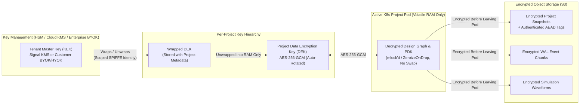
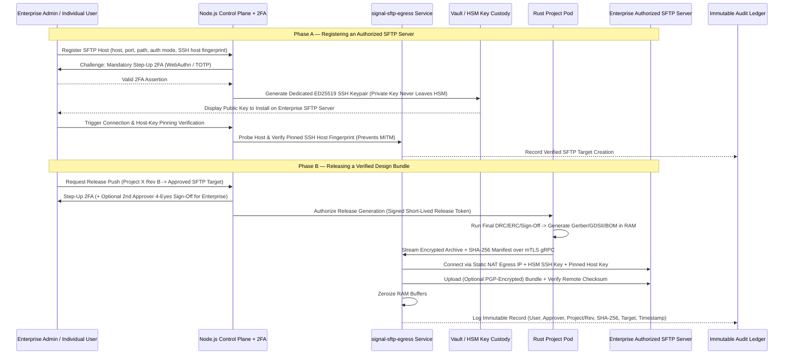

# 07 — Zero-Trust Security, Encryption, DLP & Authorized SFTP

> **Scope:** Defines Signal's end-to-end IP protection architecture—ensuring **zero local copies of design files**, **full encryption at rest and in transit**, **no export / no print / anti-screenshot controls**, and **2FA-mandatory Authorized SFTP** as the sole permitted channel to share or release design deliverables.

---

## 1. Threat Model & Core Security Invariants

Hardware schematics, custom IC layouts, PDKs, firmware, and product specs are among the highest-value corporate trade secrets in the world. Signal is engineered around **five non-negotiable security invariants**:

1. **Zero Local Design Files:** No desktop client sync, no local save, no HTTP file download API, no browser storage (`IndexedDB` / `LocalStorage` / HTTP cache) of any design artifact.
2. **Encrypted Everywhere:** All persisted design snapshots, event logs, waveforms, PDKs, and specs use per-project AES-256-GCM envelope encryption backed by HSM/KMS (with Enterprise BYOK/HYOK). In-flight traffic uses TLS 1.3 externally and SPIFFE mTLS internally.
3. **RAM-Only Decryption inside Isolated Pods:** Plaintext project state exists *only* inside volatile RAM of the active Kubernetes Project Pod and is cryptographically scrubbed (`zeroize`) immediately upon session end.
4. **No Export, No Print, Anti-Screenshot DLP:** Direct browser export and printing are structurally absent; Enterprise Zero-Leak Mode renders viewports server-side on GPU with visible + invisible forensic watermarks so raw vectors/netlists never enter the browser.
5. **Authorized Secure SFTP Is the ONLY Egress:** Manufacturing files (Gerber/ODB++/IPC-2581/GDSII/BOM), firmware binaries, and spec packages can leave Signal *exclusively* via **2FA-registered, host-key-pinned Authorized SFTP servers** with an immutable cryptographic audit log.

---

## 2. Cryptographic & Envelope Encryption Architecture

### Cryptographic Standards
- **Data-at-Rest Cipher:** `AES-256-GCM` with unique 96-bit random nonces per chunk and Additional Authenticated Data (`AAD = org_id || project_id || artifact_id || revision`) to prevent ciphertext substitution attacks.
- **Enterprise BYOK / HYOK:** Enterprise tenants can bind their own AWS KMS, Azure Key Vault, Google Cloud KMS, or on-prem HSM (Hold Your Own Key). If an Enterprise revokes their key, every Project Pod immediately loses decryption capability and terminates active sessions within seconds ("Cryptographic Kill Switch").
- **Database Column Encryption:** Sensitive fields in PostgreSQL (SFTP credentials/host metadata, SSO secrets, 2FA TOTP seeds) are encrypted at the application layer with Vault Transit keys before database insertion.
- **Transport Security:** TLS 1.3 (strict cipher suites, HSTS preload) at the edge; mutual TLS (mTLS) with automatic 1-hour certificate rotation via SPIFFE/SPIRE across every internal service and Kubernetes pod.

---

## 3. Anti-Export, Anti-Print & Anti-Screenshot DLP Controls

Signal applies **defense-in-depth Data Loss Prevention (DLP)** across backend, transport, and browser layers—while remaining architecturally transparent about physical/OS boundaries.

### 3.1 Zero Export / Zero Download Enforcement
- **Structural Absence:** There are **zero** HTTP endpoints returning Gerber, GDSII, schematic JSON, SPICE netlists, firmware archives, or PDF exports to a user's browser.
- **Zero External `git clone` (Enterprise & Private Projects):** Every Project lives in its own AES-256-GCM encrypted repository inside internal `signal-vcs` (`jj-lib` + `gitoxide`). External `git clone`, `git pull`, and ZIP downloads are structurally disabled for Enterprise and Private projects; only authenticated Project Pods fetch objects into volatile RAM over SPIFFE mTLS. Optional `github.com` mirroring is strictly restricted to opted-in `PUBLIC_OPEN_HARDWARE` community/student projects and is structurally locked OFF for Enterprise tenants (see [`13-vcs-git-server-and-storage-analysis.md`](./13-vcs-git-server-and-storage-analysis.md)).
- **API & Header Hardening:** Every API response carries `Cache-Control: no-store, no-cache, must-revalidate, private`, `Pragma: no-cache`, and strict Content-Security-Policy (`CSP`) disallowing data exfiltration to unauthorized origins.
- **Clipboard & Drag-Drop Lockdown:** Copy/cut/drag-export of schematic blocks, netlists, code files, and spec text to the OS clipboard is disabled in Enterprise Strict Mode (internal in-app clipboard lives strictly inside the Rust Project Pod!).

### 3.2 Anti-Print Enforcement
- Global print suppression stylesheet (`@media print { html, body { display: none !important; visibility: hidden !important; } }`) paired with a watermarked blank notice (`"Printing is disabled by Signal Security Policy"`).
- Keyboard shortcut interception (`Ctrl+P`, `Cmd+P`, `Ctrl+S`, `Cmd+S`), `window.print` override, and `beforeprint` event blanking.

### 3.3 Multi-Layered Anti-Screenshot & Anti-Capture Architecture

> **Architectural Honesty Note:** No standard consumer web browser alone can physically block an external smartphone camera or a privileged OS kernel screenshot tool. Signal therefore combines **four complementary layers** to eliminate silent IP theft and achieve Enterprise/ITAR-grade deterrence and enforcement:

| Layer | Control Mechanism | What It Stops |
|---|---|---|
| **Layer 1: Zero-Raw-IP Pixel Streaming** | In Enterprise Zero-Leak Mode, the browser NEVER receives vector geometry, component netlists, GDSII layers, or source text buffers—only an encrypted, resolution-capped WebRTC/WebTransport render stream from the Rust GPU Pod. | Stops DevTools inspection, HAR capture, DOM scraping, memory dumping, and browser extension theft of raw CAD files. |
| **Layer 2: Server-Burned Visible & Invisible Forensic Watermarks** | `signal-render` burns two watermarks directly into GPU frames *before* transmission: (1) subtle translucent diagonal overlay (`user@company.com • IP • UTC timestamp • session_id`), and (2) **imperceptible steganographic watermark** resilient to cropping, compression, and even **smartphone photos of the monitor**, allowing leaked images to be traced cryptographically back to the exact user and second! | Strongly deters and forensically attributes OS screenshots, screen recordings, and phone-camera photos. |
| **Layer 3: Browser Behavioral Deterrence** | Instant **Privacy Curtain** (blurs/blanks canvas immediately on `window.blur`, tab switch, DevTools open detection, or `PrintScreen` key), blocks `navigator.mediaDevices.getDisplayMedia` capture prompts inside the app, and enforces idle screen lock. | Blocks casual OS snipping tools (`Cmd+Shift+4`, Windows Snipping Tool focus-steal) and browser screen-recorders. |
| **Layer 4: Enterprise Managed Endpoint / Secure Browser Enforcement** | Native integration hooks for **Enterprise Secure Browsers** (Chrome Enterprise Premium, Island, Talon) and Managed VDI/MDM policies that enforce **OS-level screenshot blocking** (`FLAG_SECURE` / macOS screen-capture denial / Windows `SetWindowDisplayAffinity`), plus optional hardware-DRM protected video frames (EME/Widevine L1). | Enforces hard OS-level screenshot & screen-recording prevention on managed corporate devices. |

---

## 4. Authorized Secure SFTP-Only Sharing & Manufacturing Delivery

Because organizations *must* eventually send verified Gerbers to PCB fabs, GDSII files to silicon foundries, or firmware binaries to contract manufacturers, Signal provides **one rigorously controlled, audited egress channel: Authorized Secure SFTP**.

### 4.1 Who Can Configure SFTP Servers (Mandatory 2FA!)
- **Enterprise Accounts:** Only authorized **Enterprise Admins** (or delegated **Security Officers**) can add, modify, verify, or disable organization-wide or project-scoped SFTP destinations.
- **Individual Accounts:** Individual users can add authorized SFTP servers to their personal profile.
- **NON-NEGOTIABLE 2FA GATE:** Adding, editing, rotating keys on, or deleting ANY SFTP server—for **both Enterprise Admins and Individual users**—strictly requires **fresh Step-Up 2-Factor Authentication** (WebAuthn/FIDO2 hardware Passkey OR TOTP Authenticator app; SMS is disallowed as a primary SFTP 2FA factor due to SIM-swap risk).

### 4.2 Authorized SFTP Onboarding & Release Flow

### 4.3 SFTP Security Hardening Features
- **Host-Key Pinning:** Strict verification of the remote server's SSH host fingerprint (`SHA256:...`); any unexpected fingerprint change immediately aborts transmission and alerts Security Officers.
- **Static Outbound Egress IPs:** Signal's `signal-sftp-egress` cluster routes through dedicated, published static NAT IPs so enterprises can firewall their SFTP servers to accept connections *exclusively* from Signal.
- **HSM-Backed SSH Keys:** Signal generates a unique `ED25519` keypair per SFTP target inside HSM/Vault—private keys are never exposed in plaintext. (Password-only SFTP is discouraged/blocked by default in Enterprise mode.)
- **Optional Payload PGP Encryption:** Enterprises can upload their manufacturing partner's PGP public key so Signal automatically PGP-encrypts the Gerber/GDSII/BOM archive *before* writing bytes to the SFTP server.
- **Dual-Control (4-Eyes) Release Policy:** Enterprise Admins can require a second authorized reviewer (e.g., Lead Engineer + Quality/Security Officer) to co-sign with 2FA before any design package leaves Signal.
- **Target Scoping:** SFTP destinations can be scoped per-Project or per-Artifact Type (e.g., `"TSMC Foundry SFTP"` accepts ONLY `IC_GDSII` releases; `"PCB Fab SFTP"` accepts ONLY `PCB_GERBER/ODB++`).

---

## 5. Immutable Audit & Compliance Readiness

Every security-critical event—login, SSO assertion, Enterprise approval, 2FA enrollment, SFTP server addition, project open, AI merge approval, DLP alert (e.g., repeated focus-loss/print attempt), and SFTP push—is written to an **append-only, cryptographically hash-chained audit ledger** backed by WORM (Write-Once-Read-Many) object storage, ready for **SOC 2 Type II, ISO 27001, TISAX (Automotive), and ITAR/EAR** enterprise deployments.
