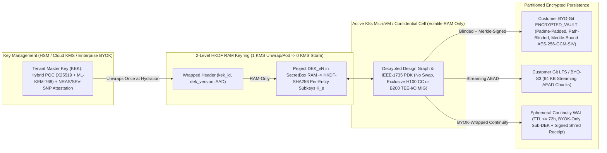
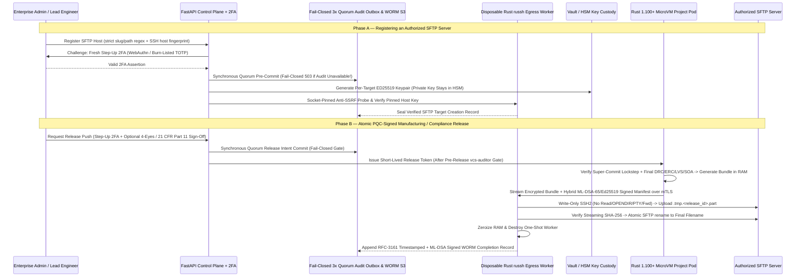

# 07 — Zero-Trust Security, Encryption, DLP & Authorized SFTP

> **Scope:** Defines Signal's end-to-end IP protection architecture—ensuring **zero local copies of design files**, **full encryption at rest and in transit**, **no export / no print / anti-screenshot controls**, and **2FA-mandatory Authorized SFTP** as the sole permitted channel to share or release design deliverables.  
> **Companion Spec:** For full OWASP ASVS L3 Application Security, MicroVM/eBPF/RLS **Complete Project Isolation**, anti-SSRF, AI prompt-injection defense, and CI security gates, see [`15-application-security-and-project-isolation.md`](./15-application-security-and-project-isolation.md).

---

## 1. Threat Model & Core Security Invariants

Hardware schematics, custom IC layouts, PDKs, firmware, and product specs are among the highest-value corporate trade secrets in the world. Signal is engineered around **five non-negotiable security invariants**:

1. **Zero Local Design Files:** No desktop client sync, no local save, no HTTP file download API, no browser storage (`IndexedDB` / `LocalStorage` / HTTP cache) of any design artifact.
2. **Encrypted Everywhere:** All persisted design snapshots, event logs, waveforms, PDKs, and specs use per-project AES-256-GCM envelope encryption backed by HSM/KMS (with Enterprise BYOK/HYOK). In-flight traffic uses TLS 1.3 externally and SPIFFE mTLS internally.
3. **RAM-Only Decryption inside Isolated Pods:** Plaintext project state exists *only* inside volatile RAM of the active Kubernetes Project Pod and is cryptographically scrubbed (`zeroize`) immediately upon session end.
4. **No Export, No Print, Anti-Screenshot DLP:** Direct browser export and printing are structurally absent; Enterprise Zero-Leak Mode renders viewports server-side on GPU with visible + invisible forensic watermarks so raw vectors/netlists never enter the browser.
5. **Authorized Secure SFTP Is the ONLY Egress:** Manufacturing files (Gerber/ODB++/IPC-2581/GDSII/BOM), firmware binaries, and spec packages can leave Signal *exclusively* via **2FA-registered, host-key-pinned Authorized SFTP servers** with an immutable cryptographic audit log.

---

## 2. Hybrid Post-Quantum & Convergent Envelope Encryption Architecture

### Cryptographic, Quantum-Safe & Side-Channel-Hardened Standards
- **Hybrid Post-Quantum Protection ("Harvest Now, Decrypt Later" Defense):** All external TLS 1.3, internal SPIFFE mTLS, and KMS key-encapsulation handshakes use **NIST FIPS 203 `ML-KEM-768` + `X25519`**; all release manifests, `.signal/vault.merkle.sig` trees, and WORM audit roots use **NIST FIPS 204 `ML-DSA-65` + `Ed25519`**.
- **Padmé-Padded, Path-Blinded, Merkle-Bound Convergent Vault (`AES-256-GCM-SIV` — Unified with `13`):**
  - **2-Level `HKDF` Key Hierarchy (Zero KMS `429` Storms):** KMS/BYOK unwraps `DEK_vN` **once at Pod Hydration** into `SecretBox` RAM (with a `60 s` async BYOK lease heartbeat). Per-entity keys derive locally in nanoseconds via $K_e = \text{HKDF-SHA256}(\text{DEK}_v, \text{provider\_repo\_id} \parallel \text{entity\_id})$ with domain nonce $N_e = \text{Trunc}_{96}(\text{HMAC-SHA256}(\text{EpochSalt}, \text{CanonicalChunk}))$ under RFC 8452 `AES-256-GCM-SIV`.
  - **Padmé Length-Hiding Padding & Blinded Git Paths:** Canonical chunks are padded via **Padmé** ($O(\log\log L)$ leaked bits, `<= 12%` overhead) before encryption to defeat standard-cell/IP byte-size fingerprinting, and stored at **HMAC-blinded Git paths (`blobs/b7/3f9a...sigv`)** so repository file trees never leak `"seeker_radar_core.sch"`.
  - **Anti-Rollback Commit Merkle Binding:** Every commit writes an `ML-DSA-65`-signed `.signal/vault.merkle.sig` binding the exact `(entity_id -> chunk_tag_hash)` map to the parent commit chain—instantly detecting and rejecting single-entity rollback or cherry-pick tampering on GitHub!
  - **Verifiable Continuity WAL Crypto-Shredding:** Ephemeral `<= 72h` Crash/Git-Outage WAL segments use a per-session sub-DEK wrapped **exclusively** by Customer BYOK/KMS and emit an `ML-DSA`-signed **Crypto-Shred Receipt** to the WORM ledger upon `Super-Commit` Git CAS.
- **`MUST_ENCRYPT` Taint Enforcement:** Foundry PDKs, IEEE 1735 blocks, IC mask layouts, and NDA models carry an immutable `MUST_ENCRYPT` taint tag in `signal-core` that refuses plaintext serialization even in `PLAIN_CANONICAL` repos.
- **Hardware-Accurate `CONFIDENTIAL_SILICON` Matrix:** Supports customer-held HSM keys (`< 10 s` kill switch) plus **AMD SEV-SNP / Intel TDX Confidential VMs** paired with either **Exclusive Whole-GPU NVIDIA Hopper `H100 CC`** (with mandatory PCIe FLR / GPU CC reset scrubbing VRAM, since Hopper hardware prohibits `MIG + CC`) OR **NVIDIA Blackwell `B200`/`GB200` `TEE-I/O` Confidential MIG Slices** attested via NVIDIA `NRAS` SPDM quotes!

---

## 3. Anti-Export, Anti-Print & AI-Stripper-Resistant DLP

### 3.1 Zero Export / Zero Download & Encrypted Cloud Clipboard
- **Structural Absence:** Zero HTTP endpoints return Gerber, GDSII, schematic JSON, SPICE netlists, firmware archives, or PDF downloads to a browser. Legitimate external compliance dossiers (UL/TÜV/FCC/ISO-26262) and ECAD-MCAD (`STEP`/`IDX`) partner baselines generate strictly in Pod RAM and egress **exclusively via Step-Up 2FA + 4-Eyes Authorized SFTP**!
- **Provider Org/Repo User Gating + Blinded `ENCRYPTED_VAULT`:** Only authorized Org/Repo users can view/edit Sub-Projects in Signal; local `git clone` yields path-blinded, Padmé-padded ciphertext.
- **Authorized Pod-to-Pod Cloud Clipboard:** Cross-project subcircuit reuse uses RBAC-verified server-side encrypted tickets (`source:read` + `dest:write` + audit log—zero bytes touch the OS clipboard!).

### 3.2 Anti-Print Enforcement
- Global `@media print` blanking stylesheet, `Ctrl/Cmd+P` & `Ctrl/Cmd+S` interception, `window.print` override, and `beforeprint` canvas purge.

### 3.3 Multi-Layered Anti-Screenshot, Constellation Watermarking & Pan-Scrape Defense

| Layer | Control Mechanism | What It Stops |
|---|---|---|
| **Layer 1: Zero-Raw-IP Dual-Plane Stream + `60 s` Rolling Key** | Browser receives ONLY composited `Zstd-QOI`/Lossless `WebP` dirty tiles & hardware video frames encrypted with a `60 s` rolling heartbeat key (canvas wipes to black within `500 ms` of heartbeat loss) + **Server-Side Pan/Tile-Harvesting Rate Anomaly Freeze**. | Stops DOM/HAR/memory scraping, unattended stale screens, and automated pan-and-scrape die harvesting bots. |
| **Layer 2: Topological Constellation + Tardos Watermarking** | `signal-render` embeds: (1) translucent session overlay, (2) **Tardos-code spread-spectrum steganography** (multi-insider collusion resistant), AND (3) **Topological/Geometric Constellation Micro-Perturbations** (`±1–2 px` Tardos-keyed wire-jog knees, resistor zig-zag phase, label kerning, via-stitch phase)! | **Survives AI diffusion watermark-removal models, vector re-tracing, B&W photocopying, and smartphone camera distortion**, attributing leaks to the exact user and session. |
| **Layer 3: Browser Deterrence Curtain** | Instant **Privacy Curtain** on `window.blur`, tab switch, DevTools detection, or `PrintScreen`; blocks `getDisplayMedia`. *(Explicitly scoped as casual deterrence—not relied upon against HDMI capture cards!)* | Blocks casual OS snipping tools and browser screen-recorders. |
| **Layer 4: Mandatory Attested Enterprise Browser / MDM (`HIGH_SECURITY` / `ITAR`)** | Pre-session **mTLS Device Posture Check** requiring **Chrome Enterprise Premium, Island, Talon**, or managed VDI enforcing **OS-kernel screen-capture lock** (`SetWindowDisplayAffinity` / macOS screen-capture denial / `FLAG_SECURE`) before `session-broker` issues a stream ticket! | Enforces kernel-level screenshot & screen-recording prevention on managed corporate endpoints. |

---

## 4. Authorized Secure SFTP-Only Sharing & Fail-Closed Delivery

### 4.1 Mandatory Phishing-Resistant Step-Up 2FA
- **Enterprise & Individual Parity:** Registering, editing, rotating keys on, deleting, or pushing to ANY SFTP server (manufacturing fab, OSAT, certification lab, or MCAD partner) requires **fresh Step-Up 2FA** (**WebAuthn/FIDO2 Passkey** preferred; RFC 6238 TOTP with `±1` step skew + **Redis atomic TOTP nonce burn-list**; SMS disallowed).

### 4.2 Atomic & Sandboxed SFTP Onboarding & Release Flow

### 4.3 SFTP Hardening Against Partial Writes, Path Traversal & Hostile Servers
- **Atomic `.tmp.part` → Verify → `rename`:** Eliminates half-written Gerbers/GDSII in foundry pickup folders; supports resumable chunk retries.
- **Disposable Write-Only `russh` Workers:** Pure safe Rust (`russh`) one-shot sandboxes with **port forwarding, X11, agent forwarding, PTY, `SSH_FXP_READ`, and `OPENDIR` disabled**, plus **socket-level anti-SSRF IP pinning** on every `connect()`.
- **Host-Key Pinning, Static NAT Egress IPs, HSM `ED25519` Keys, Optional Fab PGP Encryption, 4-Eyes Approval, Active `Deviation`/`Waiver` Quantity/Expiry Gate (`19-*`), and Artifact-Type Target Scoping** (`IC_GDSII` | `PCB_ODBPP` | `REGULATORY_DOSSIER` | `MCAD_STEP_DXF` | `CAM_GCODE` | `PRINT_3MF` | `PLM_ECN_MCN_TURNKEY`).

---

## 5. Fail-Closed Synchronous Outbox & GDPR-Safe Pseudonymous WORM Audit Ledger

Tier-0 security operations (`SFTP Release`, `VCS Credential Mutation`, `Access Review Revocation`, `Break-Glass Quorum`, `BYOK Policy Change`) write synchronously to a **3-replica quorum transactional outbox BEFORE executing**—failing closed (`503`) if the audit pipeline is unreachable so an unlogged egress can never occur. Records seal every 60s into an **RFC 3161 trusted-timestamped, `ML-DSA-65`-signed Merkle-Tree Transparency Log** on **S3 Object Lock (`COMPLIANCE` WORM mode)** using pseudonymous `actor_pseudo_id = HMAC-SHA256(org_audit_salt, provider_user_id)` with erasable PII vault mapping for full **GDPR Article 17** compliance alongside `SOC 2 Type II`, `ISO 27001`, `TISAX`, `21 CFR Part 11`, and `ITAR/EAR`.
