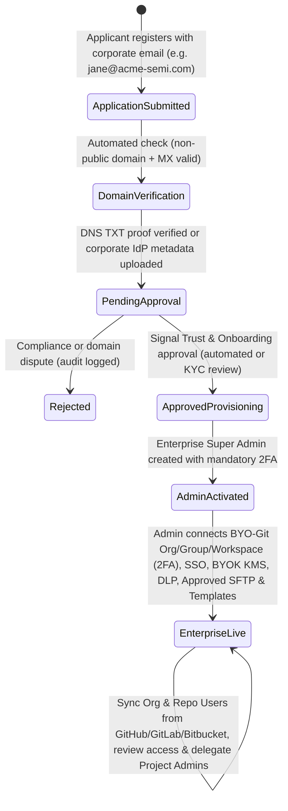
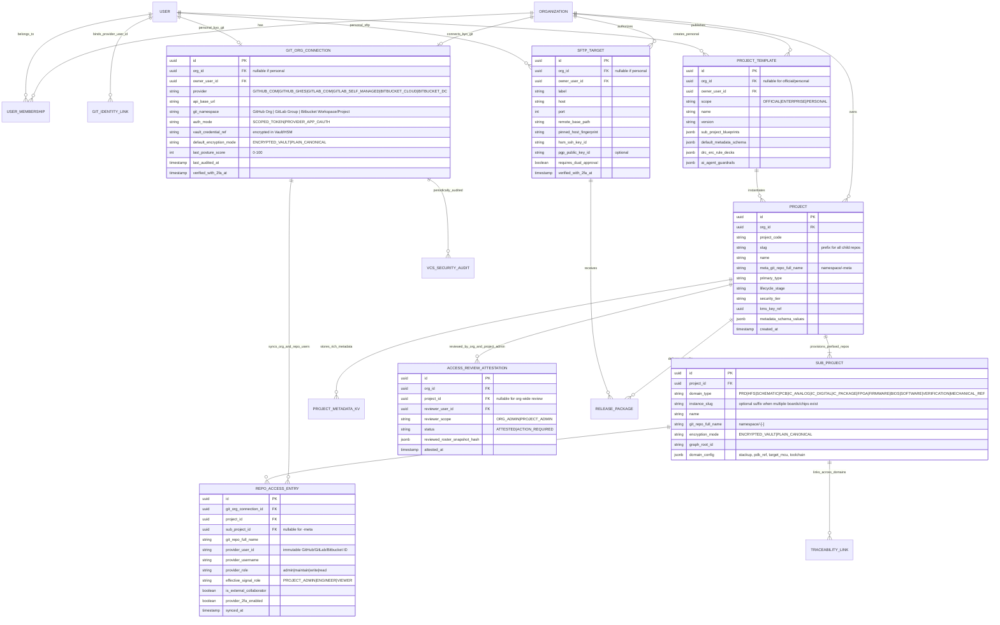

# 08 — Identity, Provider-Synced Access Review, Multi-Type Projects & Templates

> **Scope:** Defines Signal's account tiers, approval-gated **Enterprise Onboarding**, **GitHub/GitLab/Bitbucket Org & Repo-driven user authentication & access control**, the **Org Admin & Project Admin Access Review Console**, the **Multi-Repo Multi-Type Project** data model (`<project>-meta` + `<project>-<type>` repositories), and the **Project Templates** engine.

---

## 1. Account Types & Provider-Driven Authentication

Signal supports three operational identities:
1. **Individual Accounts:** Independent engineers, students, researchers, and makers.
   - Sign in via **GitHub**, **GitLab**, or **Bitbucket** OAuth 2.0 / OIDC (or email + passkey linked to their verified `provider_user_id`).
   - Connect a personal GitHub Org, GitLab Group, or Bitbucket Workspace, create personal Project Templates, and configure **personal Authorized SFTP servers (gated by mandatory 2FA)**.
2. **Enterprise / Company Accounts:** Hardware companies, semiconductor firms, automotive/aerospace/medical OEMs.
   - Created using a **verified corporate email domain** (blocks consumer domains during Enterprise creation) with **Approval-Based Super Admin Provisioning**.
   - Engineers authenticate via **GitHub / GitLab / Bitbucket OAuth/OIDC** and/or **Enterprise SAML 2.0 / OIDC SSO** linked to their immutable Git provider user ID (`provider_user_id`), so Signal enforces **live Org & Repository membership** from the connected Git provider on every project!
3. **Local Development Guest Mode (Strictly `SIGNAL_ENV=local` Only):**
   - Pre-seeded user **`Guest`** under organization **`Signal Design, Inc.`** for zero-friction local Mac development (see [`09-local-development-environment.md`](./09-local-development-environment.md)). Compile-time and runtime guards prevent activation in staging or production.

### 1.1 Enterprise / Company Onboarding State Machine

---

## 2. Provider-Backed Authorization & Admin Access Review

### 2.1 Authoritative Org + Repository Access Gate ("Only Authorized Git Users Can View the Project")
Signal uses the connected **GitHub Organization**, **GitLab Group**, or **Bitbucket Workspace/Project** and each repository's user list as the **single source of truth** for who can view or edit a Project and its Sub-Projects:

- **Zero Unauthorized Visibility:** A user can list or open Project `P` in Signal **ONLY IF** their verified `provider_user_id` is:
  1. An authorized member of the connected Organization/Group/Workspace (or an org-policy-approved external collaborator), **AND**
  2. Explicitly granted access on `<project-slug>-meta` and/or one or more `<project-slug>-<type>` repositories!
- **Per-Sub-Project Isolation via Prefixed Repos:** Because every added Project Type has its own repository (`<project>-prd`, `<project>-schematic`, `<project>-pcb`, `<project>-ic-analog`, `<project>-firmware`, `<project>-bios`), granting an engineer or external contractor repo access ONLY to `<project>-pcb` restricts them in Signal strictly to the PCB workbench—the Rust Project Pod filters out every other Sub-Project subgraph!
- **Real-Time Sync & Instant Pod Eviction:** Synced continuously via provider webhooks + 15-minute reconciliation + fresh verification on every `session/attach`. Removing a user from the Org or from a repo immediately revokes their Signal ticket and evicts their live WebSocket/WebRTC stream from the active Kubernetes Project Pod.

### 2.2 Provider Repo Role → Effective Signal Role Mapping

| GitHub Repo Role | GitLab Project Role | Bitbucket Repo Role | Effective Signal Role (Scoped to That Project / Sub-Project Repo) |
|---|---|---|---|
| `admin` / `maintain` | `Owner` / `Maintainer` | `admin` | **Project / Sub-Project Admin** — manage metadata, add Sub-Project types, **review project access list**, approve AI merges, initiate 2FA SFTP releases |
| `write` (`push`) | `Developer` | `write` | **Domain Engineer** — edit assigned Sub-Project(s), run simulations, collaborate with AI Agents, open PR/MRs |
| `triage` / `read` (`pull`) | `Reporter` / `Guest` | `read` | **Viewer / Reviewer** — read-only live probes, canvas review comments, traceability inspection; zero edit rights |
| *Not on repo user list* | *Not on project member list* | *Not on repo user list* | **DENY (`403 Forbidden`)** — Project / Sub-Project completely hidden |

*(Organization-level governance roles — **Enterprise Super Admin**, **Security & Compliance Officer**, **Template & Library Steward**, and **Auditor** — are layered cleanly above repo roles and support strict Separation of Duties.)*

### 2.3 Organization Admin & Project Admin Access Review Console
Both **Organization Admins** and **Project Admins** have a dedicated, live **Access Review Console** inside Signal:

- **Organization Admin Access Review (`/admin/access-review`):**
  - Unified roster of EVERY member, team, and external/outside collaborator synced from GitHub / GitLab / Bitbucket across ALL Projects and ALL `<project>-<type>` repositories.
  - Columns: User display name, immutable `provider_user_id` & handle, verified email, Org/Group role, Team memberships, expandable per-Project & per-Repo permission matrix, Git provider 2FA status, last active Signal session, and Attestation status (`Attested` / `Review Due` / `Unreviewed Drift`).
- **Project Admin Access Review (`/projects/:id/access-review`):**
  - Scoped to that single Project (`<project>-meta`) and **every child `<project>-<type>` repository** under it.
  - Instantly highlights **cross-repo permission anomalies** (e.g., an external PCB layout contractor who should only have `<project>-pcb` accidentally appearing on `<project>-bios` or `<project>-ic-analog`).
  - Supports **Periodic Compliance Attestation Sign-Off** (recorded in the immutable audit ledger for ISO 27001 / SOC 2 / ITAR) and **Step-Up 2FA-Gated Revocation** (removes the user directly from the target repo via `GitProviderAdapter` and evicts any active pod session immediately!).

---

## 3. Unified Multi-Type, Multi-Repo Project & Metadata Model

Inside Signal, the user creates **one unified Project** representing the entire product—and as each Project Type is added under it, Signal automatically creates a cleanly prefixed repository (`<namespace>/<project-slug>-<type>`) inside the connected GitHub Org / GitLab Group / Bitbucket Workspace while mounting them together into one seamless Kubernetes Project Pod.

### 3.1 Example: Single Signal Project → Neatly Prefixed Multi-Repo Tree
Creating Signal Project **`"ev-inverter-400v"`** inside organization **`acme-hw`** creates:
- `acme-hw/ev-inverter-400v-meta` — Project metadata, rules, AVL policy, unified traceability graph
- `acme-hw/ev-inverter-400v-prd` — Product Requirements (`REQ-001..240` with ISO-26262 ASIL-D tags)
- `acme-hw/ev-inverter-400v-hfs` — Hardware Functional Spec (power/clock trees, isolation barriers)
- `acme-hw/ev-inverter-400v-schematic-power` & `acme-hw/ev-inverter-400v-schematic-ctrl`
- `acme-hw/ev-inverter-400v-pcb-power` & `acme-hw/ev-inverter-400v-pcb-ctrl`
- `acme-hw/ev-inverter-400v-ic-analog` — Custom Isolated Gate-Driver ASIC
- `acme-hw/ev-inverter-400v-fpga` — Safety Supervisor & Space-Vector PWM RTL
- `acme-hw/ev-inverter-400v-firmware` — Embedded Rust/C Motor Control Firmware
- `acme-hw/ev-inverter-400v-bios` — Secure Bootloader & Hardware Bring-Up POST
- `acme-hw/ev-inverter-400v-verification` — Rust SPICE, Thermal, Monte-Carlo, FMEDA, and Co-Sim Suites

All child repositories mount seamlessly into **one active Kubernetes Rust Project Pod**, share **one bi-directional traceability graph**, version together cleanly via unified release manifests (`EVT1`, `DVT2`, `PVT1`), and enforce **per-repository user permissions** synced live from GitHub, GitLab, or Bitbucket!

### 3.2 Rich Extensible Metadata
Every Project supports both **core standard metadata** and **custom Enterprise-defined metadata fields**:
- **Core Fields:** Project Code / Part Number, Slug Prefix, Revision, Lifecycle Stage, Primary Type + Enabled Sub-Project Types, Target Compliance Standards, Cost & Power Targets, Owner, Confidentiality Classification (`Internal`, `Confidential`, `Restricted / ITAR`).
- **Custom Enterprise Schemas:** Admins define typed custom attributes (string, enum, number with SI unit, date, user picker, compliance checkbox) required at project creation or release sign-off.

---

## 4. Project Templates System

Users and Enterprises avoid rebuilding repo layouts, rules, stackups, and spec structures from scratch using **hierarchical, versioned Project Templates**:

### Template Scopes
1. **Signal Official Templates:** Curated industry blueprints (e.g., *4-Layer MCU IoT Board*, *8-Layer High-Speed DDR4/PCIe Board*, *Analog Mixed-Signal CMOS IC (Sky130 / Custom PDK)*, *FPGA + Carrier Board*, *Automotive ASIL-B ECU*).
2. **Enterprise Approved Templates:** Created by Organization Template Stewards—automatically provisioning the right set of `<project>-<type>` repositories, default repo branch protections, default team access mappings, corporate stackups, AVL filters, PRD/HFS scaffolds, foundry PDKs, and AI Agent design guardrails.
3. **Personal User Templates:** Any engineer can save a configured project blueprint as a private reusable template.

### What a Project Template Bundles
- Pre-configured **Sub-Project Repo Blueprints** (auto-provisions `<project>-meta` + every selected `<project>-<type>` repo on project creation!).
- Default **Git Team / Repo Permission Blueprint** (optional enterprise mapping, e.g., auto-assign `@acme-hw/pcb-team` to `*-pcb`, `@acme-hw/fw-team` to `*-firmware`, immediately reviewable in the Access Review Console).
- Pre-populated **PRD & HFS Document Scaffolds**, **DRC/ERC Rule Decks**, **AI Agent Guardrail Manifest**, **Default Metadata Schema**, and **Release Checklist Gates**.
