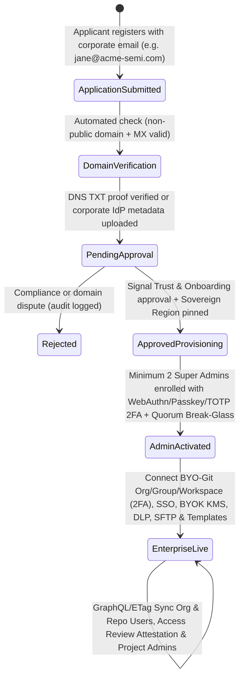

# 08 — Identity, Provider-Synced Access Review, Multi-Type Projects & Templates

> **Scope:** Defines Signal's account tiers, approval-gated **Enterprise Onboarding**, **GitHub/GitLab/Bitbucket Org & Repo-driven user authentication & access control**, the **Org Admin & Project Admin Access Review Console**, the **Multi-Repo Multi-Type Project** data model (`<project>-meta` + `<project>-<type>` repositories), and the **Project Templates** engine.

---

## 1. Account Types & Provider-Driven Authentication

Signal supports three operational identities:
1. **Individual Accounts (`EXPLORER` / `MAKER` / Independent `PRO`):** Independent engineers, students, researchers, and makers.
   - Sign in via **GitHub**, **GitLab**, or **Bitbucket** OAuth 2.0 PKCE / OIDC (binding immutable `provider_user_id`).
   - Connect either a **Git Organization / Group / Workspace** OR a **Personal User Namespace (`USER_NAMESPACE`)** (so a 12-year-old student needs zero org-admin overhead, with 1-click upgrade to an Organization later!), create personal Templates, and configure **2FA-gated personal SFTP servers**.
2. **Enterprise / Company Accounts:** Hardware companies, semiconductor firms, automotive/aerospace/medical OEMs.
   - Created using a **verified corporate email domain** with **Approval-Based Super Admin Provisioning** + **Mandatory ≥ 2 Enrolled Super Admins & 2-of-3 Quorum Break-Glass Recovery** (with 24h cooling alert to Security Officers so lost hardware keys never brick an enterprise).
   - **Cryptographic Dual-Identity Handshake:** During first Enterprise login, engineers complete SAML 2.0 / OIDC SSO (`jane.doe@acme.com`) + a one-time OAuth 2.0 PKCE proof against the connected GitHub/GitLab/Bitbucket instance (`jdoe-acme`), permanently binding `(org_id, sso_subject_id) <-> immutable provider_user_id` in `GIT_IDENTITY_LINK`—eliminating email/handle mismatch bugs!
   - **Multi-Org Consultant Isolation & Sovereign Jurisdiction Pinning:** URLs are strictly org-scoped (`/org/:org_slug/...`) so design houses working across multiple client orgs never suffer session bleed; Organizations and Projects pin to explicit sovereign regions (`US_ITAR`, `EU_SOVEREIGN`, `INDIA`, `APAC`) with citizenship/geo-IP ABAC gates.
3. **Local Development Guest Mode (Strictly `SIGNAL_ENV=local` Only):**
   - Pre-seeded user **`Guest`** under **`Signal Design, Inc.`** ([`09-local-development-environment.md`](./09-local-development-environment.md)). Rather than scattering `if (isGuest)` RBAC bypasses in application code, local `MockGit (:8085)` seeds `provider_user_id: "local-guest-0001"` directly into `REPO_ACCESS_ENTRY`—exercising 100% of real production authorization and Access Review paths offline!

### 1.1 Enterprise / Company Onboarding State Machine

---

## 2. Provider-Backed Authorization & Admin Access Review

### 2.1 Authoritative Org + Repository Access Gate ("Only Authorized Git Users Can View the Project")
Signal uses the connected **GitHub Organization**, **GitLab Group**, or **Bitbucket Workspace/Project** and each repository's user list as the **single source of truth** for who can view or edit a Project and its Sub-Projects:

- **Zero Unauthorized Visibility (Uniform `404` Anti-Enumeration):** A user can list or open Project `P` in Signal **ONLY IF** their verified `provider_user_id` is an authorized member/collaborator of the connected namespace **AND** explicitly listed on `<project-slug>-meta` and/or `<project-slug>-<type>` repositories (unauthorized UUID probes return uniform `404 Not Found`).
- **Rate-Limit-Safe Sync & Untrusted Webhook Hints:** Roster synchronization uses **batched GraphQL queries + conditional `ETag` (`304` = 0 quota cost)**; incoming provider webhooks are `HMAC-SHA256` & replay-verified and treated strictly as **dirty hints** triggering an authoritative outbound provider API re-fetch before mutating `REPO_ACCESS_ENTRY`.
- **Per-Sub-Project Isolation & `< 2 s` Instant Pod Eviction:** Granting a contractor access ONLY to `<project>-pcb` restricts them inside the Rust Project Pod strictly to the PCB subgraph, with optional **Time-Bounded Access Expiry (`expires_at`)** that auto-revokes expired contractors!

### 2.2 Provider Repo Role → Effective Signal Role Mapping

| GitHub Repo Role | GitLab Project Role | Bitbucket Repo Role | Effective Signal Role (Scoped to That Project / Sub-Project Repo) |
|---|---|---|---|
| `admin` / `maintain` | `Owner` / `Maintainer` | `admin` | **Project / Sub-Project Admin** — manage metadata, add Sub-Project types, **review & attest project access list**, approve AI merges, execute **21 CFR Part 11 / 2FA SFTP sign-offs** |
| `write` (`push`) | `Developer` | `write` | **Domain Engineer** — edit assigned Sub-Project(s), run simulations, collaborate with AI Agents, open visual PR/MRs |
| `triage` / `read` (`pull`) | `Reporter` / `Guest` | `read` | **Viewer / Reviewer** — read-only live probes, spatial canvas review threads, traceability inspection; zero edit rights |
| *Not on repo user list* | *Not on project member list* | *Not on repo user list* | **DENY (`404` Uniform)** — Project / Sub-Project completely invisible |

### 2.3 Organization Admin & Project Admin Access Review Console
- **Organization Admin Access Review (`/org/:org_slug/admin/access-review`):** Live matrix across all Org members, teams, outside collaborators, and `<project>-*` repos showing `provider_user_id`, dual-bound SSO identity, provider 2FA status, contractor `expires_at` countdown, last Signal session, and Attestation status.
- **Project Admin Access Review (`/org/:org_slug/projects/:id/access-review`):** Scoped to `<project>-meta` + all child `<project>-<type>` repos—highlighting cross-repo privilege anomalies, recording **21 CFR Part 11 / ISO 27001 `ML-DSA`-signed attestations**, and executing **Step-Up 2FA-gated member revocation**.

---

## 3. Unified Multi-Type, Multi-Repo Project & Metadata Model

```mermaid
erDiagram
    ORGANIZATION ||--o{ USER_MEMBERSHIP : "has"
    USER ||--o{ USER_MEMBERSHIP : "belongs_to"
    USER ||--o{ GIT_IDENTITY_LINK : "dual_binds_sso_and_provider_id"
    ORGANIZATION ||--o{ SFTP_TARGET : "authorizes"
    USER ||--o{ SFTP_TARGET : "personal_sftp"
    ORGANIZATION ||--o{ PROJECT_TEMPLATE : "publishes"
    USER ||--o{ PROJECT_TEMPLATE : "creates_personal"
    ORGANIZATION ||--o{ PROJECT : "owns"
    PROJECT_TEMPLATE ||--o{ PROJECT : "instantiates"

    ORGANIZATION ||--o| GIT_ORG_CONNECTION : "connects_byo_git"
    USER ||--o| GIT_ORG_CONNECTION : "personal_byo_git"
    GIT_ORG_CONNECTION ||--o{ VCS_SECURITY_AUDIT : "periodically_audited"
    GIT_ORG_CONNECTION ||--o{ REPO_ACCESS_ENTRY : "syncs_org_and_repo_users"

    PROJECT ||--|{ SUB_PROJECT : "provisions_prefixed_repos"
    PROJECT ||--o{ PROJECT_METADATA_KV : "stores_rich_metadata"
    PROJECT ||--o{ ACCESS_REVIEW_ATTESTATION : "reviewed_by_org_and_project_admin"
    PROJECT ||--o{ RELEASE_PACKAGE : "delivers_via_sftp"
    SUB_PROJECT ||--o{ REPO_ACCESS_ENTRY : "enforces_per_repo_users"
    SUB_PROJECT ||--o{ TRACEABILITY_LINK : "links_across_domains"
    SFTP_TARGET ||--o{ RELEASE_PACKAGE : "receives"

    GIT_ORG_CONNECTION {
        uuid id PK
        uuid org_id FK "nullable if personal"
        uuid owner_user_id FK
        string provider "GITHUB_COM|GITHUB_GHES|GITLAB_COM|GITLAB_SELF_MANAGED|BITBUCKET_CLOUD|BITBUCKET_DC"
        string namespace_kind "ORG_NAMESPACE|USER_NAMESPACE"
        string api_base_url
        string custom_ca_bundle_ref "optional pinned Private PKI CA"
        string git_namespace
        string auth_mode "SCOPED_TOKEN|PROVIDER_APP_OAUTH"
        string vault_credential_ref "SecretBox in Vault/HSM"
        string default_encryption_mode "ENCRYPTED_VAULT|PLAIN_CANONICAL"
        int last_posture_score "0-100"
        timestamp last_audited_at
        timestamp verified_with_2fa_at
    }

    PROJECT {
        uuid id PK
        uuid org_id FK
        string project_code
        string slug "validated <=63 chars prefix"
        string name
        string jurisdiction_region "US_ITAR|EU_SOVEREIGN|INDIA|APAC|GLOBAL"
        string spdx_license_policy "PROPRIETARY_STRICT|PERMISSIVE_ONLY|OPEN_HW"
        string meta_provider_repo_id "immutable provider repo ID"
        string meta_git_repo_full_name "namespace/<slug>-meta"
        string primary_type
        string lifecycle_stage
        string security_tier
        uuid kms_key_ref
        jsonb metadata_schema_values
        timestamp created_at
    }

    SUB_PROJECT {
        uuid id PK
        uuid project_id FK
        string domain_type "PRD|HFS|SCHEMATIC|PCB|IC_ANALOG|IC_DIGITAL|IC_PACKAGE|FPGA|FIRMWARE|BIOS|SOFTWARE|VERIFICATION|MECHANICAL_REF"
        string instance_slug "collision-free suffix"
        string name
        string provider_repo_id "immutable ID survives manual Git renames!"
        string git_repo_full_name "namespace/<project-slug>-<type>[-<instance>]"
        string encryption_mode "ENCRYPTED_VAULT|PLAIN_CANONICAL"
        string graph_root_id
        jsonb domain_config "stackup, pdk_ref, upf_ref, target_mcu"
    }

    REPO_ACCESS_ENTRY {
        uuid id PK
        uuid git_org_connection_id FK
        uuid project_id FK
        uuid sub_project_id FK "nullable for <slug>-meta"
        string provider_repo_id
        string provider_user_id "immutable GitHub/GitLab/Bitbucket ID"
        string provider_username
        string provider_role "admin|maintain|write|read"
        string effective_signal_role "PROJECT_ADMIN|ENGINEER|VIEWER"
        boolean is_external_collaborator
        timestamp expires_at "optional contractor auto-expiry"
        boolean provider_2fa_enabled
        timestamp synced_at
    }

    ACCESS_REVIEW_ATTESTATION {
        uuid id PK
        uuid org_id FK
        uuid project_id FK "nullable for org-wide review"
        uuid reviewer_user_id FK
        string reviewer_scope "ORG_ADMIN|PROJECT_ADMIN"
        string signature_meaning "ACCESS_ATTESTATION_21CFR11"
        string status "ATTESTED|ACTION_REQUIRED"
        string pqc_signature_hex "ML-DSA-65 + Ed25519"
        jsonb reviewed_roster_snapshot_hash
        timestamp attested_at
    }

    PROJECT_TEMPLATE {
        uuid id PK
        uuid org_id FK "nullable for official/personal"
        uuid owner_user_id FK
        string scope "OFFICIAL|ENTERPRISE|PERSONAL"
        string spdx_license "Apache-2.0|CERN-OHL-P-2.0|Proprietary"
        string name
        string version
        jsonb sub_project_blueprints
        jsonb default_metadata_schema
        jsonb drc_erc_rule_decks
        jsonb ai_agent_guardrails
    }

    SFTP_TARGET {
        uuid id PK
        uuid org_id FK "nullable if personal"
        uuid owner_user_id FK
        string label
        string host
        int port
        string remote_base_path
        string pinned_host_fingerprint
        string hsm_ssh_key_id
        string pgp_public_key_id "optional"
        boolean requires_dual_approval
        timestamp verified_with_2fa_at
    }
```

### 3.1 Example: Single Signal Project → Neatly Prefixed Multi-Repo Tree
Creating Signal Project **`"ev-inverter-400v"`** inside organization **`acme-hw`** creates:
- `acme-hw/ev-inverter-400v-meta` — Project metadata, rules, AVL policy, `repos.lock.json` Super-Commit manifest, unified traceability graph
- `acme-hw/ev-inverter-400v-prd` — Product Requirements (`REQ-001..240` with ISO-26262 ASIL-D tags)
- `acme-hw/ev-inverter-400v-hfs` — Hardware Functional Spec (UPF power/clock trees, isolation barriers)
- `acme-hw/ev-inverter-400v-schematic-power` & `acme-hw/ev-inverter-400v-schematic-ctrl`
- `acme-hw/ev-inverter-400v-pcb-power` & `acme-hw/ev-inverter-400v-pcb-ctrl`
- `acme-hw/ev-inverter-400v-ic-analog` — Custom Isolated Gate-Driver ASIC
- `acme-hw/ev-inverter-400v-fpga` — Safety Supervisor & Space-Vector PWM RTL
- `acme-hw/ev-inverter-400v-firmware` — Embedded Rust/C Motor Control Firmware
- `acme-hw/ev-inverter-400v-bios` — Secure Bootloader & Hardware Bring-Up POST
- `acme-hw/ev-inverter-400v-verification` — Rust SPICE, Aging, Formal/LEC, FMEDA, and 3-Speed Co-Sim Suites

All child repositories bind by immutable `provider_repo_id` (**with `<project>-meta` created synchronously in `< 800 ms` and child `<project>-<type>` repos materialized lazily on first write or via a `<= 40/min` paced queue so 60-student classroom or large enterprise Template launches never trip GitHub `80/min` secondary rate limits!**), mount into **one active Kubernetes Rust Project Pod**, version atomically via Dual-Fenced Two-Phase `Super-Commit`s, and enforce **per-repository user permissions + compute quotas**!

### 3.2 Rich Extensible Metadata, Sovereign Paired-Region DR & SPDX License Policy Gate
Every Project enforces an **SPDX License Compatibility Policy** (`PROPRIETARY_STRICT` blocks copyleft `GPL`/`CERN-OHL-S` templates/IPs from contaminating commercial silicon), **Strictly In-Jurisdiction Paired-Region Failover** (`EU_SOVEREIGN`: Frankfurt ↔ Paris/Zurich; `US_ITAR`: GovCloud-West ↔ East; `INDIA`: Mumbai ↔ Hyderabad—zero cross-border DR spillover!), and **Top-Level Redirect PKCE/SAML Cookie Upgrade** (`5 min` `SameSite=Lax` `/auth/*` transaction cookies upgraded on callback to `__Host-signal_session` `SameSite=Strict`).

---

## 4. Project Templates, Fab Capability Profiles & ECN Governance

1. **Signal Official Templates**, **Enterprise Approved Templates**, and **Personal User Templates** (each tagged with explicit SPDX license & `VerificationBadge` minimum tier).
2. **What a Project Template Bundles:** Sub-Project `<project>-<type>` lazy repo blueprints, default Git team permission mappings, PRD/HFS compliance scaffolds, **Signed Fab Capability Profiles (`*.fabprofile.toml` — exact fab drill aspect ratios, dielectric stackups, impedance coupons, copper balance)**, stackup/DRC/ERC/UPF rule decks, **AI Agent Guardrails** (derating margins, minimum `SILVER`/`GOLD` datasheet badge, budget caps), and **Engineering Change Order (`ECN`/`ECO`) + 21 CFR Part 11 / ISO 26262 Release Sign-Off Gates**.
