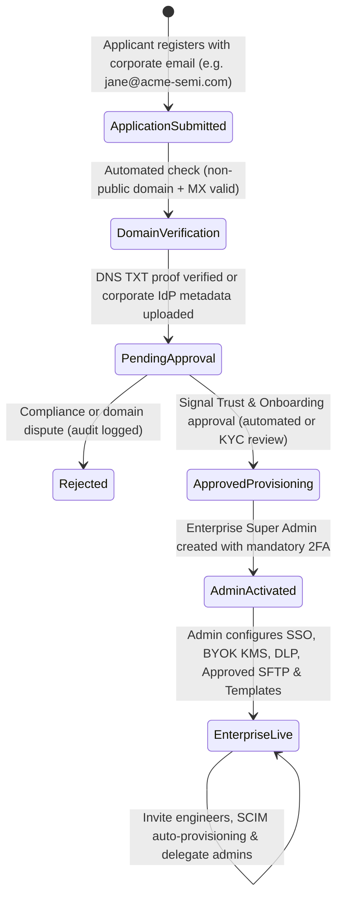
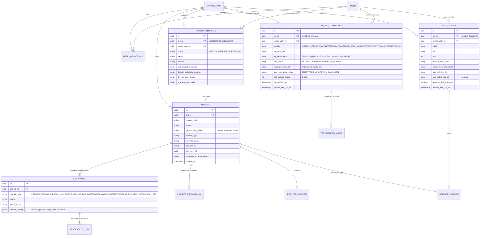

# 08 — Identity, Enterprise Onboarding, Multi-Type Projects & Templates

> **Scope:** Defines Signal's account tiers, approval-gated **Enterprise / Company Onboarding** workflow, RBAC/ABAC authorization model, the unified **Multi-Type Hierarchical Project** data model (storing PRD, HFS, Schematic, PCB, IC, FPGA, Firmware, BIOS, and Software together), and the **Project Templates** engine.

---

## 1. Account Types & Onboarding Workflows

Signal supports three distinct operational identities:
1. **Individual Accounts:** Independent engineers, researchers, consultants, and makers.
   - Self-serve registration via email + passwordless passkey/password + mandatory email verification.
   - Personal workspace, personal Project Templates, and **personal Authorized SFTP servers (strictly gated behind mandatory 2FA)**.
2. **Enterprise / Company Accounts:** Hardware companies, semiconductor firms, defense/automotive/medical OEMs.
   - Created using a **verified corporate email domain** (blocks public consumer domains like `gmail.com`/`yahoo.com` during Enterprise creation).
   - **Approval-Based Admin Provisioning:** An organization cannot self-claim an Enterprise domain without verification and approval, preventing domain squatting or unauthorized shadow-IT accounts.
3. **Local Development Guest Mode (Strictly `SIGNAL_ENV=local` Only):**
   - Pre-seeded user **`Guest`** under organization **`Signal Design, Inc.`** for zero-friction local Mac development (see [`09-local-development-environment.md`](./09-local-development-environment.md)). Compile-time and runtime guards make it impossible to activate in staging or production.

### 1.1 Enterprise / Company Onboarding State Machine

### Key Enterprise Governance Capabilities
- **Domain Capture & Claiming:** Once `acme-semi.com` is verified and approved, Enterprise Admins can enforce **SSO-Only Login** and prevent employees from creating unmanaged personal accounts with corporate emails.
- **Enterprise Admin Console:**
  - Manage SAML 2.0 / OIDC SSO & SCIM directory sync (Okta, Entra ID, Google Workspace, Ping).
  - Configure IP allowlists, session timeouts, Zero-Leak Pixel Streaming policy, watermark visibility, and BYOK KMS keys.
  - Register, verify, and scope **Authorized SFTP destinations** (2FA-gated) and toggle **Dual-Control (4-Eyes)** release approvals.
  - Curate organization-wide **Approved Vendor Lists (AVL)**, private NDA datasheets, foundry PDKs, and **Enterprise Project Templates**.

---

## 2. Authorization Model (RBAC + ABAC)

Signal enforces permissions at **both** the Node.js Control Plane AND inside the Rust Project Pod (defense-in-depth):

| Role | Scope | Core Permissions |
|---|---|---|
| **Enterprise Super Admin** | Organization | Manage SSO/SCIM, BYOK KMS, DLP policies, Approved SFTP servers (2FA), billing, delegate admins, view all audit logs (note: optionally restricted from viewing raw design IP unless also granted project membership — "Separation of Duties"). |
| **Security & Compliance Officer** | Organization | Audit logs, DLP policy, SFTP target approval, co-sign 4-eyes SFTP releases, revoke active sessions. |
| **Template & Library Steward** | Organization | Publish/approve org-wide Project Templates, AVL component rules, private datasheets, PDKs, DRC/ERC decks. |
| **Project Owner / Lead Architect** | Project | Manage project metadata, add/remove Sub-Project types, assign team members, approve AI speculative branches, initiate SFTP releases (2FA). |
| **Domain Engineer** (`EE`, `PCB`, `IC`, `FPGA`, `FW`, `BIOS`) | Project / Sub-Project | Edit assigned Sub-Projects, run simulations, collaborate with AI Agents, propose changes across linked domains. |
| **Reviewer / Approver** | Project | View designs, run read-only probes/measurements, add canvas review comments, approve PR/branch merges and SFTP release gates. |
| **External Contractor (Restricted)** | Sub-Project Only | Strictly scoped to a single Sub-Project (e.g., PCB layout only—cannot see proprietary IC schematic or BIOS), mandatory Zero-Leak Pixel Streaming + prominent watermark + zero SFTP rights. |
| **Auditor (Read-Only)** | Org / Project | Inspect traceability matrices, verification sign-offs, and compliance reports; zero edit rights. |

---

## 3. Unified Multi-Type Project & Metadata Model

Today's companies store PRD, HFS, schematics, PCB, IC, FPGA, firmware, and BIOS in separate silos. Signal models the **entire product** as one hierarchical `Project` containing **multiple typed Sub-Projects (`DomainModule`s)** linked together inside a single versioned graph.

### 3.1 Example: Multi-Type Project in Practice
A single Signal Project **`"SIG-EV-INV-400V"` (400V Traction Inverter)** contains:
- `PRD`: Product Requirements (`REQ-001..240` with ISO-26262 ASIL-D tags)
- `HFS`: Hardware Functional Specification (power architecture, isolation barriers, CAN-FD protocol, thermal budget)
- `SCHEMATIC` #1: High-Voltage SiC Power Stage Schematic
- `SCHEMATIC` #2: Low-Voltage Control & Gate-Driver Schematic
- `PCB` #1: 6-Layer Heavy-Copper Power Board (creepage/clearance rules)
- `PCB` #2: 10-Layer HDI Control Board
- `IC_ANALOG`: Custom Isolated Gate-Driver ASIC (transistor schematic + mask layout + PDK)
- `FPGA`: Safety Supervisor & Space-Vector PWM RTL (`SystemVerilog`)
- `FIRMWARE`: Embedded Rust/C Motor Control & Diagnostics Firmware
- `BIOS`: Secure Bootloader & Hardware Bring-Up POST
- `VERIFICATION`: Rust SPICE, Thermal, Monte-Carlo, Fault-Injection (FMEDA), and Hardware-Firmware Co-Sim Suites

All 11 sub-projects live in **one encrypted Project Pod**, share **one traceability graph**, version together as unified product snapshots (`EVT1`, `DVT2`, `PVT1`), and are reasoned over holistically by Signal's AI Agents.

### 3.2 Rich Extensible Metadata
Every Project supports both **core standard metadata** and **custom Enterprise-defined metadata fields**:
- **Core Fields:** Project Code / Part Number, Revision, Lifecycle Stage, Primary Type + Enabled Sub-Project Types, Target Compliance Standards, Cost & Power Targets, Owner, Confidentiality Classification (`Internal`, `Confidential`, `Restricted / ITAR`).
- **Custom Enterprise Schemas:** Admins define typed custom attributes (string, enum, number with SI unit, date, user picker, compliance checkbox) required at project creation or release sign-off (e.g., `Customer Program ID`, `Foundry Node`, `Target Fab House`, `Cost Center`).

---

## 4. Project Templates System

Users and Enterprises avoid rebuilding rules, stackups, and folder structures from scratch using **hierarchical, versioned Project Templates**:

### Template Scopes
1. **Signal Official Templates:** Curated industry blueprints (e.g., *4-Layer MCU IoT Board*, *8-Layer High-Speed DDR4/PCIe Board*, *Analog Mixed-Signal CMOS IC (Sky130 / Custom PDK)*, *FPGA + Carrier Board*, *Automotive ASIL-B ECU*).
2. **Enterprise Approved Templates:** Created by Organization Template Stewards—automatically enforcing corporate stackups, impedance tables, AVL parts filters, PRD/HFS compliance sections, foundry PDKs, and AI Agent design guardrails.
3. **Personal User Templates:** Any engineer can save a configured project structure (stripping design IP or keeping reusable boilerplate) as a private reusable template.

### What a Project Template Bundles
- Pre-configured **Sub-Project Tree** (e.g., `PRD + HFS + Schematic + PCB + Firmware + Verification`).
- Pre-populated **PRD & HFS Document Scaffolds** (standard headings, compliance checklists, acceptance tables).
- **Design Rule Decks** (ERC rules, PCB stackup & impedance profiles, DRC/DFM rules, creepage tables, IC PDK bindings).
- **AI Agent Guardrail Manifest** (e.g., *"Mandatory 50% resistor power derating, 2× capacitor voltage derating, prefer AEC-Q100 active parts, verify -40°C to +125°C corners before proposing merge"*).
- **Default Metadata Schema** & **Release Checklist Gate** definitions.
