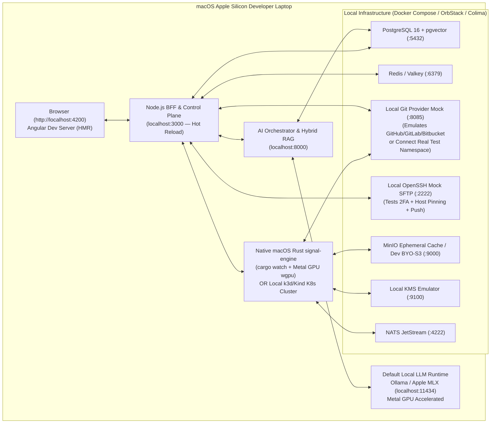

# 09 — Local Development Environment (macOS + Local LLM + Guest Mode)

> **Scope:** Defines a fast, offline-capable local development setup tailored for **macOS (Apple Silicon)** laptops—configured out of the box with a **local LLM as default**, a hard-guarded local **`Guest`** user under **`Signal Design, Inc.`**, native Rust compilation speed, and local SFTP/Kubernetes testing.

---

## 1. Local Development Philosophy

Developing a cloud-native Rust + Kubernetes + Angular + AI-Agent EDA suite should NEVER require expensive cloud GPUs, enterprise SSO setup, or internet API keys just to hack locally on a MacBook.

Signal's local development architecture ensures:
- **Zero-Friction Startup:** One command starts the entire stack locally on macOS.
- **Local Mac LLM as Default:** Uses Apple Silicon unified memory via **Ollama**, **Apple MLX (`mlx-lm`)**, or **LM Studio** by default—zero cloud LLM bills or latency during development.
- **Local Guest Mode (`Signal Design, Inc.`):** Instant auto-login as **`Guest`** inside organization **`Signal Design, Inc.`** so developers land straight in the Signal IDE without clicking through enterprise domain verification.
- **Production Parity Where It Matters:** Runs real PostgreSQL + `pgvector`, real Redis, real S3-compatible storage (MinIO), real envelope encryption (local dev KMS), and a real local mock SFTP container so security & SFTP flows are continuously tested!

---

## 2. Local Mac Topology



### Three Local Execution Modes (Monorepo Root `justfile` Defaults — [`20-*`](./20-versioning-release-monorepo-build-and-k8s-topology.md))
1. **Ultra-Light Inner-Loop Mode (`just dev` / `pnpm dev:lite` — `< 1.5 GB RAM` for 8–16 GB MacBooks):**
   - Runs `signal-engine` (`aarch64-apple-darwin` + Metal `wgpu`) + Node.js API/BFF + Angular HMR with embedded local Postgres/pgvector, in-memory Redis/NATS, and embedded `MockGit`/`DevKMS`—booting in `< 30 s` without heavy Docker VM memory overhead!
2. **Full Service-Parity Mode (`just dev-full` / `pnpm dev:full` — Default on 32 GB+ Macs):**
   - Runs native macOS Rust `signal-engine` + Docker Compose / OrbStack (`linux/arm64` native multi-arch images only—zero slow `amd64` Rosetta emulation!) with PostgreSQL 16 + RLS + partitioned `pgvector`, Redis, NATS JetStream, MinIO, DevKMS, `MockGit (:8085)`, and `MockSFTP (:2222)`.
3. **Full 3-Tier Kubernetes Parity Mode (`just dev-k8s` / `just deploy-local-k8s` — Exact Prod Topology Locally):**
   - Runs a local `aarch64` Kubernetes cluster (`OrbStack K8s` / `k3d`) deploying the monorepo Umbrella Helm Chart (`infra/k8s/helm/signal -f values-local.yaml`) with separate **`signal-web` (Angular+Node) pod**, separate **`signal-api` + `signal-engine-bridge` pod**, and **`1–4` simulated Rust Engine worker nodes** (`signal-operator`, linearizable Leases, Cilium NetworkPolicies, and `signal-egress-proxy`).

---

## 3. Local Guest User & `Signal Design, Inc.` Seed (Zero-Bypass RBAC Parity!)

When developing locally, frictionless login is essential—but a guest mode must **NEVER** ship to production OR hide RBAC/RLS bugs behind `if (isGuest)` shortcuts!

### 3.1 Seeded Local Identity (Exercises 100% of Real Production Auth/RLS Paths)
- **Organization:** `Signal Design, Inc.` (`org_slug: signal-design-inc`, tier: `ENTERPRISE_DEV`, domain: `signaldesign.local`)
- **Default User:** `Guest` (`email: guest@signaldesign.local`, `provider_user_id: "local-guest-0001"`)
- **Zero-Shortcut RBAC Parity:** Local `MockGit (:8085)` pre-seeds `local-guest-0001` as `admin` on `signal-design-inc/sig-dev-001-meta` and all child `sig-dev-001-<type>` repos (plus a second mock contractor `local-pcb-contractor-0002` scoped *only* to `sig-dev-001-pcb`!)—so PostgreSQL RLS, `REPO_ACCESS_ENTRY`, per-repo Pod filtering, and the **Org/Project Admin Access Review Console** execute **identical code paths** in local dev and cloud production!
- **Pre-Seeded Sample Data:**
  - 3 Official Project Templates (*4-Layer Smart Edge PCB*, *Analog IC Bandgap Reference (Sky130)*, *Full Product Multi-Type Template*).
  - 1 Multi-Repo Demo Project: **`"sig-dev-001 — Signal Smart Power Controller"`** (`-meta`, `-prd`, `-hfs`, `-schematic`, `-pcb`, `-fpga`, `-firmware`, `-bios`).
  - 1 Pre-registered Local Mock SFTP Server (`local-fab-sftp` at `127.0.0.1:2222`) + deterministic Dev TOTP secret printed in console logs to test real **Step-Up 2FA SFTP & BYO-Git** flows.
  - Mini Verified Universal Datasheet Seed (~500 `GOLD_ATTESTED` passives, MOSFETs, Op-Amps, Buck ICs, and MCUs + Sky130 open PDK cells pre-indexed in local `pgvector` for 100% offline RAG!).

### 3.2 Triple Safety Guard Against Production Exposure
Guest mode is protected by **three independent hard guards**:
1. **Build-Time Feature Gate (Rust & TypeScript):** Guest auto-auth handlers only compile/bundle when `dev-guest-auth` feature flag is enabled; production CI release pipelines explicitly forbid this flag and fail the build if symbol inspection detects it.
2. **Environment & Hostname Assertion:** Even in dev binaries, Guest mode activates ONLY if ALL of: `SIGNAL_ENV=local`, `SIGNAL_ALLOW_LOCAL_GUEST=true`, and bind host is loopback (`127.0.0.1` / `localhost`). Any non-local `SIGNAL_ENV` causes immediate process abort if `SIGNAL_ALLOW_LOCAL_GUEST=true` is set.
3. **Visual Banner in Angular UI:** Local dev mode renders a persistent status pill in the top bar: `LOCAL DEV • Guest @ Signal Design, Inc. • Local LLM`.

---

## 4. Default Local Mac LLM Configuration (Grammar-Constrained!)

`ai/llm-gateway` automatically defaults to the developer's local Mac LLM runtime when `SIGNAL_ENV=local`, using **`GBNF` / JSON-Schema grammar-constrained decoding** + **dynamic 5–8 tool subset routing** so even compact 7B/14B local models emit 100% valid Protobuf/JSON tool calls without syntax failures:

### Supported Local Backends (OpenAI-Compatible API)
1. **Ollama (Primary Default):** `http://localhost:11434/v1` (or `http://host.docker.internal:11434/v1` from containers). Zero-config auto-detection of installed models.
2. **Apple MLX (`mlx-lm` server):** `http://localhost:8080/v1` — maximum Apple Silicon Metal throughput and lowest memory footprint.
3. **LM Studio / `llama.cpp` server:** `http://localhost:1234/v1`.

### Recommended Mac Unified Memory Model Profiles

| Mac Unified Memory | Tier 1 (Fast / Quarantine) | Tier 2 (Deep EDA/Code Reasoning) | Tier 3 (Vision / Datasheet) | Tier 4 (RAG Embeddings) |
|---|---|---|---|---|
| **16 GB Mac** | `qwen2.5-coder:7b` (Q4) | `qwen2.5-coder:14b` (Q4) | `llama3.2-vision:11b` (on-demand) | `nomic-embed-text` |
| **32–48 GB Mac** | `qwen2.5-coder:7b` | `qwen2.5-coder:32b` or `deepseek-r1:32b` | `qwen2.5-vl:7b` | `bge-m3` |
| **64–128 GB+ Mac** | `qwen2.5-coder:14b` | `qwen2.5-coder:32b` / `llama3.3:70b` (Q4) | `qwen2.5-vl:32b` | `bge-m3` |

### Seamless Override Strategy (`.env.local` — Git-Ignored)
Developers can switch any tier between Local Mac LLM and a remote API key at any time without touching committed config:
```text
SIGNAL_ENV=local
SIGNAL_DEV_PROFILE=lite          # lite | full | k8s
SIGNAL_ALLOW_LOCAL_GUEST=true
SIGNAL_LOCAL_ORG_NAME="Signal Design, Inc."
SIGNAL_LOCAL_GUEST_USER="Guest"

# Local LLM Default (macOS Ollama / MLX with GBNF Structured Decoding)
SIGNAL_LLM_PROVIDER=local_ollama
SIGNAL_LLM_BASE_URL=http://localhost:11434/v1
SIGNAL_LLM_FAST_MODEL=qwen2.5-coder:7b
SIGNAL_LLM_REASONING_MODEL=qwen2.5-coder:32b
SIGNAL_LLM_EMBEDDING_MODEL=nomic-embed-text
```

---

## 5. Local Build Speed, Shader Parity & DLP Developer Ergonomics

In `SIGNAL_ENV=local`:
- **`< 2 s` Incremental Rust Builds (`signal-proto` + `sccache` + `lld`):** Protobuf codegen compiles **once** inside a single shared `engine/crates/signal-proto` crate (never duplicated across 20 crate `build.rs` scripts!), paired with `cargo-hakari` (`workspace-hack`), `sccache`, and `lld` fast linking so `cargo watch` inner-loop rebuilds complete in `< 2 s` on Apple Silicon.
- **Metal ↔ Vulkan WGSL Shader Parity:** Because macOS runs `wgpu` on **Metal** while Linux K8s runs **Vulkan**, CI automatically runs headless **`lavapipe` / `SwiftShader` software-Vulkan** golden-pixel tests on every shader change so WGSL alignment/precision differences never break production pods.
- **Zero-Download Offline `deterministic_mock` LLM Mode:** If a developer or university lab boots `pnpm dev:lite` before downloading multi-GB Ollama/MLX model weights (`SIGNAL_LLM_PROVIDER=deterministic_mock`), `ai/llm-gateway` serves deterministic, schema-valid golden tool responses for offline UI/engine testing and fast CI.
- **DLP Toggle & Active PQC/Padmé Encryption:** Engineers can switch live between **Standard WebGPU Mode** and **Enterprise Zero-Leak Dual-Plane Stream Mode** (`Zstd-QOI`/WebP + Metal `wgpu` + Geometric Constellation watermarks), while `MockGit` `ENCRYPTED_VAULT` repos ALWAYS run real Padmé-padded `AES-256-GCM-SIV` + Hybrid PQC via `DevKMS`!
