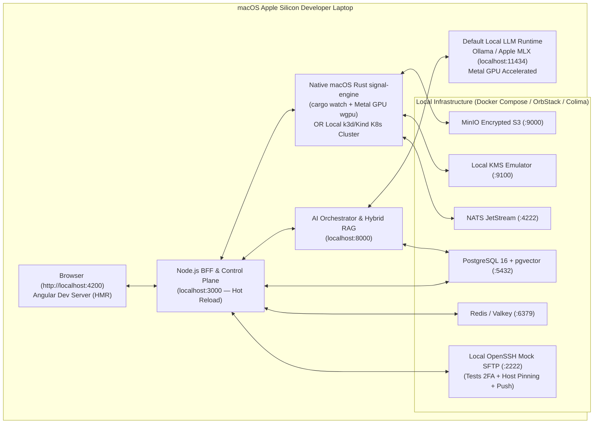

# 09 — Local Development Environment (macOS + Local LLM + Guest Mode)

> **Scope:** Defines a fast, offline-capable local development setup tailored for **macOS (Apple Silicon)** laptops—configured out of the box with a **local LLM as default**, a hard-guarded local **`Guest`** user under **`Signal Design, Inc.`**, native Rust compilation speed, and local SFTP/Kubernetes testing.

---

## 1. Local Development Philosophy

Developing a cloud-native Rust + Kubernetes + Angular + AI-Agent EDA suite should NEVER require expensive cloud GPUs, enterprise SSO setup, or internet API keys just to hack locally on a MacBook.

Signal's local development architecture ensures:
- **Zero-Friction Startup:** One command starts the entire stack locally on macOS.
- **Local Mac LLM as Default:** Uses Apple Silicon unified memory via **Ollama**, **Apple MLX (`mlx-lm`)**, or **LM Studio** by default—zero cloud LLM bills or latency during development.
- **Local Guest Mode (`Signal Design, Inc.`):** Instant auto-login as **`Guest`** inside organization **`Signal Design, Inc.`** so developers land straight in the Signal IDE without clicking through enterprise domain verification.
- **Production Parity Where It Matters:** Runs real PostgreSQL + `pgvector`, real Redis, real S3-compatible storage (MinIO), real envelope encryption (local dev KMS), and a real local mock SFTP container so security & SFTP flows are continuously tested!

---

## 2. Local Mac Topology



### Two Local Execution Modes
1. **Fast Inner-Loop Mode (`dev:native` — Default for daily coding):**
   - Runs `signal-engine` natively on macOS (`aarch64-apple-darwin`) for instant incremental `cargo` builds and native **Apple Metal GPU** acceleration in `wgpu` rendering!
   - `session-broker` routes local projects directly to local `signal-pod` worker processes (simulating sticky pod-per-project routing on localhost ports so multi-tab collaboration works identically!).
2. **Full Kubernetes Parity Mode (`dev:k8s` — For testing K8s Operator & Pod Lifecycle):**
   - Runs a lightweight local Kubernetes cluster via **`k3d` / `kind` / OrbStack K8s** with `signal-operator`, real `ProjectSession` CRDs, Warm Standby Rust Pods, Cilium network policies, and multi-user sticky routing.

---

## 3. Local Guest User & `Signal Design, Inc.` Seed (Hard-Guarded!)

When developing locally, frictionless login is essential—but a guest bypass must **NEVER** accidentally reach staging or production.

### 3.1 Seeded Local Identity
- **Organization:** `Signal Design, Inc.` (`org_slug: signal-design-inc`, tier: `ENTERPRISE_DEV`, domain: `signaldesign.local`)
- **Default User:** `Guest` (`email: guest@signaldesign.local`, display name: `Guest`)
- **Roles Granted in Local Mode:** `Enterprise Super Admin`, `Project Owner`, `Domain Engineer` (allows testing every UI surface—CAD editors, AI Agents, Enterprise Admin, Project Templates, and SFTP configuration—immediately).
- **Pre-Seeded Sample Data:**
  - 3 Official Project Templates (*4-Layer Smart Edge PCB*, *Analog IC Bandgap Reference*, *Full Product Multi-Type Template*).
  - 1 Pre-loaded Multi-Type Demo Project: **`"SIG-DEV-001 — Signal Smart Power Controller"`** containing PRD, HFS, Buck Converter Schematic (using modular Rust components), 4-Layer PCB, FPGA PWM block, Firmware HAL, and Bootloader.
  - 1 Pre-registered Local Mock SFTP Server (`local-fab-sftp` at `127.0.0.1:2222`) + deterministic Dev TOTP helper secret printed in terminal logs so engineers can test the real **2FA-mandatory SFTP registration & release push** workflow locally!
  - Mini Universal Datasheet Seed (~500 curated real-world passives, MOSFETs, Op-Amps, Buck ICs, and MCUs pre-indexed in local `pgvector` so Hybrid RAG works offline!).

### 3.2 Triple Safety Guard Against Production Exposure
Guest mode is protected by **three independent hard guards**:
1. **Build-Time Feature Gate (Rust & TypeScript):** Guest auto-auth handlers only compile/bundle when `dev-guest-auth` feature flag is enabled; production CI release pipelines explicitly forbid this flag and fail the build if detected.
2. **Environment & Hostname Assertion:** Even in dev binaries, Guest mode activates ONLY if ALL of: `SIGNAL_ENV=local`, `SIGNAL_ALLOW_LOCAL_GUEST=true`, and bind host is loopback (`127.0.0.1` / `localhost`). Any non-local `SIGNAL_ENV` causes immediate process panic/abort if `SIGNAL_ALLOW_LOCAL_GUEST=true` is set.
3. **Visual Banner in Angular UI:** Local dev mode renders a clear, persistent status pill in the top bar: `LOCAL DEV • Guest @ Signal Design, Inc. • Local LLM`.

---

## 4. Default Local Mac LLM Configuration

`ai/llm-gateway` automatically defaults to the developer's local Mac LLM runtime when `SIGNAL_ENV=local`:

### Supported Local Backends (OpenAI-Compatible API)
1. **Ollama (Primary Default):** `http://localhost:11434/v1` (or `http://host.docker.internal:11434/v1` from containers). Zero-config auto-detection of installed models.
2. **Apple MLX (`mlx-lm` server):** `http://localhost:8080/v1` — maximum Apple Silicon Metal throughput and lowest memory footprint.
3. **LM Studio / `llama.cpp` server:** `http://localhost:1234/v1`.

### Recommended Mac Unified Memory Model Profiles

| Mac Unified Memory | Tier 1 (Fast/Tool-Call) | Tier 2 (Deep EDA/Code Reasoning) | Tier 3 (Vision / Datasheet) | Tier 4 (RAG Embeddings) |
|---|---|---|---|---|
| **16 GB Mac** | `qwen2.5-coder:7b` (Q4) | `qwen2.5-coder:14b` (Q4) | `llama3.2-vision:11b` (on-demand) | `nomic-embed-text` |
| **32–48 GB Mac** | `qwen2.5-coder:7b` | `qwen2.5-coder:32b` or `deepseek-r1:32b` | `qwen2.5-vl:7b` | `bge-m3` |
| **64–128 GB+ Mac** | `qwen2.5-coder:14b` | `qwen2.5-coder:32b` / `llama3.3:70b` (Q4) | `qwen2.5-vl:32b` | `bge-m3` |

### Seamless Override Strategy (`.env.local` — Git-Ignored)
Developers can switch any tier between Local Mac LLM and a remote API key at any time without touching committed config:
```text
SIGNAL_ENV=local
SIGNAL_ALLOW_LOCAL_GUEST=true
SIGNAL_LOCAL_ORG_NAME="Signal Design, Inc."
SIGNAL_LOCAL_GUEST_USER="Guest"

# Local LLM Default (macOS Ollama / MLX)
SIGNAL_LLM_PROVIDER=local_ollama
SIGNAL_LLM_BASE_URL=http://localhost:11434/v1
SIGNAL_LLM_FAST_MODEL=qwen2.5-coder:7b
SIGNAL_LLM_REASONING_MODEL=qwen2.5-coder:32b
SIGNAL_LLM_EMBEDDING_MODEL=nomic-embed-text
```

---

## 5. Local Security & DLP Developer Ergonomics

In `SIGNAL_ENV=local`:
- **DLP Toggle:** Engineers can toggle between **Standard WebGPU Mode** (for convenient DevTools debugging of Angular/WebGPU) and **Enterprise Zero-Leak Pixel Stream Mode** (to test server-side Metal `wgpu` rendering, forensic watermarks, print blocking, and focus curtains locally).
- **Real Encryption Always Active:** Local MinIO snapshots are STILL encrypted with AES-256-GCM via the local dev KMS emulator so encryption/decryption code paths are exercised on every single developer run—never stubbed out!
