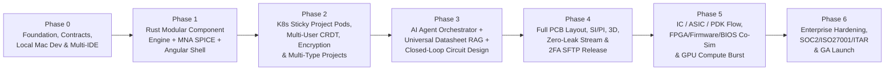

# 11 — Phased Implementation Roadmap & Risk Register

> **Scope:** Sequences the construction of **Signal** from Phase 0 foundation through General Availability (GA), defining concrete deliverables, measurable exit criteria, and technical risk mitigations so parallel engineering teams (Antigravity + Cursor) ship working increments continuously.

---

## 1. Strategic Sequencing Philosophy

Building a full AI-Agent-First Cloud EDA suite spanning SPICE, PCB, IC/ASIC, FPGA, Firmware, BIOS, Zero-Trust Security, and Kubernetes is a deep multi-phase journey. We sequence delivery to **de-risk the hardest core physics, routing, and security pillars early**:

1. Lock **Contracts & Local Mac Dev Harness** first (unblocks parallel Antigravity + Cursor development immediately).
2. Prove the **Pure-Rust Modular Component Engine + MNA SPICE Solver** on real circuits before scaling to full PCB/IC geometry.
3. Prove **Kubernetes Sticky Multi-User Pod Routing + Envelope Encryption** early so collaboration and zero-trust are native from day one—never retrofitted.
4. Layer **Universal Datasheet RAG + Closed-Loop AI Agents** directly on top of the verified Rust engine.
5. Expand horizontally into **Full PCB Layout/Routing/SFTP**, **Full IC/Chip RTL-to-GDSII**, and **FPGA/Firmware/BIOS Co-Design**.

---

## 2. Detailed Phase Breakdown & Exit Criteria

### Phase 0 — Repository Foundation, Contracts & Parallel Dev Harness
- **Deliverables:**
  - Monorepo workspace skeleton (`contracts/`, `engine/`, `services/`, `ai/`, `web/`, `infra/`, `coordination/`).
  - Canonical `v1` Protobuf (`Buf`), OpenAPI, and JSON schemas with automated Rust & TypeScript codegen.
  - Local macOS dev harness (`docker-compose` for Postgres+pgvector, Redis, NATS, MinIO, DevKMS, Mock SFTP; native Rust `cargo` + Angular HMR + Ollama/MLX auto-detection).
  - Hard-guarded local **`Guest` @ `Signal Design, Inc.`** seed & CI guard verifying `dev-guest-auth` can never ship in release artifacts.
  - Multi-AI-IDE collaboration setup (`.cursor/rules/`, `AGENTS.md`, `coordination/TASK_BOARD.md`, Git worktree scripts).
- **Exit Criteria:** A developer on macOS runs one bootstrap command, lands in the Angular shell as `Guest @ Signal Design, Inc.`, receives a health-check pong from both `signal-engine` and local Mac Ollama/MLX LLM, and Antigravity + Cursor merge parallel PRs without conflict.

### Phase 1 — Core Rust Modular Component Engine, MNA SPICE & Schematic MVP
- **Deliverables:**
  - `signal-component`: Full `ElectronicModule` trait (ports, tolerances, TCR, parasitics, thermal self-heating, SOA watchdog, fault injection, hierarchical subcircuits).
  - `signal-lib-passive` & `signal-lib-semiconductor`: Resistors, MLCCs (DC-bias), Inductors (saturation), Diodes, BJTs, MOSFETs, Op-Amp macro, Voltage/Current sources.
  - `signal-sim`: Pure-Rust sparse MNA solver supporting DC Operating Point, DC Sweep, AC Bode/Noise, Transient, and local parallel Monte Carlo.
  - `signal-graph`: In-memory ECS graph with transactional Undo/Redo and instant Copy-on-Write (CoW) branching.
  - Angular Schematic Canvas + Interactive Waveform Viewer + Live Component Parameter Inspector.
- **Exit Criteria:** Series/parallel resistor chains, RLC filters, BJT/MOSFET amplifiers, and a synchronous buck converter simulate accurately (< 0.5% deviation vs. reference SPICE golden benchmarks) with live voltage/current/SOA probes in the Angular UI.

### Phase 2 — Kubernetes Stateful Project Pods, Sticky Multi-User Sync & Unified Multi-Type Projects
- **Deliverables:**
  - `signal-operator` (`kube-rs`) managing `ProjectSession` CRDs, Warm Standby Pod Pool, fenced distributed leases, and idle hibernation.
  - `session-broker` implementing **sticky routing** so 2+ concurrent users opening Project X attach to the exact same Rust Engine Pod.
  - Real-time CRDT multi-user sync, live cursors, presence, soft locks, and continuous **AES-256-GCM encrypted WAL + S3 snapshots** (RAM-only `tmpfs` + `zeroize`).
  - `identity-org` & `project-catalog`: Individual accounts, approval-gated Enterprise Onboarding, RBAC/ABAC, Multi-Type Projects (`PRD`, `HFS`, `SCHEMATIC`, `PCB`, `IC_*`, `FPGA`, `FIRMWARE`, `BIOS`), extensible metadata, cross-domain traceability links, and Project Templates.
  - Integrated PRD & HFS structured spec editor inside the Angular IDE.
- **Exit Criteria:** Two browsers join the same encrypted project on Kubernetes (local `k3d` & cloud EKS/GKE), verify identical Pod IP assignment, edit schematics + PRD concurrently with < 50 ms sync, and survive simulated pod crash with zero data loss.

### Phase 3 — AI-Agent-First Orchestration & Universal Datasheet RAG
- **Deliverables:**
  - `ai/datasheet-ingest`: Multi-modal PDF parser (tables, pinouts, AbsMax, curves, register maps) + automated SPICE-to-Rust module validation.
  - `ai/rag-service`: Hybrid RAG (PostgreSQL parametric SQL + `pgvector` semantic + knowledge graph) with strict global vs. tenant-private NDA isolation.
  - `ai/llm-gateway`: Unified router supporting Local Mac Ollama/MLX (default in local dev), VPC GPU vLLM, and zero-retention cloud APIs.
  - `ai/orchestrator`: Supervisor + PRD/HFS Agent, Schematic Synthesis Agent, and Simulation Verification Agent executing closed-loop verify-and-fix iterations inside CoW Rust branches with visual diffs & citations.
- **Exit Criteria:** Prompting *"Design a 24V→5V 3A regulator meeting ripple & thermal specs"* autonomously selects datasheet-backed parts, builds the circuit on a CoW branch, iterates via Rust SPICE until all specs & Monte-Carlo corners pass, and commits cleanly upon engineer approval—working seamlessly on both Local Mac LLM and Cloud GPU models.

### Phase 4 — Full PCB Suite, Zero-Leak GPU Streaming & 2FA-Gated SFTP Egress
- **Deliverables:**
  - `signal-geom` & `signal-pcb`: Exact nanometer geometry, R-tree spatial DRC, stackup + 2D impedance field solver, push-and-shove router, differential pairs, length tuning, copper pours, 3D PCB renderer, and in-memory Gerber X2 / ODB++ / IPC-2581 / BOM / CPL generators.
  - `signal-render`: Server-side `wgpu` GPU renderer with WebRTC encrypted pixel/tile streaming + burned-in visible & invisible forensic watermarks (Enterprise Zero-Leak Mode).
  - Full DLP Enforcement: Print blocking, privacy curtain, zero download endpoints, Enterprise Secure Browser policy hooks.
  - `sftp-egress`: **Mandatory Step-Up 2FA** (WebAuthn/TOTP) to register/verify SFTP targets (Enterprise & Individual), HSM ED25519 keys, host-key pinning, optional PGP encryption, 4-eyes approval, and immutable hash-chained audit logs.
  - AI PCB Floorplan, Routing & DFM Auto-Repair Agent.
- **Exit Criteria:** End-to-end flow from PRD → HFS → AI-verified Schematic → 6-layer high-speed PCB (zero DRC) → 2FA-approved SFTP push of Gerber/ODB++/BOM to a remote SFTP server, while verifying zero raw CAD payloads touch browser storage or DevTools in Zero-Leak Mode.

### Phase 5 — Full IC / Chip Suite, FPGA / Firmware / BIOS Co-Design & GPU Bursting
- **Deliverables:**
  - `signal-ic`: Encrypted PDK ingestion, BSIM4/BSIM-CMG/PSP Rust transistor modules, sandboxed WASM PCELLs, custom analog mask layout editor, hierarchical DRC/LVS/PEX, RTL-to-GDSII burst orchestration, chiplet/SiP packaging, and in-memory GDSII/OASIS SFTP release.
  - Embedded Monaco IDE + LSP inside Signal for FPGA (`SystemVerilog`/`VHDL`), Firmware (`C`/`C++`/`Rust`), and BIOS (`UEFI`/`Device Tree`/`Register Maps`), bi-directionally synchronized with schematics/IC pinouts.
  - Hardware-Firmware Co-Simulation (`signal-lib-firmware-bridge`) running virtual MCU code live against Rust SPICE peripherals.
  - Elastic K8s CPU/GPU Burst Worker pool for large post-layout SPICE, 1,000+ Monte Carlo sweeps, PVT corners, EM/Thermal FEM, and full-chip DRC/LVS.
- **Exit Criteria:** Open-source PDK (e.g., SkyWater 130nm / GF180) analog IC block passes Schematic → Post-Layout PEX SPICE → DRC/LVS Clean → SFTP GDSII delivery; embedded firmware toggles a virtual GPIO and drives a simulated Rust buck/motor stage live in the browser.

### Phase 6 — Enterprise Hardening, Scale Benchmarking & General Availability
- **Deliverables:**
  - Enterprise BYOK/HYOK KMS, Kata/gVisor microVM pod sandboxing, SAML/OIDC/SCIM enterprise IdP certification.
  - External penetration testing (red-teaming DLP, pod escape, multi-tenant isolation, SFTP egress, prompt-injection safety).
  - Large-scale performance benchmarks (50,000-net PCB, multi-million-polygon IC block, 25 concurrent collaborators on one Project Pod).
  - SOC 2 Type II, ISO 27001, and ITAR-ready deployment blueprints.
- **Exit Criteria:** Zero critical/high pen-test findings, SLA benchmarks met under load testing, production multi-region readiness complete.

---

## 3. Technical Risk Register & Architectural Mitigations

| Risk | Severity | Impact | Mitigation Built Into Architecture |
|---|---|---|---|
| **SPICE Non-Convergence on Nonlinear Switching / IC Circuits** | High | Simulation stalls or fails, undermining engineer & AI trust. | Multi-stage convergence ladder (Gmin stepping, source stepping, pseudo-transient continuation, analytical Jacobians per Rust module, golden benchmark CI suite against NGSPICE/Spectre references). |
| **LLM Hallucinated Pinouts or Unsafe Circuit Designs** | High | Wrong footprints, burned hardware, or wasted engineering time. | Strict grounding via Hybrid RAG (structured pinout/AbsMax tables with citations) + mandatory deterministic validation in Rust `signal-sim` / ERC / SOA before any AI edit can be merged. |
| **Browser DLP Bypass via OS Tools / Phone Camera** | High | Screenshot leakage despite web controls. | Defense-in-depth: Zero-Leak server-rendered pixel stream (no raw CAD in browser), burned-in visible + camera-resilient invisible forensic watermarks, focus curtain, and Enterprise Managed Browser OS-level capture blocking. |
| **Kubernetes Project Pod Cold-Start Latency** | Medium | Sluggish UX when opening large IC/PCB projects. | Pre-warmed standby pod pool + streaming chunked S3 decryption + regional NVMe/RAM cache warming + idle grace window before hibernation. |
| **Split-Brain Multi-User Pod Assignment** | High | Two pods load the same project concurrently, corrupting state. | Singleflight session activation + etcd/Redis fenced distributed leases + S3 WAL fencing-token verification. |
| **Local Mac LLM Quality vs. Cloud Frontier Models** | Medium | Smaller local models struggle with complex multi-step tool calls. | Strict compact JSON tool schemas, structured RAG injection, deterministic error feedback from Rust engine, and instant `.env.local` tier override when deeper cloud reasoning is needed. |
| **Parallel AI IDE (Antigravity + Cursor) Merge Collisions or Deadlocks** | Medium | Wasted cycles, broken builds, circular dependencies. | Contract-first sequencing, isolated Git worktrees, disjoint module swimlanes, and append-only coordination logs (fully defined in [`12-multi-ide-collaboration.md`](./12-multi-ide-collaboration.md)). |
