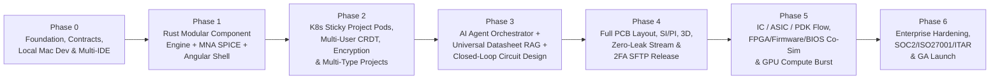

# 11 — Phased Implementation Roadmap & Risk Register

> **Scope:** Sequences the construction of **Signal** from Phase 0 foundation through General Availability (GA), defining concrete deliverables, measurable exit criteria, and technical risk mitigations so parallel engineering teams (Antigravity + Cursor) ship working increments continuously.

---

## 1. Strategic Sequencing Philosophy

Building a full AI-Agent-First Cloud EDA suite spanning SPICE, PCB, IC/ASIC, FPGA, Firmware, BIOS, Zero-Trust Security, and Kubernetes is a deep multi-phase journey. We sequence delivery to **de-risk the hardest core physics, routing, and security pillars early**:

1. Lock **Contracts & Local Mac Dev Harness** first (unblocks parallel Antigravity + Cursor development immediately).
2. Prove the **Pure-Rust Modular Component Engine + MNA SPICE Solver** on real circuits before scaling to full PCB/IC geometry.
3. Prove **Kubernetes Sticky Multi-User Pod Routing + Envelope Encryption** early so collaboration and zero-trust are native from day one—never retrofitted.
4. Layer **Universal Datasheet RAG + Closed-Loop AI Agents** directly on top of the verified Rust engine.
5. Expand horizontally into **Full PCB Layout/Routing/SFTP**, **Full IC/Chip RTL-to-GDSII**, and **FPGA/Firmware/BIOS Co-Design**.

---

## 2. Detailed Phase Breakdown & Exit Criteria

### Phase 0 — Repository Foundation, Contracts, Monorepo Build/Release & 3-Tier Local/K8s Harness
- **Deliverables:**
  - Monorepo workspace skeleton (`contracts/`, `engine/`, `services/`, `ai/`, `web/`, `infra/`, `scripts/`, `releases/`, `coordination/`) + root **`VERSION`**, **`CHANGELOG.md`**, unified **`./signal.sh` → `scripts/signal_ops.py` + `scripts/components.toml`** (Python `3.15+` stdlib-only common build/check/image/release/deploy/rollback CLI used identically locally & in thin CI workflows, with `justfile` thin aliases, [`20-*`](./20-versioning-release-monorepo-build-and-k8s-topology.md)).
  - Canonical `v1` Protobuf (`Buf`), OpenAPI 3.1, and JSON schemas with automated build-time Rust `1.100+` (`signal-proto`), Python `3.15+` (Pydantic v2), & TypeScript `6.0+` (`longAsBigint: true`) codegen (`universal_parts.proto`, `mcad_cam_print.proto`, `plm_ops.proto`, `platform_release.proto`, `collab_review.proto`).
  - Automated Release Notes & Compatibility pipeline (thin `.github/workflows/{pr-gate,release,deploy-gitops}.yml` calling `./signal.sh`, `releases/compatibility.json` with `N-2` wire window & `physics_determinism_epoch`, `releases/notes/vX.Y.Z.{md,json}`, SLSA L3 + Cosign + `SPDX 3.0` SBOM) + Umbrella Helm Chart (`infra/k8s/helm/signal/`: **Tier 1 separate `signal-web` Angular `v22+`+Node `26` pod `pool-web`, Tier 2 dedicated HA Python `3.15+` FastAPI/Granian `signal-api-gateway` + Envoy `signal-engine-bridge` `pool-api`, Tier 3 `1–4` baseline extensible to `N` Rust `1.100+` worker nodes `pool-rust-engine`**).
  - Local macOS Apple Silicon dev harness (`./signal.sh dev [lite|full|k8s]` / `just dev`, `< 1.5 GB RAM` `dev:lite` + `dev:full` Docker ARM64 + `dev:k8s` 3-tier K8s `1.37+` parity; native Rust `1.100+` + FastAPI/Granian + Angular `v22+` HMR + Ollama/MLX/`deterministic_mock` auto-detection).
  - Hard-guarded local **`Guest` @ `Signal Design, Inc.`** (`local-guest-0001` in `local-git-mock`) & CI binary symbol guard verifying `dev-guest-auth` can never ship in release artifacts.
  - Multi-AI-IDE collaboration setup (`.cursor/rules/*.mdc`, `.agents/skills/*/SKILL.md` [19 skills], `AGENTS.md`, `docs/engineering/{ANGULAR_UI_STYLE_GUIDE,FASTAPI_ENGINEERING_GUIDE}.md`, `coordination/TASK_BOARD.md`).
- **Exit Criteria:** A developer on macOS runs `./signal.sh dev` (or `./signal.sh dev k8s`), lands in the Angular `v22+` shell as `Guest @ Signal Design, Inc.`, receives a health-check pong from both `signal-pod` (via `signal-engine-bridge`) and local Mac Ollama/MLX LLM, `./signal.sh release preview` emits valid Release Notes, `./signal.sh check` passes green locally and in CI identically, and Antigravity + Cursor merge parallel PRs without conflict.

### Phase 1 — Core Rust Modular Component Engine, Equilibrated MNA SPICE & Schematic MVP
- **Deliverables:**
  - `signal-core` & `signal-component`: Strongly-typed SI units (`m` vs `Meg` safe), `SecretBox`, Hybrid PQC primitives, and full `ElectronicModule` trait (charge/flux-conserving ports, tolerances, TCR, parasitics, thermal self-heating, SOA watchdog, fault injection, hierarchical subcircuits).
  - `signal-lib-passive`, `signal-lib-semiconductor` & `signal-module-sdk` (multi-dialect SPICE parser): Resistors, MLCCs (DC-bias), Inductors (saturation), Diodes, BJTs, SiC/GaN MOSFETs, Op-Amp macro.
  - `signal-sim` & `benchmarks/`: Ruiz-equilibrated `f64`/`f128` sparse MNA solver (`0.5-ULP` deterministic `core_math`), `C^2` smooth limiting, TR-BDF2, DC/AC/Noise/Transient/Monte-Carlo, and continuous **NGSPICE/XYCE Golden Parity Suite**.
  - `signal-graph`: In-memory ECS graph with topological-invariant CRDT, per-actor selective causal Undo/Redo, and Copy-on-Write (CoW) branching.
  - Angular Schematic Canvas + Color-Blind-Safe Palettes + Interactive Arrow-Streamed Waveform Viewer + In-App **"What's New"** Release Notes Drawer (`20-*`).
  - **Extended Features (`17-*`):** Schematic auto-beautifier (`FEAT-001`), typed bus ribbons (`FEAT-002`), interactive on-canvas potentiometers/switches (`FEAT-003`), animated current rivers (`FEAT-004`), cross-sheet portals (`FEAT-005`), geographical re-annotation (`FEAT-009`), virtual bench instruments & waveform formula DSL (`FEAT-081`, `FEAT-082`), what-if parameter scrubbers (`FEAT-085`), Omni-Palette CLI (`FEAT-091`), WCAG keyboard CAD (`FEAT-100`), visual smoke sandbox & resistor/SMD quick-calculators (`FEAT-113`, `FEAT-114`).
- **Exit Criteria:** Series/parallel chains, RLC filters, BJT/MOSFET stages, and a 2 MHz GaN synchronous buck converter simulate deterministically (`ARM64 Mac == x86_64 Linux`, `< 0.2%` deviation vs. golden SPICE benchmarks) with live SOA probes in Angular.

### Phase 2 — 3-Tier K8s Project Pods (`1–4` Extensible Rust Nodes), BYO-Git, Universal Parts, Collab Hub & Access Review
- **Deliverables:**
  - `services/vcs-connector` & `engine/crates/signal-git-sync`: 2FA-gated Customer BYO-Git setup (`GitProviderAdapter` for **GitHub**, **GitLab**, **Bitbucket**, `ORG_NAMESPACE` + student `USER_NAMESPACE`, custom PKI CA), automatic `<project>-meta` + lazy `<project>-<type>` repo provisioning (`<= 40/min`, bound by immutable `provider_repo_id`), **Dual-Fenced Two-Phase `Super-Commit` lockstep**, Padmé-blinded `AES-256-GCM-SIV` `ENCRYPTED_VAULT` (95%+ Git dedup), and visual semantic diff (`libs/visual-diff`).
  - **Universal Component, Datasheet, Symbol, Parametric Padstack & 3D Asset Repository (`18-*`):** `engine/crates/signal-parts`, `services/parts-registry`, and `web/libs/library-studio` implementing 3-Tier Federated Resolution (Sharded Global Git + BLAKE3 CAS → Encrypted Org BYO-Git `<org>/signal-org-parts` AVL Overlays → Project `.signal/parts.lock.json`), Master Pin Table (`pins.json`) bijection, Dual-Standard IEEE/IEC Symbols, Parametric Padstacks (`PadstackDef`), IPC-7351 Footprints, and 5-Gate 3D STEP pin-to-pad alignment verification.
  - **Zero-Leak 5-Team Collaboration Space & Live Project Status (`21-*`):** `services/collab-hub` + `signal-huddle-sfu` + `web/libs/collab-hub` delivering DEK-encrypted RBAC-scoped channels (`Design`, `Dev/Bring-Up`, `Software/FW`, `Manufacturing`, `Ops`), live `@entity` anchors, encrypted WebRTC audio/video + viewport-follow huddles, and native Project Status/RAG/Dependencies/Action-Items/`ADR` tracking.
  - **Provider-Driven User Auth & Access Review Console:** Dual-bound OAuth PKCE + SAML SSO, GraphQL/`ETag` roster sync, uniform `404` RBAC, contractor `expires_at`, and live **Org & Project Admin Access Review Consoles** with 21 CFR Part 11 `ML-DSA` attestations.
  - `services/vcs-auditor`: Periodic + webhook multi-provider security vulnerability, drift & CVE auditor + Posture Score `0–100`.
  - `signal-operator` (`kube-rs`), `session-broker` & `signal-engine-bridge`: Host-Aggregated K8s `Lease` fencing across **`1–4` baseline (extensible to `N`) `pool-rust-engine` worker nodes**, multi-version Rust pod coexistence (`platform.lock.json`), predictive Warm Pool, in-pod Memory Governor, `< 150 ms` 3-Phase Pre-Copy Live Migration, Envoy zero-copy WebTransport/`turns:443` sticky relay, conflating ring buffers, and ephemeral BYOK continuity WAL.
  - Multi-Type Projects (`PRD`, `HFS`, `CAD_MCAD`, `CAM_CNC`, `PRINT_3D`, `PLM_OPS`, etc.), SPDX license gate, Templates, spatial review redlining (`libs/review`), and **Progressive UI Profiles (`EXPLORER` / `MAKER` / `PRO`)**.
  - **Extended Features (`17-*`):** Multi-channel `Repeat(N)` (`FEAT-006`), variant stuffing curtains (`FEAT-007`), interactive pin/gate swapper (`FEAT-008`), KaTeX math-linked schematics (`FEAT-010`), IPC-7351 parametric footprint+STEP generator & symbol splitter (`FEAT-071`, `FEAT-072`), zero-download WebAudio audition (`FEAT-090`), Multi-Monitor Zero-Leak pop-outs (`FEAT-092`), Radial Pie-Menu + SpaceMouse WebHID (`FEAT-093`), Follow-Mode/Laser Pointer (`FEAT-094`), X-Ray net isolation (`FEAT-096`), Visual History Time-Scrubber (`FEAT-097`), topological bulk query (`FEAT-099`), and Breadboard↔Schematic↔PCB Twin (`FEAT-111`).
- **Exit Criteria:** Multi-repo Project provisions `<project>-*` repos with atomic `Super-Commit`s and pinned `parts.lock.json`; two authorized users join the exact same Pod via `signal-engine-bridge` across `1–4` Rust worker nodes while collaborating in RBAC-scoped `collab-hub` channels/huddles; live pod resize completes with zero dropped collaborators.

### Phase 3 — Neuro-Symbolic AI Agents, Differentiable Sizing & Verified Datasheet/Supply-Chain RAG
- **Deliverables:**
  - `ai/datasheet-ingest`: Sandboxed **Dual-VLM consensus parser** (`orderable_mpn + package + die_rev` + Silicon Errata), 3-way Symbol-Footprint-STEP pin verifier, and `BRONZE`/`SILVER`/`GOLD` cryptographic trust badges feeding `signal-universal-parts`.
  - `ai/rag-service`: 3-Tier Sharded `pgvector` HNSW indexes (`GLOBAL_VERIFIED` vs. per-org `ORG_PRIVATE_NDA` RLS) + **Signal-mirrored & `4×` chaff-padded live supply-chain stock/lead-time & Embodied Carbon / PFAS Digital Product Passports**.
  - `engine/crates/signal-diff-sim`, `signal-surrogate`, `signal-magnetics` & `signal-import`: **End-to-End Saltation + `Revolve` Adjoint Differentiable Optimizer**, `< 50 ms` GPU PINN surrogate previews, and **Sandboxed Clean-Room Legacy CAD (KiCad/Altium/OrCAD) & Whiteboard Importer**.
  - `ai/llm-gateway` & `ai/orchestrator`: **`GBNF` grammar-constrained decoding**, Multimodal VLM + Dual-LLM prompt-injection quarantine, K-Hop cone-of-influence slicing, **Multilingual Socratic AI Tutor**, and **SignalBench-AI** 200-task benchmark.
  - **Extended Features (`17-*`):** Custom magnetics winding studio (`FEAT-021`), Bode pole-zero compensator & power-sequencing Gantt (`FEAT-026`, `FEAT-030`), org derating dashboard (`FEAT-040`), live bus protocol decoders & SAT pinmux solver (`FEAT-053`, `FEAT-055`), curve-fitter, Rust/WASM module test-rig, AVL where-used, franchise lineage, datasheet rev-differ & Golden Snippets (`FEAT-073`–`075`, `FEAT-077`–`079`), Monte-Carlo/Tornado yield explorer & regression test runner (`FEAT-083`, `FEAT-086`), stage-gate checklists (`FEAT-098`), AI circuit explainer, breaking-point explorer, Pareto frontier, 200-pt Red-Team auditor, NL rule compiler, datasheet-to-testbench, BOM consolidator, Live Review Deck, quarantined translator (`FEAT-101`–`105`, `FEAT-107`–`110`), and auto-graded classroom labs (`FEAT-112`).
- **Exit Criteria:** Autonomous buck/LDO/filter synthesis converges in milliseconds via `signal-diff-sim` (zero LLM oscillation), produces an Immutable Design Proof Bundle, and passes all Monte-Carlo corners on both Local Mac LLM and VPC GPUs.

### Phase 4 — Full PCB, Integrated CAD/CAM, 3D Printing, Unified 3D View, Native PLM-Ops, Auto Reviews & 2FA SFTP
- **Deliverables:**
  - `signal-geom`, `signal-pcb`, `signal-em3d`, `signal-power-integrity`, `signal-emc`, `signal-dfm`, `signal-harness`: Overflow-proof `i128`/Shewchuk exact predicates + arc/Bézier curves, 2D BEM + **GPU 3D Full-Wave EM**, analytical placer + push-and-shove/224G diff-pair router, multi-board cable/harness co-design, **IEEE 1149.1/1687 JTAG & ICT synthesis**, and RAM-only Gerber X2 / ODB++ / IPC-2581 writers.
  - **Integrated Mechanical CAD/CAM, 3D Printing & Native PLM / Supply-Chain Operations (`19-*`):**
    - `engine/crates/signal-mcad` + `web/libs/mcad-studio`: Parametric 2D constraint sketcher, B-Rep 3D solid modeling, sheet-metal K-factor unfold (`DXF`), assembly mates, GD&T PMI, and live bi-directional `signal-pcb` ↔ `signal-mcad` anchors (`<project>-cad`).
    - `engine/crates/signal-cam` + `web/libs/cam-print`: 2.5D/3/`3+2`/5-axis adaptive CNC toolpaths, voxel/dexel `±10 µm` gouge & fixture BVH collision simulation, signed CNC post-processors (`<project>-cam`), AND direct-B-Rep 3D-printing slicer across FDM/SLA/SLS/DMLS with auto-orientation, tree/metal supports, gyroid infill, and embedded-PCB pause-insert layers (`<project>-3dprint`).
    - `engine/crates/signal-plm` + `services/plm-ops` + `web/libs/plm-ops`: Live auto-compiled `eBOM` ↔ `mBOM` ↔ `sBOM` ↔ `Costed BOM`, signed `ECR`/`ECO`/`ECN`, `MCN`, `PCN`/`PDN` blast-radius & Zero-Spin BOM Rescue, **hard qty/time-gated `Deviation`/`Waiver`**, 8D `NCR`/`CAPA`, Clear-to-Build (`CTB`) shortage cockpit, interactive 3D factory work instructions, and `signal-egress-proxy` ERP/MES webhooks (`<project>-ops`).
  - **Automated Weekly, Monthly & Stage-Gate Project Status Review Engine (`21-*`):** Deterministic ground-truth compiler + quarantined `GBNF` narrative synthesizer generating signed `WEEKLY_REVIEW`, `MONTHLY_REVIEW`, and `PROJECT_STATUS_REVIEW` decks archived in `<project>-ops/reviews/` with Step-Up 2FA `ML-DSA-65` executive sign-off.
  - `signal-render`: Unified Cross-Discipline 3D PBR & 2D Multi-Pane GPU Atlas (rendering PCB + CAD enclosures + CNC toolpaths + 3D-print slices + wire harnesses + thermal/EM/gouge heatmaps together via `Zstd-QOI`/WebP dirty tiles + hardware `HEVC`/Dual-Luma motion stream + **Tardos + Topological Constellation watermarks**).
  - `sftp-egress`: Step-Up Passkey/burn-listed TOTP 2FA, socket-pinned anti-SSRF, disposable `russh` write-only workers, **atomic `.tmp.part` → SHA-256 read-back → `rename`**, Hybrid `ML-DSA-65` manifest signing, active `Deviation` gate check, and GDPR-safe pseudonymous WORM Merkle audit logs for PCB, MCAD `STEP AP242`/`DXF`, CNC `G-code`, 3D-Print `3MF`, and turnkey CM packages.
  - **Extended Features (`17-*`):** Full high-speed/RF/HDI/flex suite (`FEAT-011`–`020`), PDN `Z_target(f)` optimizer, 3D geodesic creepage, heavy-copper IR-drop, SiC/GaN hot-loop & thermal airflow studio (`FEAT-022`–`025`, `FEAT-029`), `CISPR`/`FCC` pre-compliance, Middlebrook EMI filter, ESD/surge clamping, shield-can resonance, adjoint WCCA & MLCC piezo-singing (`FEAT-031`–`034`, `FEAT-037`, `FEAT-039`), memory-map explorer, graphical FSM & fixed-point DSP (`FEAT-054`, `FEAT-057`, `FEAT-060`), multi-board 3D clearance, 1:1 harness nailboard, panelizer + MLCC flex-crack guard, DFA reflow/tombstone/coating, dynamic GD&T drawings, live should-cost HUD, ICT coverage, interactive factory board-map, padstack/MSL checkers (`FEAT-061`–`064`, `FEAT-066`–`070`, `FEAT-076`, `FEAT-080`), PAM4 jitter/COM, 3D EM field animator, TDR-to-trace-mm mapper, constraint spreadsheet, AI waveform anomaly debugger (`FEAT-084`, `FEAT-087`, `FEAT-089`, `FEAT-095`, `FEAT-106`), plus FinOps telemetry, Policy-as-Code rules, portfolio DAG, and External Partner Guest Review (`FEAT-116`–`119`).
- **Exit Criteria:** PRD → HFS → AI Schematic → 8-layer high-speed PCB + Parametric B-Rep Enclosure (`CAD_MCAD`) + 5-Axis CNC Heatsink (`CAM_CNC`) + 3D-Printed Bracket (`PRINT_3D`) + Released `mBOM`/`ECN`/`MCN`/`CTB` (`PLM_OPS`) + Signed Weekly/Monthly/Stage-Gate Status Review (`collab-hub`) → 2FA atomic SFTP turnkey release verified end-to-end with razor-sharp Zero-Leak 3D rendering.

### Phase 5 — IC / 100B-GPU Suite, Formal/UPF/Aging, HW Security, FPGA/FW Co-Sim & Digital Twin
- **Deliverables:**
  - `signal-ic`, `signal-formal`, `signal-aging`, `signal-fpga`, `signal-security-hw`: Encrypted foundry + Open-Silicon PDKs, BSIM-CMG/PSP + AOT Cranelift Verilog-A, WASM PCELLs, **SAT/SMT/IC3 Formal & LEC (`signal-formal`)**, **IEEE 1801 UPF low-power verification**, **15-yr BTI/HCI/TDDB/EM aging (`signal-aging`)**, DFT/ATPG, hierarchical DRC/LVS/PEX, MMMC STA, UCIe 3D-IC & Co-Packaged Optics (CPO), and GDSII/OASIS SFTP release.
  - **100B-Transistor GPU Scale-Out:** `SILICON_SCALE` federation via **signed immutable abstract & `20 µm` Halo views + `signal-federation-broker`** across extended `core-highmem` / `core-gpu` Rust worker nodes (`20-*`, zero direct pod-to-pod lateral traffic!).
  - `signal-lib-firmware-bridge` & `signal-twin`: Embedded Monaco HDL/C/Rust/UEFI IDE, **3-Speed Co-Sim (`100+ MIPS` ISS → RTL → SPICE)**, and **Post-Silicon Lab Oscilloscope/VNA Digital Twin Calibration**.
  - Multi-Physics WASM/Rust Domain Plugin SDK (Photonics, Quantum/Cryo-CMOS, MEMS).
  - **Extended Features (`17-*`):** BMS pack & FOC motor co-sim (`FEAT-027`, `FEAT-028`), ISO 26262 FMEDA/FTA & Rad-Hard SEU/SET (`FEAT-035`, `FEAT-036`, `FEAT-038`), full advanced IC/3D-IC/HW-Security suite (`FEAT-041`–`050`: `gm/Id`, common-centroid, Liberty `.lib` char, BSPDN, SoC/NoC floorplan, CTS, interactive STA, chiplet bumps, OPC/CMP, DPA/TVLA + GLIFT), FPGA die/SLR/SSO floorplan & SDC verifier (`FEAT-051`, `FEAT-052`), firmware battery-life profiler, cold-boot/UEFI & virtual HIL fault bench (`FEAT-056`, `FEAT-058`, `FEAT-059`), solder-joint fatigue/drop-shock modal (`FEAT-065`), Shmoo plots (`FEAT-088`), `TinyTapeout` wizard (`FEAT-115`), and `Signal Campus Edge` (`FEAT-120`).
- **Exit Criteria:** Sky130/GF180 mixed-signal IC passes Schematic → Adjoint Sizing → Formal LEC/UPF → PEX/Aging SPICE → DRC/LVS/TVLA Clean → atomic SFTP GDSII tape-out; RTOS boots at `100+ MIPS` and interacts live with simulated analog hardware.

### Phase 6 — Confidential Silicon Computing, Elastic `1–4 -> N` Node Scaling, Isolation Red-Teaming & GA
- **Deliverables:**
  - Enterprise BYOK/HYOK (`2-level HKDF` RAM caching), **`CONFIDENTIAL_SILICON` (AMD SEV-SNP / Intel TDX + Exclusive Hopper `H100 CC` or Blackwell `B200 TEE-I/O` Confidential MIG)**, Wasmtime `EXPLORER` Isolate Cells (`< 8 MB`), Kata MicroVMs, Karpenter elastic scaling from **`1–4` baseline to `N` specialized Rust Core Engine worker nodes**, Cilium 3-tier eBPF + Tetragon/Falco auto-quarantine, SLSA L3 Cosign + Kyverno gates, Argo Rollouts Canary auto-rollback, In-Jurisdiction Paired-Region DR, and ≥2 Super Admin 2-of-3 Quorum break-glass.
  - Automated **Cross-Project Isolation & OWASP ASVS L3/LLM Red-Team Suite** + external penetration testing + 50,000-net PCB / 100B-transistor federated SoC (`20 µm` Halo + MapReduce DRC/LVS) load benchmarks + full 120-feature (`FEAT-001`–`FEAT-120`) + Universal Parts (`18-*`) + CAD/CAM/3D-Print/PLM (`19-*`) + Multi-Version Upgrade (`20-*`) end-to-end conformance regression.
  - SOC 2 Type II, ISO 27001, TISAX, 21 CFR Part 11, and ITAR sovereign deployment certification.
- **Exit Criteria:** Zero critical/high pen-test findings, 100% pass on cross-project isolation, golden physics, CAD/CAM/PLM, and 120-feature conformance suites, GA launch ready.

---

## 3. Technical Risk Register & Architectural Mitigations

| Risk | Severity | Impact | Mitigation Built Into Architecture |
|---|---|---|---|
| **SPICE Precision Collapse, Hybrid Adjoint Jumps, or Small-Matrix GPU Slowdown** | High | Simulation stalls, wrong switching gradients, or slow transient steps. | Ruiz equilibration + `f128` refinement, exact `q(v)`/`Φ(i)` conservation, **Filippov Saltation Matrices + `Revolve` $O(\log N_t)$ checkpointing**, **CPU `KLU`/`CKTSO` (`<25k`) ↔ GPU `cuDSS`/mixed-precision dispatcher**, and NGSPICE/XYCE golden CI suite. |
| **LLM Hallucinated Pinouts, Context-Free `25°C` Ratings, or Visual Prompt Injection** | High | Field thermal/DC-bias board failures or hijacked agents. | Dual-VLM Zero-Tool Quarantine (text + vision!), **condition-parameterized curves (`C(V,T,f)`, copper-coupled `R_thetaJC/JB`)**, 3-way Symbol/Footprint/STEP check (`18-*`), Saltation/PSS Adjoint sizing, and merge-time proof delta re-verification. |
| **External Git Split-Brain, `80/min` Rate-Limit Blocks, or Vault Side Channels** | High | Zombie pod overwrites, blocked classroom templates, or IP size/path leaks. | **Dual-Gate External Fencing (`signal-egress-proxy` epoch gate + `<project>-meta` CAS first)**, `<= 40/min` lazy repo materialization, blobless partial clones, **Padmé-padded + path-blinded + `.signal/vault.merkle.sig` `AES-256-GCM-SIV`**, and BYOK-wrapped Continuity WAL. |
| **Unaccelerated `AV1 4:4:4` CPU Drain, `COOP`/OAuth Breakage, or AI Watermark Stripping** | High | 100% laptop CPU drain, broken SSO logins, or scrubbed photo leaks. | **Dual-Plane `Zstd-QOI`/WebP lossless tiles + hardware-probed `HEVC 4:4:4`/Dual-Luma `AV1`**, route-partitioned `COOP`/`COEP` + `__Host-` cookie upgrade, **Topological/Geometric Constellation Watermarks**, and Attested Browser OS capture lock. |
| **Pod `etcd` Lease Storms, `128 GB` Migration Stalls, or `50k`-Partition Postgres Bloat** | High | Control-plane saturation or dropped multi-user sessions. | Host-Aggregated Node Leases (`100×` fewer `etcd` writes), **3-Phase Pre-Copy `< 150 ms` Live Migration**, `< 8 MB` Wasmtime `EXPLORER` isolates, and **3-Tier `pgvector` Sharding (`<= 500` partitions/cluster)**. |
| **Quantum "Harvest Now, Decrypt Later", Hopper `MIG+CC` Mismatch & Foundry IP Lock-In** | High | Future quantum decryption, invalid GPU config, or blocked commercial PDKs. | Hybrid PQC (`ML-KEM-768` + `ML-DSA-65`), **Exclusive `H100 CC` vs. Blackwell `B200 TEE-I/O` Confidential MIG**, HSM **IEEE 1735** key-block, and child-MicroVM `OSDI`/`IBIS-AMI` IPC sandboxes. |
| **ECAD↔MCAD Step-File Drift, Unbounded Factory Deviations, or Unapproved BOM Swaps (`18-*`, `19-*`)** | High | Enclosures colliding with PCB connectors, expired factory concessions shipping, or NDA AVL leaks. | Live parametric `signal-pcb` ↔ `signal-mcad` anchors, direct-B-Rep CNC/3D slicing (`signal-cam`), **hard qty & `expires_at_utc` SFTP release blocks on `Deviation`/`Waiver`s (`services/plm-ops`)**, and encrypted Org BYO-Git `<org>/signal-org-parts` AVL overlays (`signal-parts`). |
| **Noisy-Neighbor Pod Starvation, API Bridge Jitter, or Rolling-Upgrade Physics/Chunk Skew (`20-*`)** | High | UI/API pods starved by SPICE/CAM bursts, `ChunkLoadError` during deploys, or shifted tape-out hashes. | **3-Tier K8s `1.37+` Pool Isolation** (`pool-web` separate Angular `v22+` + Node `26 LTS+` pod, `pool-api` HA Python `3.15+` FastAPI/Granian `signal-api-gateway` + native Envoy `signal-engine-bridge`, `pool-rust-engine` `1–4 -> N` extensible Rust `1.100+` worker nodes), **per-project LTS engine pinning (`platform.lock.json`) + `physics_determinism_epoch`**, `N-3` chunk retention, and Expand-and-Contract PostgreSQL `19+` migrations. |
| **JS `2^53` `int64` Precision Loss or Parallel Antigravity + Cursor Protocol Drift** | Medium | Silent coordinate rounding or client/server state-machine mismatch. | Mandatory **ES2020 `bigint` (`jstype = JS_STRING` / `longAsBigint: true`)**, shared `signal-proto` crate, `contracts/fixtures/`, and **replayable `contracts/transcripts/*.jsonl`** in CI. |
