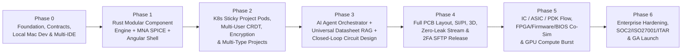

# 11 — Phased Implementation Roadmap & Risk Register

> **Scope:** Sequences the construction of **Signal** from Phase 0 foundation through General Availability (GA), defining concrete deliverables, measurable exit criteria, and technical risk mitigations so parallel engineering teams (Antigravity + Cursor) ship working increments continuously.

---

## 1. Strategic Sequencing Philosophy

Building a full AI-Agent-First Cloud EDA suite spanning SPICE, PCB, IC/ASIC, FPGA, Firmware, BIOS, Zero-Trust Security, and Kubernetes is a deep multi-phase journey. We sequence delivery to **de-risk the hardest core physics, routing, and security pillars early**:

1. Lock **Contracts & Local Mac Dev Harness** first (unblocks parallel Antigravity + Cursor development immediately).
2. Prove the **Pure-Rust Modular Component Engine + MNA SPICE Solver** on real circuits before scaling to full PCB/IC geometry.
3. Prove **Kubernetes Sticky Multi-User Pod Routing + Envelope Encryption** early so collaboration and zero-trust are native from day one—never retrofitted.
4. Layer **Universal Datasheet RAG + Closed-Loop AI Agents** directly on top of the verified Rust engine.
5. Expand horizontally into **Full PCB Layout/Routing/SFTP**, **Full IC/Chip RTL-to-GDSII**, and **FPGA/Firmware/BIOS Co-Design**.

---

## 2. Detailed Phase Breakdown & Exit Criteria

### Phase 0 — Repository Foundation, Contracts & Parallel Dev Harness
- **Deliverables:**
  - Monorepo workspace skeleton (`contracts/`, `engine/`, `services/`, `ai/`, `web/`, `infra/`, `coordination/`).
  - Canonical `v1` Protobuf (`Buf`), OpenAPI, and JSON schemas with automated Rust & TypeScript codegen.
  - Local macOS dev harness (`docker-compose` for Postgres+pgvector, Redis, NATS, MinIO, DevKMS, Mock SFTP; native Rust `cargo` + Angular HMR + Ollama/MLX auto-detection).
  - Hard-guarded local **`Guest` @ `Signal Design, Inc.`** seed & CI guard verifying `dev-guest-auth` can never ship in release artifacts.
  - Multi-AI-IDE collaboration setup (`.cursor/rules/`, `AGENTS.md`, `coordination/TASK_BOARD.md`, Git worktree scripts).
- **Exit Criteria:** A developer on macOS runs one bootstrap command, lands in the Angular shell as `Guest @ Signal Design, Inc.`, receives a health-check pong from both `signal-engine` and local Mac Ollama/MLX LLM, and Antigravity + Cursor merge parallel PRs without conflict.

### Phase 1 — Core Rust Modular Component Engine, Equilibrated MNA SPICE & Schematic MVP
- **Deliverables:**
  - `signal-core` & `signal-component`: Strongly-typed SI units (`m` vs `Meg` safe), `SecretBox`, Hybrid PQC primitives, and full `ElectronicModule` trait (charge/flux-conserving ports, tolerances, TCR, parasitics, thermal self-heating, SOA watchdog, fault injection, hierarchical subcircuits).
  - `signal-lib-passive`, `signal-lib-semiconductor` & `signal-module-sdk` (multi-dialect SPICE parser): Resistors, MLCCs (DC-bias), Inductors (saturation), Diodes, BJTs, SiC/GaN MOSFETs, Op-Amp macro.
  - `signal-sim` & `benchmarks/`: Ruiz-equilibrated `f64`/`f128` sparse MNA solver (`0.5-ULP` deterministic `core_math`), `C^2` smooth limiting, TR-BDF2, DC/AC/Noise/Transient/Monte-Carlo, and continuous **NGSPICE/XYCE Golden Parity Suite**.
  - `signal-graph`: In-memory ECS graph with topological-invariant CRDT, per-actor selective causal Undo/Redo, and Copy-on-Write (CoW) branching.
  - Angular Schematic Canvas + Color-Blind-Safe Palettes + Interactive Arrow-Streamed Waveform Viewer.
- **Exit Criteria:** Series/parallel chains, RLC filters, BJT/MOSFET stages, and a 2 MHz GaN synchronous buck converter simulate deterministically (`ARM64 Mac == x86_64 Linux`, `< 0.2%` deviation vs. golden SPICE benchmarks) with live SOA probes in Angular.

### Phase 2 — K8s MicroVM Project Pods, Two-Phase Multi-Repo BYO-Git, Provider Auth & Access Review
- **Deliverables:**
  - `services/vcs-connector` & `engine/crates/signal-git-sync`: 2FA-gated Customer BYO-Git setup (`GitProviderAdapter` for **GitHub**, **GitLab**, **Bitbucket**, `ORG_NAMESPACE` + student `USER_NAMESPACE`, custom PKI CA), automatic `<project>-meta` + `<project>-<type>` repo provisioning (bound by immutable `provider_repo_id`), **Two-Phase `Super-Commit` lockstep**, convergent `AES-256-GCM-SIV` `ENCRYPTED_VAULT` (95%+ Git dedup), and visual semantic diff (`libs/visual-diff`).
  - **Provider-Driven User Auth & Access Review Console:** Dual-bound OAuth PKCE + SAML SSO, GraphQL/`ETag` roster sync, uniform `404` RBAC, contractor `expires_at`, and live **Org & Project Admin Access Review Consoles** with 21 CFR Part 11 `ML-DSA` attestations.
  - `services/vcs-auditor`: Periodic + webhook multi-provider security vulnerability, drift & CVE auditor + Posture Score `0–100`.
  - `signal-operator` (`kube-rs`) & `session-broker`: Linearizable K8s `Lease` fencing, predictive Warm Pool, in-pod Memory Governor, `< 150 ms` Live Pod Resize/Migration, Envoy zero-copy WebTransport/`turns:443` sticky relay, conflating ring buffers, and ephemeral BYOK continuity WAL.
  - Multi-Type Projects (`PRD`, `HFS`, etc.), SPDX license gate, Templates, spatial review redlining (`libs/review`), and **Progressive UI Profiles (`EXPLORER` / `MAKER` / `PRO`)**.
- **Exit Criteria:** Multi-repo Project provisions `<project>-*` repos with atomic `Super-Commit`s; two authorized users join the exact same Pod while unauthorized/contractor scopes are strictly isolated; live pod resize completes with zero dropped collaborators; `vcs-auditor` catches simulated drift.

### Phase 3 — Neuro-Symbolic AI Agents, Differentiable Sizing & Verified Datasheet/Supply-Chain RAG
- **Deliverables:**
  - `ai/datasheet-ingest`: Sandboxed **Dual-VLM consensus parser** (`orderable_mpn + package + die_rev` + Silicon Errata), 3-way Symbol-Footprint-STEP pin verifier, and `BRONZE`/`SILVER`/`GOLD` cryptographic trust badges.
  - `ai/rag-service`: Physically partitioned `pgvector` HNSW indexes (`GLOBAL_VERIFIED` vs. per-org `ORG_PRIVATE_NDA` RLS) + **k-anonymous live supply-chain stock/lead-time & Embodied Carbon / PFAS Digital Product Passports**.
  - `engine/crates/signal-diff-sim`, `signal-surrogate` & `signal-import`: **End-to-End Adjoint Differentiable Optimizer**, `< 50 ms` GPU PINN surrogate previews, and **Sandboxed Clean-Room Legacy CAD (KiCad/Altium/OrCAD) & Whiteboard Importer**.
  - `ai/llm-gateway` & `ai/orchestrator`: **`GBNF` grammar-constrained decoding**, Dual-LLM prompt-injection quarantine, K-Hop cone-of-influence slicing, **Multilingual Socratic AI Tutor**, and **SignalBench-AI** 200-task benchmark.
- **Exit Criteria:** Autonomous buck/LDO/filter synthesis converges in milliseconds via `signal-diff-sim` (zero LLM oscillation), produces an Immutable Design Proof Bundle, and passes all Monte-Carlo corners on both Local Mac LLM and VPC GPUs.

### Phase 4 — Full PCB, Harness, 3D EM, Zero-Leak `YUV 4:4:4` Stream & Atomic 2FA SFTP
- **Deliverables:**
  - `signal-geom`, `signal-pcb` & `signal-em3d`: Overflow-proof `i128`/Shewchuk exact predicates + arc/Bézier curves, 2D BEM + **GPU 3D Full-Wave EM**, analytical placer + push-and-shove/224G diff-pair router, multi-board cable/harness co-design, **IEEE 1149.1/1687 JTAG & ICT synthesis**, and RAM-only Gerber X2 / ODB++ / IPC-2581 writers.
  - `signal-render`: Composited Multi-Pane GPU Atlas (`YUV 4:4:4` lossless `AV1-SCC`/WebP dirty tiles + motion stream + `80 ms` crisp settle) + **Tardos collusion-resistant forensic watermarks**.
  - `sftp-egress`: Step-Up Passkey/burn-listed TOTP 2FA, socket-pinned anti-SSRF, disposable `russh` write-only workers, **atomic `.tmp.part` → SHA-256 read-back → `rename`**, Hybrid `ML-DSA-65` manifest signing, and GDPR-safe pseudonymous WORM Merkle audit logs.
- **Exit Criteria:** PRD → HFS → AI Schematic → 8-layer high-speed PCB (zero DRC/SI errors) → 2FA atomic SFTP release verified end-to-end with razor-sharp Zero-Leak rendering behind a TCP-443-only firewall.

### Phase 5 — IC / 100B-GPU Suite, Formal/UPF/Aging, 3-Speed FW Co-Sim & Digital Twin
- **Deliverables:**
  - `signal-ic`, `signal-formal` & `signal-aging`: Encrypted foundry + Open-Silicon PDKs, BSIM-CMG/PSP + OpenVAF Verilog-A compiler, WASM PCELLs, **SAT/SMT/IC3 Formal & LEC (`signal-formal`)**, **IEEE 1801 UPF low-power verification**, **15-yr BTI/HCI/TDDB/EM aging (`signal-aging`)**, DFT/ATPG, hierarchical DRC/LVS/PEX, MMMC STA, UCIe 3D-IC & Co-Packaged Optics (CPO), and GDSII/OASIS SFTP release.
  - **100B-Transistor GPU Scale-Out:** `SILICON_SCALE` federation via **signed immutable abstract views + `signal-federation-broker`** (zero direct pod-to-pod lateral traffic!).
  - `signal-lib-firmware-bridge` & `signal-twin`: Embedded Monaco HDL/C/Rust/UEFI IDE, **3-Speed Co-Sim (`100+ MIPS` ISS → RTL → SPICE)**, and **Post-Silicon Lab Oscilloscope/VNA Digital Twin Calibration**.
  - Multi-Physics WASM/Rust Domain Plugin SDK (Photonics, Quantum/Cryo-CMOS, MEMS).
- **Exit Criteria:** Sky130/GF180 mixed-signal IC passes Schematic → Adjoint Sizing → Formal LEC/UPF → PEX/Aging SPICE → DRC/LVS Clean → atomic SFTP GDSII tape-out; RTOS boots at `100+ MIPS` and interacts live with simulated analog hardware.

### Phase 6 — Confidential Silicon Computing, Isolation Red-Teaming & General Availability
- **Deliverables:**
  - Enterprise BYOK/HYOK, **`CONFIDENTIAL_SILICON` (AMD SEV-SNP / Intel TDX + NVIDIA Confidential H100/B200 GPUs)**, Kata MicroVMs, Cilium eBPF + Tetragon/Falco auto-quarantine, SLSA L3 Cosign + Kyverno gates, and ≥2 Super Admin M-of-N break-glass recovery.
  - Automated **Cross-Project Isolation & OWASP ASVS L3/LLM Red-Team Suite** + external penetration testing + 50,000-net PCB / 100B-transistor federated SoC load benchmarks.
  - SOC 2 Type II, ISO 27001, TISAX, 21 CFR Part 11, and ITAR sovereign deployment certification.
- **Exit Criteria:** Zero critical/high pen-test findings, 100% pass on cross-project isolation & golden physics suites, GA launch ready.

---

## 3. Technical Risk Register & Architectural Mitigations

| Risk | Severity | Impact | Mitigation Built Into Architecture |
|---|---|---|---|
| **SPICE Precision Collapse or Non-Convergence on Switching/IC Circuits** | High | Simulation stalls or drifts on stiff circuits. | Ruiz matrix equilibration, `f128` iterative refinement, exact charge/flux conservation, `C^2` smooth limiting, TR-BDF2, Vector-Fitted passive `.sNp` macromodels, and continuous NGSPICE/XYCE golden CI suite. |
| **LLM Hallucinated Pinouts, Bad OCR, or Parameter Oscillation** | High | Dead prototype boards or runaway token loops. | Dual-VLM consensus + 3-way Symbol/Footprint/STEP pin check (`SILVER`/`GOLD` badges), Neuro-Symbolic delegation of numerical sizing to `signal-diff-sim` Adjoint Pareto solver, and mandatory Rust ERC/SOA/Aging verification. |
| **Multi-Repo Cross-Domain Skew or Git Provider Outage** | High | Pinout mismatch between schematic & firmware, or blocked work during GitHub/GitLab downtime. | Two-Phase `Super-Commit` (`repos.lock.json`) across `<project>-*` repos + Ephemeral BYOK-Encrypted Continuity WAL (`< 500 ms` RPO) surviving external Git outages. |
| **Zero-Leak Video Blur, UDP Firewall Blocks, or Collusion Leaks** | High | Blurry 1px CAD wires, blocked enterprise network, or unattributed photo leak. | `YUV 4:4:4` lossless dirty-tile (`AV1-SCC`/WebP) + `80 ms` crisp settle, `turns:443`/WebTransport/WSS fallback, Tardos collusion-resistant watermarks + sub-pixel micro-jitter, and Enterprise Secure Browser OS capture lock. |
| **Project Pod Cold-Start, OOMKill, or Split-Brain Dual-Pod** | High | Sluggish UX, dropped 20-user session, or corrupted commits. | Predictive CPU warm pool + parallel shallow `gitoxide` fetch (`< 1.5 s`), In-Pod Memory Governor + live pod resize/migration, and linearizable Kubernetes `Lease` (etcd Raft) fencing tokens. |
| **Quantum "Harvest Now, Decrypt Later" & Cloud Host Snooping** | High | Long-term compromise of 2nm GPU / defense IP. | Hybrid Post-Quantum Crypto (`ML-KEM-768` + `ML-DSA-65`), convergent `AES-256-GCM-SIV` vault chunks, and `CONFIDENTIAL_SILICON` (AMD SEV-SNP + Confidential GPUs). |
| **Local Mac LLM Tool-Call Fragility or Parallel AI-IDE Drift** | Medium | Broken JSON tool calls on 7B models or unit mismatches between Antigravity & Cursor. | `GBNF` grammar-constrained decoding (5–8 tools/step), SI-unit-suffixed Protobuf fields (`_nm`, `_uv`), build-time codegen, golden `contracts/fixtures/`, and 24h stale-task lease expiry. |
