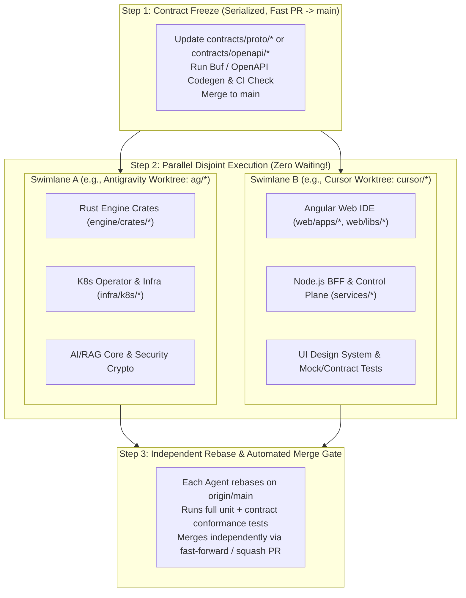

# 12 — Multi-AI-IDE Parallel Collaboration Protocol (Antigravity + Cursor)

> **Scope:** Establishes a strict, **deadlock-free** engineering and repository workflow so **Antigravity** and **Cursor** can build **Signal** simultaneously at full speed—with zero file collisions, zero circular wait deadlocks, zero broken interface contracts, and clean Git history.

---

## 1. Why Naive Multi-AI-IDE Collaboration Fails (and How We Prevent It)

Running two autonomous AI coding agents concurrently on the same repository typically breaks down in four ways:
1. **Working-Tree Clobbering:** Both IDEs edit files in the same folder simultaneously, overwriting uncommitted changes and corrupting builds/tests.
2. **Logical Deadlocks (Circular Wait):** Agent A waits for Agent B to finish a schema while Agent B waits for Agent A's service endpoint—or both hold file-based locks waiting for each other.
3. **Shared-File Contention:** Both agents append to `Cargo.toml`, `package.json`, `index.ts`, DB migration sequence numbers, or a single shared status file, causing constant merge conflicts.
4. **Convention & Architecture Drift:** Each IDE invents slightly different naming, error formats, or security shortcuts because instructions aren't unified.

**Signal eliminates all four failure modes using five classic distributed-systems guarantees:**
1. **Physical Isolation via Git Worktrees** (zero shared working directory).
2. **Contract-First Dependency DAG** (eliminates circular wait—deadlocks become structurally impossible).
3. **Disjoint Ownership Swimlanes & File-Scope Claims** (eliminates write-write collisions).
4. **Lock-Free Append-Only Coordination Ledger** (no mutual waiting; each agent only writes to its own journal).
5. **Single Canonical Rulebook & Automated CI Merge Gates** (guarantees identical engineering quality from both IDEs).

---

## 2. Physical Isolation: Mandatory Git Worktrees

**HARD RULE:** Antigravity and Cursor MUST **NEVER** operate in the same local checkout directory at the same time.

Instead, use **Git Worktrees** backed by a single shared `.git` object store on the developer's machine:

```text
~/workspaces/
├── signal-main/          # Clean read-only reference tracking origin/main
├── signal-antigravity/   # Worktree dedicated EXCLUSIVELY to Antigravity (branches: ag/*)
└── signal-cursor/        # Worktree dedicated EXCLUSIVELY to Cursor      (branches: cursor/*)
```

### Branch Naming Convention
- **Antigravity branches:** `ag/<task-id>-<short-slug>` (e.g., `ag/P1-04-resistor-mna-module`)
- **Cursor branches:** `cursor/<task-id>-<short-slug>` (e.g., `cursor/P1-07-angular-schematic-canvas`)
- **Contract-change branches (sequenced first):** `contract/<task-id>-<short-slug>` (merged into `main` BEFORE parallel implementation branches consume it).

---

## 3. Eliminating Deadlocks: Contract-First Acyclic Workflow

In operating systems, deadlock requires four Coffman conditions—most critically **Hold-and-Wait** and **Circular Wait**. We break BOTH structurally:



### Anti-Deadlock Rules
1. **No Cross-Agent Blocking Waits:** Neither AI IDE is ever permitted to "sleep/wait for the other agent." If an upstream implementation isn't merged yet, the agent builds against the **frozen `contracts/` mock/stub** generated from Protobuf/OpenAPI and merges cleanly!
2. **Strict Topological Ordering for Contracts:** If a task requires a new gRPC RPC or REST endpoint, a tiny **Contract-Only PR** (`contracts/` only, < 10 minutes to review & merge) lands on `main` FIRST. Once merged, both worktrees run `git fetch && git rebase origin/main` and implement both sides of the contract simultaneously in complete independence.
3. **One Task = Disjoint `touched_paths` Globs:** Every claimed task declares explicit directory/file globs (`touched_paths`). Two active tasks in parallel MUST have **empty path intersection** (`paths(A) ∩ paths(B) = ∅`).

---

## 4. Recommended Parallel Swimlane Ownership

Because Signal's monorepo is cleanly layered, default swimlanes minimize overlap dramatically (lanes can be swapped per sprint as long as active tasks remain path-disjoint):

| Swimlane | Primary Directories | Default Primary Owner | Shared Interface Boundary |
|---|---|---|---|
| **Lane A — Core Engine, Physics & Infra** | `engine/`, `infra/k8s/`, `ai/datasheet-ingest/`, `ai/rag-service/` | **Antigravity** (configurable per sprint) | Implements `contracts/proto/signal/v1/*` servers |
| **Lane B — Web Platform, BFF & UX** | `web/`, `services/`, `ai/orchestrator/` (UI bridge) | **Cursor** (configurable per sprint) | Consumes `contracts/proto/*`, implements `contracts/openapi/*` |
| **Shared Governed Zone (Serialized Only)** | `contracts/`, `architecture/`, `infra/local/`, root lockfiles | **Single-Writer PR Rule** (either agent may propose, merged sequentially to `main` before parallel consumers rebase) | Checked by CI breaking-change detector (`buf breaking`) |

---

## 5. Lock-Free Coordination Ledger (`coordination/`)

When coding starts in Phase 0, we create a lightweight, human-readable `coordination/` directory engineered so **Antigravity and Cursor NEVER suffer merge conflicts on status tracking**:

```text
coordination/
├── TASK_BOARD.md            # Orchestrated backlog (Human / Task Planner assigns Lane A vs Lane B)
├── agents/
│   ├── antigravity.md       # WRITTEN ONLY BY ANTIGRAVITY (read-only for Cursor)
│   └── cursor.md            # WRITTEN ONLY BY CURSOR      (read-only for Antigravity)
└── handoffs/
    └── YYYYMMDD-<id>.md     # Immutable one-file-per-handoff notes (append-only, never edited by both!)
```

### Why Separate Per-Agent Status Files Matter
- If both AI IDEs updated a single `STATUS.md` on every PR, **every single merge would conflict on `STATUS.md`**.
- With `coordination/agents/antigravity.md` (single-writer: Antigravity) and `coordination/agents/cursor.md` (single-writer: Cursor), plus immutable timestamped files under `coordination/handoffs/`, **zero coordination merge conflicts ever occur**, while each AI can read the other AI's latest status after `git fetch origin main`!

### Standard Agent Journal Entry Format
Each agent logs concise, machine-scannable entries in its own file:
```markdown
### [P1-04] Implement Resistor MNA Stamp & Tolerance Sampler
- **Status:** `IN_PROGRESS` | `MERGED` | `BLOCKED_ON_CONTRACT`
- **Branch:** `ag/P1-04-resistor-mna`
- **Touched Paths:** `engine/crates/signal-lib-passive/**`
- **Contract Dependency:** `contracts/proto/signal/v1/component.proto@v1.0` (merged in commit `abc1234`)
- **Verification:** `cargo test -p signal-lib-passive` passing
- **Handoff Notes for Peer IDE:** None — matches frozen v1.0 contract.
```

---

## 6. High-Contention Shared File Rules (Conflict Prevention)

Even with disjoint swimlanes, certain files traditionally attract conflicts in monorepos. Signal enforces deterministic rules to neutralize them:

| Contention Hotspot | Deterministic Anti-Conflict Rule |
|---|---|
| **Database Migrations** | NEVER use sequential integers (`001_`, `002_`). ALWAYS use UTC microsecond timestamp + agent tag: `YYYYMMDDHHMMSS_<ag\|cursor>_<slug>.sql` (e.g., `20261201143022_cursor_add_sftp_targets.sql`). |
| **`Cargo.toml` (Workspace Members & Deps)** | Keep crate dependencies declared inside each crate's local `Cargo.toml`; only add new workspace crates via quick serialized PRs; keep `Cargo.lock` regenerated automatically on rebase. |
| **`package.json` / Workspace Packages** | Keep feature dependencies scoped to individual `services/*` or `web/libs/*` packages (`pnpm` workspace); isolate lockfile updates during rebase before merge. |
| **Protobuf / OpenAPI Schemas (`contracts/`)** | Additive-only evolution inside `v1`; reserve deleted field tags; enforce `buf breaking` and `openapi-diff` in CI so neither agent can silently break the peer's build. |
| **Barrel / Export Index Files** | Keep alphabetical sorting enforced by linter/formatter (Prettier / `rustfmt`) and prefer direct module imports over giant monolithic barrel files. |
| **Environment Config (`.env.example`)** | Split config by subsystem (`infra/local/env/engine.env.example`, `web.env.example`, `ai.env.example`) instead of one contested root `.env.example`. |

---

## 7. Unified AI Rulebook (Keeping Antigravity & Cursor 100% Aligned)

To ensure both AI IDEs enforce the exact same Signal architecture, security invariants (zero local files, no export/print, mandatory 2FA for SFTP, RAM-only decryption, local `Guest @ Signal Design, Inc.` compile-guards), and coding standards:

1. **Single Source of Truth:** Create one canonical `AGENTS.md` at repository root (when entering Phase 0) pointing directly to `architecture/` and summarizing all hard invariants.
2. **IDE Adapter Files (Thin Pointers Only):**
   - Cursor reads `.cursor/rules/signal-core.mdc` → explicitly references `AGENTS.md` and `architecture/` (never duplicates diverging rules).
   - Antigravity reads `AGENTS.md` and `architecture/` directly.
3. **Automated CI Guardrails (Enforced Equally on Both Agents):**
   - `cargo clippy --deny warnings`, `cargo test`, `rustfmt --check`
   - `pnpm lint`, `pnpm typecheck`, `pnpm test`
   - `buf lint` & `buf breaking`
   - **Security Policy CI Check:** Fails any PR that adds HTTP file-download/export headers on design routes, writes design entities to `localStorage`/`IndexedDB`, enables `dev-guest-auth` in release profiles, or creates SFTP endpoints without the Step-Up 2FA middleware decorator!

---

## 8. Daily Parallel Operating Checklist (Human Tech Lead + Antigravity + Cursor)

1. **Start of Sprint / Session:**
   - Review `coordination/TASK_BOARD.md`. Pick non-overlapping tasks for **Lane A (Antigravity)** and **Lane B (Cursor)**.
   - If any task needs new API/Proto fields, merge the small `contract/*` PR to `main` FIRST.
2. **Parallel Execution:**
   - Sync both worktrees (`git fetch origin && git rebase origin/main`).
   - Launch Antigravity in `signal-antigravity/` on `ag/<task>` and Cursor in `signal-cursor/` on `cursor/<task>`.
   - Each agent updates ONLY its own `coordination/agents/<agent>.md` file.
3. **Short-Lived PR Merges (< 1 Day Lifecycle):**
   - First agent to finish rebases on `origin/main`, passes CI, and merges.
   - Second agent rebases on updated `origin/main` (near-zero conflict because `touched_paths` are disjoint!), passes CI, and merges.
   - **Result:** Continuous parallel velocity, zero deadlocks, zero clobbered files, and 100% architectural integrity across both AI IDEs.
