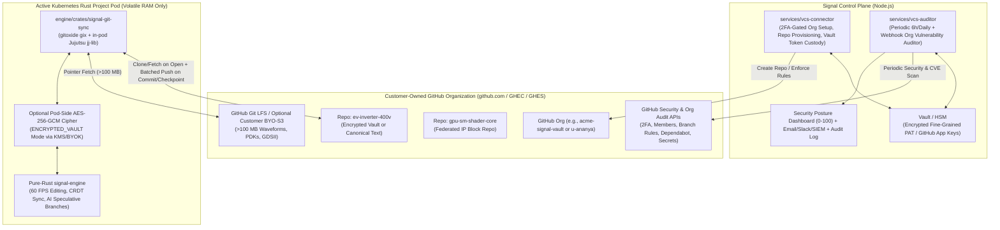

# 13 — Version Control Architecture: Customer-Owned BYO-GitHub Organization & Periodic Security Auditor

> **Scope:** Defines Signal's **single unified Version Control & Storage Architecture**—eliminating dual-VCS maintenance and customer file-hosting liability by storing every Project directly as a repository inside the **Customer's or User's own GitHub Organization** (GitHub.com, GitHub Enterprise Cloud, or GitHub Enterprise Server), paired with RAM-only Rust Pod sync (`gitoxide` + `jj-lib`), optional pod-side AES-256-GCM encryption, and a **Periodic GitHub Organization Security Vulnerability & Posture Auditor (`services/vcs-auditor`)**.

---

## 1. Strategic Decision (ADR-001): Single Unified "Bring Your Own GitHub" (BYOG) Model

Rather than building and maintaining two separate VCS systems—or assuming legal, financial, and data-residency liability for hosting petabytes of proprietary enterprise hardware files on Signal's storage servers—Signal adopts a **single unified Customer-Owned GitHub Organization model** across **all** user tiers (kids, students, makers, startups, and Fortune 500 semiconductor enterprises):

1. **One Unified VCS Flow for Everyone:**
   - Every **Enterprise Admin** (in Organization Settings) or **Individual User** (in Profile Settings) connects their **own GitHub Organization** (`github.com`, **GitHub Enterprise Cloud**, or self-hosted **GitHub Enterprise Server [GHES]**).
   - **1 Signal Organization → 1 Connected GitHub Organization.**
   - **1 Signal Project → 1 Dedicated Repository** (`<github-org>/<project-slug>`) automatically created, structured, versioned, and managed by Signal inside that organization.
2. **Zero Customer File-Hosting Liability for Signal:**
   - Signal **NEVER** permanently stores customer schematics, PCBs, IC layouts, RTL, firmware, BIOS, or PRD/HFS files on Signal's cloud storage.
   - Plaintext design state exists *only* inside volatile RAM (`tmpfs`, `zeroize` on drop) of the active Kubernetes Rust Project Pod during live editing sessions and is committed cleanly back to the customer's GitHub Organization.
   - Enterprises retain 100% ownership, legal custody, backup control, and data residency of their files inside their existing GitHub Enterprise infrastructure; students and makers in developing nations get **free GitHub Organizations and repositories** at \$0 storage cost to Signal.
3. **Future Provider Extensibility (Clean Abstraction):**
   - All Git API operations sit behind a clean `GitOrgProvider` interface (`services/vcs-connector` + `engine/crates/signal-git-sync`), targeting **GitHub (`github.com` / GHES)** natively in v1 while allowing future drop-in adapters for GitLab or Bitbucket Enterprise without changing the Rust engine or UI.

---

## 2. Connecting a GitHub Organization: Authentication & Trade-Off Analysis

In **Organization Settings** (Enterprise Admin) or **Profile Settings** (Individual), users enter their **GitHub Organization Name**, optional **GHES Base URL** (defaults to `https://api.github.com`), and authenticate via **Mandatory Step-Up 2FA** (WebAuthn/TOTP) before saving or rotating credentials.

### Auth Method Comparison

| Auth Method | How It Works | Strengths | Risks / Limitations | Signal Policy |
|---|---|---|---|---|
| **Fine-Grained PAT** (`github_pat_...`) | Admin/User creates a Fine-Grained Personal Access Token scoped **strictly to one GitHub Organization** and pastes it into Signal Settings (encrypted immediately in Vault/HSM). | Instant zero-friction onboarding; ideal for **Individuals, Students, Local Dev, and quick Enterprise setup**; granular org-scoped permissions. | Tied to one human user (breaks if admin leaves); max 1-year expiry (requires rotation); 5,000 API req/hr per token. | **Fully Supported.** Protected by 2FA on save/edit, Vault/HSM encrypted, never displayed again, automatic 30/14/7-day expiry alerts. |
| **GitHub App Installation** | Admin clicks **"Install Signal GitHub App"** on their GitHub Org (or registers a private Signal App on GHES). | **Enterprise Gold Standard:** Not tied to any individual employee; **1-hour auto-rotating short-lived tokens** (zero static secret); **12,500–15,000+ req/hr** rate limits; granular per-org audit trail. | Slightly more initial setup than pasting a token. | **Fully Supported & Recommended for Enterprise.** Uses the exact same `GitOrgProvider` adapter. |
| **Classic PAT** (`ghp_...`) | Legacy account-wide token. | Broad compatibility. | **Dangerous:** Over-privileged across ALL orgs/repos of the creator; long-lived blast radius. | **Blocked by default for Enterprise**; flagged as **`HIGH`/`CRITICAL` vulnerability** by Signal's Periodic Security Auditor. |

### Exact Minimum Required GitHub Organization Permissions

Signal enforces **Least Privilege**—requesting ONLY the permissions required to create/manage project repos and perform periodic security audits:

| Permission Scope | Access Level | Purpose |
|---|---|---|
| **Repository Administration** | Read & Write | Create new project repositories, enforce branch protection, disable forking, remediate public-repo drift |
| **Repository Contents** | Read & Write | Clone/fetch into Pod RAM (`gitoxide`), commit & push versioned EDA files, manage branches/tags |
| **Pull Requests & Metadata** | Read & Write | Visual hardware/firmware PR reviews, AI Agent speculative PR proposals, repo listing |
| **Organization Administration & Members** | Read-Only | Audit Org 2FA enforcement, SAML SSO, default member permissions, unauthorized outside collaborators |
| **Dependabot, Secret Scanning & Code Scanning Alerts** | Read-Only | Periodic vulnerability & leaked-secret auditing surfaced inside Signal's Security Console |

*(Note: Signal NEVER requests `delete_org` or account-wide permissions outside the configured Organization.)*

---

## 3. End-to-End Architecture: RAM-Only Rust Pod Sync + Customer GitHub Org



### Why This Runs at 60 FPS Without Hitting GitHub API Rate Limits
- Signal **NEVER** calls GitHub APIs on mouse drags, trace routes, or individual edits.
- When the first user opens Project X, `signal-git-sync` (pure-Rust **`gitoxide`**) clones/fetches `<github-org>/<project-slug>` directly into the Pod's **volatile RAM `tmpfs`** using a short-lived scoped token fetched from Vault.
- Inside the Pod's RAM, **`Jujutsu` (`jj-lib`)** powers instant local operation-log undo, first-class conflict resolution, and **zero-cost anonymous speculative branches for AI Agents**—without creating noisy GitHub commits or burning API quota!
- Only clean, intentional **Commits, Branch Merges, Releases, and Periodic Encrypted Checkpoints** push back to the customer's GitHub Org—cutting API calls by **99.9%** and zeroizing RAM completely when the pod hibernates.

---

## 4. Reconciling Zero-Local-Copies & Encryption with Customer-Owned GitHub

Because files reside inside the customer's GitHub Organization, Signal provides **two configurable Organization Repository Modes** on the exact same GitHub backend:

| Mode | Default Audience | How Files Are Stored in GitHub | Zero-Local-Copy / IP Protection |
|---|---|---|---|
| **`ENCRYPTED_VAULT`** *(Recommended Default for Enterprise)* | Semiconductor, Defense, Automotive, Commercial Enterprise | Before pushing to GitHub, `signal-git-sync` **AES-256-GCM encrypts** sensitive design artifacts (`schematics/`, `pcb/`, `ic/`, `prd/`, `hfs/`, `firmware/`) using the tenant's **KMS / Enterprise BYOK DEK**. Enterprise creates a dedicated GitHub Org (e.g., `acme-signal-vault`) with **zero regular engineers added as GitHub members**—only Signal's credential accesses it. | **Full Zero-Leak Protection:** Engineers work strictly in Signal's Zero-Leak browser IDE; even a compromised GitHub repo backup yields unreadable ciphertext. Signal's Periodic Auditor immediately alerts if any human user is added to the vault org or if a repo turns public! |
| **`PLAIN_CANONICAL`** | Kids, Students, Universities, Open-Hardware Makers, or Enterprises wanting native GitHub PR/CI | Commits Signal's clean, deterministic, diffable canonical text files directly to GitHub in plaintext. | Standard GitHub private/public visibility; enables native GitHub Actions CI for firmware/RTL and public open-hardware portfolios for developing-nation students! |

---

## 5. Canonical Diffable Repository Structure (1 Project = 1 GitHub Repo)

Every Signal Project repository created inside `<github-org>/<project-slug>` follows a clean, deterministic, multi-domain layout (partitioned by sheet/layer/cell so parallel engineers and AI Agents merge cleanly):

```text
<github-org>/<project-slug>/
├── .signal/
│   ├── project.signal.toml          # Project metadata, sub-project types, encryption mode, template ref
│   ├── rules/erc-drc.rules.toml     # Design rules, stackup constraints, AI agent guardrails
│   └── avl-policy.toml              # Approved Vendor List & derating margins
├── prd/
│   └── requirements.md              # Structured PRD with REQ-xxx IDs
├── hfs/
│   ├── architecture.md              # Hardware Functional Spec
│   └── power-clock-tree.signal.json # Machine-verified power & clock trees
├── schematics/
│   └── main_power/
│       ├── sheet_01_buck.sch.sig    # Canonical schematic (plaintext or .sig.enc in ENCRYPTED_VAULT)
│       └── modules.lock.json        # ElectronicModule versions & Universal Datasheet hashes
├── pcb/
│   └── control_board/
│       ├── stackup.toml             # Layers, Dk/Df, target impedances
│       ├── placement.pcb.sig        # Deterministic i64 nm placement
│       └── routing_l1_l8.pcb.sig    # Per-layer partitioned routing
├── ic/
│   └── gate_driver_asic/
│       ├── rtl/                     # SystemVerilog / VHDL / SystemRDL register maps
│       ├── analog_sch/              # Transistor-level schematics
│       ├── constraints/             # SDC timing, floorplan, pad-ring specs
│       └── layout_cells/            # Hierarchical layout cells (large masks -> Git LFS / BYO-S3 ptr)
├── fpga/                            # HDL, XDC/SDC pin constraints (synced with schematics)
├── firmware/                        # Embedded C/C++/Rust, HAL, generated pinmux headers
├── bios/                            # Bootloader, UEFI/ACPI, Device Tree (.dts)
├── software/                        # Host drivers, ATE test scripts
├── verification/
│   ├── spice_benches/               # Declarative SPICE/Monte-Carlo/PVT testbenches
│   ├── assertions.toml              # Pass/Fail checks linked to REQ-xxx
│   └── waveforms/                   # Pinned waveforms via Git LFS or Customer BYO-S3 pointer
└── traceability/
    └── graph-links.json             # Bi-directional REQ <-> Sch <-> PCB <-> IC <-> FW links
```

### Handling GitHub Size Limits at GPU / Frontier ASIC Scale
- **Compact Canonical Hardware Text:** Schematics, PRDs, HFS, PCB routing, RTL, Firmware, and BIOS stay well within GitHub's standard limits (KBs to tens of MBs).
- **Large Binary Artifacts (>100 MB Waveforms, PDKs, 3D STEP, Massive GDSII):**
  - Default: Stored in **GitHub Git LFS** inside the customer's GitHub Org (zero storage on Signal).
  - Extreme Silicon Scale (Multi-TB PDKs / full-chip waveforms): Optional **Customer-Owned BYO-S3 / GCS / Azure Blob** bucket configured alongside GitHub Settings, referenced by tiny SHA-256 pointer files (`*.byo-ptr`) committed to the GitHub repo—maintaining **zero customer file hosting by Signal**.
- **100B-Transistor GPU / SoC Partitioning:** A super-project (`<org>/gpu-x1-top`) composes modular **per-IP repositories** inside the same GitHub Org (`<org>/gpu-x1-sm-core`, `<org>/gpu-x1-l2-cache`, `<org>/gpu-x1-hbm4-phy`) mounted via hierarchical Multi-Pod Federation (see [`14-universal-scale-accessibility-and-expandability.md`](./14-universal-scale-accessibility-and-expandability.md)).

---

## 6. Periodic GitHub Organization Security Vulnerability & Posture Auditor (`services/vcs-auditor`)

Because Signal does not host the customer's files, Signal takes proactive responsibility for **continuously auditing the connected GitHub Organization** and immediately warning Enterprise Admins, Security Officers, and Individual users of any misconfiguration, IP exposure, or code vulnerability.

### Audit Execution Cadence
- **Scheduled Periodic Sweep:** Configurable per org (default: **every 6 hours** for Enterprise, **every 24 hours** for Individual).
- **Real-Time Event Triggers:** Optional GitHub Organization Webhooks (`repository`, `member`, `organization`, `secret_scanning_alert`, `dependabot_alert`, `deploy_key`) trigger instant critical alerts within seconds.
- **On-Demand Audit:** One-click **"Run Security Audit Now"** inside Signal's Security Console and automatic pre-release check before any 2FA SFTP manufacturing push!

### Five Security Audit Pillars

| Audit Pillar | Automated Checks Performed | Severity |
|---|---|---|
| **1. Zero-Leak & IP Exposure Drift** | • Any Enterprise/Private Signal repo changed to `public` or `internal`<br>• Unauthorized human engineers or **outside collaborators** added with direct clone access to an `ENCRYPTED_VAULT` repo<br>• Repository forking enabled on private hardware repos<br>• Unencrypted plaintext hardware files detected inside an `ENCRYPTED_VAULT` repo | `CRITICAL`<br>`HIGH`<br>`HIGH`<br>`CRITICAL` |
| **2. Org Access & Credential Hygiene** | • GitHub Org 2FA enforcement disabled (`two_factor_requirement_enabled == false`)<br>• Enterprise SAML SSO inactive<br>• Default member repo permission too permissive (`default_repository_permission != "none"`)<br>• Excessive or dormant Organization Owners<br>• Connected with insecure **Classic PAT** (`ghp_...`) or over-broad token scopes<br>• Fine-Grained PAT approaching expiration (**30 / 14 / 7 days** warning) | `CRITICAL`<br>`HIGH`<br>`HIGH`<br>`MEDIUM`<br>`HIGH`<br>`WARN/HIGH` |
| **3. Repo Integrity & Backdoor Detection** | • Missing branch protection / rulesets on `main` & release branches (allows force-push or unreviewed merges)<br>• Unrecognized SSH **Deploy Keys** added to a project repo<br>• Unauthorized third-party GitHub Apps or unexpected outbound webhooks with read access to IP repos | `HIGH`<br>`HIGH`<br>`HIGH` |
| **4. Firmware, BIOS & Software Vulnerabilities** | • **GitHub Secret Scanning Alerts:** Leaked signing keys, API keys, Wi-Fi/cloud credentials committed in Firmware/BIOS/Software<br>• **Dependabot CVE Alerts:** Known vulnerabilities in embedded C/C++/Rust crates, RTOS, UEFI/EDK2, drivers, or ATE scripts<br>• **Code Scanning / SARIF Alerts:** Static analysis security flaws (buffer overflows, unsafe memory ops) | `CRITICAL`<br>`HIGH`<br>`MEDIUM/HIGH` |
| **5. Compliance & Remediation** | • Computes live **Org Security Posture Score (0–100)** tracked over time<br>• Dispatches alerts via **Signal Security Console, Email, Slack/Teams Webhook, and SIEM (NATS immutable audit ledger)**<br>• Offers **Step-Up 2FA-Gated 1-Click Safe Remediation** (e.g., revert repo to private, disable forking, enable branch protection, set default org permission to `none`, revoke unauthorized outside collaborator) | Operational |

---

## 7. Local Mac Development Mode (`SIGNAL_ENV=local`)

In local macOS development ([`09-local-development-environment.md`](./09-local-development-environment.md)), developers have two zero-friction options:
1. **Default Offline Mode (`local-git-mock`):** Docker Compose starts a lightweight local GitHub-compatible mock API + bare-Git container (`http://localhost:8085`) pre-seeded with Org **`signal-design-inc`** and repository **`signal-design-inc/sig-dev-001-smart-power`**—plus a simulated vulnerable-org fixture so engineers can develop and test the **Periodic Security Auditor** completely offline!
2. **Real GitHub Test Org Mode:** Paste a personal test GitHub Org name + Fine-Grained PAT into `.env.local` (or the local Settings UI) to test live GitHub repo creation, `ENCRYPTED_VAULT` commits, and real GitHub security audits end-to-end.
