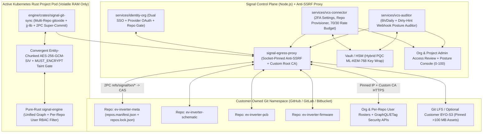

# 13 — Version Control Architecture: Customer-Owned BYO-Git (GitHub, GitLab & Bitbucket), Multi-Repo-Per-Project & Periodic Security Auditor

> **Scope:** Defines Signal's **single unified Customer-Owned BYO-Git Architecture**—supporting **GitHub**, **GitLab**, and **Bitbucket** (Cloud and Enterprise Self-Hosted) through one `GitProviderAdapter`. Maps **1 Signal Project → 1 Meta Repo + N Neatly Prefixed Per-Type Repositories** (`<project>-meta`, `<project>-prd`, `<project>-schematic`, `<project>-pcb`, `<project>-ic-*`, `<project>-firmware`, `<project>-bios`, etc.), enforces **Git Org/Repo User Authentication & Access Review**, encrypts Enterprise repos via **`ENCRYPTED_VAULT`**, and runs a **Periodic Organization Security Vulnerability & Posture Auditor (`services/vcs-auditor`)**.

---

## 1. Strategic Decision (ADR-001): Unified Customer-Owned BYO-Git + Multi-Repo-Per-Project

Rather than operating a competing persistent Git server or assuming custody/liability for customer IP files, Signal uses **one unified Customer-Owned BYO-Git architecture** across every user tier (students, makers, startups, and Fortune 500 chipmakers):

1. **First-Class Multi-Provider Enterprise & Individual Support:**
   - **GitHub:** `github.com`, GitHub Enterprise Cloud (GHEC), and self-hosted GitHub Enterprise Server (GHES).
   - **GitLab:** `gitlab.com`, GitLab Dedicated, and self-managed GitLab Enterprise Edition.
   - **Bitbucket:** `bitbucket.org` Cloud and self-hosted Bitbucket Data Center.
2. **1 Signal Workspace → 1 Connected Git Namespace (`ORG_NAMESPACE` or `USER_NAMESPACE`); 1 Signal Project → Multi-Repo Prefixed Tree:**
   - Enterprise Admins (in Organization Settings) connect their **GitHub Organization**, **GitLab Group**, or **Bitbucket Workspace/Project** (`ORG_NAMESPACE`). Individual students, hobbyists, and solo makers (in Profile Settings) can connect either an Organization OR their **Personal User Namespace** (`USER_NAMESPACE`: GitHub personal account, GitLab personal namespace, or Bitbucket personal workspace) for zero-friction 1-click onboarding without enterprise admin overhead.
   - Inside Signal, creating a **Project** (`<project-slug>`) creates ONE unified logical Project in Signal—and under the connected Git namespace automatically creates **multiple neatly prefixed repositories as each Sub-Project Type is added**:
     - `<namespace>/<project-slug>-meta` (created immediately on Project creation: project metadata, rules, template lineage, cross-domain traceability, child repo manifest `.signal/repos.manifest.json`, and cross-repo atomic lockfile `.signal/repos.lock.json`)
     - `<namespace>/<project-slug>-<type>` (or `<project-slug>-<type>-<instance>` when multiple boards/chips exist) created cleanly on demand whenever a Project Type (`prd`, `hfs`, `schematic`, `pcb`, `ic-analog`, `ic-digital`, `ic-package`, `fpga`, `firmware`, `bios`, `software`, `verification`, `mechanical`) is added!
   - **Immutable `provider_repo_id` Binding & Non-Destructive Lifecycle:**
     - `.signal/repos.manifest.json` binds every Sub-Project to the Git provider's **immutable numeric/UUID `provider_repo_id`** alongside its current slug as a mutable display alias. If a repo is renamed externally in GitHub/GitLab/Bitbucket, Signal reconciles the display alias automatically without breaking mounts, RBAC, or encryption `AAD` headers (while logging a rename-drift alert in `services/vcs-auditor`).
     - **Zero Destructive Repo Deletion Policy:** Detaching or archiving a Sub-Project inside Signal **NEVER** issues a destructive `DELETE` API call against customer repositories; it marks the repo `DETACHED_ARCHIVED` in `repos.manifest.json` so 100% of customer Git history remains intact.
3. **Why Multi-Repo-Per-Project Is Architecturally Superior:**
   - **Granular Per-Discipline Access Control:** Granting an external PCB contractor repo access ONLY to `<ns>/ev-inverter-pcb` automatically restricts them in Signal to the PCB workbench—they can NEVER view `<ns>/ev-inverter-ic-analog` or `<ns>/ev-inverter-bios`!
   - **Zero Cross-Discipline Repo Bloat:** Firmware engineers don't sync multi-GB PCB/STEP files; PCB engineers don't sync RTL verification suites; every repo stays lean, fast to hydrate into Pod RAM, and well within provider size limits.
   - **Still ONE Unified App Experience + Atomic Cross-Repo `Super-Commit`:** Inside Signal's Kubernetes Project Pod (`signal-pod`), `signal-git-sync` mounts `<project>-meta` plus all child `<project>-<type>` repos into **one unified in-RAM Design Graph (`signal-graph`)**, giving authorized users full cross-probing (`REQ` ↔ `Schematic` ↔ `PCB` ↔ `Firmware`) and **Two-Phase Cross-Repo `Super-Commit` atomicity** while enforcing per-repo RBAC on every user stream!
4. **Zero Customer File-Hosting Liability for Signal:**
   - Signal **NEVER** permanently stores customer design files. Active state lives strictly in volatile Pod RAM (`tmpfs`, `zeroize` on drop) and commits back to the customer's Git repositories (with only a short-lived `<= 72h` BYOK-encrypted continuity journal activated if the customer's Git provider suffers a global outage mid-session).

---

## 2. Multi-Provider Mapping, Naming Convention & Auth Matrix

In **Organization Settings** (Enterprise Admin) or **Profile Settings** (Individual), users configure their Git provider behind **Mandatory Step-Up 2FA (WebAuthn/TOTP)**. Credentials are immediately encrypted in **Vault / HSM** and are never logged or returned to the browser. For **self-hosted GHES, GitLab EE, and Bitbucket Data Center**, Admins may also pin a **2FA-verified Custom Enterprise Root CA Bundle** (validated by SPKI SHA-256 fingerprint—never `TLS_REJECT_UNAUTHORIZED=0`), with all traffic routed through **`signal-egress-proxy`** enforcing socket-level resolved-IP anti-SSRF pinning on every `connect()`.

### 2.1 Provider Mapping & Credentials

| Dimension | GitHub (`github.com` / GHEC / GHES) | GitLab (`gitlab.com` / Self-Managed EE) | Bitbucket (`bitbucket.org` / Data Center) |
|---|---|---|---|
| **Namespace (`ORG_NAMESPACE` / `USER_NAMESPACE`)** | **Organization** (`org-slug`) or **Personal User** (`user-slug`) | **Top-Level Group / Subgroup** (`group/subgroup`) or **Personal Namespace** | **Workspace** / **Project Key** or **Personal Workspace** |
| **Immutable Repo Identifier** | Numeric `repository.id` + GraphQL `node_id` | Numeric `project.id` | UUID `{repo-uuid}` (Cloud) / Numeric `repository.id` (DC) |
| **Project Grouping Metadata** | Repo Custom Properties / Topic `signal-project:<slug>` | Optional Subgroup `<group>/<slug>` or Topic `signal-project:<slug>` | Bitbucket Project `<slug>` / Repo Labels |
| **Quick-Connect Scoped Token (Supported)** | **Fine-Grained PAT** (`github_pat_...`) scoped strictly to 1 Org/User & selected repos | **Group Access Token** (`glpat-...`) scoped strictly to 1 Group *(not tied to a human)* | **Workspace Access Token** (Cloud) / **HTTP Project Access Token** (Data Center) |
| **Enterprise App / Short-Lived Auth (Recommended)** | **GitHub App Installation** (1-hr auto-rotating tokens, 12.5k–15k req/hr) | **Group Access Token** (rotated) or **GitLab Service Account / OAuth App** | **Workspace/Project Access Token** (rotated) or **Bitbucket OAuth / Forge App** |
| **Insecure Legacy Token (Blocked / Flagged `HIGH`)** | **Classic PAT** (`ghp_...`, account-wide) | Account-wide **Personal Access Token** (`api`) | Account-wide **Personal App Password** / global admin token |

### 2.2 Clean Prefixed Multi-Repo Naming Standard

Given a Signal Project with slug `ev-inverter` inside namespace `acme-hw`:

| Signal Entity | Repository Created Automatically in Customer Git Org | Key Contents |
|---|---|---|
| **Project Root (Created at Project Creation)** | `acme-hw/ev-inverter-meta` | `.signal/project.signal.toml`, `.signal/repos.manifest.json` (`provider_repo_id` map), `.signal/repos.lock.json` (`Super-Commit` SHA vector), `.signal/rules/erc-drc.rules.toml`, `avl-policy.toml`, `traceability/graph-links.json`, release manifests |
| **Sub-Project: `PRD`** | `acme-hw/ev-inverter-prd` | `requirements.md`, structured `REQ-xxx` tables & acceptance criteria |
| **Sub-Project: `HFS`** | `acme-hw/ev-inverter-hfs` | `architecture.md`, `power-clock-tree.signal.json`, interface budgets |
| **Sub-Project: `SCHEMATIC`** | `acme-hw/ev-inverter-schematic` *(or `ev-inverter-schematic-power`, `ev-inverter-schematic-ctrl`)* | Entity-chunked canonical sheets (`sheet_*.sch.sig`), `modules.lock.json` |
| **Sub-Project: `PCB`** | `acme-hw/ev-inverter-pcb` *(or `ev-inverter-pcb-power`, `ev-inverter-pcb-ctrl`)* | `stackup.toml`, `placement.pcb.sig`, per-layer `routing_l*.pcb.sig` |
| **Sub-Project: `IC_ANALOG` / `IC_DIGITAL` / `IC_PACKAGE`** | `acme-hw/ev-inverter-ic-analog`, `ev-inverter-ic-digital`, `ev-inverter-ic-package` | RTL (`SystemVerilog`/`VHDL`), UPF power intent, transistor schematics, SDC/floorplan, signed Abstract Views (`*.lef.sig`, `*.lib.sig`), layout cells (large masks → Git LFS / BYO-S3 ptr) |
| **Sub-Project: `FPGA`** | `acme-hw/ev-inverter-fpga` | HDL sources, XDC/SDC pin constraints synced with schematics |
| **Sub-Project: `FIRMWARE`** | `acme-hw/ev-inverter-firmware` | Embedded C/C++/Rust, HAL, auto-synced SVD/pinmux & register headers |
| **Sub-Project: `BIOS`** | `acme-hw/ev-inverter-bios` | Bootloader, UEFI/ACPI tables, Linux Device Trees (`.dts`) |
| **Sub-Project: `SOFTWARE`** | `acme-hw/ev-inverter-software` | Host drivers, SDKs, ATE test-bench automation & `signal-twin` correlation fixtures |
| **Sub-Project: `VERIFICATION`** | `acme-hw/ev-inverter-verification` | Compact **Declarative Sim Recipes & Formal Assertions (`< 10 KB` text)** re-computable in Pod RAM; raw waveforms pushed to Git LFS / BYO-S3 (`*.byo-ptr`) **only** when explicitly pinned for sign-off (saving 99% LFS quota!) |
| **Sub-Project: `CAD_MCAD`** | `acme-hw/ev-inverter-cad` | Parametric B-Rep feature trees (`*.mcad.sig`), sheet-metal bends, assembly mates, GD&T drawings & live PCB anchor links |
| **Sub-Project: `CAM_CNC`** | `acme-hw/ev-inverter-cam` | 2.5D/3/5-axis CNC setups, tool cribs, fixture specs, deterministic toolpath recipes (`*.cam.sig`) & signed post-processor configs |
| **Sub-Project: `PRINT_3D`** | `acme-hw/ev-inverter-3dprint` | FDM/SLA/SLS/DMLS build-plate layouts (`*.3dp.sig`), orientations, support/infill modifiers & embedded-PCB pause layers |
| **Sub-Project: `PLM_OPS`** | `acme-hw/ev-inverter-ops` | Multi-view `eBOM`/`mBOM`/`sBOM` specs, signed `ECO`/`ECN`, `MCN`, `PCN`, `Deviation`/`Waiver`, `NCR`/`CAPA` ledgers & 3D assembly work instructions |
| **Sub-Project: `MECHANICAL_REF`** | `acme-hw/ev-inverter-mechanical` | External read-only enclosure keep-out bounds & STEP references (Git LFS / BYO-S3) |

*(Slug rules: lowercase alphanumeric + hyphens, deterministic collision-free suffixing when multiple instances of the same Sub-Project type exist, e.g., `ev-inverter-pcb-main` and `ev-inverter-pcb-sensor`. Every repo is created `private` by default for Enterprise & Individual Private projects.)*

---

## 3. Provider-Driven User Authentication, Repo Access Control & Admin Review

Signal uses the **Organization/Namespace and Repository users of GitHub, GitLab, or Bitbucket as the authoritative access roster** for viewing and editing Projects (full details in [`08-identity-enterprise-and-project-model.md`](./08-identity-enterprise-and-project-model.md)):

1. **Dual-Identity Binding:** Users sign in via **GitHub / GitLab / Bitbucket OAuth 2.0 PKCE / OIDC** (cryptographically binding their immutable numeric/UUID `provider_user_id` alongside Enterprise SAML/OIDC `enterprise_subject_id` where SSO is enforced).
2. **Strict Project & Sub-Project Visibility Gate:**
   - A user can see Project `ev-inverter` in Signal **ONLY IF** their verified `provider_user_id` is an authorized user of the connected Organization/Group/Workspace (or owner/collaborator in `USER_NAMESPACE`) **AND** has repository access on `ev-inverter-meta` and/or at least one child `ev-inverter-<type>` repository (and has not passed an optional contractor `expires_at` access deadline)!
   - Inside an opened Project, the Rust Project Pod filters every API call, canvas render, and AI Agent context strictly to the **exact subset of `<project>-<type>` repositories (`provider_repo_id`s) that user is authorized to read/write** in GitHub/GitLab/Bitbucket!
   - **Instant Session Revocation:** Removing a user from the Org or from a repo (detected via HMAC-verified dirty-hint webhooks re-checked against the provider HTTPS API + session-attach verification) immediately evicts them from the active Rust Project Pod within `< 2 s`.
3. **Org Admin & Project Admin Access Review Console:**
   - Both **Organization Admins** (across all org repos & projects) and **Project Admins** (across `<project>-meta` and all child `<project>-<type>` repos) get a live **Access Review Dashboard** displaying every authorized user, their Git handle & immutable ID, team membership, repo-by-repo role matrix (`Admin` / `Write` / `Read` / `None`), contractor `expires_at` TTL, provider 2FA status, last Signal session, periodic attestation sign-off status, and 2FA-gated revocation controls.

---

## 4. End-to-End Architecture: Multi-Repo RAM Sync, Convergent `ENCRYPTED_VAULT` & Two-Phase `Super-Commit`

### 4.1 Padmé-Padded, Path-Blinded, Merkle-Bound Convergent `ENCRYPTED_VAULT`
Because engineers ARE listed as repo users on `<ns>/<project>-<type>` in GitHub/GitLab/Bitbucket so their provider membership drives Signal authorization & Access Reviews, what stops an authorized engineer from running `git clone` locally—and how do we defeat 100× Git packfile bloat, standard-cell byte-size fingerprinting, filename leakage, AND single-chunk rollback attacks simultaneously?

- **Padmé-Padded, Path-Blinded RFC 8452 `AES-256-GCM-SIV` (`ENCRYPTED_VAULT` — Recommended Enterprise Default):**
  - **Unified 2-Level `HKDF` + Convergent `AES-256-GCM-SIV` Construction (Aligned with [`07`](./07-security-encryption-dlp-and-sftp.md)):** `DEK_vN` unwraps from KMS/BYOK **once at Pod Hydration** into `SecretBox` RAM (zero per-commit KMS `429` storms!). For each canonical `SignalEntityId` chunk, `signal-git-sync` applies **Padmé length-hiding padding** ($O(\log\log L)$ leaked bits, `<= 12%` overhead), derives $K_e = \text{HKDF-SHA256}(\text{DEK}_v, \text{provider\_repo\_id} \parallel \text{entity\_id})$ and $N_e = \text{Trunc}_{96}(\text{HMAC-SHA256}(\text{EpochSalt}, \text{CanonicalChunk}))$, and encrypts via RFC 8452 `AES-256-GCM-SIV` into **HMAC-blinded Git paths (`blobs/b7/3f9a...sigv`)**.
  - **Result 1 (Zero Local Leaks, Zero Filename Leaks & Anti-Rollback Integrity):** Running `git clone` locally yields path-blinded, Padmé-padded ciphertext! Every commit also writes an `ML-DSA-65`-signed `.signal/vault.merkle.sig` binding the exact `(entity_id -> chunk_tag_hash)` map to the parent commit chain—defeating single-entity cherry-pick/rollback attacks on GitHub!
  - **Result 2 (95%+ Git Packfile Deduplication & 3-Way Structural Merge):** Unchanged components, nets, and layout cells produce **identical `.sigv` ciphertext blobs across commits**, preserving Git packfile delta compression and enabling `jj-lib` structural 3-way entity merges inside Pod RAM!
  - **Result 3 (Instant Key Rotation Without Full-History Rewrites):** Every chunk header carries `(kek_id, dek_version, pqc_alg)`. Rotating a DEK writes all new commits under `dek_version + 1` in `< 1 s` while historical commits remain readable via the KMS keyring.
- **`PLAIN_CANONICAL` Mode + Cryptographic `MUST_ENCRYPT` Taint Gate:**
  - Default for Students/Hobbyists/Open-Hardware and opt-in per Sub-Project (e.g., `firmware` or `fpga`) for native GitHub Actions / GitLab CI / Bitbucket Pipelines.
  - **Non-Bypassable `MUST_ENCRYPT` Taint Enforcement:** Any entity, IEEE 1735 block, PDK cell, or netlist carrying an `NDA_PDK`, `ITAR`, or `ENCRYPTED_ONLY` classification tag is **cryptographically blocked** by `signal-git-sync` pre-push hooks from ever being serialized into a `PLAIN_CANONICAL` repository!

### 4.2 Dual-Fenced Two-Phase Cross-Repo `Super-Commit` Protocol (`repos.lock.json`)
Because external GitHub/GitLab/Bitbucket servers have no native concept of Kubernetes Lease tokens, Signal enforces **Dual-Gate External Fencing + Two-Phase `Super-Commit`** across `<project>-schematic`, `<project>-pcb`, `<project>-firmware`, and `<project>-meta`:

1. **Gate 0 — `signal-egress-proxy` Active Epoch Fence:** Every outbound Git/LFS request carries `X-Signal-Fencing-Token: (project_id, fencing_epoch)`. `signal-egress-proxy` verifies `fencing_epoch >= live_lease_epoch` and **hard-drops (`412 Precondition Failed`)** any stale/zombie pod before a single packet reaches GitHub/GitLab/Bitbucket!
2. **Phase 1 — Parallel Isolated Ref Prepare:** `signal-git-sync` pushes deterministic commits to temporary staging refs `refs/signal/txn/<txn_ulid>` across all participating `<project>-<type>` repositories concurrently. If *any* target repo rejects Phase 1, zero user-visible branches move.
3. **Phase 2 — `<project>-meta` Coordinator `CAS` First → Child `CAS` Advance:** `signal-git-sync` **first** commits the `ML-DSA-65 + Ed25519`-signed `Super-Commit` entry (embedding monotonic `fencing_epoch` + child `provider_repo_id -> commit_sha` map) into `.signal/repos.lock.json` on `<project>-meta` via **strict non-force Git `old_meta_oid -> new_meta_oid` Compare-and-Swap (`CAS`)**, then advances each child repo's target branch via `CAS` and prunes `refs/signal/txn/<txn_ulid>`!

### 4.3 Secondary-Rate-Limit Pacing, Blobless Hydration, External-Push Rebase & Outage Continuity
- **Lazy Sub-Repo Materialization (`<= 40/min` Pacer — Defeats GitHub `80/min` Secondary Rate Limit!):** Launching a 10-domain Project Template creates **only `<project>-meta` synchronously (`< 800 ms`)**; child `<project>-<type>` repos materialize **lazily on first discipline write** or via an adaptive `<= 40 creations/min` pacer queue so 60-student classrooms (`600` repos) never trigger provider abuse/secondary rate limits!
- **Blobless Partial Clone (`--filter=blob:none`) + `64 KB` Streaming AEAD LFS:** Pods hydrate via `gitoxide` **blobless partial clones** (complete commit DAG in kilobytes for accurate `jj-lib` 3-way merges, fetching blobs on demand—avoiding `--depth=1` push pack-negotiation stalls!) and stream `> 100 MB` GDSII/STEP/pinned-waveform LFS & BYO-S3 objects in **`64 KB` AEAD chunks (`< 16 MB` constant Pod RAM)**.
- **Live External `git push` Ingestion & Auto-Rebase:** When an engineer or CI pipeline pushes directly to `<project>-firmware` from an external terminal while the Project Pod is open, dirty-hint `push` webhooks fetch into a pod shadow ref and run **`jj-lib` 3-way tree/entity auto-rebase**, surfacing an inline visual merge banner (`libs/visual-diff`) only on true line/entity overlaps!
- **70/30 Rate-Limit Budget, Partial Degradation & BYOK Continuity Journal:** `vcs-connector`/`vcs-auditor` enforce a **70% Interactive / 30% Auditor** GraphQL + `ETag` (`304`) budget. During external Git outages, pending `jj` op-log deltas seal under a **per-session sub-DEK wrapped EXCLUSIVELY by Customer BYOK/KMS** (`TTL <= 72h`, default `24h`), replaying the `Super-Commit` on recovery and emitting an `ML-DSA`-signed **Crypto-Shred Receipt** to the WORM ledger.
- **100B-Transistor GPU / Frontier ASIC Scale:** Composes per-IP repositories (`<ns>/gpu-x1-ic-sm-core`, etc.) via `ML-DSA`-signed Abstract + **`20 µm` Boundary-Halo Views (`*.halo.gds.sig`)** pinned in `repos.lock.json`.

---

## 5. Periodic Multi-Provider Security Vulnerability & Access-Drift Auditor (`services/vcs-auditor`)

Running on a configurable schedule (default: **every 6 hours** for Enterprise, **every 24 hours** for Individual) plus **HMAC-verified dirty-hint webhooks** and **pre-SFTP-release gates**, `services/vcs-auditor` inspects the connected **GitHub**, **GitLab**, or **Bitbucket** namespace and every `<project>-*` repository across **5 audit pillars**:

| Audit Pillar | GitHub Checks | GitLab Checks | Bitbucket Checks | Severity |
|---|---|---|---|---|
| **1. Zero-Leak, Rename & Access-Review Drift** | • Any Enterprise/Private `<project>-*` repo changed to `public`/`internal` • **Unreviewed / newly added repo users** or **expired contractor access (`expires_at < now`)** • Cross-repo privilege drift (contractor added to `ic`/`bios` repo) or **unexpected external repo rename** (`provider_repo_id` slug drift) • `allow_forking == true` or plaintext/`MUST_ENCRYPT` violation in vault | • Project `public`/`internal` • Unreviewed/expired group or project members vs. Access Review attestation & `expires_at` • External path rename drift vs. `provider_repo_id` • `forking_access_level != "disabled"` or plaintext in vault | • Repo `is_private == false` • Unreviewed/expired workspace or repo members vs. Access Review attestation & `expires_at` • External slug rename drift vs. `{repo-uuid}` • `fork_policy != "no_forks"` or plaintext in vault | `CRITICAL` / `HIGH` |
| **2. Identity, 2FA & Token Hygiene** | Org 2FA (`two_factor_requirement_enabled`), SAML SSO, ≥2 Super Admins enrolled, `default_repository_permission != "none"`, dormant owners, Classic PAT (`ghp_`) & PAT expiry (30/14/7d) | Group 2FA (`require_two_factor_authentication`), Group SAML, ≥2 Group Owners, excessive Maintainers, personal PAT & Group Token expiry (30/14/7d) | Workspace 2FA / Atlassian Guard SSO / Data Center SAML, ≥2 Workspace Admins, default permissions, personal App Password & Token expiry | `CRITICAL` / `HIGH` / `WARN` |
| **3. Repo Integrity & Backdoors** | Missing branch rulesets/protection on `main`/release, unrecognized Deploy Keys, unexpected webhooks or unauthorized third-party Apps | Missing Protected Branches/Tags (`allow_force_push`), unrecognized Deploy Keys/Tokens, unexpected webhooks | Missing Branch Restrictions, unrecognized Access Keys, unexpected webhooks or unauthorized OAuth/Forge apps | `HIGH` |
| **4. Secrets, CVEs & SPDX License Gate** | GitHub Secret Scanning, Dependabot CVE alerts, Code Scanning (SARIF) **+ SPDX Open-Source Hardware/Software License Compatibility check (`CERN-OHL-S` / `GPL` copyleft vs. commercial policy)** | GitLab Secret Detection, Dependency Scanning / Vulnerability Report, SAST + SPDX License Gate | Bitbucket Secret Scanning + Snyk integrations **+ Signal RAM-only OSV/Gitleaks/SPDX check on FW/BIOS/IP manifests for uniform parity** | `CRITICAL` / `HIGH` |
| **5. Posture Score & 2FA Remediation** | Live **Security Posture Score (0–100)** + Email/Slack/Teams/SIEM alerts + pseudonymous WORM Merkle audit log + **Step-Up 2FA-gated 1-click remediation** (revert to private, disable forks, enforce branch protection, revoke unapproved/expired repo user) | Same unified pipeline across all three providers | Same unified pipeline across all three providers | Operational |

---

## 6. Local Mac Development Mode (`SIGNAL_ENV=local`)

In local macOS development ([`09-local-development-environment.md`](./09-local-development-environment.md)):
1. **Default Offline Mode (`local-git-mock` in `dev:lite` & `dev:full`):** Runs a local multi-provider mock (`http://localhost:8085`) pre-seeded with namespace **`signal-design-inc`**, user **`Guest` (`local-guest-0001` explicitly seeded in `REPO_ACCESS_ENTRY` so zero RBAC middleware is bypassed)**, and a multi-repo sample project (`signal-design-inc/sig-dev-001-meta` with `repos.manifest.json` + `repos.lock.json`, `sig-dev-001-prd`, `sig-dev-001-hfs`, `sig-dev-001-schematic`, `sig-dev-001-pcb`, `sig-dev-001-firmware`) with active convergent `AES-256-GCM-SIV` + Hybrid PQC encryption and mock vulnerability fixtures.
2. **Real Test Namespace Mode:** Connect a real test **GitHub Org/User**, **GitLab Group/User**, or **Bitbucket Workspace** in local Settings to test live OAuth PKCE login, `<project>-<type>` multi-repo creation, Two-Phase `Super-Commit`, Org/Project Admin Access Review, and real vulnerability scans end-to-end.
