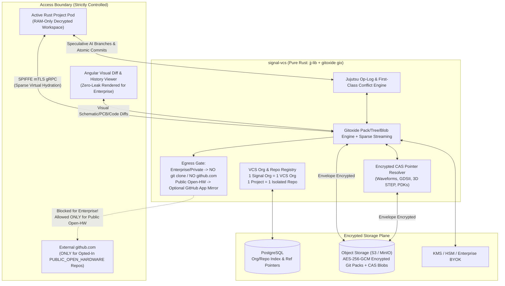

# 13 — Version Control Architecture: Embedded Encrypted Git / Next-Gen VCS (`signal-vcs`) vs. GitHub Analysis

> **Scope:** Evaluates how Signal stores, versions, branches, merges, and secures every engineering file across every project—from a 50 KB student circuit to a 500 GB 2nm GPU/ASIC tape-out—mapping **1 Organization → 1 VCS Organization** and **1 Project → 1 Dedicated Repository**. Analyzes **`github.com`** vs. **Self-Hosted Git Server** vs. **Next-Generation Rust VCS (`Jujutsu (jj)` + `gitoxide`)** and establishes Signal's definitive architecture.

---

## 1. The Core Problem: Versioning Everything Without Breaking Zero-Trust Security

Signal unifies PRD, HFS, Schematics, PCBs, IC/ASIC RTL & layouts, FPGAs, Firmware, BIOS, Drivers, and Verification suites inside a single Project. That requires **Git-grade versioning, branching, diffing, code/hardware review, history, and multi-team collaboration**—while simultaneously honoring Signal's non-negotiable invariants:

1. **Zero Local Copies & No Export (Enterprise / Private Projects):** Engineers must NEVER be able to `git clone` proprietary hardware designs onto laptops or download ZIP archives.
2. **Envelope Encryption + Enterprise BYOK:** Every file, commit blob, and binary waveform must be AES-256-GCM encrypted using per-project KMS/BYOK keys.
3. **1 Organization → 1 VCS Org; 1 Project → 1 Repository:** Every company or individual gets a clean organization namespace, and every Project becomes its own isolated, cleanly structured repository (never dumping unrelated projects or tenants into a single shared repository).
4. **Massive Scale Range:** Must feel instantaneous for a kid's 5-component LED blinker AND scale smoothly to a 100-billion-transistor GPU/ASIC with tens of thousands of RTL/layout/verification files and multi-gigabyte binary assets.
5. **AI-Agent Native Branching:** AI Agents continuously create, simulate, compare, rebase, and discard speculative design branches—requiring near-zero-cost branching and first-class conflict handling.
6. **Optional Open-Hardware Community Sharing:** Students, hobbyists, and open-silicon builders in developing nations *do* benefit from publishing **explicitly public open-source projects** to `github.com`.

---

## 2. Architectural Options Analysis

### Option A: Using External `github.com` Directly as Primary Storage
Provisioning GitHub Organizations and Repositories via GitHub's cloud API for all Signal projects.

| Dimension | Assessment |
|---|---|
| **Zero-Trust / Zero Local Copies** | **FAILS (Fatal for Enterprise).** `github.com` is built around `git clone`, `git pull`, and "Download ZIP." Even if Signal hides UI links, any user with GitHub repo access can exfiltrate the entire design onto a laptop—directly violating [`07-security-encryption-dlp-and-sftp.md`](./07-security-encryption-dlp-and-sftp.md). |
| **Encryption & BYOK / ITAR** | **FAILS.** Blobs rest unencrypted under GitHub/Microsoft infrastructure; Signal cannot enforce per-project KMS/BYOK cryptographic kill switches or RAM-only decryption. |
| **Scale (GPU / ASIC / Waveforms)** | **POOR.** Hard 100 MB file limit, ~5–10 GB repo soft limits, expensive Git LFS billing, poor handling of 50 GB GDSII/PEX/waveform artifacts. |
| **Cost & Global Accessibility** | **POOR.** GitHub Enterprise per-seat fees + API rate limits make free/accessible global developing-nation student accounts economically unsustainable. |
| **Open-Source Ecosystem** | **EXCELLENT** for public hobbyist/university/open-silicon projects wanting community visibility. |

**Verdict:** **Rejected as primary backing store.** Retained *strictly* as an **optional, policy-gated mirror/sync connector for `PUBLIC_OPEN_HARDWARE` projects only** (structurally locked OFF for Enterprise tenants).

---

### Option B: Self-Hosted Traditional Git Forge (e.g., Gitea / Forgejo / GitLab CE)
Deploying an off-the-shelf Git server inside Signal's Kubernetes cluster with external SSH/HTTP clone disabled.

| Dimension | Assessment |
|---|---|
| **Org → Repo Isolation** | **GOOD.** Native Organization and Repository primitives. |
| **Security & Zero-Clone** | **GOOD** once placed strictly behind internal mTLS with external git transport disabled. |
| **Encryption at Rest** | **WEAK by default.** Standard Git stores plaintext loose objects & packfiles on local POSIX disk (PVC); achieving per-project AES-256-GCM BYOK envelope encryption and RAM-only Project Pod hydration requires fragile filesystem-level hacks. |
| **AI Agent & Concurrent CAD Workflows** | **LIMITING.** Classic Git requires clean working trees for rebases, stalls on merge conflicts (cannot store conflicted states as commits), has weak operation-level undo, and requires full repo checkouts unless heavily customized with partial-clone servers. |
| **Stack Alignment** | Adds a Go/Ruby monolith with its own DB, auth model, and web UI duplicating Signal's Node.js Control Plane + Rust Engine. |

**Verdict:** Viable interim stepping stone, but introduces unnecessary tech-stack duplication, disk-encryption impedance mismatch, and friction for AI-Agent-first speculative CAD branching.

---

### Option C: Next-Generation Rust VCS Engine (`signal-vcs` = `Jujutsu (jj-lib)` + `gitoxide (gix)` + Encrypted S3 CAS)
Building Signal's internal Git-compatible VCS server in **pure Rust** using **`gitoxide` (`gix`)** (pure-Rust Git object/pack/protocol engine) paired with **`Jujutsu` (`jj-lib`)** (Google-originated next-generation Rust VCS backed natively by the Git object model) + **Encrypted Content-Addressed Object Storage (S3 CAS)** for large binary EDA artifacts.

*(Note: Other next-gen VCS candidates such as **Pijul** [patch theory] and **Fossil** were evaluated and rejected because they break compatibility with the universal Git object model and ecosystem tooling. `Jujutsu (jj)` is uniquely superior because it delivers next-generation VCS semantics **on top of 100% standard Git storage**!)*

| Dimension | Assessment |
|---|---|
| **Standard Git Compatibility** | **100% GIT-COMPATIBLE.** Every commit, tree, blob, branch, and tag is a real standard Git object—meaning standard diff algorithms, blame, history, and optional export/mirroring to `github.com` (for public projects) or SFTP Git bundles (for authorized Enterprise archives) work natively! |
| **Org → Repo Mapping** | **NATIVE & CLEAN.** `org/<org-slug>/<project-slug>` — every Signal Organization owns an isolated VCS Org namespace, and every Project is its own independent encrypted repository. |
| **Zero-Trust Encryption & Zero Local Copies** | **GOLD STANDARD.** `signal-vcs` encrypts every Git packfile, `jj` operation log, and large binary blob with the Project's **AES-256-GCM KMS/BYOK DEK** before writing to S3 Object Storage. **Zero plaintext files ever touch disk.** External `git clone` is structurally non-existent for Enterprise/Private repos; only authenticated `signal-project-pod` instances pull objects into volatile RAM via SPIFFE mTLS! |
| **AI-Agent & Multi-User Superpowers (`jj-lib`)** | **INDUSTRY-LEADING:** (1) **First-Class Conflict Commits** — concurrent schematic/PCB/RTL conflicts are stored safely inside the DAG without blocking collaborators and resolved visually on the Signal canvas; (2) **Immutable Operation Log** — instant atomic time-travel undo of *any* rebase, merge, or AI Agent batch operation; (3) **Anonymous Zero-Cost Branches** — AI Agents can spawn, simulate, compare, and prune dozens of speculative circuit experiments without polluting branch names. |
| **GPU / ASIC Scale (Virtual Sparse Hydration)** | **EXCELLENT.** Like Google's Piper / Meta's Sapling virtualized VCS, `signal-vcs` streams tree manifests on demand over gRPC to the Rust Project Pod. Opening a 500 GB GPU tape-out repo hydrates ONLY the opened sub-project (e.g., `ic/l2_cache_ctrl/`) in **< 2 seconds**, leaving untouched blocks lazily fetched! |
| **Pure-Rust Stack Synergy** | **PERFECT.** Compiles into Signal's existing Rust workspace (`engine/crates/signal-vcs/`), shares `signal-core` crypto (`zeroize`), runs natively on macOS local dev with zero external forge daemon, and eliminates C `libgit2` memory-safety risks. |

---

## 3. Architectural Decision (ADR-001): Hybrid `signal-vcs` + Policy-Gated `github.com` Mirror

**Decision:** Signal adopts **Option C (`signal-vcs`: Pure-Rust `Jujutsu (jj-lib)` + `gitoxide (gix)` + Encrypted S3 CAS)** as the universal internal version-control server for ALL projects, combined with an **optional, policy-gated `github.com` Public Open-Hardware Sync Connector** strictly for opted-in public community/student/maker repositories.



### Clarifying "Separate Repo" Scope
To avoid any ambiguity between Signal's own codebase and user design data:
1. **Signal Platform Source Code:** Remains cleanly inside this single monorepo (`the-code-master/signal`).
2. **Every User / Enterprise Project:** Lives inside its **own separate, dedicated encrypted repository** inside `signal-vcs`:
   - Enterprise Example: `signal-vcs://acme-semi/ev-inverter-400v`
   - Individual Example: `signal-vcs://u-priya/solar-mppt-charger`
   - Local Dev Seed Example: `signal-vcs://signal-design-inc/sig-dev-001-smart-power`
   - **Isolation Invariant:** Two projects NEVER share a repository, packfile bucket prefix, or DEK—ensuring clean version history, instant archival/deletion, and zero cross-project blast radius.

---

## 4. Canonical Diffable Repository Layout (Inside Every Project Repo)

Legacy EDA tools store schematics and PCBs in opaque binary blobs where `git diff` is useless. **Signal enforces deterministic, canonical, line-oriented structured text formats** (normalized sorted JSON / TOML / S-Expression / SystemVerilog / Markdown) so every single pin move, resistor tolerance change, or routing adjustment produces crystal-clear **semantic & line-level diffs**:

```text
<org-slug>/<project-slug>/
├── project.signal.toml              # Project metadata, primary/sub-project types, template lineage
├── rules/
│   ├── erc-drc.rules.toml           # Design rule decks, stackup, creepage, AI agent guardrails
│   └── avl-policy.toml              # Approved Vendor List & derating margins
├── prd/
│   └── requirements.md              # Structured PRD with REQ-xxx IDs
├── hfs/
│   ├── architecture.md              # Hardware Functional Spec
│   └── power-clock-tree.signal.json # Machine-verified power & clock trees
├── schematics/
│   ├── main_power/
│   │   ├── sheet_01_buck.sch.sig    # Deterministic canonical schematic (diffable text)
│   │   └── modules.lock.json        # Exact ElectronicModule crate versions & datasheet hashes
├── pcb/
│   ├── control_board/
│   │   ├── stackup.toml             # Copper layers, Dk/Df, impedance targets
│   │   ├── placement.pcb.sig        # Component XY/rotation/side (deterministic i64 nm)
│   │   └── routing_l1_l8.pcb.sig    # Partitioned per-layer routing for conflict-free multi-user merge!
├── ic/
│   ├── gate_driver_asic/
│   │   ├── rtl/                     # SystemVerilog / VHDL / SystemRDL register maps
│   │   ├── analog_sch/              # Transistor-level schematics
│   │   ├── constraints/             # SDC timing, floorplan, pad-ring specs
│   │   └── layout_cells/            # Hierarchical layout cells (large masks -> CAS pointer!)
├── fpga/                            # HDL, XDC/SDC pin constraints (synced with schematics)
├── firmware/                        # Embedded C/C++/Rust, HAL, generated pinmux headers
├── bios/                            # Bootloader, UEFI/ACPI, Device Tree (.dts)
├── software/                        # Host drivers, ATE test scripts
├── verification/
│   ├── spice_benches/               # Declarative DC/AC/Transient/Monte-Carlo testbenches
│   ├── assertions.toml              # Pass/Fail checks linked to REQ-xxx
│   └── waveforms/                   # *.wave.casptr (encrypted S3 CAS pointers, never raw GBs in Git!)
└── traceability/
    └── graph-links.json             # Bi-directional REQ <-> Sch <-> PCB <-> IC <-> FW links
```

### Why Partitioned Canonical Files Unlock True Hardware Collaboration
- Splitting PCB traces by layer/region (`routing_l1_l8.pcb.sig`), schematics by hierarchical sheet, and IC layouts by hierarchical cell means **Engineer A editing Power Sheet 1, Engineer B routing DDR Layer 4, Engineer C editing Firmware HAL, and an AI Agent tuning an LDO** touch completely orthogonal files—merging cleanly in `signal-vcs` with near-zero conflicts!
- When two edits *do* modify the same schematic wire or trace, **Signal's Visual Semantic 3-Way Hardware Merge** (powered by `jj`'s first-class conflict objects + `signal-graph`) highlights the exact conflicting component/net visually on canvas rather than showing unreadable raw text conflict markers!

---

## 5. Scaling VCS From a Kid's Project to a 100B-Transistor GPU Tape-Out

| Scale Tier | Typical Repo Footprint | How `signal-vcs` Handles It |
|---|---|---|
| **Kid / Hobby / Student** | 5–50 files, < 1 MB | Instant full hydration into a micro Project Pod (< 200 ms); optional one-click mirror to `github.com` if marked `PUBLIC_OPEN_HARDWARE`. |
| **Commercial Multi-Board PCB + FW** | 500–5,000 files, 50 MB – 2 GB | Full metadata hydration + lazy CAS streaming for 3D STEP/waveforms (< 1.5 s cold start). |
| **Advanced SoC / GPU / 3D-IC ASIC** | 50,000–500,000+ files, 10 GB – 500 GB+ (with PDKs, IP blocks, hierarchical GDSII, PEX parasitics, verification waveforms) | **Virtual Sparse Partial Hydration** (fetches only directory manifests + opened IP blocks/subsystems into pod RAM); **Hierarchical Sub-Module Federation** (shared verified IP blocks mounted as read-only versioned repo references across chip teams); **S3 Encrypted CAS Deduplication** (identical standard cells, STEP models, and PDKs stored once per tenant, never duplicated across commits). |

---

## 6. Security Matrix: Enterprise vs. Individual vs. Public Open-Hardware

| Capability | Enterprise Account | Individual (Private Project) | Public Open-Hardware (`PUBLIC_OPEN_HARDWARE` Opt-In) |
|---|---|---|---|
| **Stored in `signal-vcs` (1 Org → N Project Repos)** | Yes (Dedicated KMS/BYOK) | Yes (Signal KMS AES-256-GCM) | Yes |
| **Internal Branching, PRs, Visual Diff, `jj` Undo** | Yes (Inside Signal Web IDE) | Yes (Inside Signal Web IDE) | Yes (Inside Signal Web IDE) |
| **External `git clone` / `git pull` / Download ZIP** | **HARD BLOCKED** | **HARD BLOCKED** | Read-only mirror available via `github.com` |
| **Optional `github.com` Auto-Mirror** | **STRUCTURALLY LOCKED OFF** | Disabled by default (only if user explicitly converts project to Public Open-Hardware + confirms warning) | **ENABLED** (1-way or 2-way GitHub App sync for community/education!) |
| **Manufacturing / Release Delivery** | **2FA Authorized SFTP Only** | **2FA Authorized SFTP Only** | 2FA Authorized SFTP + Open Community Release |

---

## 7. Local Mac Development Parity

In `SIGNAL_ENV=local` (see [`09-local-development-environment.md`](./09-local-development-environment.md)):
- `signal-vcs` runs locally inside the native macOS Rust binary backed by local MinIO (encrypted with DevKMS), automatically creating the local VCS Org **`signal-design-inc`** and seeding the demo project repository **`signal-design-inc/sig-dev-001-smart-power`**!
- Developers get full Git/`jj` branching, visual diffs, AI speculative branches, and encrypted CAS storage completely offline on their MacBook without needing a GitHub token or running Gitea/GitLab in Docker.
