# 13 — Version Control Architecture: Customer-Owned BYO-Git (GitHub, GitLab & Bitbucket) & Periodic Security Auditor

> **Scope:** Defines Signal's **single unified Customer-Owned BYO-Git Architecture**—supporting **GitHub**, **GitLab**, and **Bitbucket** (both Cloud and Enterprise Self-Hosted editions) through one clean `GitProviderAdapter` interface. Eliminates dual-VCS maintenance and customer file-hosting liability while pairing RAM-only Rust Pod sync (`gitoxide` + `jj-lib`), optional pod-side AES-256-GCM encryption (`ENCRYPTED_VAULT`), and a **Periodic Organization Security Vulnerability & Posture Auditor (`services/vcs-auditor`)**.

---

## 1. Strategic Decision (ADR-001): Single Unified "Bring Your Own Git" (BYO-Git) Model

Rather than building and maintaining a proprietary persistent Git server—or carrying legal, financial, and data-residency liability for hosting petabytes of proprietary enterprise hardware designs on Signal's storage—Signal adopts a **single unified Customer-Owned BYO-Git model** natively supporting the three enterprise-standard Git platforms:

1. **First-Class Multi-Provider Enterprise Support (One Unified Protocol):**
   - **GitHub:** `github.com`, GitHub Enterprise Cloud (GHEC), and self-hosted GitHub Enterprise Server (GHES).
   - **GitLab:** `gitlab.com`, GitLab Dedicated, and self-managed GitLab Enterprise Edition (widely adopted in European, automotive ISO-26262, aerospace, and air-gapped semiconductor VPCs).
   - **Bitbucket:** `bitbucket.org` Cloud and self-hosted Bitbucket Data Center (widely adopted in Atlassian/Jira-driven hardware organizations).
2. **1 Customer Namespace → 1 Signal Org; 1 Signal Project → 1 Dedicated Repository:**
   - Every **Enterprise Admin** (in Organization Settings) or **Individual User** (in Profile Settings) connects their **own Git Organization / Group / Workspace**.
   - Creating a Project in Signal automatically provisions a dedicated repository (`<namespace>/<project-slug>`) inside the connected Git provider.
   - Because GitHub, GitLab, and Bitbucket all speak standard Git over HTTPS, Signal's Rust core (`engine/crates/signal-git-sync`) uses **one single sync engine (`gitoxide` + in-pod `jj-lib`)** regardless of provider—only control-plane API calls (repo creation, branch rules, security audit collection) dispatch through `GitProviderAdapter`!
3. **Zero Customer File-Hosting Liability for Signal:**
   - Signal **NEVER** permanently stores customer schematics, PCBs, IC layouts, RTL, firmware, BIOS, or PRD/HFS files on Signal storage.
   - Active design state exists *only* in volatile RAM (`tmpfs`, `zeroize` on drop) inside the active Kubernetes Rust Project Pod and commits cleanly back to the customer's Git provider.
   - Enterprises keep 100% custody, compliance, SSO, IP allowlists, and backups inside their existing GitHub/GitLab/Bitbucket infrastructure; students and makers in developing nations use free GitHub/GitLab/Bitbucket tiers at \$0 storage cost to Signal.

---

## 2. Multi-Provider Mapping & Authentication Matrix

In **Organization Settings** (Enterprise Admin) or **Profile Settings** (Individual), users choose their provider (`GitHub`, `GitLab`, or `Bitbucket`), enter the **Namespace** (Org / Group / Workspace) + optional **Self-Hosted Server URL**, and save credentials behind **Mandatory Step-Up 2FA (WebAuthn/TOTP)**. All credentials are immediately encrypted in **Vault / HSM** and are never logged or returned to the browser.

### Provider Mapping & Recommended Auth

| Dimension | GitHub (`github.com` / GHEC / GHES) | GitLab (`gitlab.com` / Self-Managed EE) | Bitbucket (`bitbucket.org` / Data Center) |
|---|---|---|---|
| **Org Container (`namespace`)** | **Organization** (`org-slug`) | **Top-Level Group / Subgroup** (`group/subgroup`) | **Workspace** (Cloud) / **Project Key** (Data Center) |
| **1 Project = 1 Repo** | `<org>/<project-slug>` | `<group>/<project-slug>` | `<workspace>/<project-slug>` (or `<project-key>/<slug>`) |
| **Quick-Connect Scoped Token (Supported)** | **Fine-Grained PAT** (`github_pat_...`) scoped strictly to 1 Organization | **Group Access Token** (`glpat-...`) scoped strictly to 1 Group *(not tied to a human!)* | **Workspace Access Token** (Cloud) / **HTTP Project Access Token** (Data Center) *(not tied to a human!)* |
| **Enterprise App / Short-Lived Auth (Recommended)** | **GitHub App Installation** (1-hr auto-rotating tokens, 12.5k–15k req/hr, zero static secret) | **Group Access Token** (rotated) or **GitLab Service Account / OAuth App** | **Workspace/Project Access Token** (rotated) or **Bitbucket OAuth / Forge App** |
| **Insecure Legacy Token (Blocked / Flagged `HIGH`)** | **Classic PAT** (`ghp_...`, spans all orgs) | Account-wide **Personal Access Token** with full `api` scope | Account-wide **Personal App Password** / global admin token |

### Least-Privilege Permissions Required (Normalized Across All Three Providers)

| Capability | Access Level | Purpose |
|---|---|---|
| **Repo Provisioning & Settings** | Read & Write (Namespace-scoped) | Create project repos, set `private`, enforce branch protection, disable forking, execute 2FA-gated remediations |
| **Repository Contents & PR/MRs** | Read & Write (Namespace-scoped) | Clone/fetch into Pod RAM (`gitoxide`), push batched commits, manage visual hardware/firmware PRs & Merge Requests |
| **Namespace Members & Security Settings** | Read-Only | Audit Org/Group/Workspace 2FA, SSO, default member roles, unauthorized human/external collaborators, deploy/access keys, webhooks |
| **Native Security & Vulnerability APIs** | Read-Only | Collect Secret Scanning, Dependabot / Dependency Scanning, and SAST/Code Scanning alerts into Signal's Security Dashboard |

*(Signal NEVER requests organization/group deletion or account-wide permissions outside the connected namespace.)*

---

## 3. End-to-End Architecture: Unified `GitProviderAdapter` + RAM-Only Rust Pod Sync

```mermaid
flowchart TB
    subgraph CustomerGit["Customer-Owned Git Provider (Cloud or Enterprise Self-Hosted)"]
        GH["GitHub / GHEC / GHES\n(Organization -> Project Repos)"]
        GL["GitLab / Self-Managed EE\n(Group -> Project Repos)"]
        BB["Bitbucket Cloud / Data Center\n(Workspace/Project -> Repos)"]
        LFS["Provider Git LFS / Optional Customer BYO-S3\n(>100 MB Waveforms, PDKs, GDSII)"]
    end

    subgraph Control["Signal Control Plane (Node.js)"]
        Conn["services/vcs-connector\n(2FA-Gated Provider Settings + GitProviderAdapter)"]
        Aud["services/vcs-auditor\n(Periodic 6h/Daily + Webhook Multi-Provider Security Auditor)"]
        Vault["Vault / HSM\n(Encrypted Tokens / App Keys)"]
        Alert["Unified Security Posture Dashboard (0-100) + Email/Slack/SIEM + Audit Log"]
    end

    subgraph Pod["Active Kubernetes Rust Project Pod (Volatile RAM Only)"]
        Sync["engine/crates/signal-git-sync\n(Provider-Agnostic gitoxide + in-pod Jujutsu jj-lib)"]
        Crypto["Optional Pod-Side AES-256-GCM Cipher\n(ENCRYPTED_VAULT Mode via KMS/BYOK)"]
        Engine["Pure-Rust signal-engine\n(60 FPS Editing, CRDT Sync, AI Speculative Branches)"]
    end

    Conn <--> Vault
    Conn -->|"Repo Provisioning & Rules"| GH
    Conn -->|"Repo Provisioning & Rules"| GL
    Conn -->|"Repo Provisioning & Rules"| BB
    Aud <--> Vault
    Aud -->|"Periodic Security & CVE Scan"| GH
    Aud -->|"Periodic Security & CVE Scan"| GL
    Aud -->|"Periodic Security & CVE Scan"| BB
    Aud --> Alert
    Sync <-->|"Standard Git HTTPS Clone/Push (Batched)"| GH
    Sync <-->|"Standard Git HTTPS Clone/Push (Batched)"| GL
    Sync <-->|"Standard Git HTTPS Clone/Push (Batched)"| BB
    Sync <-->|"Pointer Fetch (>100 MB)"| LFS
    Sync <--> Crypto
    Crypto <--> Engine
```



### Why This Runs at 60 FPS Without Hitting Provider API Rate Limits
- Signal **NEVER** calls GitHub, GitLab, or Bitbucket APIs on interactive edits (dragging components, routing traces, editing PRD paragraphs).
- On project open, `signal-git-sync` (pure-Rust **`gitoxide`**) clones/fetches the repo directly into the Pod's **volatile RAM `tmpfs`** via standard Git HTTPS using a short-lived Vault-issued token.
- Inside Pod RAM, **`Jujutsu` (`jj-lib`)** provides instant operation-log undo, first-class conflict resolution, and **zero-cost anonymous speculative branches for AI Agents**.
- Clean, batched commits push back to the customer's Git provider only on **Save/Commit, PR/MR Merge, Release, or Periodic Checkpoint**—cutting provider API calls by **99.9%** and zeroizing RAM completely when the pod terminates.

---

## 4. Reconciling Zero-Local-Copies & Encryption Across All Three Providers

Every connected GitHub Org, GitLab Group, or Bitbucket Workspace selects one of **two repository storage modes**:

| Mode | Default Audience | How Files Are Stored in Customer's Git Repo | Zero-Local-Copy / IP Protection |
|---|---|---|---|
| **`ENCRYPTED_VAULT`** *(Recommended Default for Enterprise)* | Semiconductor, Defense, Automotive, Commercial Enterprise | Before pushing to GitHub/GitLab/Bitbucket, `signal-git-sync` **AES-256-GCM encrypts** sensitive hardware/spec artifacts using the tenant's **KMS / Enterprise BYOK DEK**. Enterprise dedicates an isolated Org/Group/Workspace (e.g., `acme-signal-vault`) with **zero regular engineers as direct Git members**—only Signal's scoped credential accesses it. | **Full Zero-Leak Protection:** Engineers work strictly inside Signal's Zero-Leak web IDE; raw Git clones yield unreadable ciphertext. `services/vcs-auditor` immediately alerts if any human collaborator is added or any repo turns public! |
| **`PLAIN_CANONICAL`** | Kids, Students, Universities, Open-Hardware Makers, or Enterprises wanting native GitHub Actions / GitLab CI / Bitbucket Pipelines | Commits Signal's clean, deterministic, diffable canonical text files directly in plaintext. | Standard provider visibility controls; unlocks native CI/CD pipelines for firmware/RTL and public open-hardware portfolios for students worldwide. |

---

## 5. Canonical Diffable Repository Structure (Identical Across GitHub, GitLab & Bitbucket)

Every Signal Project repo (`<namespace>/<project-slug>`) uses the exact same deterministic, sheet/layer/cell-partitioned directory layout:

```text
<namespace>/<project-slug>/
├── .signal/
│   ├── project.signal.toml          # Project metadata, sub-project types, encryption mode, template ref
│   ├── rules/erc-drc.rules.toml     # Design rules, stackup constraints, AI agent guardrails
│   └── avl-policy.toml              # Approved Vendor List & derating margins
├── prd/
│   └── requirements.md              # Structured PRD with REQ-xxx IDs
├── hfs/
│   ├── architecture.md              # Hardware Functional Spec
│   └── power-clock-tree.signal.json # Machine-verified power & clock trees
├── schematics/
│   └── main_power/
│       ├── sheet_01_buck.sch.sig    # Canonical schematic (plaintext or .sig.enc in ENCRYPTED_VAULT)
│       └── modules.lock.json        # ElectronicModule versions & Universal Datasheet hashes
├── pcb/
│   └── control_board/
│       ├── stackup.toml             # Layers, Dk/Df, target impedances
│       ├── placement.pcb.sig        # Deterministic i64 nm placement
│       └── routing_l1_l8.pcb.sig    # Per-layer partitioned routing
├── ic/
│   └── gate_driver_asic/
│       ├── rtl/                     # SystemVerilog / VHDL / SystemRDL register maps
│       ├── analog_sch/              # Transistor-level schematics
│       ├── constraints/             # SDC timing, floorplan, pad-ring specs
│       └── layout_cells/            # Hierarchical layout cells (large masks -> Git LFS / BYO-S3 ptr)
├── fpga/                            # HDL, XDC/SDC pin constraints (synced with schematics)
├── firmware/                        # Embedded C/C++/Rust, HAL, generated pinmux headers
├── bios/                            # Bootloader, UEFI/ACPI, Device Tree (.dts)
├── software/                        # Host drivers, ATE test scripts
├── verification/
│   ├── spice_benches/               # Declarative SPICE/Monte-Carlo/PVT testbenches
│   ├── assertions.toml              # Pass/Fail checks linked to REQ-xxx
│   └── waveforms/                   # Pinned waveforms via Git LFS or Customer BYO-S3 pointer
└── traceability/
    └── graph-links.json             # Bi-directional REQ <-> Sch <-> PCB <-> IC <-> FW links
```

### Scaling Beyond Git Size Limits (Waveforms, PDKs & 100B-Transistor GPUs)
- **Large Binary Artifacts (>100 MB):** Stored via native **Git LFS** (supported by GitHub, GitLab, and Bitbucket) OR optional **Customer-Owned BYO-S3 / GCS / Azure Blob** pointer files (`*.byo-ptr`)—maintaining **zero customer file custody on Signal**.
- **100B-Transistor GPU / Frontier ASIC Partitioning:** Super-projects compose modular **per-IP repositories** inside the customer's Org/Group/Workspace (`<ns>/gpu-x1-top`, `<ns>/gpu-x1-sm-core`, `<ns>/gpu-x1-l2-cache`, `<ns>/gpu-x1-hbm4-phy`) mounted across federated Project Pods (see [`14-universal-scale-accessibility-and-expandability.md`](./14-universal-scale-accessibility-and-expandability.md)).

---

## 6. Periodic Multi-Provider Organization Security Vulnerability & Posture Auditor (`services/vcs-auditor`)

Because Signal never hosts customer files, `services/vcs-auditor` continuously inspects the connected **GitHub Organization**, **GitLab Group**, or **Bitbucket Workspace/Project** on a periodic schedule (default: **every 6 hours** for Enterprise, **every 24 hours** for Individual) plus **real-time provider webhooks** and **pre-SFTP-release checks**, normalizing findings from all three providers into **one canonical Security Posture Score (0–100)**.

### Cross-Provider Security Audit Matrix

| Audit Pillar | GitHub Checks | GitLab Checks | Bitbucket Checks | Severity |
|---|---|---|---|---|
| **1. Zero-Leak & IP Exposure Drift** | Repo `public`/`internal`, unauthorized collaborators / outside collaborators on `ENCRYPTED_VAULT` repos, `allow_forking == true`, plaintext file in vault | Project `public`/`internal`, unauthorized/external group members on vault projects, `forking_access_level != "disabled"`, plaintext file in vault | Repo `is_private == false`, unauthorized workspace/repo users on vault repos, `fork_policy != "no_forks"`, plaintext file in vault | `CRITICAL` / `HIGH` |
| **2. Identity, 2FA & Token Hygiene** | Org 2FA (`two_factor_requirement_enabled`), SAML SSO, `default_repository_permission != "none"`, dormant owners, Classic PAT (`ghp_`) & PAT expiry (30/14/7d) | Group 2FA (`require_two_factor_authentication`), Group SAML, excessive Maintainers/Owners, account-wide personal PAT & Group Token expiry (30/14/7d) | Workspace 2FA / Atlassian Guard SSO / Data Center SAML, default workspace permissions, personal App Password & Workspace/Project Token expiry | `CRITICAL` / `HIGH` / `WARN` |
| **3. Repo Integrity & Backdoors** | Missing branch rulesets/protection on `main`/release, unrecognized Deploy Keys, unauthorized webhooks or third-party GitHub Apps | Missing Protected Branches/Tags (`allow_force_push`), unrecognized Deploy Keys/Deploy Tokens, unexpected group/project webhooks | Missing Branch Restrictions, unrecognized Access Keys, unexpected webhooks or unauthorized OAuth/Forge apps | `HIGH` |
| **4. Secrets & Supply-Chain CVEs (Firmware / BIOS / Software)** | GitHub Secret Scanning, Dependabot CVE alerts, Code Scanning (SARIF) | GitLab Secret Detection, Dependency Scanning / Vulnerability Report, SAST | Bitbucket Secret Scanning + Snyk/Security integrations **+ optional Signal RAM-only OSV/Gitleaks check on FW/BIOS manifests for uniform parity** | `CRITICAL` / `HIGH` |
| **5. Alerting & 2FA Remediation** | Unified Signal Security Console, Posture Score (0–100), Email / Slack / Teams / SIEM alerts, immutable audit log, and **Step-Up 2FA-gated 1-click remediation** (revert to private, disable forks, enforce branch protection, remove unauthorized external collaborator) | Same unified pipeline across all three providers | Same unified pipeline across all three providers | Operational |

---

## 7. Local Mac Development Mode (`SIGNAL_ENV=local`)

In local macOS development ([`09-local-development-environment.md`](./09-local-development-environment.md)):
1. **Default Offline Mode (`local-git-mock`):** Docker Compose starts a lightweight local bare-Git + mock provider API (`http://localhost:8085`) emulating GitHub, GitLab, and Bitbucket adapters—pre-seeded with namespace **`signal-design-inc`** and repo **`signal-design-inc/sig-dev-001-smart-power`**, plus simulated security-audit fixtures so developers can test `services/vcs-auditor` completely offline!
2. **Real Test Namespace Mode:** Paste a personal test **GitHub Org**, **GitLab Group**, or **Bitbucket Workspace** credential into `.env.local` (or Settings UI) to validate live multi-provider repo provisioning, `ENCRYPTED_VAULT` sync, and real vulnerability audits end-to-end.
