# 13 — Version Control Architecture: Customer-Owned BYO-Git (GitHub, GitLab & Bitbucket), Multi-Repo-Per-Project & Periodic Security Auditor

> **Scope:** Defines Signal's **single unified Customer-Owned BYO-Git Architecture**—supporting **GitHub**, **GitLab**, and **Bitbucket** (Cloud and Enterprise Self-Hosted) through one `GitProviderAdapter`. Maps **1 Signal Project → 1 Meta Repo + N Neatly Prefixed Per-Type Repositories** (`<project>-meta`, `<project>-prd`, `<project>-schematic`, `<project>-pcb`, `<project>-ic-*`, `<project>-firmware`, `<project>-bios`, etc.), enforces **Git Org/Repo User Authentication & Access Review**, encrypts Enterprise repos via **`ENCRYPTED_VAULT`**, and runs a **Periodic Organization Security Vulnerability & Posture Auditor (`services/vcs-auditor`)**.

---

## 1. Strategic Decision (ADR-001): Unified Customer-Owned BYO-Git + Multi-Repo-Per-Project

Rather than operating a competing persistent Git server or assuming custody/liability for customer IP files, Signal uses **one unified Customer-Owned BYO-Git architecture** across every user tier (students, makers, startups, and Fortune 500 chipmakers):

1. **First-Class Multi-Provider Enterprise Support:**
   - **GitHub:** `github.com`, GitHub Enterprise Cloud (GHEC), and self-hosted GitHub Enterprise Server (GHES).
   - **GitLab:** `gitlab.com`, GitLab Dedicated, and self-managed GitLab Enterprise Edition.
   - **Bitbucket:** `bitbucket.org` Cloud and self-hosted Bitbucket Data Center.
2. **1 Signal Organization → 1 Connected Git Namespace; 1 Signal Project → Multi-Repo Prefixed Tree:**
   - Every Enterprise Admin (in Organization Settings) or Individual user (in Profile Settings) connects their **GitHub Organization**, **GitLab Group**, or **Bitbucket Workspace/Project**.
   - Inside Signal, creating a **Project** (`<project-slug>`) creates ONE unified logical Project in Signal—and under the connected Git organization automatically creates **multiple neatly prefixed repositories as each Sub-Project Type is added**:
     - `<namespace>/<project-slug>-meta` (created immediately on Project creation: project metadata, rules, template lineage, cross-domain traceability, child repo manifest)
     - `<namespace>/<project-slug>-<type>` (or `<project-slug>-<type>-<instance>` when multiple boards/chips exist) created cleanly on demand whenever a Project Type (`prd`, `hfs`, `schematic`, `pcb`, `ic-analog`, `ic-digital`, `ic-package`, `fpga`, `firmware`, `bios`, `software`, `verification`, `mechanical`) is added!
3. **Why Multi-Repo-Per-Project Is Architecturally Superior:**
   - **Granular Per-Discipline Access Control:** Granting an external PCB contractor repo access ONLY to `<ns>/ev-inverter-pcb` automatically restricts them in Signal to the PCB workbench—they can NEVER view `<ns>/ev-inverter-ic-analog` or `<ns>/ev-inverter-bios`!
   - **Zero Cross-Discipline Repo Bloat:** Firmware engineers don't sync multi-GB PCB/STEP files; PCB engineers don't sync RTL verification suites; every repo stays lean, fast to hydrate into Pod RAM, and well within provider size limits.
   - **Still ONE Unified App Experience:** Inside Signal's Kubernetes Project Pod (`signal-pod`), `signal-git-sync` mounts `<project>-meta` plus all child `<project>-<type>` repos into **one unified in-RAM Design Graph (`signal-graph`)**, giving authorized users full cross-probing (`REQ` ↔ `Schematic` ↔ `PCB` ↔ `Firmware`) while enforcing per-repo RBAC on every user stream!
4. **Zero Customer File-Hosting Liability for Signal:**
   - Signal **NEVER** permanently stores customer design files. Active state lives strictly in volatile Pod RAM (`tmpfs`, `zeroize` on drop) and commits back to the customer's Git repositories.

---

## 2. Multi-Provider Mapping, Naming Convention & Auth Matrix

In **Organization Settings** (Enterprise Admin) or **Profile Settings** (Individual), users configure their Git provider behind **Mandatory Step-Up 2FA (WebAuthn/TOTP)**. Credentials are immediately encrypted in **Vault / HSM** and are never logged or returned to the browser.

### 2.1 Provider Mapping & Credentials

| Dimension | GitHub (`github.com` / GHEC / GHES) | GitLab (`gitlab.com` / Self-Managed EE) | Bitbucket (`bitbucket.org` / Data Center) |
|---|---|---|---|
| **Org Container (`namespace`)** | **Organization** (`org-slug`) | **Top-Level Group / Subgroup** (`group/subgroup`) | **Workspace** (Cloud) / **Project Key** (Data Center) |
| **Project Grouping Metadata** | Repo Custom Properties / Topic `signal-project:<slug>` | Optional Subgroup `<group>/<slug>` or Topic `signal-project:<slug>` | Bitbucket Project `<slug>` / Repo Labels |
| **Quick-Connect Scoped Token (Supported)** | **Fine-Grained PAT** (`github_pat_...`) scoped strictly to 1 Org | **Group Access Token** (`glpat-...`) scoped strictly to 1 Group *(not tied to a human)* | **Workspace Access Token** (Cloud) / **HTTP Project Access Token** (Data Center) |
| **Enterprise App / Short-Lived Auth (Recommended)** | **GitHub App Installation** (1-hr auto-rotating tokens, 12.5k–15k req/hr) | **Group Access Token** (rotated) or **GitLab Service Account / OAuth App** | **Workspace/Project Access Token** (rotated) or **Bitbucket OAuth / Forge App** |
| **Insecure Legacy Token (Blocked / Flagged `HIGH`)** | **Classic PAT** (`ghp_...`, account-wide) | Account-wide **Personal Access Token** (`api`) | Account-wide **Personal App Password** / global admin token |

### 2.2 Clean Prefixed Multi-Repo Naming Standard

Given a Signal Project with slug `ev-inverter` inside namespace `acme-hw`:

| Signal Entity | Repository Created Automatically in Customer Git Org | Key Contents |
|---|---|---|
| **Project Root (Created at Project Creation)** | `acme-hw/ev-inverter-meta` | `.signal/project.signal.toml`, `.signal/repos.manifest.json`, `.signal/rules/erc-drc.rules.toml`, `avl-policy.toml`, `traceability/graph-links.json`, release manifests |
| **Sub-Project: `PRD`** | `acme-hw/ev-inverter-prd` | `requirements.md`, structured `REQ-xxx` tables & acceptance criteria |
| **Sub-Project: `HFS`** | `acme-hw/ev-inverter-hfs` | `architecture.md`, `power-clock-tree.signal.json`, interface budgets |
| **Sub-Project: `SCHEMATIC`** | `acme-hw/ev-inverter-schematic` *(or `ev-inverter-schematic-power`, `ev-inverter-schematic-ctrl`)* | Partitioned canonical sheets (`sheet_*.sch.sig`), `modules.lock.json` |
| **Sub-Project: `PCB`** | `acme-hw/ev-inverter-pcb` *(or `ev-inverter-pcb-power`, `ev-inverter-pcb-ctrl`)* | `stackup.toml`, `placement.pcb.sig`, per-layer `routing_l*.pcb.sig` |
| **Sub-Project: `IC_ANALOG` / `IC_DIGITAL` / `IC_PACKAGE`** | `acme-hw/ev-inverter-ic-analog`, `ev-inverter-ic-digital`, `ev-inverter-ic-package` | RTL (`SystemVerilog`/`VHDL`), transistor schematics, SDC/floorplan, layout cells (large masks → Git LFS / BYO-S3 ptr) |
| **Sub-Project: `FPGA`** | `acme-hw/ev-inverter-fpga` | HDL sources, XDC/SDC pin constraints synced with schematics |
| **Sub-Project: `FIRMWARE`** | `acme-hw/ev-inverter-firmware` | Embedded C/C++/Rust, HAL, auto-synced pinmux & register headers |
| **Sub-Project: `BIOS`** | `acme-hw/ev-inverter-bios` | Bootloader, UEFI/ACPI tables, Linux Device Trees (`.dts`) |
| **Sub-Project: `SOFTWARE`** | `acme-hw/ev-inverter-software` | Host drivers, SDKs, ATE test-bench automation |
| **Sub-Project: `VERIFICATION`** | `acme-hw/ev-inverter-verification` | Declarative SPICE/Monte-Carlo/PVT testbenches, `assertions.toml`, waveform Git LFS / BYO-S3 pointers |
| **Sub-Project: `MECHANICAL_REF`** | `acme-hw/ev-inverter-mechanical` | Enclosure keep-out bounds, STEP references (Git LFS / BYO-S3) |

*(Slug rules: lowercase alphanumeric + hyphens, deterministic collision-free suffixing when multiple instances of the same Sub-Project type exist, e.g., `ev-inverter-pcb-main` and `ev-inverter-pcb-sensor`. Every repo is created `private` by default for Enterprise & Individual Private projects.)*

---

## 3. Provider-Driven User Authentication, Repo Access Control & Admin Review

Signal uses the **Organization and Repository users of GitHub, GitLab, or Bitbucket as the authoritative access roster** for viewing and editing Projects (full details in [`08-identity-enterprise-and-project-model.md`](./08-identity-enterprise-and-project-model.md)):

1. **Identity Binding:** Users sign in via **GitHub / GitLab / Bitbucket OAuth 2.0 / OIDC** (or link their immutable numeric/UUID `provider_user_id` alongside Enterprise SAML SSO).
2. **Strict Project & Sub-Project Visibility Gate:**
   - A user can see Project `ev-inverter` in Signal **ONLY IF** their verified `provider_user_id` is an authorized user of the connected Organization/Group/Workspace **AND** has repository access on `ev-inverter-meta` and/or at least one child `ev-inverter-<type>` repository!
   - Inside an opened Project, the Rust Project Pod filters every API call, canvas render, and AI Agent context strictly to the **exact subset of `<project>-<type>` repositories that user is authorized to read/write** in GitHub/GitLab/Bitbucket!
   - **Instant Session Revocation:** Removing a user from the Org or from a repo (detected via real-time webhooks + session-attach verification) immediately evicts them from the active Rust Project Pod.
3. **Org Admin & Project Admin Access Review Console:**
   - Both **Organization Admins** (across all org repos & projects) and **Project Admins** (across `<project>-meta` and all child `<project>-<type>` repos) get a live **Access Review Dashboard** displaying every authorized user, their Git handle & immutable ID, team membership, repo-by-repo role matrix (`Admin` / `Write` / `Read` / `None`), provider 2FA status, last Signal session, periodic attestation sign-off status, and 2FA-gated revocation controls.

---

## 4. End-to-End Architecture: Multi-Repo RAM Sync + `ENCRYPTED_VAULT` Protection

```mermaid
flowchart TB
    subgraph CustomerGit["Customer-Owned Git Namespace (GitHub Org / GitLab Group / Bitbucket Workspace)"]
        MetaRepo["Repo: ev-inverter-meta\n(Metadata, Rules, Traceability)"]
        SchRepo["Repo: ev-inverter-schematic"]
        PcbRepo["Repo: ev-inverter-pcb"]
        FwRepo["Repo: ev-inverter-firmware"]
        UsersAPI["Org & Per-Repo User Rosters + Security APIs"]
        LFS["Git LFS / Optional Customer BYO-S3\n(>100 MB Waveforms, PDKs, GDSII)"]
    end

    subgraph Control["Signal Control Plane (Node.js)"]
        Auth["services/identity-org\n(GitHub/GitLab/Bitbucket OAuth + Repo User Gate)"]
        Conn["services/vcs-connector\n(2FA Provider Settings, Prefixed Repo Provisioner, Roster Sync)"]
        Aud["services/vcs-auditor\n(Periodic 6h/Daily + Webhook Multi-Provider Security Auditor)"]
        Vault["Vault / HSM\n(Encrypted Org Tokens / App Keys)"]
        Review["Org & Project Admin Access Review + Security Posture Console (0-100)"]
    end

    subgraph Pod["Active Kubernetes Rust Project Pod (Volatile RAM Only)"]
        Sync["engine/crates/signal-git-sync\n(Multi-Repo gitoxide + in-pod jj-lib)"]
        Crypto["Pod-Side AES-256-GCM Cipher\n(ENCRYPTED_VAULT via KMS/BYOK)"]
        Engine["Pure-Rust signal-engine\n(Unified Graph + Per-Repo User RBAC Filter)"]
    end

    Auth <-->|"Verify Org + Repo Users"| UsersAPI
    Conn <--> Vault
    Conn -->|"Provision <project>-meta & <project>-<type>"| MetaRepo
    Conn --> SchRepo
    Conn --> PcbRepo
    Conn --> FwRepo
    Conn --> Review
    Aud <--> Vault
    Aud -->|"Periodic Security, Drift & CVE Scan"| UsersAPI
    Aud --> Review
    Sync <-->|"Shallow/Batched Git HTTPS Sync"| MetaRepo
    Sync <--> SchRepo
    Sync <--> PcbRepo
    Sync <--> FwRepo
    Sync <--> LFS
    Sync <--> Crypto
    Crypto <--> Engine
```

### How `ENCRYPTED_VAULT` + Repo Users Achieve Zero-Local-Copies Simultaneously!
A crucial security insight: because engineers ARE listed as repo users on `<ns>/<project>-<type>` in GitHub/GitLab/Bitbucket so their provider membership drives Signal authorization & Access Reviews, what stops an authorized engineer from running `git clone` directly on their laptop?

- **`ENCRYPTED_VAULT` Mode (Recommended Enterprise Default):**
  - Before pushing commits to any `<project>-<type>` repository, `signal-git-sync` **AES-256-GCM encrypts** all sensitive design files (`*.sch.sig.enc`, `*.pcb.sig.enc`, `*.ic.enc`, `*.prd.enc`, etc.) using the Enterprise's **KMS / BYOK DEK**.
  - Decryption keys are released **ONLY** to authenticated Kubernetes Rust Project Pods via short-lived SPIFFE identities—never to engineer laptops!
  - **Result:** Listing Engineer A on `acme-hw/ev-inverter-pcb` cleanly grants them authorized access inside Signal's Zero-Leak web IDE AND shows them in the Org/Project Admin Access Review list—yet if they run `git clone` locally, they receive **unreadable AES-256-GCM ciphertext**!
- **`PLAIN_CANONICAL` Mode (Default for Students/Hobbyists/Open-Hardware; Opt-In for Enterprise CI):**
  - Commits canonical diffable text files directly in plaintext so students/makers can share open hardware and firmware/RTL teams can run native GitHub Actions / GitLab CI / Bitbucket Pipelines (can even be configured **per Sub-Project type**, e.g., `ENCRYPTED_VAULT` for `ic-analog`/`pcb`/`schematic`, while opting `firmware` into `PLAIN_CANONICAL` for CI builds if Enterprise policy permits!).

### Performance & Scale Without API Thrashing
- On project open, `signal-git-sync` (pure-Rust **`gitoxide`**) clones/fetches `<project>-meta` and active `<project>-<type>` repos in parallel directly into the Pod's **volatile RAM `tmpfs`**.
- Interactive 60 FPS editing, multi-user CRDT sync, instant undo, and anonymous AI Agent speculative branches execute entirely in RAM via **`jj-lib`**—pushing clean, batched commits back to the matching `<project>-<type>` repo only on Save/Commit, PR/MR Merge, Release, or Periodic Checkpoint (99.9% fewer API calls; zero RAM residue after pod termination).
- **100B-Transistor GPU / Frontier ASIC Scale:** Large silicon projects compose per-IP repositories (`<ns>/gpu-x1-ic-sm-core`, `<ns>/gpu-x1-ic-l2-cache`, `<ns>/gpu-x1-ic-hbm4-phy`) across federated Project Pods + Git LFS / Customer BYO-S3 pointers (`*.byo-ptr`) for >100 MB PDKs & waveforms.

---

## 5. Periodic Multi-Provider Security Vulnerability & Access-Drift Auditor (`services/vcs-auditor`)

Running on a configurable schedule (default: **every 6 hours** for Enterprise, **every 24 hours** for Individual) plus **real-time provider webhooks** and **pre-SFTP-release gates**, `services/vcs-auditor` inspects the connected **GitHub Org**, **GitLab Group**, or **Bitbucket Workspace/Project** and every `<project>-*` repository across **5 audit pillars**:

| Audit Pillar | GitHub Checks | GitLab Checks | Bitbucket Checks | Severity |
|---|---|---|---|---|
| **1. Zero-Leak & Access-Review Drift** | • Any Enterprise/Private `<project>-*` repo changed to `public`/`internal` • **Unreviewed / newly added repo users or outside collaborators** not yet attested in Org/Project Access Review • Cross-repo privilege drift (e.g., restricted contractor added to `ic`/`bios` repo) • `allow_forking == true` or plaintext files inside `ENCRYPTED_VAULT` | • Project `public`/`internal` • Unreviewed/external group/project members vs. Access Review attestation • `forking_access_level != "disabled"` or plaintext files in vault | • Repo `is_private == false` • Unreviewed workspace/repo members vs. Access Review attestation • `fork_policy != "no_forks"` or plaintext files in vault | `CRITICAL` / `HIGH` |
| **2. Identity, 2FA & Token Hygiene** | Org 2FA (`two_factor_requirement_enabled`), SAML SSO, `default_repository_permission != "none"`, dormant owners, Classic PAT (`ghp_`) & PAT expiry (30/14/7d) | Group 2FA (`require_two_factor_authentication`), Group SAML, excessive Maintainers/Owners, personal PAT & Group Token expiry (30/14/7d) | Workspace 2FA / Atlassian Guard SSO / Data Center SAML, default workspace permissions, personal App Password & Workspace/Project Token expiry | `CRITICAL` / `HIGH` / `WARN` |
| **3. Repo Integrity & Backdoors** | Missing branch rulesets/protection on `main`/release, unrecognized Deploy Keys, unexpected webhooks or unauthorized third-party Apps | Missing Protected Branches/Tags (`allow_force_push`), unrecognized Deploy Keys/Tokens, unexpected webhooks | Missing Branch Restrictions, unrecognized Access Keys, unexpected webhooks or unauthorized OAuth/Forge apps | `HIGH` |
| **4. Secrets & Supply-Chain CVEs (Firmware / BIOS / Software)** | GitHub Secret Scanning, Dependabot CVE alerts, Code Scanning (SARIF) | GitLab Secret Detection, Dependency Scanning / Vulnerability Report, SAST | Bitbucket Secret Scanning + Snyk/Security integrations **+ optional Signal RAM-only OSV/Gitleaks check on FW/BIOS manifests for uniform parity** | `CRITICAL` / `HIGH` |
| **5. Posture Score & 2FA Remediation** | Live **Security Posture Score (0–100)** + Email/Slack/Teams/SIEM alerts + immutable audit log + **Step-Up 2FA-gated 1-click remediation** (revert to private, disable forks, enforce branch protection, revoke unapproved repo user) | Same unified pipeline across all three providers | Same unified pipeline across all three providers | Operational |

---

## 6. Local Mac Development Mode (`SIGNAL_ENV=local`)

In local macOS development ([`09-local-development-environment.md`](./09-local-development-environment.md)):
1. **Default Offline Mode (`local-git-mock`):** Docker Compose runs a local multi-provider mock (`http://localhost:8085`) pre-seeded with namespace **`signal-design-inc`**, user **`Guest`**, and a multi-repo sample project (`signal-design-inc/sig-dev-001-meta`, `sig-dev-001-prd`, `sig-dev-001-hfs`, `sig-dev-001-schematic`, `sig-dev-001-pcb`, `sig-dev-001-firmware`) plus mock access-review & vulnerability fixtures.
2. **Real Test Namespace Mode:** Connect a real test **GitHub Org**, **GitLab Group**, or **Bitbucket Workspace** in local Settings to test live OAuth login, `<project>-<type>` multi-repo creation, Org/Project Admin Access Review, and real vulnerability scans end-to-end.
