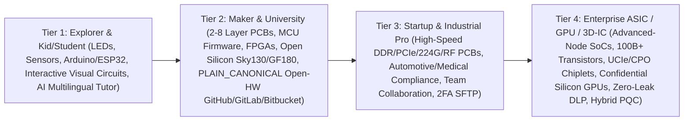
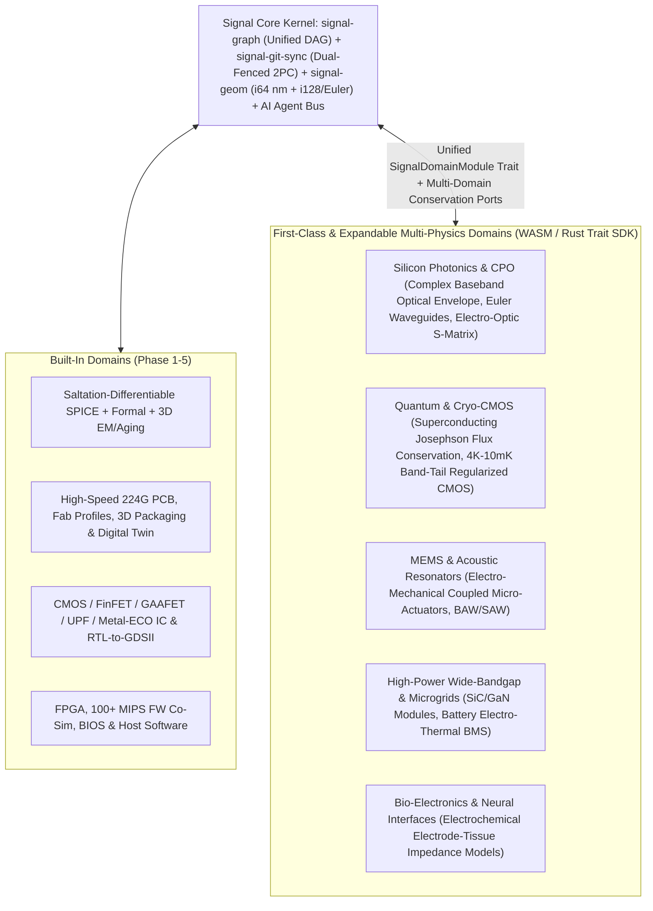

# 14 — Universal Scale, Global Accessibility & Future Expandability

> **Scope:** Defines how **Signal** achieves a **"Zero-Floor, Infinite-Ceiling"** architecture—empowering a student or hobbyist in a developing nation on a low-cost browser and modest internet connection to design their very first circuit, while scaling seamlessly on the exact same Rust engine to **100-billion-transistor GPUs, advanced-node ASICs, 3D-IC chiplets, and future physical domains** (Silicon Photonics, Quantum/Cryo-CMOS, MEMS).

---

## 1. Mission: Democratizing World-Class EDA Without Compromising Industrial Power

Today, the hardware industry suffers from a massive accessibility chasm:
- **Developing nations, schools, universities, and emerging startups** are locked out of modern semiconductor and high-speed hardware engineering by **\$100,000+/seat annual legacy EDA licenses**, **\$20,000 Linux workstation requirements**, opaque 1990s GUIs, and zero guided mentorship.
- Meanwhile, hobbyist tools hit a brick wall as soon as a student graduates to multi-layer high-speed PCBs, RF, FPGAs, or real IC silicon—forcing engineers to re-learn completely different tools at every stage of growth.

**Signal bridges the entire spectrum inside ONE platform and ONE Rust physics core:**

**Core Architectural Guarantee:** A circuit built by a 14-year-old student in **Explorer Mode** (connected in 1 click to their personal **`USER_NAMESPACE`** on GitHub, GitLab, or Bitbucket without needing an enterprise Organization) uses the **exact same `ElectronicModule` Rust physics engine**, **exact same `signal-graph`**, and **exact same BYO-Git repository format** (`signal-git-sync` across GitHub, GitLab, or Bitbucket) as a flagship GPU tape-out—only the UI complexity profile, pod compute quota, and security/compliance policies scale up!

---

## 2. Progressive Complexity Architecture (Same Engine, Adaptive UI Profiles)

Rather than building separate dumbed-down apps, Signal exposes **Workspace Experience Profiles** in the Angular IDE shell that progressively unlock tools, parameters, and constraints:

| Experience Profile | Target User | UI & Canvas Experience | AI Agent Role | Default Compute Pod |
|---|---|---|---|---|
| **`EXPLORER` (Kids / K-12 / First-Time Learners)** | Students, STEM classrooms, hobbyists | Clean distraction-free toolbar; visual animated electron/current-flow & glowing LED/motor indicators on schematic; simple friendly parameters (`Resistance`, `Battery Voltage`, `Tolerance`); instant "What happens if I double R1?" live sliders; zero intimidating SPICE syntax! | **Patient Socratic AI Tutor** (multilingual!): explains *why* an LED needs a current-limiting resistor, catches short circuits with visual explanations, guides step-by-step breadboard-to-PCB transition. | **Dedicated Wasmtime Isolate Security Cell (`signal-cell-wasm`: `< 8 MB` linear memory, `< 5 ms` boot, hardware MPK + per-project DEK/RLS — fractions of a cent/hr, auto-promoting seamlessly to a full Kata MicroVM Pod as designs grow!)** |
| **`MAKER` (University / Open Hardware)** | Undergrads, robotics clubs, indie inventors | Full schematic + 2–8 layer PCB layout + 3D preview + embedded C/Rust/Arduino/MicroPython + entry FPGA + **Open-Source Silicon PDKs** (`SkyWater 130nm`, `GF180MCU`, `IHP SG13G2` for affordable multi-project wafer shuttles!). | **Co-Designer & Datasheet Mentor:** helps select real low-cost locally available parts via Universal Datasheet RAG, verifies thermal/power margins, auto-checks fab DFM & SPDX open-hardware license rules. | Dedicated Small MicroVM Project Pod (2 vCPU / 4 GB RAM). |
| **`PRO` (Startup / Commercial Hardware)** | Hardware teams, OEMs | Full multi-type Projects (`PRD + HFS + Schematic + High-Speed PCB + FPGA + Firmware + BIOS`), Differentiable SPICE, Formal Verification, 3D EM/Thermal/Aging, Post-Silicon Digital Twin, 2FA SFTP fab delivery. | **Autonomous Neuro-Symbolic Specialist Agents:** Saltation/PSS adjoint Pareto sizing, diff-pair routing guidance, firmware SVD/pinmux sync, BOM & carbon/PFAS defense. | Medium/Large MicroVM Project Pod (8–16 vCPU / 16–32 GB RAM + Burst Workers). |
| **`SILICON_SCALE` (GPU / AI Accelerator / Advanced ASIC)** | Semiconductor leaders, hyperscalers, defense | Hierarchical multi-team SoC floorplanning, IEEE 1801 UPF, RTL-to-GDSII, FinFET/GAAFET/Backside-Power layouts, Metal-Only ECO, 2.5D/3D-IC UCIe & Co-Packaged Optics (CPO), Dual-Plane `Zstd-QOI`/WebP + HW Video Streaming, `CONFIDENTIAL_SILICON` + Hybrid PQC. | **Full Multi-Agent Silicon Team:** Pelgrom/aging-aware adjoint `(W/L)` sizing, PINN surrogates, RTL + formal SVA/LEC proof synthesis, automated LVS/DRC/timing debug across thousands of parallel GPU/CPU burst jobs. | High-Memory Project Pod (32–64 vCPU / 128–512 GB RAM + **Hardware-Isolated NVIDIA MIG**, Exclusive **Hopper H100 CC**, or **Blackwell B200 `TEE-I/O` Confidential MIG**) + Elastic HPC/GPU Burst Clusters. |

---

## 3. Scaling to Extreme Complexity: Designing a Modern GPU or Frontier ASIC

Designing an extremely complex chip (e.g., a multi-reticle AI GPU with 100B+ transistors, HBM4 memory stacks, Co-Packaged Optics, 100+ UPF power domains, thousands of engineers across continents) requires **five explicit scale-out architectural mechanisms** built into Signal from Day 1—without EVER violating [`15-application-security-and-project-isolation.md`](./15-application-security-and-project-isolation.md)'s zero-lateral-movement pod invariant:

### 3.1 Zero-Lateral-Movement Hierarchical Federation + `20 µm` Signed Boundary-Halo Views
A single Kubernetes pod cannot—and should not—hold a 100B-transistor flattened GPU in one monolithic RAM heap, yet Cilium eBPF strictly prohibits direct Pod-to-Pod lateral sockets (`Cell A <-> Cell B 100% DROPPED`), AND pure black-box LEF outlines alone miss sub-micron boundary DRC/antenna interactions at 2nm/3nm block edges! Signal solves all three simultaneously:
- **Hierarchical Project Federation:** A top-level **Super-Project** (`GPU-X1-SoC`) composes hundreds of independently versioned **Subsystem / IP Block Repositories** (`sm_shader_core`, `tensor_alu`, `l2_cache_slice`, `hbm4_phy`, `pcie6_serdes`, `cpo_optical_engine`, `power_mgmt_unit`, `interposer_pkg`, `reference_board_pcb`).
- Each subsystem runs in its own dedicated **Rust Project Pod** and publishes **`ML-DSA-65 + Ed25519`-Signed Immutable Abstract + `20 µm` Boundary-Halo Views** (`*.lef.sig`, clipped `20 µm` perimeter polygon shell `*.halo.gds.sig` for exact abutment DRC/antenna/CMP density checks while keeping 99% of internal core IP opaque, LVF Liberty `*.lib.sig`, UPF supply contracts, and PINN/behavioral `*.mod.sig`) to its `<project>-ic-<block>` repo pinned in `.signal/repos.lock.json`!
- Live cross-hierarchy constraint negotiation routes strictly through the stateless **`signal-federation-broker`**, while final full-chip tape-out DRC/LVS/PEX fans out across **Spatially-Tiled Overlapping MapReduce Burst Workers**—**zero direct Pod-to-Pod sockets ever open!**

### 3.2 Level-of-Detail (LOD), Overflow-Proof Geometry & Curved Waveguides (`signal-geom` + `signal-render`)
- IC layouts are stored as **instanced Directed Acyclic Graphs (DAGs)** using `i64` nanometer coordinates paired with **exact `i128` cross-products and adaptive Shewchuk predicates** (zero overflow from 2nm GAAFET gates up to 2-meter wafer/backplane assemblies) plus native **Circular Arc, Cubic Bézier, and Adiabatic Euler-Bend primitives** for curved RF traces and Silicon Photonics waveguides.
- `signal-render` performs GPU frustum culling + hierarchical LOD bounding-box rendering so zooming from an 800 mm² multi-reticle GPU die down to a single transistor gate maintains **60–120 FPS** smoothly.

### 3.3 Distributed HPC / Hardware-Isolated GPU Solver Fabric
For workloads that exceed a single pod, `signal-sim`, `signal-em3d`, `signal-formal`, and `signal-ic` partition work across single-job, zero-egress Kubernetes HPC/GPU worker pools:
- **Domain-Decomposed Multi-GPU Solvers:** Hierarchical Schur-complement / `cuDSS` + mixed-precision iterative refinement across **Hardware-Isolated NVIDIA MIG slices**, Exclusive Hopper `H100` CC, or Blackwell `B200` `TEE-I/O` Confidential MIG GPUs.
- **Embarrassingly Parallel Sweeps:** 10,000-corner PVT/LVF/Monte-Carlo runs, MMMC STA, 15-year NBTI/HCI/TDDB aging sign-off, spatially-tiled MapReduce DRC/PEX, and parallel RTL/UVM regressions fan out elastically via per-project NATS JetStream subjects + Karpenter.

### 3.4 Foundry Sign-Off Bridge, HSM IEEE 1735 & Isolated `OSDI`/`IBIS-AMI` Interop
Semiconductor foundries and SerDes vendors distribute encrypted IP and certified sign-off decks. Signal combines **(1) HSM-backed IEEE 1735 v2/v3 `Signal Design` key-block decryption**, **(2) child-MicroVM IPC sandboxes for binary `IBIS-AMI`/`OSDI` models**, and **(3) `signal-toolchain-bridge`** invoking containerized, air-gapped foundry sign-off runners (or open-source OpenROAD / Yosys / Verilator / Magic / Netgen / KLayout runners in Maker/Edu tiers) inside ephemeral zero-egress worker pods.

---

## 4. Developing-Nation & Low-Resource Engineering Accessibility

To truly empower engineers and students across Africa, South Asia, Southeast Asia, Latin America, and underserved regions worldwide:

1. **Zero High-End Hardware Requirement:** Runs smoothly in any standard browser on a **\$150 Chromebook, low-RAM laptop, or tablet**—all heavy Rust physics, SPICE simulation, rendering, and AI reasoning execute in the cloud (or on a university's local mini-server!).
2. **Low-Bandwidth Adaptive Transport + Volatile RAM Reconnect Resilience:**
   - Automatic connection-quality detection (`3G / 4G / high-latency satellite` vs. fiber) over **HTTP/3 WebTransport** / TCP `turns:443` / WSS fallback.
   - In non-restricted `EXPLORER` / `MAKER` modes, drops to **ultra-compact binary delta vectors** (kilobytes/min) so editing and live simulation stay snappy at **500 Kbps / 250 ms RTT**.
   - **Volatile JS Heap Reconnect Ring-Buffer (`<= 60 s`):** Holds unsent CRDT ops strictly in a **volatile JS RAM closure** (zero `localStorage`/`IndexedDB`) and replays idempotently on reconnect.
   - **Lazy Sub-Repo Materialization & `< 10 KB` Declarative Sim Recipes:** Classroom template launches create `<project>-meta` first (avoiding GitHub `80/min` secondary rate limits!) and store `< 10 KB` deterministic sim recipes so free-tier student Git accounts never hit LFS paywalls.
   - In Enterprise Zero-Leak mode, `Zstd-QOI` / Lossless `WebP` dirty-tile prioritization keeps active-cursor schematic/layout regions razor-sharp on modest links.
3. **Regional Edge Kubernetes Deployment & Sovereign Campus Edition (`Signal Campus`):**
   - Stateless Envoy edge relays + paired regional K8s clusters (Mumbai/Hyderabad, Singapore, São Paulo, Johannesburg, Nairobi, Frankfurt/Paris, US) keep latency low globally.
   - **Self-Hostable University / National Lab Appliance (`Signal Campus`):** Runs cleanly in Kubernetes (or `pnpm dev:lite` on 8 GB campus Macs with offline `deterministic_mock` / Ollama LLM) with **zero per-seat foreign currency lock-in**!
4. **Multilingual AI Engineering Tutor & Clean-Room Sketch Import:**
   - Converses natively in **English, Hindi, Tamil, Spanish, Portuguese, French, Swahili, Bahasa, Arabic, Vietnamese, Mandarin**, and more—and converts photographed classroom notebook sketches (`signal-import`) into live simulated schematics.
5. **Open-Hardware, Open-Silicon & SPDX License Safety:**
   - Pre-indexed packs for **RISC-V cores**, **SkyWater 130nm / GF180 / IHP SG13G2 PDKs**, **TinyTapeout**, and low-cost regional parts (ESP32, STM32, RP2040), guarded by an automated **SPDX Hardware/IP License Compatibility Gate** (`Apache-2.0`, `CERN-OHL-P/W/S`, `MIT`, `Solderpad`).

---

## 5. Future Expandability: Multi-Physics & Next-Generation Domain Plugin Architecture

Electronics in the 2030s and 2040s will extend far beyond classical silicon CMOS and FR-4 PCBs. Signal's Rust core is intentionally architected as a **Domain-Extensible Multi-Physics Platform** so future technologies plug in cleanly without rewriting the engine:

### How Future Expandability Is Engineered Technically
1. **Generalized Multi-Physics Ports, Baseband Envelopes & Cryo Regularization:** `PinPort` supports `Electrical(V, I, q)`, `Thermal(T, P)`, `DigitalLogic`, `RFWave(a, b)`, `OpticalEnvelope(E_complex_env, lambda_0_nm)` (solving `GHz` modulation envelopes rather than intractable `193 THz` optical carriers!), `MagneticFlux(MMF, Phi)`, `Mechanical(F, v)`, and `QuantumFlux(Phi_q, I_s)` with `4 K–10 mK` regularized cryo-subthreshold physics and exact `q(v)`/`Φ(i)` state conservation.
2. **Versioned, Signed & Sandboxed Extension SDK (`signal-module-sdk` — Rust + Fuel-Metered `WASM-SIMD`):** Universities, foundries, startups, and enterprises author new component models, DRC/DFM rules, physics surrogates, or importers as AOT-compiled, `ML-DSA`-signed, SPDX-tagged, `wasmtime`-sandboxed plugins distributed via the **Signal Marketplace**.
3. **Declarative Schema Evolution (`contracts/` + `signal-graph`):** SI-unit-suffixed `bigint`-safe Protobuf schemas (`N-1` wire compatibility) allow adding `PHOTONICS_PIC` or `QUANTUM_CHIP` Sub-Project types with zero breaking DB migrations or repo rewrites!
