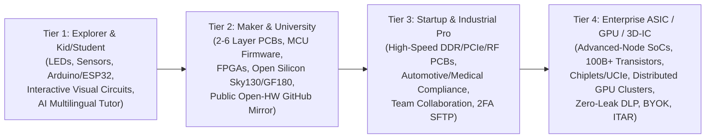
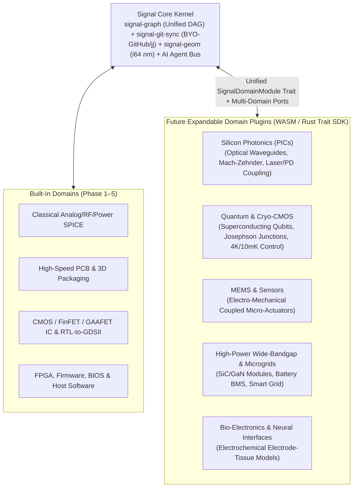

# 14 — Universal Scale, Global Accessibility & Future Expandability

> **Scope:** Defines how **Signal** achieves a **"Zero-Floor, Infinite-Ceiling"** architecture—empowering a student or hobbyist in a developing nation on a low-cost browser and modest internet connection to design their very first circuit, while scaling seamlessly on the exact same Rust engine to **100-billion-transistor GPUs, advanced-node ASICs, 3D-IC chiplets, and future physical domains** (Silicon Photonics, Quantum/Cryo-CMOS, MEMS).

---

## 1. Mission: Democratizing World-Class EDA Without Compromising Industrial Power

Today, the hardware industry suffers from a massive accessibility chasm:
- **Developing nations, schools, universities, and emerging startups** are locked out of modern semiconductor and high-speed hardware engineering by **\$100,000+/seat annual legacy EDA licenses**, **\$20,000 Linux workstation requirements**, opaque 1990s GUIs, and zero guided mentorship.
- Meanwhile, hobbyist tools hit a brick wall as soon as a student graduates to multi-layer high-speed PCBs, RF, FPGAs, or real IC silicon—forcing engineers to re-learn completely different tools at every stage of growth.

**Signal bridges the entire spectrum inside ONE platform and ONE Rust physics core:**

**Core Architectural Guarantee:** A circuit built by a 14-year-old student in **Explorer Mode** uses the **exact same `ElectronicModule` Rust physics engine**, **exact same `signal-graph`**, and **exact same GitHub Organization repository format** (`signal-git-sync`) as a flagship GPU tape-out—only the UI complexity profile, pod compute quota, and security/compliance policies scale up!

---

## 2. Progressive Complexity Architecture (Same Engine, Adaptive UI Profiles)

Rather than building separate dumbed-down apps, Signal exposes **Workspace Experience Profiles** in the Angular IDE shell that progressively unlock tools, parameters, and constraints:

| Experience Profile | Target User | UI & Canvas Experience | AI Agent Role | Default Compute Pod |
|---|---|---|---|---|
| **`EXPLORER` (Kids / K-12 / First-Time Learners)** | Students, STEM classrooms, hobbyists | Clean distraction-free toolbar; visual animated electron/current-flow & glowing LED/motor indicators on schematic; simple friendly parameters (`Resistance`, `Battery Voltage`, `Tolerance`); instant "What happens if I double R1?" live sliders; zero intimidating SPICE syntax! | **Patient Socratic AI Tutor** (multilingual!): explains *why* an LED needs a current-limiting resistor, catches short circuits with visual explanations, guides step-by-step breadboard-to-PCB transition. | Shared-pool lightweight Micro Project Pod (0.5 vCPU / 512 MB RAM — pennies per hour!). |
| **`MAKER` (University / Open Hardware)** | Undergrads, robotics clubs, indie inventors | Full schematic + 2–8 layer PCB layout + 3D preview + embedded C/Rust/Arduino/MicroPython + entry FPGA + **Open-Source Silicon PDKs** (`SkyWater 130nm`, `GF180MCU`, `IHP SG13G2` for affordable multi-project wafer shuttles!). | **Co-Designer & Datasheet Mentor:** helps select real low-cost locally available parts via Universal Datasheet RAG, verifies thermal/power margins, auto-checks fab DFM rules. | Small Project Pod (2 vCPU / 4 GB RAM). |
| **`PRO` (Startup / Commercial Hardware)** | Hardware teams, OEMs | Full multi-type Projects (`PRD + HFS + Schematic + High-Speed PCB + FPGA + Firmware + BIOS`), full SI/PI/Thermal/Monte-Carlo, team collaboration, Templates, 2FA SFTP fab delivery. | **Autonomous Specialist Agents:** closed-loop circuit synthesis, diff-pair routing guidance, firmware pinmux/driver sync, BOM obsolescence defense. | Medium/Large Project Pod (8–16 vCPU / 16–32 GB RAM + Burst Workers). |
| **`SILICON_SCALE` (GPU / AI Accelerator / Advanced ASIC)** | Semiconductor leaders, hyperscalers, defense | Hierarchical multi-team SoC floorplanning, RTL-to-GDSII, custom analog/FinFET/GAAFET layouts, 2.5D/3D-IC interposer & UCIe chiplets, multi-corner PVT/STA/EM-IR sign-off, Zero-Leak Pixel Streaming, BYOK/Kata isolation. | **Full Multi-Agent Silicon Team:** `gm/Id` analog corner optimization, RTL + formal SVA generation, automated LVS/DRC/timing debug across thousands of parallel GPU/CPU burst jobs. | High-Memory Project Pod (32–64 vCPU / 128–512 GB RAM + MIG GPU) + Elastic K8s HPC/GPU Burst Clusters. |

---

## 3. Scaling to Extreme Complexity: Designing a Modern GPU or Frontier ASIC

Designing an extremely complex chip (e.g., a multi-reticle AI GPU with 100B+ transistors, HBM4 memory stacks, 100+ power domains, thousands of engineers across continents) requires **five explicit scale-out architectural mechanisms** built into Signal from Day 1:

### 3.1 Hierarchical Multi-Pod Federation (Sub-Block Sharding)
A single Kubernetes pod cannot—and should not—hold a 100B-transistor flattened GPU in one monolithic RAM heap.
- **Hierarchical Project Federation:** A top-level **Super-Project** (`GPU-X1-SoC`) composes hundreds of independently versioned **Subsystem / IP Block Repositories** (`sm_shader_core`, `tensor_alu`, `l2_cache_slice`, `hbm4_phy`, `pcie6_serdes`, `power_mgmt_unit`, `interposer_pkg`, `reference_board_pcb`).
- Each active subsystem runs in its own dedicated **Rust Project Pod** (with sticky routing for that IP team!), while the top-level **Full-Chip Integration Pod** mounts verified **Abstract Views** (LEF/pin-rings, timing Liberty `.lib`, behavioral/black-box `ElectronicModule` wrappers, thermal power maps) over internal mTLS!
- Result: 500 engineers work concurrently across the same GPU without any single pod bottleneck, while full-chip integration remains instantaneous.

### 3.2 Level-of-Detail (LOD) & Sparse Hierarchical Geometry (`signal-geom` + `signal-render`)
- IC layouts are stored as **instanced Directed Acyclic Graphs (DAGs)** (a single 6T SRAM cell instanced 500 million times takes bytes, not terabytes!).
- `signal-render` performs GPU frustum culling + hierarchical LOD bounding-box rendering so zooming from a 800 mm² GPU die all the way down to a 2nm FinFET/GAAFET gate maintains **60 FPS** smoothly.

### 3.3 Distributed HPC / GPU Solver Fabric
For workloads that exceed a single pod, `signal-sim` and `signal-ic` partition work across Kubernetes HPC/GPU worker pools:
- **Domain-Decomposed Sparse Linear Solvers & Multi-GPU SPICE:** Partitioning huge post-layout PDN/clock/analog networks using hierarchical Schur-complement / multi-level domain decomposition across GPU nodes.
- **Embarrassingly Parallel Sweeps:** 10,000-corner PVT/Monte-Carlo runs, multi-mode multi-corner (MMMC) STA, tiled spatial DRC/PEX, and parallel RTL/UVM regressions fan out elastically via NATS JetStream + Karpenter.

### 3.4 Plug-In External Foundry & Toolchain Bridge (Enterprise Pragmatism)
Semiconductor foundries sometimes mandate certified sign-off decks for tape-out warranty. Signal's **`signal-toolchain-bridge`** allows Enterprise tenants to run Signal's native Rust engines *and* invoke containerized, air-gapped foundry-certified sign-off runners (or open-source OpenROAD / Yosys / Verilator / Magic / Netgen runners in Maker/Edu tiers) inside zero-egress Kubernetes worker pods—streaming results directly back into Signal's unified Design Graph and AI Agents.

---

## 4. Developing-Nation & Low-Resource Engineering Accessibility

To truly empower engineers and students across Africa, South Asia, Southeast Asia, Latin America, and underserved regions worldwide:

1. **Zero High-End Hardware Requirement:** Runs smoothly in any standard browser on a **\$150 Chromebook, low-RAM laptop, or tablet**—all heavy Rust physics, SPICE simulation, rendering, and AI reasoning execute in the cloud (or optionally on a school/university's local mini-server!).
2. **Low-Bandwidth Adaptive Transport:**
   - Automatic connection-quality detection (`3G / 4G / high-latency satellite` vs. fiber).
   - In non-restricted `EXPLORER` / `MAKER` modes, automatically drops to **ultra-compact binary delta vectors** (kilobytes per minute instead of megabits/sec video streaming!) so editing and live circuit simulation stay snappy even at **500 Kbps / 250 ms RTT**.
   - In Enterprise Zero-Leak mode, adaptive AV1/H.264 dynamic tile quantization prioritizes crisp active-cursor tiles first.
3. **Regional Edge Kubernetes Deployment & Sovereign Campus Edition:**
   - Stateless edge relays + regional K8s clusters (e.g., Mumbai, Singapore, São Paulo, Johannesburg, Nairobi, Frankfurt, US) keep interactive latency low globally.
   - **Self-Hostable University / National Lab Appliance (`Signal Campus`):** Because the entire Signal stack runs cleanly in Kubernetes with local/open-weights LLMs (vLLM/Ollama), universities and national innovation hubs in developing nations can deploy a full air-gapped or low-cost campus cluster on modest local servers with **zero per-seat foreign currency lock-in**!
4. **Multilingual AI Engineering Tutor:**
   - Signal's AI Agents natively teach and converse in **English, Hindi, Tamil, Spanish, Portuguese, French, Swahili, Bahasa, Arabic, Vietnamese, Mandarin**, and more—breaking the English-only barrier to learning advanced electrical & chip engineering while still grounding every formula and component in exact SI units and verified datasheets.
5. **Open-Hardware & Open-Silicon First-Class Support:**
   - Built-in templates and pre-indexed Universal Datasheet/PDK packs for **open-source RISC-V cores**, **SkyWater 130nm / GF180 / IHP SG13G2 PDKs**, **TinyTapeout** shuttles, and low-cost locally available components (e.g., ESP32, STM32, RP2040, jellybean BJTs/op-amps).

---

## 5. Future Expandability: Multi-Physics & Next-Generation Domain Plugin Architecture

Electronics in the 2030s and 2040s will extend far beyond classical silicon CMOS and FR-4 PCBs. Signal's Rust core is intentionally architected as a **Domain-Extensible Multi-Physics Platform** so future technologies plug in cleanly without rewriting the engine:

### How Future Expandability Is Engineered Technically
1. **Generalized Multi-Physics Port Abstraction:** In `signal-component`, `PinPort` is parameterized by `PhysicalDomain` (today: `Electrical(V, I)`, `Thermal(T, P)`, `DigitalLogic`, `RFWave(a, b)`; future: `OpticalMode(E_complex, wavelength)`, `MagneticFlux(MMF, Φ)`, `Mechanical(F, v)`, `QuantumFlux`). Every solver couples through generalized **Across / Through conservation laws** (Kirchhoff generalized via Bond-Graph / Acausal DAE physics)!
2. **Versioned Extension SDK (`signal-sdk` — Rust + Sandboxed WASM):** Universities, foundries, startups, and enterprises can author new component models, custom DRC/DFM rules, new physics solvers, custom file-format importers, or specialized AI Agent tools as sandboxed WASM/Rust plugins—distributed through a curated **Signal Marketplace** (Global Open-Source + Private Enterprise Registry).
3. **Declarative Schema Evolution (`contracts/` + `signal-graph`):** Project metadata, Sub-Project types, and Datasheet records use forward-compatible versioned schemas so adding a brand-new `PHOTONICS_PIC` or `QUANTUM_CHIP` Sub-Project type requires zero breaking database migrations or repository format rewrites!
