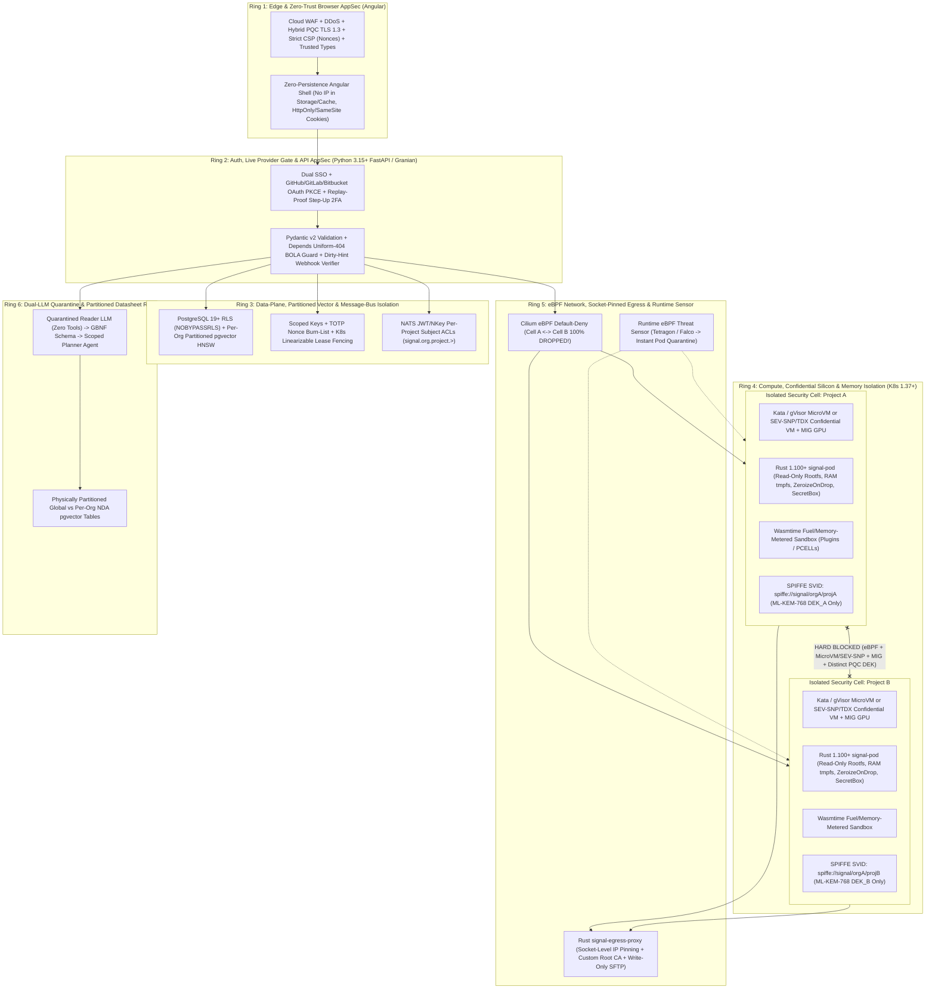

# 15 — Application Security & Complete Project Isolation Architecture

> **Scope:** Defines Signal's end-to-end **Application Security (AppSec)** and **Complete Project Isolation** architecture—complementing [`07-security-encryption-dlp-and-sftp.md`](./07-security-encryption-dlp-and-sftp.md) (Encryption, DLP & 2FA SFTP) to engineer **OWASP ASVS Level 3** security across browser, API, database, compute, kernel, network, AI/RAG, and CI/CD supply chain so that **every single Project operates as a mathematically, cryptographically, and physically isolated security cell**.

---

## 1. Core Security Guarantee: "1 Project = 1 Isolated Security Cell"

No single control achieves complete security—true enterprise & semiconductor-grade security comes from **non-bypassable Defense-in-Depth** where every layer assumes adjacent layers could be attacked.

**Signal's Project Isolation Invariant:**
> *Even if an adversary compromises a user's browser session, uploads a weaponized datasheet/PDK/WASM plugin, triggers an AI prompt injection, exploits an application query bug, OR achieves arbitrary code execution inside one Project Pod—there MUST be **ZERO network, kernel, memory, cache, queue, database, or cryptographic path** to read, decrypt, pivot into, or corrupt **ANY other Project** (even another Project inside the same Organization).*

---

## 2. Project-to-Project Isolation Matrix (Every Layer Audited)

This matrix governs BOTH **Cross-Organization Isolation** (Company A vs. Company B) AND **Intra-Organization Project Isolation** (Project X vs. Project Y inside the same company, plus Sub-Project Repo isolation inside Project X):

| Layer | Isolation Mechanism | What Happens If Layer Above Is Breached |
|---|---|---|
| **Browser / Angular `v22+` UI** | Route-partitioned `COOP: same-origin` + `COEP: require-corp` on `/org/:org_slug/project/*` (preserving top-level `/auth/*` PKCE/SAML redirects), CSP with per-request nonces, Angular Trusted Types, `60 s` rolling stream key + pan-scrape anomaly detector, zero design data in `localStorage`/`IndexedDB`/SW cache (`<= 60 s` volatile JS RAM closure only). | Compromised extension, multi-tab context, or stolen laptop disk cannot scrape cross-origin tokens, harvest full-die tiles, or pull cached design files. |
| **Authentication & Sessions** | Top-level redirect SAML/OIDC + OAuth 2.0 PKCE (`provider_user_id`), `5 min` `SameSite=Lax` `/auth/*` state cookies upgraded on callback to host-locked `__Host-signal_session` (`HttpOnly; Secure; SameSite=Strict`) + `Sec-Fetch-Site` guards, short-lived JWTs (`<= 10 min`), pre-session **mTLS Attested Enterprise Browser posture** (`HIGH_SECURITY`), live `provider_repo_id` + `expires_at` check, `< 2 s` pod eviction. | Stolen, expired, unmanaged-device, or revoked user loses access across all active Project Pods within `< 2 s`; OAuth/SAML flows never break on `window.opener`. |
| **Python `3.15+` FastAPI Control Plane (`Granian`)** | Zero-trust BOLA/IDOR `Depends(require_*)` guards (+ startup route-introspection gate) checking live `REPO_ACCESS_ENTRY` and returning constant-time **uniform `404 Not Found`**; strict Pydantic v2 (`extra="forbid"`) + exact 64-bit `int`/JSON-string validation; **Synchronous 3x Quorum Audit Outbox (`Fail-Closed` `503`)** on Tier-0 actions. | Attackers probing UUIDs learn ZERO existence info, 64-bit IDs never round in JSON, and no Tier-0 release/credential mutation can ever execute unlogged. |
| **PostgreSQL `19+` & Tiered `pgvector`** | **Mandatory Row-Level Security (RLS)** (`NOBYPASSRLS`) on every tenant/project table. **3-Tier `pgvector` HNSW Sharding:** `datasheet_chunks_global` + **Sharded Dedicated Physical Partitions (`<= 500` orgs/cluster)** for `ENTERPRISE_ISOLATED` NDA pools + **64 Fixed Hash-Bucket Partitions (`hnsw.iterative_scan = strict_order` + constant-time padding)** for standard `MAKER`/`PRO` orgs. | Eliminates missing-`WHERE` SQL leaks, eliminates HNSW vector timing leaks, AND prevents `50,000`-partition Postgres `relcache`/planner memory collapse! |
| **Host Leases, Dual Fencing, Redis & NATS** | Single-writer exclusivity via **Host-Aggregated K8s Node Leases (`100×` fewer `etcd` writes) + Sharded Linearizable `project_lease` Epochs (`fencing_epoch`)** enforced both in **Rust `signal-egress-proxy` (`X-Signal-Fencing-Token` `412` hard-drop)** and `<project>-meta` Git `CAS`. Scoped Redis keys + per-project **NATS JWT/NKey ACLs**. | Zombie pods stalled across Lease expiry are blocked at `signal-egress-proxy` BEFORE packets reach external GitHub/GitLab servers! |
| **Hybrid PQC & 2-Level `HKDF` KMS** | **Unique DEK per Project** wrapped via **Hybrid Post-Quantum `ML-KEM-768 + X25519`** and unwrapped **once per Pod Hydration** into `SecretBox` RAM (deriving per-entity `AES-256-GCM-SIV` subkeys via local `HKDF-SHA256`—zero KMS `429` storms!). Vault/BYOK verifies SPIFFE SVID + `NRAS`/SEV-SNP attestation quotes. | Defeats cross-project ciphertext substitution, KMS throttling DoS, AND "Harvest Now, Decrypt Later" quantum adversaries! |
| **Compute, Kernel & Hardware-Accurate Confidential GPUs** | **1 Dedicated Cell per Loaded Project:** `< 8 MB` **Wasmtime Isolate (`signal-cell-wasm` + hardware MPK)** for tiny `EXPLORER` circuits (auto-promoting to **Kata / Firecracker MicroVM**); **`CONFIDENTIAL_SILICON`** runs **AMD SEV-SNP / Intel TDX** paired with **Exclusive Whole-GPU Hopper `H100 CC`** (with FLR/CC reset) OR **Blackwell `B200`/`GB200` `TEE-I/O` Confidential MIG** (`A100`/`H100`/`L40S` non-CC pods use **Hardware MIG** + VRAM scrub; time-sliced multi-project GPUs are forbidden!). | Reflects real silicon hardware rules (`H100` forbids `MIG + CC`, `B200` enables `TEE-I/O` MIG)—blocking kernel escapes, VRAM residue, and host-root snooping! |
| **Inside Multi-Repo Project Pod** | Rust `1.100+` `signal-engine` enforces each connected user's signed **per-repo (`provider_repo_id`) Sub-Project RBAC map** on graph queries, viewport layers, Cloud Clipboard pastes, and AI context. | An external PCB contractor connected to Project A's pod receives ZERO nodes, polygons, net names, or clipboard data from Project A's IC or BIOS repos. |
| **Network (3-Tier Cilium eBPF + Brokered Federation, `20-*`)** | Default-deny 3-Tier Cilium NetworkPolicies: `signal-web` (`pool-web`) can ONLY dial `signal-api-gateway` (`pool-api`); only `signal-engine-bridge` (`pool-api`) can dial active `signal-pod`s across the `1–4 -> N` extensible `pool-rust-engine` worker nodes over SPIFFE mTLS; **100% of Pod-to-Pod lateral traffic between Project Pods is DROPPED at kernel eBPF level.** `SILICON_SCALE` federation exchanges `ML-DSA`-signed Abstract + `20 µm` Halo Views (`*.halo.gds.sig`) via Git + stateless `signal-federation-broker`—zero lateral sockets! | Zero web-to-Rust or web-to-DB path, zero lateral scanning, zero east-west movement, zero direct internet exfiltration from inside any Project Pod. |
| **Burst, SFTP & Foreign-Binary IPC Sandboxes** | SPICE/EM/DRC/Formal/AOT-Verilog-A workers are **single-job, zero-egress microVM pods**. Untrusted binary `IBIS-AMI`/`OSDI` `.so` models run in **out-of-process child `Firecracker`/`gVisor` IPC sandboxes**. SFTP pushes run in **disposable write-only `russh` pods** (`SSH_FXP_READ`/`OPENDIR` disabled). | Segfaulting/malicious vendor `.so` binaries, firmware `Makefile`s, or hostile fab SFTP servers can never compromise `signal-pod` or read back files. |
| **BYO-Git Storage & Universal Parts (`18-*`)** | Separate prefixed repos (`<= 40/min` paced lazy materialization) + Org-private `<org>/signal-org-parts` AVL overlays, **Padmé-padded, path-blinded (`blobs/*.sigv`), `.signal/vault.merkle.sig`-bound `AES-256-GCM-SIV` `ENCRYPTED_VAULT`**, **`MUST_ENCRYPT` taint gate**, Dual-Fenced Two-Phase `Super-Commit`, audited by `services/vcs-auditor`. | Defeats local `git clone` leaks, filename architecture leaks, standard-cell byte-size fingerprinting, NDA AVL leakage, and single-chunk rollback tampering! |
| **AI Agents & Text+Vision Dual-LLM Quarantine** | Agents inherit calling user's exact per-repo RBAC, route **100% of untrusted PDFs, errata, CAD notes, AND VLM whiteboard/datasheet images through Zero-Tool Quarantine Models** (`GBNF` JSON primitives only), and write strictly to speculative `jj` CoW branches with merge-time delta re-verification. | Both prose and low-contrast visual/typographic prompt injections are structurally incapable of invoking tools or leaking IP. |

---

## 3. Application-Layer Hardening Standards (OWASP ASVS Level 3)

### 3.1 Angular `v22+` Frontend Hardening (`web/`)
- **Strict Content Security Policy (CSP) & Route-Partitioned `COOP`/`COEP`:** Per-request cryptographic `nonce` for scripts, `object-src 'none'`, `base-uri 'none'`, `frame-ancestors 'none'`, `connect-src` locked to Signal Envoy/TURN origins (`turns:443`, HTTP/3 WebTransport, WSS), and `COOP: same-origin` + `COEP: require-corp` scoped to `/org/:org_slug/project/*` workspace routes so top-level `/auth/*` OAuth/SAML flows never break.
- **XSS Elimination:** Angular **Trusted Types** enforcement enabled globally; `bypassSecurityTrust*` APIs banned by ESLint CI rule; all PRD/HFS/Review Markdown rendered via strict DOMPurify allowlist.
- **Session, `__Host-` Cookie Upgrade & CSRF Protection:** Top-level `/auth/*` PKCE/SAML callbacks upgrade short-lived `SameSite=Lax` state cookies into host-locked `__Host-signal_session` (`HttpOnly; Secure; Path=/; SameSite=Strict`); active org/project context binds to URL route params (`/org/:org_slug/project/:proj_slug`); mutations enforce double-submit CSRF + `Origin` + `Sec-Fetch-Site: same-origin`.
- **Subresource Integrity (SRI) & Lockfile Pinning:** All build bundles verified with SRI hashes; zero external third-party CDN scripts or telemetry trackers loaded in the Signal IDE.

### 3.2 Python `3.15+` FastAPI Control Plane, Quorum Governance & Socket-Pinned Anti-SSRF (`services/`)
- **Fail-Closed `Depends` Auth, Startup Route Audit, Uniform `404` & Synchronous Tier-0 Audit:** Every non-health route MUST declare `Depends(require_project_repo_role(...))`, `Depends(require_org_admin)`, or `Depends(require_step_up_2fa)` (an automated startup route-introspection gate fails boot & CI on any unannotated route). Unauthorized lookups return constant-time `404 Not Found`. Tier-0 security mutations (including `PLM_OPS` `ECO`/`ECN`/`MCN`/`PCN`/`Deviation`/`NCR` CCB transitions in `services/plm-ops` and Stage-Gate sign-offs in `services/collab-hub`) commit synchronously to a **3-replica quorum audit outbox BEFORE executing** (`503` fail-closed if audit unavailable).
- **Strict Pydantic v2 (`extra="forbid"`) & 64-Bit Wire Fidelity:** Every request validated against Rust-backed Pydantic v2 schemas matching OpenAPI 3.1 (`contracts/openapi/control-plane.v1.yaml`), preserving exact 64-bit Python `int` serialized as JSON strings (`[jstype = JS_STRING]`) for lossless Angular `v22+` `bigint` parity with strict byte-length limits, SI-unit bounds, and Unicode NFC normalization.
- **Untrusted "Dirty-Hint" Webhook Policy:** Incoming GitHub/GitLab/Bitbucket webhooks validate constant-time `HMAC-SHA256` signatures + 5-minute replay windows, and are treated strictly as **untrusted dirty hints**—always re-querying the provider's authoritative HTTPS API over Rust `signal-egress-proxy` before mutating RBAC or evicting pods!
- **Socket-Level Anti-SSRF, Active Fencing & Pinned Enterprise PKI (`signal-egress-proxy` & `signal-sftp-egress`):**
  1. Enforce `https://` (Git/ERP webhooks) or `ssh/sftp` (SFTP) schemes only; disable cross-host HTTP redirects; verify `X-Signal-Fencing-Token` epoch floor on all pod Git writes (`412` zombie-pod drop!).
  2. **Defeat `TTL=0` DNS Rebinding:** Custom resolver resolves DNS, validates every returned IPv4/IPv6 address against **HARD BLOCKED** CIDRs (`127.0.0.0/8`, `::1`, `169.254.0.0/16`, `fd00:ec2::254`, `100.64.0.0/10`, and RFC1918/K8s pod CIDRs unless bound to an attested Enterprise PrivateLink/VPC endpoint), and **binds the outbound TCP socket directly to the verified IP on EVERY `connect()`** while preserving TLS SNI.
  3. **Custom Enterprise Root CA Pinning:** Self-hosted Git servers using private enterprise PKIs verify against Step-Up 2FA-uploaded Custom Root CA `PEM` bundles pinned by SPKI SHA-256 fingerprint—never disabling TLS verification.
- **Replay-Proof Step-Up 2FA & Multi-Admin Quorum:**
  - Fresh WebAuthn/FIDO2 (preferred) or TOTP assertions (`<= 5 min` TTL) with atomic Redis `(user_id, totp_time_step)` `SET NX EX 90` burn-lists.
  - Enterprise orgs require **≥ 2 enrolled hardware-key Org Super Admins** and enforce **2-of-3 M-of-N Multi-Admin Quorum** for Emergency Break-Glass recovery.

### 3.3 Rust `1.100+` Engine, Untrusted File Parser Caps, Foreign-Binary IPC & `SecretBox<T>` (`engine/`)
- **Pure Safe Rust Core & AOT LLVM-Free Pods:** `#![forbid(unsafe_code)]` enforced across `signal-core`, `signal-graph`, `signal-component`, `signal-parts`, `signal-mcad`, `signal-cam`, `signal-plm`, `signal-git-sync`, `signal-pod`, `signal-import`, `signal-twin`, and `signal-operator` (Verilog-A compiles AOT in `signal-verify-worker` via Cranelift/`WASM-SIMD` so `signal-pod` stays LLVM-free).
- **Hardened Untrusted File Parser Sandboxes & Bomb Caps:** External uploads execute inside **ephemeral, zero-network, memory-and-CPU-capped microVM/WASM parser sandboxes** enforcing `<= 20:1` decompression ratios, **zero XML DTD/XXE expansion** (critical for `IPC-2581`, `3MF`, `SVG`, `SPDX`), and max GDSII/OASIS/STEP/DXF/3MF hierarchy depth `<= 64`.
- **Two-Tier Custom Module & Vendor Binary Isolation:** `.wasm` plugins/PCELLs require `ML-DSA` publisher signatures and run in zero-WASI, fuel-metered **`wasmtime`** (`<= 256 MB`); untrusted binary vendor `IBIS-AMI`/`OSDI` `.so` executables run strictly out-of-process inside a **zero-network, seccomp-locked child `Firecracker`/`gVisor` IPC sandbox** over zeroized shared-memory rings (while HSM-backed `signal-ieee1735-v1` keys unwrap IEEE 1735 IP strictly in attested RAM).
- **Mandatory Memory Zeroization & `SecretBox<T>` / `SecretStr` Telemetry Hygiene:** `zeroize::ZeroizeOnDrop` + `swapoff -a` + `RLIMIT_CORE = 0` + **`SecretBox<T>`** / **`SecretStr`** (`"[REDACTED]"` on `Debug`/`Display`/`Serialize`).

---

## 4. AI Agent & Universal Datasheet RAG Security (Text+Vision Quarantine & Tiered RAG)

1. **Multimodal Dual-LLM Quarantine (Text + Vision Prompt-Injection Immunity):**
   - Untrusted external PDFs, errata, CAD notes, commit messages, **AND VLM-processed whiteboard photos / datasheet plots** are **NEVER** fed into a tool-calling agent's instruction stream; a **Zero-Tool Quarantine Extractor** emits strictly `GBNF`-constrained typed primitives consumed by the **Privileged Planner Agent**.
2. **Zero Ambient Authority & Hard Tool Allowlist:** Every `AgentToolsService` call carries the invoking user's non-elevated per-repo RBAC token; AI Agents have **ZERO tool bindings** to `sftp-egress`, `vcs-connector` credentials, `identity-org` admin APIs, Access Review revocations, or outbound sockets.
3. **Speculative Branch + Merge-Time Proof Re-Verification:** AI writes exclusively to `jj` CoW branches with parent-hash-bound proof bundles re-verified incrementally (`< 1 s`) on post-rebase merge.
4. **3-Tier Multi-Tenant `pgvector` Sharding & Chaff-Padded Supply-Chain Privacy:** Combines `datasheet_chunks_global`, sharded dedicated partitions (`<= 500` orgs/cluster) for `ENTERPRISE_ISOLATED` NDA libraries, and 64 hash-bucketed `NOBYPASSRLS` + `hnsw.iterative_scan` partitions for standard orgs, plus Signal-mirrored bulk supply-chain catalogs with `4×` chaff-padded delta lookups.
5. **Anti-Exfiltration & Zero Training Guarantee:** Supports **VPC-Only / Confidential-GPU Inference** (Exclusive `H100 CC` or `B200 TEE-I/O` MIG) with zero external egress and zero training retention.

---

## 5. Secrets Management, Workload Identity & Runtime Intrusion Detection

- **Zero Static Secrets & 2-Level `HKDF` KMS Caching:** Secrets live in **Vault / Cloud HSM** under Hybrid PQC envelopes; workloads authenticate via 60-min **SPIFFE/SPIRE** SVIDs (+ `NRAS`/SEV-SNP hardware attestation quotes) and unwrap `DEK_vN` once per pod into `SecretBox` RAM.
- **Runtime eBPF Security Monitoring (Cilium Tetragon / Falco):** Kernel-level eBPF sensors trigger **Instant Pod Quarantine (`< 1 s`)** on any unexpected exec, non-`tmpfs` write, unbrokered socket, or `/proc` access.

---

## 6. Secure SDLC, Supply-Chain Integrity & Automated Security Gates

| Gate | Tooling / Enforcement | Fails Build If... |
|---|---|---|
| **Static Security Analysis (SAST)** | `cargo clippy`, `ruff`, `pyright --strict`, `bandit -ll`, `Semgrep` (Signal rules), `CodeQL`, TypeScript `6.0+` strict checks | Unapproved `unsafe`, banned sinks (`eval`, `exec`, `pickle`, `shell=True`, `bypassSecurityTrust*`), unredacted logging outside `SecretBox`/`SecretStr`, missing `Depends(require_*)` auth guard, non-uniform `403` leak, or browser storage of IP! |
| **Supply-Chain & Crate-Diff Vetting** | **`cargo vet`**, `cargo-deny` (+ Rust `1.100+` dependency cooldowns), `pnpm audit --ignore-scripts`, `uv lock --locked` + `pip-audit --strict`, CycloneDX SBOM | Unvetted crate diff, Critical/High CVE, disallowed SPDX license, lifecycle install script, or unpinned dependency! |
| **Build-Time Contract, `bigint` & Transcript Check** | `buf lint`, `buf breaking`, `contracts/fixtures/` & `contracts/transcripts/` CI | Committed generated stubs, un-suffixed SI units, 64-bit JS `number` precision loss (missing `bigint`), or stateful protocol transcript mismatch! |
| **Container, MicroVM & GPU Admission** | **SLSA Level 3** + **Sigstore Cosign** (`ML-DSA`/ECDSA) + **Kyverno / OPA Gatekeeper** | Unsigned image, root user, writable rootfs, time-sliced GPU, invalid `H100 MIG+CC` combo, missing MicroVM/SEV-SNP class, or missing Cilium default-deny! |
| **Production Guardrail CI Check** | Automated binary symbol & bundle verification | `dev-guest-auth` or `SIGNAL_ALLOW_LOCAL_GUEST` in staging/prod binaries, OR any `/download`/`/export`/`/print` design endpoint! |
| **Continuous Fuzzing & Isolation Suite** | `cargo-fuzz` + Cross-Project Isolation chaos suite + semi-annual red-team pen-tests | Parser panic/OOM on malformed PDF/GDSII/STEP/ODB++/IBIS-AMI, or any cross-project SQL/NATS/HNSW/eBPF/clipboard breach! |

---

## 7. Incident Response, Cryptographic Kill Switches & Fail-Closed WORM Forensics

1. **User Session Eviction (`< 2 s`):** Kills JWT, drops `60 s` stream key, terminates WebTransport/WebRTC/WSS streams, and evicts from all Project Cells.
2. **Project Cell Freeze (`< 5 s`):** Bumps `fencing_epoch` (blocking zombie egress at `signal-egress-proxy`), terminates cell, scrubs RAM, and halts SFTP releases.
3. **Enterprise BYOK / HYOK Cryptographic Kill Switch (`< 10 s`):** Revokes customer KMS/HSM key → active pods terminate immediately, bricking all `ENCRYPTED_VAULT` blobs and BYOK-wrapped Continuity WAL segments.
4. **Fail-Closed Synchronous Outbox & GDPR-Safe Pseudonymous WORM Merkle Logs:** Tier-0 events commit synchronously to a 3x quorum outbox before execution and anchor hourly via **RFC-3161 TSA + `ML-DSA-65`** into **S3 Object Lock (`COMPLIANCE` WORM)** using pseudonymous `actor_pseudo_id` + erasable PII vault mapping.
