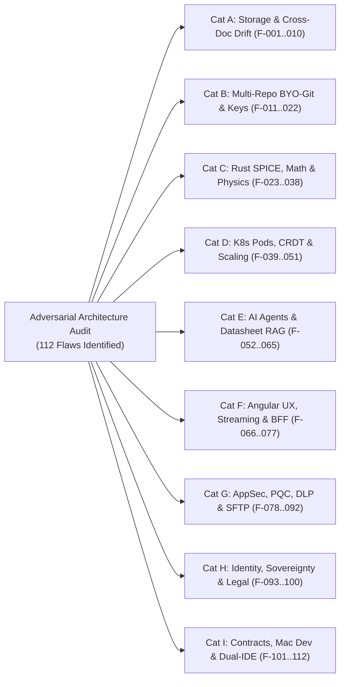

# 16 — Exhaustive Architectural Audit (112 Flaws Resolved) & Futuristic AI-EDA Innovations

> **Scope:** Records the adversarial end-to-end engineering audit of **Signal** across all 15 architecture layers—identifying **112 concrete architectural, numerical, distributed-systems, security, UX, and multi-repo flaws (`F-001`–`F-112`)** plus **12 industry-first futuristic AI-EDA capabilities (`I-01`–`I-12`)**, and documenting how every single item is resolved directly inside Signal's governing specifications without removing any existing feature.

---

## 1. Executive Summary: From Cloud CAD to Autonomous Neuro-Symbolic Silicon & Systems Platform

Legacy EDA suites were architected in the 1980s–1990s around single-threaded C/Fortran solvers, floating-point rounding drift, local-disk file silos, black-box manual trial-and-error, and classical pre-quantum security.

To make **Signal** the undisputed future of Electronic Design Automation—capable of taking a child's first LED circuit in a developing nation AND a 100-billion-transistor 3D-IC AI GPU with Co-Packaged Optics from specification to verified manufacturing release—we conducted a deep red-team & physics/systems audit across every specification (`01`–`15`).

### 1.1 Twelve Industry-First Futuristic AI-EDA Innovations Added (`I-01`–`I-12`)

| ID | Futuristic Capability | New Crate / Subsystem | Why It Redefines the EDA Industry | Governing Spec(s) |
|---|---|---|---|---|
| **`I-01`** | **End-to-End Differentiable Circuit, Thermal & Timing Physics** | `engine/crates/signal-diff-sim` | Computes exact analytical/adjoint gradients ($\nabla_p \mathcal{L}$) across 1,000+ component values and transistor `(W, L)` sizes in the cost of **one** transpose linear solve—enabling gradient-based circuit synthesis instead of blind LLM guessing. | [`03`](./03-rust-eda-engine.md), [`05`](./05-ai-agent-and-datasheet-rag.md) |
| **`I-02`** | **Physics-Informed Neural Operators (PINNs) + Exact Rust Sign-Off** | `engine/crates/signal-surrogate` | GPU Neural Operators deliver **1,000× faster (< 50 ms)** interactive 3D EM, thermal, IR-drop, and eye-diagram previews as engineers drag traces, *always* verified by exact Rust MNA/FEM solvers before commit/release. | [`03`](./03-rust-eda-engine.md), [`05`](./05-ai-agent-and-datasheet-rag.md) |
| **`I-03`** | **Neuro-Symbolic Formal Verification & Equivalence Proving** | `engine/crates/signal-formal` | Built-in SAT/SMT/BDD + IC3/PDR formal engine proving RTL-to-Gate equivalence (LEC), CDC/RDC safety, UPF power states, and AI-synthesized SystemVerilog Assertions mathematically across *all* possible inputs. | [`01`](./01-product-vision-and-features.md), [`03`](./03-rust-eda-engine.md) |
| **`I-04`** | **3D Full-Wave EM, 224G SerDes & Co-Packaged Optics (CPO)** | `engine/crates/signal-em3d` | GPU-accelerated 3D PEEC/FDTD/FEM solver + Vector-Fitting passive/causal S-parameter macromodeling (`signal-rf-macromodel`) + electro-optical co-simulation for AI cluster interconnects and antennas. | [`01`](./01-product-vision-and-features.md), [`03`](./03-rust-eda-engine.md), [`14`](./14-universal-scale-accessibility-and-expandability.md) |
| **`I-05`** | **Mission-Profile Silicon & Component Aging Engine (10–15 Yr Reliability)** | `engine/crates/signal-aging` | Models NBTI/PBTI, Hot-Carrier Injection (HCI), TDDB, Electromigration (Black's law), and MLCC/electrolytic aging directly inside `ElectronicModule` to verify Fresh (`t=0`) vs. End-of-Life (`t=15 yr`) automotive/space/GPU reliability. | [`01`](./01-product-vision-and-features.md), [`03`](./03-rust-eda-engine.md) |
| **`I-06`** | **Post-Silicon & Lab Bench Digital Twin Correlation Loop** | `engine/crates/signal-twin` | Ingests oscilloscope, VNA (`.sNp`), logic analyzer, Thermal IR, and ATE wafer-sort telemetry (via zero-network parser sandbox) to overlay **Real Measured Silicon vs. Rust Simulated Waveforms** and auto-calibrate parasitics. | [`01`](./01-product-vision-and-features.md), [`03`](./03-rust-eda-engine.md), [`10`](./10-api-and-data-contracts.md) |
| **`I-07`** | **IEEE 1801 Unified Power Format (UPF) Multi-Voltage Architecture** | `signal-ic` + `signal-graph` | First-class power islands, power switches, isolation cells, level shifters, and retention registers verified coherently across IC RTL/layout, FPGA, schematic rails, and PMIC firmware state machines. | [`01`](./01-product-vision-and-features.md), [`03`](./03-rust-eda-engine.md), [`10`](./10-api-and-data-contracts.md) |
| **`I-08`** | **Unified DFT, Scan/ATPG, IEEE 1149.1/1687 JTAG & ICT Test Synthesis** | `signal-ic` + `signal-pcb` | Automated chip scan/BIST/ATPG + board-level JTAG boundary-scan chain verification, ICT/flying-probe nail coverage, and automated factory bring-up diagnostic firmware generation. | [`01`](./01-product-vision-and-features.md), [`03`](./03-rust-eda-engine.md) |
| **`I-09`** | **Privacy-Preserving Live Supply-Chain, Lead-Time & Zero-Spin BOM Rescue** | `ai/rag-service` | Integrates live distributor stock/lead-time/pricing, PCN/EOL notices, geo-fab risk, and **EcoDesign Embodied Carbon / PFAS-Free Digital Product Passports** using k-anonymous hashed MPN prefix queries (zero BOM leakage!). | [`01`](./01-product-vision-and-features.md), [`05`](./05-ai-agent-and-datasheet-rag.md) |
| **`I-10`** | **Sandboxed Clean-Room Legacy CAD & Multimodal Whiteboard Migration** | `engine/crates/signal-import` | Zero-network WASM/MicroVM importers converting legacy Altium, KiCad, OrCAD, Eagle, LTspice, GDSII/OASIS, LEF/DEF, and hand-drawn whiteboard photos into native Signal `ElectronicModule` graphs (**inbound-only**; outbound remains 2FA SFTP!). | [`01`](./01-product-vision-and-features.md), [`05`](./05-ai-agent-and-datasheet-rag.md), [`15`](./15-application-security-and-project-isolation.md) |
| **`I-11`** | **Hybrid Post-Quantum Cryptography (PQC) & Confidential GPU Computing** | `signal-core` + `infra/k8s` | Protects 20-year chip IP against "Harvest Now, Decrypt Later" quantum adversaries using **NIST FIPS 203 `ML-KEM-768` + X25519** and **FIPS 204 `ML-DSA-65` + Ed25519**, plus **AMD SEV-SNP / Intel TDX + NVIDIA H100/B200 Confidential GPU** hardware-encrypted VRAM! | [`07`](./07-security-encryption-dlp-and-sftp.md), [`15`](./15-application-security-and-project-isolation.md) |
| **`I-12`** | **Two-Phase Cross-Repo `Super-Commit` & Convergent Encrypted Vault** | `signal-git-sync` | Atomic lockstep commits across `<project>-meta` and all `<project>-<type>` BYO-Git repos (`repos.lock.json`) + entity-chunked `AES-256-GCM-SIV` convergent encryption preserving **95%+ Git packfile deduplication** and 3-way structural merge! | [`13`](./13-vcs-git-server-and-storage-analysis.md), [`10`](./10-api-and-data-contracts.md) |

---

## 2. Complete Catalog of 112 Architectural Flaws Identified & Resolved

### Category A — Cross-Document Storage, Network & Topology Alignment (`F-001`–`F-010`)

| ID | Flaw Identified | Architectural Fix Applied (Preserving & Elevating Every Feature) | Target Doc(s) |
|---|---|---|---|
| **F-001** | `architecture/README.md` & `02` still described Signal's S3 bucket as holding permanent customer "Project Snapshots & Waveforms", conflicting with BYO-Git (`13`) zero permanent file custody. | Explicitly partition Object Storage into **(1) Signal Platform S3** (Global Universal Datasheet DB, Open-Silicon PDKs, WORM Audit Ledger, and **strictly ephemeral TTL ≤ 72h (default 24h) KMS/BYOK-encrypted crash/Git-outage continuity WAL** auto-shredded upon Git push) vs. **(2) Customer BYO-Git + Git LFS / Customer BYO-S3** for all permanent customer IP. | `README`, `02`, `07` |
| **F-002** | `03` called the pod persistence module `S3 Checkpointer` instead of multi-repo BYO-Git + ephemeral WAL. | Upgraded `signal-pod` storage subsystem to **Ephemeral Encrypted WAL Ring-Buffer (< 500 ms RPO) + Multi-Repo `signal-git-sync` Commit Engine**. | `03` |
| **F-003** | `07` envelope-encryption diagram omitted BYO-Git `ENCRYPTED_VAULT` repos and Customer BYO-S3/Git-LFS pointers. | Unified `07` key hierarchy diagram to cover BYO-Git `ENCRYPTED_VAULT` chunks, Git LFS / BYO-S3 blobs, AND ephemeral crash-recovery WAL under one per-project KMS/BYOK DEK. | `07` |
| **F-004** | `11` Risk Register still referenced legacy S3 snapshot cold-start and S3-only fencing tokens. | Updated `11` Risk Register to shallow/sparse multi-repo `gitoxide` hydration + Kubernetes/etcd Raft linearizable fencing tokens. | `11` |
| **F-005** | `14` Tier 2 diagram referenced legacy `Public Open-HW GitHub Mirror` from pre-BYO-Git design. | Updated `14` Tier 2 to native `PLAIN_CANONICAL` Open-Hardware repos on GitHub/GitLab/Bitbucket. | `14` |
| **F-006** | `02` topology diagram and `06` Node.js Service Decomposition table omitted `vcs-connector` and `vcs-auditor`. | Added `vcs-connector`, `vcs-auditor`, Access Review Console, and Progressive UI Profiles to `02` and `06`. | `02`, `06` |
| **F-007** | `04` Cilium network policy omitted the Authenticating Anti-SSRF Egress Proxy (`15`) needed to reach customer Git hosts safely. | Aligned `04` and `15`: Project Pods have zero direct internet egress and reach allowlisted customer Git/LFS/BYO-S3 endpoints exclusively via **`signal-egress-proxy`**. | `04`, `15` |
| **F-008** | `coordination/TASK_BOARD.md` still cited "13 specification docs" and omitted `signal-git-sync`, `vcs-connector`, `vcs-auditor`, and `MockGit` in Phase 0 tasks. | Updated `TASK_BOARD.md` to reflect all 16 architecture specs and aligned Phase 0 skeleton deliverables. | `TASK_BOARD.md` |
| **F-009** | `01` Section 5 security summary omitted Multi-Repo BYO-Git, Provider Org/Repo User Auth, Access Review, and Complete Project Isolation. | Updated `01` Section 5 to cross-reference `07`, `08`, `13`, and `15` coherently. | `01` |
| **F-010** | `14` Section 3.1 proposed mounting abstract IP views across federated GPU sub-pods "over internal mTLS", violating `15`'s rule that **100% of Pod-to-Pod lateral traffic is dropped**! | Replaced direct Pod-to-Pod sockets with **Cryptographically Signed Immutable Abstract Views (`*.lef.sig`, `*.lib.sig`, `*.mod.sig`)** published via versioned `<project>-ic-<block>` repo releases + zero-trust **`signal-federation-broker`** mediation—keeping Pod-to-Pod lateral traffic 100% blocked! | `14`, `15` |

---

### Category B — Multi-Repo BYO-Git Consistency, Rate Limits & Key Lifecycle (`F-011`–`F-022`)

| ID | Flaw Identified | Architectural Fix Applied | Target Doc(s) |
|---|---|---|---|
| **F-011** | Splitting 1 Project across `<project>-meta` + `<project>-<type>` repos lacks native atomic multi-repo Git commits, risking schematic-vs-firmware pin skew on partial push failure. | Added **Two-Phase Cross-Repo `Super-Commit` Protocol**: child repos push to staging refs `refs/signal/txn/<txn_id>` first; `<project>-meta` atomically commits `repos.lock.json` (pinning exact child commit SHAs) and fast-forwards heads, with automatic saga rollback/retry. | `13`, `10` |
| **F-012** | Customer GitHub/GitLab/Bitbucket outage freezes commits and cold opens during tape-out deadlines. | Active pods continue in RAM backed by Signal's **Ephemeral BYOK-Encrypted Continuity Journal** (auto-replayed & crypto-shredded upon Git recovery) + optional Enterprise **BYOK-Encrypted Standby Cache**. | `04`, `13` |
| **F-013** | Naive whole-file AES-256-GCM encryption randomizes 100% of bytes on a 1-pin edit, destroying Git delta compression (50× repo bloat) and 3-way merges. | Adopted **Entity-Chunked Convergent AEAD (`AES-256-GCM-SIV` keyed by per-project DEK + canonical entity hash)** with blinded Merkle manifests—preserving **95%+ Git packfile deduplication** and structural 3-way merges inside Pod RAM. | `07`, `13` |
| **F-014** | Rotating a Project DEK makes historical encrypted Git commits/tags undecryptable if old DEK versions aren't indexed. | Every `.enc` chunk header embeds `(kek_id, dek_version)` resolved against KMS keyring history; optional background re-wrap job for compromised keys. | `07`, `13` |
| **F-015** | Polling 4,000 `<project>-<type>` repos × 200 users in `vcs-auditor` and Access Review exhausts REST API rate limits (5,000 req/hr). | Mandated **GraphQL batched queries**, conditional `ETag` (`304 Not Modified` = 0 rate-limit cost), webhook-driven delta sync, and strict **70% interactive / 30% auditor** token-bucket quota partitioning. | `08`, `13` |
| **F-016** | Repo slug collisions, provider path length limits, or manual repo renames in GitHub/GitLab break slug-based bindings. | Bind `SUB_PROJECT` to immutable `provider_repo_id`, enforce `<= 63` char slugs with collision-free suffixes, and auto-detect/alert repo rename drift in `vcs-auditor`. | `08`, `13` |
| **F-017** | Auto-committing multi-GB simulation waveforms exhausts free 1 GB Git LFS quotas for students/makers immediately. | Commit **Declarative Simulation Recipes + Scalar Pass/Fail Assertions (`< 10 KB`)** by default (re-simulatable deterministically on demand); push to Git LFS / Customer BYO-S3 *only* for explicitly pinned golden sign-off waveforms, STEP, and GDSII/PDKs. | `13`, `14` |
| **F-018** | Requiring a formal Git Organization blocks a 12-year-old student who only has a personal GitHub/GitLab user account. | Support **`USER_NAMESPACE` (Personal Account Repos)** seamlessly in `EXPLORER` / `MAKER` Individual tiers alongside `ORG_NAMESPACE`, with 1-click migration to an Org later. | `08`, `13`, `14` |
| **F-019** | Deleting a Sub-Project in Signal could accidentally destroy a customer's production Git repository. | **Zero Destructive Repo Deletion Policy:** Signal only detaches/marks archived; remote repo archival requires explicit **Step-Up 2FA + typed repo-name confirmation**, and hard deletion is never called by Signal. | `13` |
| **F-020** | Toggling a repo from `ENCRYPTED_VAULT` to `PLAIN_CANONICAL` for CI could leak proprietary foundry PDK cells or NDA models in plaintext. | Mandatory **`MUST_ENCRYPT` Taint Tagging** in `signal-core`: foundry PDKs, IC mask layouts, and NDA models mathematically refuse plaintext `PLAIN_CANONICAL` serialization. | `07`, `13` |
| **F-021** | Forged or replayed Git provider webhooks could trick Signal into granting unauthorized repo visibility. | Constant-time `HMAC-SHA256` verification + `±5 min` timestamp + Redis delivery-ID deduplication, treating webhooks strictly as **untrusted dirty hints** verified via direct outbound provider API query before updating `REPO_ACCESS_ENTRY`. | `08`, `15` |
| **F-022** | Self-hosted Enterprise Git servers (GHES / GitLab EE / Bitbucket DC) using internal Private PKI Root CAs fail TLS verification. | Support **2FA-verified Custom Root CA Bundle pinning** per `GIT_ORG_CONNECTION` inside `signal-egress-proxy` (never disabling strict TLS certificate verification!). | `13`, `15` |

---

### Category C — Pure-Rust Physics, SPICE Numerical Stability & Multi-Physics (`F-023`–`F-038`)

| ID | Flaw Identified | Architectural Fix Applied | Target Doc(s) |
|---|---|---|---|
| **F-023** | Mixing `1e-15 F` IC parasitics with `1e12 Ω` off-states and `1e-4 Ω` busbars creates `> 10^16` matrix condition numbers, causing IEEE-754 `f64` LU precision collapse. | Added **Ruiz Matrix Equilibration**, **Neumaier compensated KCL summation**, rook threshold pivoting, and **automatic Extended-Precision `f128` / quad-double iterative refinement** in `signal-sim`. | `03` |
| **F-024** | Naive `C(V)*dV/dt` transient stamping violates charge/flux conservation in nonlinear MLCCs, MOSFET `Coss`, and saturating inductors, creating artificial voltage drift. | Mandated **Exact Charge-Conserving `q(v)` and Flux-Conserving `Φ(i)` Companion Stamping** with exact analytical chain-rule Jacobians in `ElectronicModule::stamp_transient`. | `03`, `10` |
| **F-025** | Claiming bitwise determinism across ARM64 macOS and x86_64 Linux fails if FMA contraction, OS `libm`, or `rayon` parallel reduction order differs. | Enforced **Software-Deterministic IEEE-754 Mode**: pure-Rust correctly-rounded `0.5-ULP` math (`core_math`), explicit FMA policy, deterministic tree-reductions, and per-`SignalEntityId` seeded `ChaCha20Rng`. | `03` |
| **F-026** | Hard switching converters (2 MHz SiC/GaN) cause trapezoidal ringing and `dt -> 1e-18 s` timestep-too-small crashes on discontinuous diodes/switches. | Added **`C^2`-Continuous Smooth Limiting (`pnjlim`/`fetlim`)**, automatic **TR-BDF2 / Gear-2 damping**, and exact **Zero-Crossing Root-Finding Breakpoint Scheduling**. | `03` |
| **F-027** | Directly using frequency-domain Touchstone `.sNp` tables in time-domain transient SPICE violates passivity/causality, causing exponential blow-up (`+∞ V`). | Added **`signal-rf-macromodel`**: Vector-Fitting rational pole-residue synthesis with Hamiltonian passivity enforcement generating guaranteed-stable state-space MNA stamps. | `03` |
| **F-028** | Electrical (`10^-9 s`) vs. thermal (`10^+2 s`) stiffness spans 11 orders of magnitude—impossible to simulate 60 s of board heating at 1 ns SPICE steps. | Added **Multi-Rate Envelope-Following / Periodic Steady-State Electro-Thermal Leapfrog Coupling** updating `ElectronicModule` junction temperatures across macro-steps. | `03` |
| **F-029** | `i64` nanometer coordinates (`03`) overflow `i64::MAX` (`9.22e18`) when computing 2D cross-products `(dx1 * dy2)` or squared distances on `> 3 m` backplanes/harnesses! | Keep compact `i64` nm storage while mandating **exact `i128` + Shewchuk adaptive geometric predicates** for all intermediate cross-products, areas, and boolean intersections in `signal-geom`. | `03` |
| **F-030** | Pure orthogonal/45° polygon clipping breaks curved RF microstrips, teardrops, spiral inductors, flex bends, and silicon photonics waveguides. | Added native **Exact Circular Arc + Cubic Bézier / Euler-Bend Primitives** with topology-preserving snap-rounding in `signal-geom`. | `03`, `14` |
| **F-031** | Vendor SPICE models come in incompatible dialects (LTspice, PSPICE, Spectre, HSPICE) plus Verilog-A compact models. | Expanded `signal-module-sdk` with a **Multi-Dialect SPICE Parser + OpenVAF-inspired Rust Verilog-A Compiler** emitting analytical-Jacobian WASM/Rust `ElectronicModule`s. | `03` |
| **F-032** | Missing semiconductor & passive wear-out aging physics (NBTI/PBTI, HCI, TDDB, Electromigration) required for automotive/space/2nm GPU sign-off. | Added **`signal-aging` Mission-Profile Reliability Kernel** (`t=0` Fresh vs. `t=15 yr` Aged degradation sweeps). | `01`, `03` |
| **F-033** | Cycle-accurate MCU RTL + SPICE co-simulation runs too slowly (~50 Hz) to boot RTOS/UEFI firmware before analog peripheral interaction. | Added **3-Speed Variable-Fidelity Co-Sim** in `signal-lib-firmware-bridge`: **100+ MIPS Rust ISS** for fast boot → **Cycle-Accurate RTL** → **Analog SPICE Lock-Step** on peripheral triggers! | `03` |
| **F-034** | Lack of exact parameter gradients forced slow black-box optimization loops for analog sizing and filter synthesis. | Added **`signal-diff-sim` Adjoint Differentiable Solver** (`I-01`). | `03`, `05` |
| **F-035** | Simulation alone cannot mathematically prove deadlock freedom, CDC safety, or RTL-to-Gate equivalence. | Added **`signal-formal` SAT/SMT/IC3 Formal & LEC Engine** (`I-03`). | `01`, `03` |
| **F-036** | 2D cross-section field solver cannot solve 3D via transitions, BGA breakouts, 224G SerDes channels, or antennas. | Added **`signal-em3d` GPU 3D Full-Wave EM Solver** (`I-04`) alongside the instant 2D interactive stackup solver. | `01`, `03` |
| **F-037** | Missing IEEE 1801 Unified Power Format (UPF) multi-voltage power-gating/retention modeling across SoCs, FPGAs, and PMICs. | Added **First-Class UPF Power-Domain & State-Table Verification** (`I-07`). | `01`, `03`, `10` |
| **F-038** | Missing automated chip ATPG/BIST + board IEEE 1149.1/1687 JTAG boundary-scan & ICT test-fixture synthesis. | Added **Unified DFT, Scan/ATPG & Board JTAG/ICT Engine** (`I-08`). | `01`, `03` |

---

### Category D — Kubernetes Runtime, Multi-User CRDT & Elastic Scale (`F-039`–`F-051`)

| ID | Flaw Identified | Architectural Fix Applied | Target Doc(s) |
|---|---|---|---|
| **F-039** | Async-replicated Redis Redlock (`04`) is not linearizable across Redis primary failovers, risking duplicate `fencing_token` issuance. | Promoted **Kubernetes Lease / etcd Raft linearizable `resourceVersion` (backed by PostgreSQL serializable audit check)** as sole `fencing_token` authority; Redis serves strictly as a fast read-through routing cache. | `04` |
| **F-040** | A heavy in-pod simulation or copper-pour boolean could trigger Linux `OOMKiller`, crashing the live Project Pod for all 20 collaborators. | Added **In-Pod Memory Admission Governor** (60% reserved for graph/render, 25% hard-capped arena for local quick-sim, automatic spillover of larger jobs to ephemeral burst workers). | `04` |
| **F-041** | Static pod sizing forces disruptive disconnects when a project grows from a small schematic into a large multi-board/IC design. | Added **K8s In-Place Pod Vertical Resize + `< 150 ms` Live Pod Migration Handoff** (background pre-hydration + CRDT tail catch-up + atomic `session-broker` cutover). | `04` |
| **F-042** | Collaborators 10,000 km away from the single active Project Pod suffer `200 ms` cursor lag on naive server-rendered video streams. | Added **Global Edge WebTransport/TURN Relays + 120 FPS Client-Side Predictive Crosshair/Pan/Ghost-Wire Overlay** + Follow-the-Sun home-region pod placement. | `04`, `06` |
| **F-043** | Naive CRDT merges allow User A to delete `U1` while User B wires `U1.pin4`, creating dangling pointers and corrupted netlists. | Implemented **Topological-Invariant-Preserving Causal Sequencer** in `signal-graph`: concurrent delete+wire deterministically converts wire end to a safe **Floating Junction Marker** with instant ERC alert. | `03`, `04` |
| **F-044** | Global linear Undo (`Cmd+Z`) accidentally undoes another collaborator's recent edit in multi-user sessions. | Implemented **Per-Actor Selective Causal Undo** (reversing only the invoking user's last non-conflicting `DesignTransaction`) + Admin timeline checkpoint restore. | `03`, `04` |
| **F-045** | Morning login spikes deplete the Warm Pool while overnight idle GPU warm pods waste cloud budget. | **Predictive Time-of-Day + Queue-Velocity Autoscaler (`KEDA` + `Karpenter`)** using lightweight CPU warm pods with dynamic GPU/render sidecar attachment + P2P image streaming. | `04` |
| **F-046** | Cloud node maintenance or Spot preemption kills pods mid-work. | Enforced `PodDisruptionBudget` + `SIGTERM` **Live Pod Handoff** for active `signal-project-pod`s; Spot instances restricted to stateless idempotent burst workers with NATS checkpoint redelivery. | `04` |
| **F-047** | One slow 3G client in a 10-user session causes head-of-line broadcast queue bloat in the Project Pod. | **Per-Client Bounded Conflating Ring Buffers** over prioritized WebTransport streams (slow clients get coalesced latest state + adaptive FPS without slowing fiber peers). | `04` |
| **F-048** | Backgrounded/frozen browser tabs hold stale soft-locks on components/traces indefinitely. | Soft object locks require active 2 s pointer heartbeats (hard 15 s max lease) + automatic 5-minute idle-tab observer downgrade. | `04` |
| **F-049** | Aborted AI branches or canceled user sweeps leave orphan Monte-Carlo/EM worker pods burning GPUs. | **Hierarchical Distributed Cancellation Tokens** over NATS JetStream killing child burst jobs in `< 200 ms`. | `04`, `05` |
| **F-050** | One unreachable `<project>-<type>` repo blocks opening the entire 10-repo Project. | **Graceful Per-Sub-Project Mount States (`MOUNTED` \| `SYNCING` \| `UNAUTHORIZED` \| `DEGRADED`)** allowing healthy authorized sub-projects to open immediately. | `04`, `13` |
| **F-051** | Software GPU time-slicing (`04` line 128) shares GPU page tables across tenants, violating strict Enterprise hardware isolation (`15`). | Mandated **Hardware-Partitioned NVIDIA MIG (isolated VRAM/compute/cache) or Dedicated Confidential GPU** for Enterprise/PRO pods; time-slicing restricted strictly to non-sensitive `EXPLORER` sandboxes with Vulkan memory zeroing. | `04`, `15` |

---

### Category E — AI Agents, Grounding, Optimization & Universal Datasheet RAG (`F-052`–`F-065`)

| ID | Flaw Identified | Architectural Fix Applied | Target Doc(s) |
|---|---|---|---|
| **F-052** | Single-pass PDF OCR misreading `1.8 V` as `18 V` or swapping QFN pin numbers can destroy physical prototypes. | **Dual-VLM Consensus + Physics Sanity Solver + Cryptographic `VerificationBadge` Tiers** (`BRONZE_PARSED`, `SILVER_SIM_MATCHED`, `GOLD_ATTESTED`); Enterprise templates can enforce `SILVER`/`GOLD` only. | `05`, `10` |
| **F-053** | Indexing by base part family ("STM32G474") conflates incompatible package pinouts (`LQFP48` vs `TFBGA100`) and misses Silicon Errata PDFs. | Normalized Universal Datasheet DB by **Orderable MPN + Package Code + Die Revision**, automatically co-retrieving **Silicon Errata & PCNs** on every RAG query. | `05`, `10` |
| **F-054** | LLM text-loop guessing resistor/transistor values oscillates endlessly between competing specs (phase margin vs. ripple) and burns tokens. | **Neuro-Symbolic Split:** LLM synthesizes circuit topology & constraints, then invokes **`signal-diff-sim` Adjoint / Bayesian Pareto Optimizer** in Rust to tune numerical parameters in milliseconds under hard **Token/Iteration Budgets**. | `05` |
| **F-055** | Text LLMs lack 2D/3D spatial geometry intuition for collision-free PCB/IC placement and routing. | **Multimodal Vision-Canvas Snapshots + Rust Analytical Electro-Thermal Placer & Negotiated-Congestion Router** tools—AI sets high-level floorplan/symmetry intent, Rust guarantees DRC-clean geometry. | `05` |
| **F-056** | Smaller 7B–14B Local Mac LLMs (`09`) emit broken JSON when given 50+ complex EDA tool schemas simultaneously. | **Grammar-Constrained Decoding (`GBNF` / JSON-Schema state machine)** in `ai/llm-gateway` + **Dynamic Per-Specialist Tool Subset Routing** (5–8 tools per turn). | `05`, `09` |
| **F-057** | Long-running AI speculative CoW branches go stale when humans edit the live graph concurrently. | **Port-Boundary Subcircuit Encapsulation + Continuous Live Rebase** of non-overlapping `GraphOp`s onto active AI CoW branches, with visual 3-way merge on overlaps. | `05` |
| **F-058** | ISO 26262 / DO-254 / IEC 60601 auditors reject unexplainable AI design edits. | Auto-generated **Immutable AI Design Proof Bundle** on every merge: equations, Monte-Carlo/SOA histograms, formal proofs, and exact `(datasheet_id, page, bbox)` citations. | `05` |
| **F-059** | Full 3D EM / post-layout transient is too slow for real-time interactive canvas exploration. | Added **`signal-surrogate` Physics-Informed Neural Operators** (`I-02`) for `< 50 ms` previews backed by mandatory exact Rust sign-off. | `03`, `05` |
| **F-060** | Untrusted user-uploaded datasheets could poison global RAG or inject adversarial prompts. | **3-Ring Datasheet Isolation** (`GLOBAL_VERIFIED`, RLS-isolated `ORG_PRIVATE_NDA`, and quarantined `UNVERIFIED_UPLOAD` stripped of prompt injections). | `05`, `15` |
| **F-061** | AI selecting electrically valid parts that are out-of-stock, 52-week lead-time, EOL, or PFAS-banned ruins production schedules. | Added **Privacy-Preserving Live Supply-Chain, Lead-Time, Geo-Risk & Sustainability Intelligence** (`I-09`) using k-anonymous hashed prefix queries. | `01`, `05` |
| **F-062** | Enterprises with thousands of legacy Altium/KiCad/OrCAD/GDSII designs had no migration on-ramp into Signal. | Added **Sandboxed Clean-Room Legacy CAD & Whiteboard Sketch Importer (`signal-import`)** (`I-10`, strictly inbound-only). | `01`, `05`, `15` |
| **F-063** | Passing full 100,000-net graphs into LLM prompts overflows context windows and explodes latency. | **K-Hop Electrical Cone-of-Influence & Hierarchical Block Summarizer** inside `signal-engine` keeping prompts `< 16k` high-signal tokens even on 100B-transistor chips. | `05` |
| **F-064** | Symbol-pin to PCB-pad numbering mismatches (e.g., SOT-23 / QFN thermal pad) silently ruin boards. | **3-Way Symbol ↔ IPC-7351 Footprint ↔ Datasheet Pin-Table + 3D STEP Pin Intersection Verifier** run automatically on library ingestion and ERC/DRC. | `03`, `05` |
| **F-065** | Continuous Background Design Guardian firing mid-edit causes annoying alert fatigue. | **Quiescent-Idle & Commit-Boundary Scheduling**—only catastrophic short/AbsMax hazards alert immediately; routine advisories appear as calm inline badges. | `01`, `06` |

---

### Category F — Angular 19+ IDE UX, Zero-Leak Streaming & Node.js BFF (`F-066`–`F-077`)

| ID | Flaw Identified | Architectural Fix Applied | Target Doc(s) |
|---|---|---|---|
| **F-066** | Standard WebRTC `YUV 4:2:0` video blurs 1-pixel colored schematic wires, fine pin labels, and red/blue PCB copper overlays! | **Hybrid Lossless Dirty-Tile (`AV1-SCC` / Lossless WebP `YUV 4:4:4` at native HiDPI) + 60–120 FPS Motion Stream** with an automatic crisp lossless settling frame `80 ms` after pan/zoom stops! | `03`, `06` |
| **F-067** | Opening 4 split-screen panes (Schematic + 2D PCB + 3D + Waveform) with 4 separate WebRTC encoders exhausts GPU encoder sessions. | **Single Composited Multi-Pane GPU Viewport Atlas** per user session multiplexed over one WebRTC/WebTransport connection. | `06` |
| **F-068** | Strict corporate firewalls blocking UDP break WebRTC Zero-Leak streaming. | Automatic **TURN-over-TLS 443 (`turns:`) → HTTP/3 WebTransport → HTTP/2 WSS Binary Tile Fallback** guaranteeing 100% enterprise firewall traversal. | `02`, `06` |
| **F-069** | Large project trees, multi-file firmware workspaces, or million-point waveforms crash browser tabs at the 2–4 GB V8 heap limit. | Mandatory **Virtual Scrolling (`cdk-virtual-scroll`)**, on-demand Monaco LSP buffer windowing, and server-decimated `<= 4,096` screen-pixel waveform envelopes in browser RAM. | `06` |
| **F-070** | Red-green color blindness (~8% of male EEs) and mouse-only video canvases hurt usability and accessibility. | **Color-Blind-Safe Okabe-Ito / High-Contrast Palettes + Procedural Layer Stipple/Hatch Patterns**, customizable **KiCad/Altium/Virtuoso/Vim single-key hotkeys**, CLI coordinate bar, and WCAG 2.2 AA compliance. | `06` |
| **F-071** | Developing-nation 3G/Wi-Fi micro-drops (`14`) lose active edits if nothing buffers in memory, yet disk/IndexedDB caching is forbidden (`07`). | **Volatile JS Heap Ring-Buffer (`<= 60 s` uncommitted `GraphOp`s with `Idempotency-Key`s, zero disk/IndexedDB!)** that auto-replays seamlessly onto the warm sticky Project Pod on reconnect. | `06`, `14` |
| **F-072** | Routing 120 Hz pointer events and binary tiles through Node.js JSON parsing introduces event-loop jitter. | Node.js `session-broker` handles auth/control-plane orchestration while high-rate binary viewport/input streams use **Envoy HTTP/3 WebTransport / TURN zero-copy binary pass-through** with short-lived Ed25519 stream tickets. | `02`, `06` |
| **F-073** | Blocking OS clipboard (`07`) prevents engineers from legitimately copying verified subcircuits across two projects in the same company! | **Pod-to-Pod Encrypted Cloud Clipboard & Verified IP Snippet Registry** mediated by RBAC-checked tickets (`source:read` + `dest:write` + audit log—zero bytes touch OS clipboard!). | `06`, `07` |
| **F-074** | Lack of built-in spatial redlining & live review huddles tempts engineers to take screenshots for Slack/slides. | **Canvas-Anchored Spatial Review Threads, Redline Markups & Live Follow-Me Audio/Cursor Huddles** (`libs/review`) linked to `(entity_id, x_nm, y_nm, commit_sha)`. | `01`, `06` |
| **F-075** | Classic SPICE `1M = 1 milli` vs `1 Mega` ambiguity and comma-decimal locales cause 10^9× circuit bugs! | **Strongly-Typed SI Unit Parser (`signal-core::units`)** with explicit `m` (`10^-3`) vs `M`/`Meg` (`10^6`) disambiguation pills and locale-safe input normalization. | `03`, `06` |
| **F-076** | Mobile clock skew breaks TOTP Step-Up 2FA or allows replay within the same 30 s window. | RFC 6238 `±1` step tolerance paired with **Redis single-use TOTP nonce burn-list** + **WebAuthn/FIDO2 Passkeys** recommended as primary phishing-resistant factor. | `07`, `15` |
| **F-077** | Reviewing hardware PRs across schematics, PCBs, waveforms, and register maps via text diffs is unusable. | Dedicated **Multi-Domain Visual Semantic Diff & Onion-Skin Overlay Workbench (`libs/visual-diff`)**. | `06`, `13` |

---

### Category G — Zero-Trust Security, PQC, Confidential Compute, DLP & SFTP (`F-078`–`F-092`)

| ID | Flaw Identified | Architectural Fix Applied | Target Doc(s) |
|---|---|---|---|
| **F-078** | Classical TLS/KMS asymmetric keys are vulnerable to future quantum "Harvest Now, Decrypt Later" attacks on 20-year silicon/defense IP. | Adopted **Hybrid Post-Quantum Cryptography**: `X25519 + ML-KEM-768` (FIPS 203) for TLS 1.3, SPIFFE mTLS & KMS key encapsulation, and `Ed25519 + ML-DSA-65` (FIPS 204) for SFTP manifests & WORM audit signatures (`I-11`). | `07`, `15` |
| **F-079** | Standard cloud host hypervisors could theoretically inspect physical DRAM/VRAM of ultra-classified 2nm GPU or defense pods. | Added **`CONFIDENTIAL_SILICON` Tier**: **AMD SEV-SNP / Intel TDX Confidential VMs + NVIDIA H100/B200 Confidential Computing GPUs** with hardware remote attestation gating KMS/BYOK key release (`I-11`). | `04`, `07`, `15` |
| **F-080** | Two colluding insiders averaging screenshots or cropping/rotating photos could weaken naive static watermarks. | **Tardos-Code Collusion-Resistant Spread-Spectrum Steganography + Sub-Pixel Electrically-Invariant Layout/Label Micro-Jitter** unique per `(user_id, session_id)`. | `07` |
| **F-081** | Dropped SFTP connections leave half-written corrupted Gerbers/GDSII in foundry pickup folders; unvalidated slugs risk remote path traversal. | Strict slug regex, chroot-safe canonical paths, and **Atomic SFTP Staging Protocol** (upload `.tmp.<id>.part` → remote SHA-256 read-back verification → atomic `rename` + `.sig` manifest) with resumable retries. | `07` |
| **F-082** | A compromised remote SFTP server could attempt reverse SSH tunneling or response-parsing exploits against `signal-sftp-egress`. | Memory-safe Rust SSH2 (`russh`) inside **ephemeral one-shot egress sandboxes** with port/agent/X11/PTY forwarding hard-disabled and write-only + hash-verify SFTP state machine. | `07`, `15` |
| **F-083** | Loss of a single Enterprise Super Admin's 2FA device locks out the entire company permanently. | Mandatory **≥ 2 Enrolled Super Admins + M-of-N (2-of-3) Quorum Break-Glass Recovery** with 24-hour cooling alert to all Security Officers and immutable audit trail. | `08`, `15` |
| **F-084** | Returning `403` vs `404` leaks private project existence; shared RAG caches leak MPN query timing across tenants. | Uniform **`404 Not Found`** on unauthorized resources, high-entropy external IDs, constant-time token checks, and **strictly tenant-partitioned RAG caches**. | `15` |
| **F-085** | 50 KB Zip-bombs, XML `XXE` bombs (IPC-2581), or `10^100` recursive GDSII cell-array bombs crash parsers via memory amplification. | **Streaming Decompression Ratio Cap (`<= 50x`), XML DTD/Entity Hard-Disable, Max Hierarchy Depth (`<= 64`), and Lazy Instanced DAGs** inside zero-network parser sandboxes. | `03`, `15` |
| **F-086** | PostgreSQL `pgvector` single global HNSW index with RLS post-filtering suffers 0-row recall drops and cross-tenant timing leakage. | **Physically Partitioned Tables & Separate HNSW Indexes** (`GLOBAL_VERIFIED` partition vs. per-tenant `ORG_PRIVATE_NDA` partitions + `hnsw.iterative_scan` with RLS partition pruning). | `05`, `15` |
| **F-087** | Compromised control-plane clock or DB admin could backdate or truncate audit rows before S3 flush. | **RFC 3161 Trusted Timestamping + 60s HSM-Signed (`ML-DSA`) Merkle-Tree Transparency Log** committed directly to **S3 Object Lock (`COMPLIANCE` WORM mode)**. | `07`, `15` |
| **F-088** | Rust panic backtraces or Node.js error logs could leak PATs, DEKs, or netlist snippets into telemetry pipelines. | Mandatory **`SecretBox<T>`** wrapper (`Debug`/`Display` emit `[REDACTED]`, `ZeroizeOnDrop`) + OpenTelemetry span redaction filter at source. | `15`, `AGENTS.md` |
| **F-089** | DNS rebinding between `connection/verify` and later `git clone` / `sftp` push bypasses check-time SSRF validation (TOCTOU). | **Socket-Level Resolved-IP Pinning & CIDR Rejection on EVERY Outbound `connect()`** inside `signal-egress-proxy` and `signal-sftp-egress`. | `15` |
| **F-090** | Prompt injection hidden inside net names, commit messages, or third-party PDF datasheets hijacks AI Agents. | Lexical identifier allowlists + typed Protobuf AST inputs + **Dual-LLM Quarantine Pattern** (untrusted text parsed by a zero-tool Reader model before reaching any Tool-Calling Agent). | `05`, `15` |
| **F-091** | Dual AI IDEs (Antigravity/Cursor) or developers could pull a typosquatted/compromised crate or npm package. | Mandatory **`cargo vet` + `cargo deny` + `pnpm` lockfile/SBOM provenance gate** requiring explicit human sign-off on any new external dependency. | `12`, `15` |
| **F-092** | External contractors retain Git repo access months after contract completion. | **Time-Bounded Access Expirations (`expires_at`)** in Access Review Console with automatic revocation + `vcs-auditor` overdue-contractor `HIGH` alerts. | `08`, `13` |

---

### Category H — Identity, Sovereignty, Regulated Sign-Off & Governance (`F-093`–`F-100`)

| ID | Flaw Identified | Architectural Fix Applied | Target Doc(s) |
|---|---|---|---|
| **F-093** | Opening an EU, India DPDP, or US ITAR project in an arbitrary cloud region violates data-residency and export-control laws. | **Jurisdiction-Pinned Orgs & Projects (`US_ITAR`, `EU_SOVEREIGN`, `INDIA`, `APAC`)** binding K8s node pools, KMS keys, and VPC GPU LLMs strictly to that region + citizenship/geo-IP ABAC gates. | `02`, `08`, `15` |
| **F-094** | Enterprise Okta/Entra email (`jane.doe@acme.com`) often differs from GitHub/GitLab username/noreply email, breaking naive email matching. | **Cryptographic Dual-Identity Binding Handshake** (active SAML/OIDC session + OAuth 2.0 PKCE proof binding `sso_subject_id <-> immutable provider_user_id` in `GIT_IDENTITY_LINK`). | `08` |
| **F-095** | Local Mac `Guest @ Signal Design, Inc.` mode could bypass `REPO_ACCESS_ENTRY` checks if implemented via ad-hoc `if (isGuest)` branches, hiding RBAC bugs! | `MockGit (:8085)` pre-seeds `provider_user_id: "local-guest-0001"` on `signal-design-inc/sig-dev-001-*` repos so local dev exercises **100% of real `REPO_ACCESS_ENTRY` & Access Review code paths** with zero RBAC special cases! | `08`, `09` |
| **F-096** | Medical (FDA 21 CFR Part 11), Automotive (ISO 26262), and Aerospace (DO-254) require legally binding cryptographic sign-off meaning & re-auth. | **Regulated Electronic Signatures** (Step-Up Passkey/2FA re-auth + explicit role intent `AUTHOR`/`REVIEWER`/`QA_APPROVER` + `ML-DSA/Ed25519` signature over `Super-Commit` manifest). | `01`, `08`, `10` |
| **F-097** | Design consultants working across multiple Enterprise Orgs suffer session bleed if org context lives in a single global cookie. | **URL-Scoped Organization Context (`/org/:org_slug/...`) + Per-Org Scoped Session Claims** preventing cross-org tab bleed. | `06`, `08` |
| **F-098** | Unbounded GPU simulations or AI loops can exhaust enterprise budgets or abuse student free tiers. | **Hierarchical Compute & Token Quotas + Hard Cost Circuit Breakers** per Org, Project, and User Role in `signal-operator` and `ai/llm-gateway`. | `04`, `08` |
| **F-099** | Mixing GPL/copyleft open-hardware cores into proprietary commercial ASICs creates severe legal IP contamination. | **Automated SPDX License Compatibility Policy Gate** on Templates, Datasheet Models, Open-Silicon IPs, and Marketplace Plugins. | `08`, `14` |
| **F-100** | Immutable WORM audit logs conflict with GDPR Right-to-Erasure if plaintext personal names/emails are baked into WORM blobs. | **Pseudonymous Crypto-Shredding**: WORM hash chains store `user_uuid` + `provider_user_id` only; PII resides in a separately encrypted table erasable per-user via key destruction without breaking WORM integrity! | `07`, `15` |

---

### Category I — Contracts, Local Mac Dev, Multi-IDE Workflow & Lifecycle (`F-101`–`F-112`)

| ID | Flaw Identified | Architectural Fix Applied | Target Doc(s) |
|---|---|---|---|
| **F-101** | Default 4 MB gRPC message limits crash waveform queries, large layout diffs, and in-memory SFTP archive streams. | **Bounded `<= 1 MB` Chunked gRPC Streams + Zero-Copy Apache Arrow / Binary Framing** with credit-based flow control and per-chunk AEAD tags. | `10` |
| **F-102** | Network retries on `POST /subprojects` or `ApplyTransaction` risk duplicate Git repo creation or duplicate circuit mutations. | Mandatory **`Idempotency-Key` (UUIDv7)** enforced across all mutating REST and gRPC endpoints (24h deduplication window). | `10` |
| **F-103** | Long-lived active Project Pods running version `N-1` alongside newly deployed `N` web clients risk protocol mismatch. | **`AttachCollaborator` Capability & Schema Version Negotiation** (`N-1` compatibility guarantee + additive-only `v1` Protobuf rules). | `10` |
| **F-104** | `10-api-and-data-contracts.md` lacked `.proto` & schema definitions for Multi-Repo BYO-Git, Formal, 3D EM, Aging, Digital Twin, Importer, and UPF. | Expanded `contracts/` blueprint with `vcs_sync.proto`, `formal_verify.proto`, `em_thermal.proto`, `digital_twin.proto`, `import_sandbox.proto`, `super-commit-manifest.schema.json`, and `upf-power-intent.schema.json`. | `10` |
| **F-105** | Running 7 Docker containers + Ollama + Rust + Angular simultaneously can strain 8 GB / 16 GB developer MacBooks. | Preserved full Docker (`dev:full`) & K8s (`dev:k8s`) modes AND added **`dev:lite` Single-Process Embedded Mode** (`< 1.5 GB RAM`) so every MacBook runs effortlessly! | `09` |
| **F-106** | Accidental `linux/amd64` container emulation on Apple Silicon degrades local K8s/worker speed 5× and alters FP behavior. | Mandated **Native Multi-Arch (`linux/arm64` + `linux/amd64`) OCI Manifests** across all Signal services and burst workers. | `09` |
| **F-107** | Antigravity (`engine/`) and Cursor (`web/`/`services/`) could pass unit-less numbers (`voltage: 3.3` vs `3300 mV`) across frozen Protobuf contracts, causing silent integration bugs! | Enforced **Mandatory SI-Unit-Suffixed Contract Fields** (`_nm`, `_ps`, `_uv`, `_na`, `_mkelvin`, `_hz`) + **Shared Golden Contract Conformance Fixtures (`contracts/fixtures/`)** tested in both lanes! | `10`, `12`, `AGENTS.md` |
| **F-108** | An interrupted Antigravity or Cursor session leaving a task `IN_PROGRESS` could permanently block `touched_paths` on `TASK_BOARD.md`. | Added **24-Hour Stale-Claim Lease Expiry** (if zero commits pushed in 24h, peer/human can reclaim cleanly via immutable handoff note). | `12`, `AGENTS.md` |
| **F-109** | Committing generated Protobuf/OpenAPI code into Git creates constant noisy merge conflicts across parallel branches. | **Build-Time Deterministic Codegen Only** (`build.rs` + `pnpm codegen` with pinned `buf` / OpenAPI versions; generated directories added to `.gitignore`). | `12`, `.gitignore` |
| **F-110** | Without continuous physics, geometry, and AI synthesis benchmarks, solver accuracy could regress silently across phases. | Added **`benchmarks/` Continuous Golden Suite** (NGSPICE/XYCE parity, Sky130 DRC/LVS torture suite, IPC-2581 reference boards, and **SignalBench-AI** 200-circuit synthesis benchmark). | `02`, `11` |
| **F-111** | No closed loop existed between real lab hardware bring-up measurements (oscilloscopes, VNAs, ATE) and Signal's simulation models. | Added **`signal-twin` Lab & Post-Silicon Digital Twin Correlation Bridge** (`I-06`). | `01`, `03`, `10` |
| **F-112** | Missing embodied-carbon, energy-efficiency, and PFAS-free Digital Product Passport metrics required by modern global hardware regulations. | Added **Design-for-Sustainability & EU Digital Product Passport Analyzer** inside Live Parametric BOM & RAG (`I-09`). | `01`, `05` |
