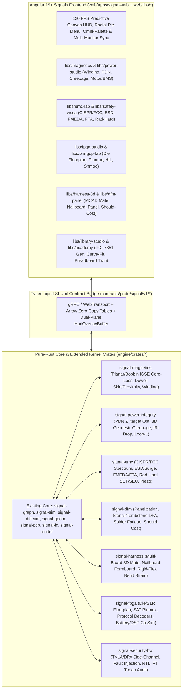

# 17 — Extended Feature Specifications: 120 Next-Generation EDA Capabilities (Angular UI & Rust Engine Dual Blueprint)

> **Scope:** Defines **120 advanced, industry-leading features (`FEAT-001`–`FEAT-120`)** above and beyond the baseline product scope in [`01-product-vision-and-features.md`](./01-product-vision-and-features.md) through [`16-architectural-audit-flaws-and-futuristic-innovations.md`](./16-architectural-audit-flaws-and-futuristic-innovations.md). Every single feature is **dual-specified** with crystal-clear boundaries across both the **Angular 19+ Web UI (`web/`)** and the **Pure-Rust EDA Engine (`engine/`)**, bound by `bigint`-safe SI-unit contracts (`contracts/proto/signal/v1/*`) and 100% compliant with Signal's Zero-Leak, Complete Project Isolation, and BYO-Git invariants.

---

## 1. Dual-Stack Feature Architecture (Angular UI ↔ Contracts ↔ Pure-Rust Engine)

Every extended capability strictly separates **UI presentation, ergonomics, interactive HUDs, and predictive 120 FPS client feedback** (Angular 19+ Signals in `web/libs/*`) from **physics math, exact geometry, constraint solving, rendering, and hardware verification** (Pure Rust crates in `engine/crates/*`):

### 1.1 Extended Rust Crate & Angular Library Expansion Map

| Layer | New Module / Crate | Primary Responsibility Across `FEAT-001`–`FEAT-120` |
|---|---|---|
| **Rust Engine** | `engine/crates/signal-magnetics` | Bobbin & planar transformer geometry, nonlinear `B-H` / `iGSE` core loss, Dowell winding loss, leakage/capacitance extraction (`FEAT-021`). |
| **Rust Engine** | `engine/crates/signal-power-integrity` | Multi-rail PDN `Z_target(f)` optimization, 3D geodesic creepage/clearance, Joule/EM busbar IR-drop, hot-loop inductance, Type-II/III & digital PID synthesis, BMS/FOC motor/thermal-network kernels (`FEAT-022`–`030`). |
| **Rust Engine** | `engine/crates/signal-emc` | Conducted/radiated CISPR/FCC pre-compliance, CM/DM EMI filter synthesis, ESD/EFT/Surge clamping, shield-can cavity resonance, ISO 26262 FMEDA/FTA, WCCA, Rad-Hard SET/SEU, piezo MLCC acoustic checker (`FEAT-031`–`040`). |
| **Rust Engine** | `engine/crates/signal-dfm` | Multi-up panelization, V-score/mouse-bite MLCC flex-crack keepouts, DFA reflow/tombstone/stencil checks, solder-joint Coffin-Manson fatigue, coating masks, live should-cost & test-point coverage (`FEAT-063`–`070`). |
| **Rust Engine** | `engine/crates/signal-harness` | Multi-board 3D enclosure clearance/mating, wire-harness 1:1 formboard routing, ampacity/voltage-drop, and rigid-flex 3D neutral-axis copper-strain folding (`FEAT-020`, `FEAT-061`–`062`). |
| **Rust Engine** | `engine/crates/signal-fpga` | FPGA SLR/clock-region/SSO floorplanning, SDC verifier, SAT pinmux solver, bus protocol decoders, firmware battery-life energy ledger, visual FSM & fixed-point DSP generators (`FEAT-051`–`060`). |
| **Rust Engine** | `engine/crates/signal-security-hw` | Hardware DPA/TVLA side-channel leakage simulation, EM/laser fault-injection susceptibility mapping, and RTL Information-Flow Tracking (IFT) Trojan auditing (`FEAT-050`). |
| **Angular UI** | `web/libs/power-studio` & `web/libs/magnetics` | Interactive winding stackup editor, PDN impedance waterfall, 3D creepage path visualizer, Bode pole-zero dragger, power-sequencing Gantt, and BMS/FOC live dashboards. |
| **Angular UI** | `web/libs/emc-lab` & `web/libs/safety-wcca` | CISPR/FCC limit-mask spectrum view, ESD strike injector, interactive FMEDA/FTA tree canvas, WCCA margin tables, and component derating heatmaps. |
| **Angular UI** | `web/libs/fpga-studio` & `web/libs/bringup-lab` | Die SLR/bank grid, pinmux matrix wheel, protocol-decoded waveform overlays, Shmoo-plot visualizer, virtual bench instruments, and zero-export factory board-map debugger. |
| **Angular UI** | `web/libs/harness-3d` & `web/libs/dfm-panel` | Multi-board 3D mate & flex-fold slider, 1:1 harness nailboard canvas, panel array composer, dynamic drawing studio, and real-time should-cost/yield HUD. |
| **Angular UI** | `web/libs/library-studio` & `web/libs/academy` | IPC-7351 parametric footprint/3D generator, curve-fitter workbench, AVL where-used console, interactive breadboard↔schematic twin, guided classroom labs, and visual smoke sandbox. |

---

## 2. Strict UI-Side & Rust-Side Engineering Contracts

### 2.1 Angular UI Side Contract (`web/`)
1. **Signals-First Zero-Zone State:** Every workbench manages reactive state exclusively via Angular Signals (`signal`, `computed`, `effect`) fed by typed WebTransport/gRPC push streams—guaranteeing zero `Zone.js` jitter during 60–120 FPS interactive dragging, live slider scrubbing, or instrument streaming.
2. **Dual-Plane Zero-Leak HUD Compositing (`HudOverlayPrimitive`):** In Enterprise Zero-Leak mode, raw netlists/polygons never cross into browser RAM; instead, `signal-render` rasterizes all design copper/schematics/heatmaps into the `Zstd-QOI`/WebP GPU Atlas while Angular renders crisp, interactive vector HUD chrome (sliders, tooltips, Bode handles, radial menus, protocol badges, Shmoo axes) synchronized to viewport camera transforms using `bigint` nanometer screen-to-world projection tokens.
3. **120 FPS Predictive Interaction + Authoritative Rust Commit:** Cursor drags (meander bumps, pole-zero handles, flex-fold sliders, potentiometer dials) render optimistic visual guides locally at 120 FPS while streaming throttled `GraphOp` / `InteractiveTuneCmd` deltas (`16 ms` coalesced) to the Rust Project Pod for authoritative physics/DRC validation.
4. **Multi-Monitor & Ergonomic Uniformity:** Pop-out windows communicate via same-origin volatile `BroadcastChannel` + `SharedWorker` (zero `localStorage`/`IndexedDB` IP caching!), inheriting identical focus-curtain, watermark, and `COOP`/`COEP` headers; all 120 features expose keyboard shortcuts, Omni-Palette (`Cmd+K`) verbs, Okabe-Ito color-blind palettes, and WCAG 2.2 AA ARIA semantics.

### 2.2 Pure-Rust Engine Side Contract (`engine/`)
1. **Unified `SignalFeatureKernel` & ECS Integration:** All 7 extended crates operate directly on read-only snapshots or transactional CoW arenas of `signal-graph`'s generational SlotMap ECS—zero serialization copies between schematic, PCB, IC, thermal, EMC, and firmware domains!
2. **Deterministic Exact Numerics & Zero `unsafe` Core:** All spatial calculations use `i64` nm storage + exact `i128`/Shewchuk geometric predicates; all solvers use `0.5-ULP` rounded `core_math`, `ChaCha20Rng`, and canonical sorting; core crates enforce `#![forbid(unsafe_code)]`.
3. **Incremental Cone-of-Influence Recomputation & Memory Governance:** Interactive features (live glass-weave skew, PDN impedance, creepage paths, should-cost HUD, live potentiometer SPICE) maintain incremental dirty-cone caches inside `signal-pod` under the In-Pod Memory Governor (`< 50 ms` local response; heavy 3D EM/FMEDA/Shmoo sweeps fan out automatically to single-job zero-egress K8s burst workers via per-project NATS JetStream subjects).
4. **Zero-Copy Arrow & `bigint` Protobuf Contracts:** Large tabular outputs (FMEDA matrices, Shmoo grids, spectrum traces, protocol packets, Monte-Carlo distributions) stream over `<= 1 MB` Apache Arrow RecordBatches with explicit SI-unit suffixes (`_nm`, `_ps`, `_fs`, `_uv`, `_na`, `_uw`, `_mkelvin`, `_hz`, `_mohm`) and `jstype = JS_STRING` / ES2020 `bigint` for every 64-bit integer.

---

## 3. Complete 120-Feature Dual Specification Catalog (`FEAT-001`–`FEAT-120`)

### Domain 1 — Precision Schematic Ergonomics, Smart Capture & Visual Circuit Intelligence (`FEAT-001`–`FEAT-010`)

| ID | Feature | Angular UI Side (`web/`) | Rust Engine Side (`engine/`) | Phase / Profile |
|---|---|---|---|---|
| **`FEAT-001`** | **Live Schematic Auto-Beautifier & Orthogonal Wire Untangler** | `libs/schematic` (`BeautifyPreviewDirective`): 1-click toolbar/Cmd+K trigger displaying translucent before/after ghost preview with slider weighting alignment vs. compactness and selective region-lock pins. | `signal-graph` + `signal-geom` (`SchematicLayoutBeautifier`): Sugiyama hierarchical signal-flow layering + orthogonal A* channel wire router minimizing bend/crossing cost via exact `i128` grid collision checks inside an atomic CoW `GraphOp` batch. | P1 / `EXPLORER+` |
| **`FEAT-002`** | **Semantic Bus Slice, Struct-Bundle & Protocol-Aware Fanout Harness** | `libs/schematic` (`BusBundleCanvasOverlay` + `BundleInspectorPanel`): Click-to-expand colored bus ribbons (`AXI4`, `DDR5`, `MIPI`, `USB4`), drag-to-breakout auto-labeled tap stubs, and autocomplete port-matching badges. | `signal-graph` (`TypedBusRegistry` + `ProtocolSchema`): Strongly-typed nested struct-bus ECS nodes validating signal directionality (`Master`/`Slave`, `TX`/`RX` crossover check), bit-slice bounds, and net-class propagation across hierarchical sheets. | P1 / `MAKER+` |
| **`FEAT-003`** | **Interactive On-Canvas Potentiometer, Switch & Fault-Toggle Controls** | `libs/schematic` (`LiveControlWidgetLayer`): Tactile rotary sliders, toggle switches, momentary pushbuttons, and fault-toggle icons anchored to symbol coordinates, emitting 60 Hz throttled `LiveStimulusDelta` frames over WebTransport. | `signal-sim` (`InteractiveContinuousStepper`): Lock-free incremental MNA re-stamping updating only mutated resistor/switch matrix entries in `< 0.5 ms` via incremental LU refactorization and streaming live node badges + Arrow waveforms. | P1 / `EXPLORER+` |
| **`FEAT-004`** | **Animated Schematic Power-Rail & Current-River Heatmap Overlay** | `libs/schematic` (`CurrentRiverHudToggle`): Single-hotkey (`H`) canvas mode rendering directional current flow arrows, wire stroke width scaled by `log10(I)`, Okabe-Ito voltage color ramp, and hover popups showing `I_rms`, `V_dc`, and `%` of wire/pin rating. | `signal-sim` + `signal-render` (`SchematicFieldOverlayPass`): Computes branch currents/potentials from DC-OP or RMS transient window and packs per-segment shader uniforms (`u_current_na`, `u_voltage_uv`, `u_soa_ratio`) into the GPU atlas pass. | P1 / `EXPLORER+` |
| **`FEAT-005`** | **Cross-Sheet Net-Jump Portal Minimap & Signal-Path Breadcrumb Tracer** | `libs/schematic` (`NetPortalPopoverComponent`): Clicking any off-sheet label opens a floating portal listing every sheet instance with live rendered thumbnails, driver/load counts, pull-up badges, and 1-click split-pane jump. | `signal-graph` (`GlobalNetIndex`): $O(1)$ inverted index mapping `NetId -> Vec<(SheetId, PinRole, BoundingBoxNm)>`, supplying sub-millisecond cross-sheet fanout queries and cropped thumbnail atlas regions via `DesignGraphService`. | P1 / `MAKER+` |
| **`FEAT-006`** | **Multi-Channel Block Parameterization & Live Matrix Instantiation (`Repeat(N)`)** | `libs/schematic` (`ChannelMatrixTableComponent`): Spreadsheet popover bound to hierarchical sheet symbols allowing per-channel overrides (`R_gain[i]`, `I2C_Addr[i]`, `RoomOffset[i]`) and live channel-instance switcher pills at sheet top. | `signal-graph` + `signal-component` (`ParametricInstanceExpander`): Evaluates deterministic expression ASTs per channel index `0..N-1`, generating stable UUIDv7 child `SignalEntityId`s linked 1:1 to PCB layout room templates. | P2 / `PRO+` |
| **`FEAT-007`** | **Schematic Variant Diff Overlay & Interactive Stuffing-Option Curtain** | `libs/schematic` (`VariantSelectorToolbar`): Dropdown + split-curtain slider comparing `BASE`, `COST_OPT`, `HIGH_TEMP` variants—greying DNP parts with diagonal cross-outs and live-updating variant BOM cost, power, and sim delta pills. | `signal-graph` (`VariantOverlayEvaluator`): Zero-copy variant bitmask layer per entity overriding `mounted: bool`, `orderable_mpn`, and `ElectronicModule` parameters before passing the active variant view to `signal-sim` and BOM roll-up. | P2 / `PRO+` |
| **`FEAT-008`** | **Interactive Pin-Swapping & Gate-Swapping Negotiator** | `libs/schematic` & `libs/pcb` (`PinSwapDragController`): Alt+drag between pins displays green valid-swap targets (same swap-group or valid MCU alternate-function mux) and red blocked pins with exact conflict explanations; confirms atomic cross-domain swap. | `signal-graph` + `signal-fpga` (`PinSwapConstraintSolver`): Validates electrical swap groups, differential polarity rules, and MCU/FPGA peripheral mux tables, then emits an atomic transaction updating Schematic, PCB ratlines, and Firmware pinmux simultaneously. | P2 / `MAKER+` |
| **`FEAT-009`** | **Geographical Auto-Numbering Re-Annotator & Rev-History RefDes Map** | `libs/schematic` (`ReannotateDialogComponent`): Preview table of `Old RefDes -> New RefDes` sorted by configurable spatial snake/sheet-prefix rules (`R101`, `R201`), locking critical calibration designators and exporting Rev-A↔Rev-B diff markers into assembly docs. | `signal-graph` (`SpatialRefDesAssigner`): Sorts entity centroids in `i64` nm space per sheet/room, updates immutable `SignalEntityId -> RefDes` maps atomically across Schematic/PCB/BOM/HFS, and persists a permanent `refdes_lineage` audit map in `<project>-meta`. | P1 / `MAKER+` |
| **`FEAT-010`** | **Live Math-Linked Parametric Equation Blocks on Canvas** | `libs/schematic` (`CanvasEquationBlockComponent`): KaTeX-rendered math cards placed on sheets (`f_c = 1/(2π√(LC))`) with clickable variable chips bound to real parts—editing target `f_c` highlights proposed E96 resistor/capacitor updates live. | `signal-core` (`SymbolicUnitExprEngine`): Dimensional-analysis-checked AST solver verifying SI unit consistency (`Ω × F = s`), evaluating forward/inverse constraints, and proposing exact E24/E96 standard-series snaps via `DesignGraphService`. | P2 / `EXPLORER+` |

---

### Domain 2 — Next-Generation PCB Routing, HDI, RF & High-Speed Signal Integrity (`FEAT-011`–`FEAT-020`)

| ID | Feature | Angular UI Side (`web/`) | Rust Engine Side (`engine/`) | Phase / Profile |
|---|---|---|---|---|
| **`FEAT-011`** | **Fiber-Weave Skew Mitigation & Zig-Zag / Panel-Rotation Planner** | `libs/pcb` (`GlassWeaveOverlayToggle` + `WeaveSkewHud`): Renders translucent FR-4 glass-bundle pitch grids (`1080`, `2116`, `3313`) over copper layers, flags high-speed pairs running parallel to glass fibers, and offers 1-click `10°` zig-zag or panel rotation preview. | `signal-pcb` (`FiberWeaveSkewKernel`): Computes 2D periodic `Dk(x,y)` resin-vs-glass propagation velocity integral along differential legs in `i64` nm space, estimating worst-case intra-pair skew (`ps/in`) and synthesizing exact `10°` zig-zag trace segments. | P4 / `PRO+` |
| **`FEAT-012`** | **Interactive Diff-Pair Phase-Tuning & Coupled-Arc Meander Composer** | `libs/pcb` (`LengthTuneHudDirective`): Cursor-attached live gauge displaying target vs. actual flight time (`ps`), intra-pair phase mismatch (`fs`), dynamic impedance bump (`Ω`), and hotkey cycling between trombone, accordion, sawtooth, and curved-arc meanders. | `signal-pcb` + `signal-geom` (`CurvedMeanderSynthesizer`): Generates DRC-clean circular-arc / Euler-bend meander geometries keeping coupled spacing >= `3W`, updating 2D BEM coupled-line delay incrementally in `< 5 ms` per mouse frame. | P4 / `PRO+` |
| **`FEAT-013`** | **Automated Back-Drill Stub Optimizer & Via S-Parameter Tuner** | `libs/pcb` (`ViaTransitionTunerDrawer`): Clicking any high-speed via displays its 3D cross-section, resonant stub frequency (`f_stub`), live `< 50 ms` `S11`/`S21` plot, and interactive handles for anti-pad diameter, back-drill depth, and ground-stitch via count. | `signal-pcb` + `signal-surrogate` + `signal-em3d` (`ViaStubOptimizer`): Computes quarter-wave stub resonance vs. Nyquist `f_max`, assigns exact Fab-Profile-legal back-drill layer pairs + must-not-cut clearance, and verifies return loss via PINN preview + exact 3D FEM sign-off. | P4 / `PRO+` |
| **`FEAT-014`** | **Copper-Pour Island Detector, Acid-Trap Eliminator & Teardrop Sculptor** | `libs/pcb` (`PourHygieneInspectorPanel`): Live list of floating islands, thin slivers (`< fab_min`), and acute `< 90°` copper acid traps with 1-click "Heal All" preview plus parametric teardrop curve controls (linear vs. smooth snowball fillet). | `signal-geom` + `signal-pcb` (`CopperTopologyHealer`): Exact `i128` polygon boolean + connected-component graph identifying un-grounded copper islands, morphological opening removing sub-minimum slivers, and curved Bézier fillet injection at pad/via junctions. | P4 / `MAKER+` |
| **`FEAT-015`** | **Die-to-Ball Package Flight-Time (`ps`) Pin-Delay Compensator** | `libs/pcb` (`PackageDelayColumn` inside Constraint Manager): Displays raw PCB length (`mm`), imported IC package flight delay (`ps`), total silicon-to-silicon flight time (`ps`), and color-coded DDR5/PCIe skew bars synced live while routing. | `signal-pcb` (`FlightTimeBudgetEngine`): Parses `.pkg`/IBIS `[Pin]` R/L/C/delay tables into `bigint` femtosecond offsets per pin, combining substrate propagation delay (`t_pd = √Dk_eff / c`) + via z-axis delay into exact total flight-time DRC rules. | P4 / `PRO+` |
| **`FEAT-016`** | **Return-Path Reference-Plane Split & Ground-Slot Crossing Guardian** | `libs/pcb` (`ReturnPathOverlayLayer`): Draws glowing crimson "current-detour loops" whenever a high-speed trace crosses a plane split or changes reference layers without a nearby stitching via/cap, offering 1-click optimal via drop. | `signal-pcb` (`ReturnPathContinuitySolver`): Projects every routed segment onto adjacent `n-1` / `n+1` reference planes via R*-tree polygon subtraction, computes detour loop perimeter & partial inductance (`nH`), and locates DRC-clean stitching-via coordinates. | P4 / `PRO+` |
| **`FEAT-017`** | **Multi-Trace Bundled Bus-Trunk Push-and-Shove Router** | `libs/pcb` (`BusTrunkRouterTool`): Drag-select 8–64 ratlines to route an entire DDR/MIPI bus as one cohesive elastic ribbon; scroll wheel dynamically fans out or compresses trunk pitch around obstacles and BGA edges. | `signal-pcb` (`ElasticBusTrunkRouter`): Solves multi-lane homotopy topological routing over constrained Delaunay triangulations (`signal-geom`), preserving differential pairing and lane ordering while pushing obstacles atomically. | P4 / `PRO+` |
| **`FEAT-018`** | **HDI Microvia Stack Reliability & Aspect-Ratio Live Enforcer** | `libs/pcb` (`HdiViaMatrixDesigner`): Interactive layer-pair drill matrix showing laser microvias, buried core vias, and stacked-vs-staggered warnings with live IPC-6012 Class 3 aspect-ratio & thermal-reflow reliability badges. | `signal-pcb` + `signal-dfm` (`HdiReliabilityChecker`): Enforces `FabCapabilityProfile` laser aspect ratios (`<= 0.8:1`), flags `>= 3`-high stacked microvia reliability hazards (requiring stagger offset or waiver), and checks copper-plating fill constraints. | P4 / `PRO+` |
| **`FEAT-019`** | **Planar RF Microstrip, Coupler, Hairpin Filter & Patch Antenna Synthesizer** | `libs/pcb` (`RfGeometryWizardModal`): Enter `f_0`, bandwidth, substrate stackup, and topology (`Hairpin`, `Interdigital`, `Wilkinson`, `Lange`, `Patch`, `Meander`) → live parametric 2D/3D RF preview + instant `S11`/`S21` curve before stamping to copper. | `signal-pcb` + `signal-em3d` (`PlanarRfSynthesizer`): Analytical closed-form synthesis (Hammerstad/Pozar/Chebyshev) refined via `signal-diff-sim` / 3D PEEC adjoint optimization emitting exact `i64` nm arc/mitered copper primitives + GCPW via fences. | P4 / `PRO+` |
| **`FEAT-020`** | **Rigid-Flex 3D Bend-Zone Kinematic Folding Simulator & Copper-Strain Verifier** | `libs/harness-3d` (`FlexFoldSliderHud`): Smooth 0%–100% fold animation slider bending rigid-flex PCBs into target 3D enclosures, coloring copper zones by bend strain (`%`) and highlighting illegal vias/pads inside bend keepouts. | `signal-harness` + `signal-geom` (`RigidFlexKinematicsKernel`): Computes cylindrical/conical bend-axis coordinate mappings, calculates neutral-axis bending strain $\varepsilon = t / (2R + t)$ per copper layer (distinguishing RA vs. ED copper), and verifies cross-hatched shield compliance. | P4 / `PRO+` |

---

### Domain 3 — Power Electronics, Custom Magnetics, PDN & Electro-Thermal Studio (`FEAT-021`–`FEAT-030`)

| ID | Feature | Angular UI Side (`web/`) | Rust Engine Side (`engine/`) | Phase / Profile |
|---|---|---|---|---|
| **`FEAT-021`** | **Custom Transformer & Planar Magnetics Winding Designer** | `libs/magnetics` (`MagneticsStudioComponent`): Visual bobbin/planar cross-section builder with drag-and-drop interleaved winding layers, wire/foil/Litz picker, core catalog filter, live `B_pk` saturation gauge, temperature rise, and printable/SFTP winding sheet. | `signal-magnetics` (`MagneticsPhysicsKernel`): Solves improved Generalized Steinmetz Equation (`iGSE`) non-sinusoidal core loss, Dowell/Ferreira AC skin + proximity winding loss, 2D axisymmetric leakage inductance & inter-winding capacitance, emitting a coupled `ElectronicModule` directly to `signal-sim`! | P3 / `PRO+` |
| **`FEAT-022`** | **Interactive PDN Target-Impedance (`Z_target(f)`) Decoupling Optimizer** | `libs/power-studio` (`PdnImpedanceStudioComponent`): Log-log `10 Hz – 10 GHz` impedance plot overlaying target mask, VRM, bulk, MLCC bank, and anti-resonance markers; drag-add/remove caps to watch impedance peaks flatten in real time. | `signal-power-integrity` (`PdnOptimizerKernel`): Combines PCB plane-cavity FEM impedance + mounting via/pad loop inductance + DC-bias-derated MLCC `C(V,T,f)` curves, running MILP/gradient search to hit `Z(f) <= Z_target(f)` at minimum BOM cost & area. | P4 / `PRO+` |
| **`FEAT-023`** | **3D Surface Creepage & Clearance High-Voltage Geodesic Verifier** | `libs/power-studio` (`HvCreepageInspectorLayer`): Renders glowing 3D geodesic shortest-surface-distance ribbons hopping across PCB edges, milled air slots, and IC packages, with live CTI / Pollution Degree / Altitude selector (`IEC 60664` / `IEC 62368` / `800 V` EV). | `signal-power-integrity` + `signal-geom` (`GeodesicCreepageSolver`): Runs 3D Euclidean clearance (straight-line air distance) AND Dijkstra/Fast-Marching geodesic shortest-path over triangulated PCB+slot+component surfaces accounting for CTI & Paschen altitude derating. | P4 / `PRO+` |
| **`FEAT-024`** | **Heavy-Copper Busbar IR-Drop, Necking & Via Current-Density Mapper** | `libs/power-studio` (`DcIrDropHeatmapLayer`): Interactive 2D/3D voltage-drop (`mV`), current-density (`A/mm²`), and Joule-heating (`ΔT`) heatmap with hover current-density probe and 1-click "Auto-Stitch Parallel Vias" action on overloaded bottlenecks. | `signal-power-integrity` (`CoupledDcIrThermalFem`): Assembles 2.5D multi-layer finite-volume conductance mesh with temperature-dependent copper resistivity $\rho(T)$, solving coupled electrical-thermal fixed-point iterations via `KLU`/`cuDSS` and flagging `J > J_max` vias. | P4 / `PRO+` |
| **`FEAT-025`** | **Switching Hot-Loop Inductance Minimizer & SiC/GaN Miller-Turn-On Analyzer** | `libs/power-studio` (`HotLoopInspectorOverlay`): Highlights the exact physical switching power loop and gate-drive loop on 3D PCB copper, reporting extracted `L_loop (nH)`, predicted `V_ds` overshoot spike, and false Miller `dv/dt` turn-on safety margin. | `signal-power-integrity` + `signal-em3d` (`SwitchingLoopExtractor`): Traces source-to-return switching paths via graph topology + 3D PEEC partial inductance extraction, back-annotating `L_loop` + `L_common_source` directly into `signal-sim` GaN/SiC transient verification! | P4 / `PRO+` |
| **`FEAT-026`** | **Interactive Control-Loop Bode / Nyquist & Analog/Digital Compensator Synthesizer** | `libs/power-studio` (`CompensatorBodeStudio`): Click-drag compensator poles and zeros directly on the plant + loop-gain Bode/Nichols chart, toggling between Analog Type-II/III passive synthesis and fixed-point digital `2p2z`/`3p3z` firmware ISR generation. | `signal-power-integrity` + `signal-sim` (`LoopCompensatorKernel`): Extracts small-signal averaged/PSS plant transfer function from `signal-sim`, computes closed-form K-factor / bilinear `z`-domain coefficients, snaps R/C to E96 values, and verifies step-load recovery in transient SPICE. | P3 / `PRO+` |
| **`FEAT-027`** | **Battery Pack & BMS Cell-Balancing, Aging & Thermal-Runaway Co-Simulator** | `libs/power-studio` (`BmsPackStudioComponent`): Visual `N-Series × M-Parallel` cell-pack matrix coloring State-of-Charge (`SoC`), cell temperature, balance current, and runaway propagation timeline with clickable fault triggers (internal cell short, open sense wire). | `signal-power-integrity` + `signal-aging` (`BatteryPackKernel`): Solves coupled multi-cell 2-RC Equivalent Circuit Models + Arrhenius SEI aging + 3D inter-cell thermal conduction + pyro-fuse/contactor `I²t` clearing physics linked directly to BMS IC & firmware modules. | P5 / `PRO+` |
| **`FEAT-028`** | **Motor Drive, FOC Control & SVPWM Electro-Mechanical Co-Simulator** | `libs/power-studio` (`MotorDriveLabComponent`): Real-time phasor/d-q vector scope, torque-speed curve overlay, live load-torque step slider, and inverter thermal loss breakdown (conduction vs. switching vs. dead-time body-diode loss). | `signal-power-integrity` + `signal-lib-firmware-bridge` (`MotorFocCoupler`): Implements nonlinear `d-q` PMSM/BLDC/IM electromechanical `ElectronicModule` (back-EMF, cogging, rotor inertia) co-simulated lock-step with 3-phase SiC/GaN bridge and compiled C/Rust FOC firmware! | P5 / `PRO+` |
| **`FEAT-029`** | **Heatsink, Forced-Airflow (CFM), TIM & Cold-Plate Thermal Network Studio** | `libs/power-studio` (`ThermalAssemblyInspector`): Assign airflow velocity (`m/s`), duct direction, TIM conductivity (`W/m·K`) & bond-line thickness, and parametric finned heatsinks directly on 3D PCB components with live 3D isotherm slice planes. | `signal-power-integrity` + `signal-sim` (`CompactThermalFvmSolver`): Builds 3D anisotropic PCB copper-layer + heatsink fin convection/radiation finite-volume matrix coupled via multi-rate leapfrog back into every `ElectronicModule`'s `T_j` thermal port. | P4 / `PRO+` |
| **`FEAT-030`** | **Power-Sequencing Gantt, Inrush, Hot-Swap & Back-Powering Stress Verifier** | `libs/power-studio` (`PowerSeqGanttComponent`): Drag-and-drop timeline defining rail ramp slopes, `EN`/`PGOOD` dependencies, and discharge sequences; flags rails exceeding ramp-rate limits or forward-biasing unpowered IC ESD clamp diodes! | `signal-power-integrity` + `signal-sim` (`PowerSequencingVerifier`): Auto-generates startup/shutdown/brown-out transient tests verifying monotonic ramps, MOSFET hot-swap SOA pulses (`Vds × Id × t`), and parasitic ESD-diode back-powering currents across all power islands. | P3 / `PRO+` |

---

### Domain 4 — Pre-Compliance EMC/EMI, ESD, Lightning & Functional Safety (`FEAT-031`–`FEAT-040`)

| ID | Feature | Angular UI Side (`web/`) | Rust Engine Side (`engine/`) | Phase / Profile |
|---|---|---|---|---|
| **`FEAT-031`** | **Conducted & Radiated Pre-Compliance Simulator (`CISPR 11/25/32`, `FCC`, `MIL-STD-461`)** | `libs/emc-lab` (`EmcSpectrumStudioComponent`): Frequency-domain spectrum chart (`150 kHz – 6 GHz`) with selectable official QP/AVG regulatory limit masks; clicking any failing harmonic peak highlights the exact offending net/cable/trace on the PCB! | `signal-emc` + `signal-em3d` (`PreComplianceEmcKernel`): Performs CISPR-16 RBW quasi-peak/average detector FFT on LISN conducted currents and computes 3m/10m radiated E-field (`dBµV/m`) from common-mode cable currents & PCB loop dipoles. | P4 / `PRO+` |
| **`FEAT-032`** | **EMI Input Filter (CM/DM Choke + X/Y-Cap) & Middlebrook Stability Synthesizer** | `libs/emc-lab` (`EmiFilterDesignerDrawer`): Displays required attenuation (`dB`) vs. frequency, lets engineers drag CM/DM choke & X/Y-cap selections, and overlays the live Middlebrook stability ratio (`mag(Z_out_filter) << mag(Z_in_conv)`) + IEC 60601 leakage current gauge! | `signal-emc` + `signal-sim` (`EmiFilterSynthesisKernel`): Computes CM/DM insertion loss including real choke winding self-capacitance and capacitor ESL, checking Middlebrook Nyquist stability criteria against switching-converter negative input impedance. | P4 / `PRO+` |
| **`FEAT-033`** | **ESD (`IEC 61000-4-2`), EFT (`-4-4`) & Surge/Lightning (`-4-5`, `DO-160`) Clamping Tracer** | `libs/emc-lab` (`SurgeEsdInjectorTool`): Click any external connector pin or chassis point to fire a calibrated `±15 kV` ESD or `8/20 µs` surge strike, animating the transient clamping path across TVS diodes, trace inductance, and residual peak voltage at the IC pin. | `signal-emc` + `signal-sim` (`TransientSurgeKernel`): Stamps standardized human-metal-model / IEC `0.8 ns` ESD and `1.2/50 µs` surge generators coupled with extracted PCB trace `L_par` + nonlinear TVS snapback models and `I²t` copper-trace fusing energy checks. | P4 / `PRO+` |
| **`FEAT-034`** | **Shield-Can, Gasket Aperture & Chassis Grounding Resonance Analyzer** | `libs/emc-lab` (`ShieldApertureHeatmapLayer`): 3D view of RF shield cans and metal enclosure slots coloring aperture leakage intensity (`dB`) vs. frequency and proposing optimal perimeter ground-via / spring-finger spacing. | `signal-emc` + `signal-em3d` (`CavityResonanceSolver`): Computes rectangular/arbitrary shield cavity eigenmodes (`TE`/`TM`), slot-antenna cutoff wavelengths, and perimeter via-fence shielding effectiveness (`SE dB`). | P4 / `PRO+` |
| **`FEAT-035`** | **Automated ISO 26262 / IEC 61508 FMEDA & `SPFM`/`LFM`/`PMHF` Workbench** | `libs/safety-wcca` (`FmedaWorkbenchComponent`): Virtualized FMEDA matrix linking every component, failure mode, FIT rate, and diagnostic mechanism with live ASIL-A..D compliance gauges (`SPFM`, `LFM`, `PMHF`) and 1-click drilldown to failing simulation waveforms! | `signal-emc` + `signal-sim` (`AutomatedFmedaRunner`): Batch-dispatches fault-injection runs (`Open`, `Short`, `Drift`) across K8s burst workers, evaluates safety-goal assertions automatically, aggregates `IEC 62380`/`SN 29500` FIT rates, and emits signed ISO 26262 FMEDA tables. | P5 / `PRO+` |
| **`FEAT-036`** | **Interactive Fault-Tree Analysis (FTA) & Cut-Set Traceability Diagrammer** | `libs/safety-wcca` (`FaultTreeCanvasComponent`): Drag-and-drop AND/OR/K-of-N Fault-Tree editor where clicking any minimal cut-set lights up the exact vulnerable components and rails across Schematic and PCB simultaneously! | `signal-emc` + `signal-formal` (`MinimalCutSetSolver`): Converts visual FTA + hardware redundancy graph into BDD/SAT Boolean representations, extracting all single-point and dual-point minimal cut-sets and computing top-event failure probability over mission life. | P5 / `PRO+` |
| **`FEAT-037`** | **Automated Worst-Case Circuit Analysis (WCCA / EVA / RSS) Engine** | `libs/safety-wcca` (`WccaReportStudio`): Interactive margin matrix comparing Nominal, RSS, and Extreme-Value-Analysis (EVA) bounds against every `REQ-xxx` with breakdown bars showing tolerance, temp, aging, and solder-shift contributions. | `signal-emc` + `signal-diff-sim` (`WccaSensitivityEngine`): Uses exact adjoint gradients (`sign(∂f/∂p)`) to locate true extreme corners mathematically in `O(1)` solves instead of exponential `2^N` brute-force sweeps, producing audit-ready EVA/RSS proofs! | P4 / `PRO+` |
| **`FEAT-038`** | **Rad-Hard Single-Event Upset (SEU) & Transient (SET) Heavy-Ion Injector** | `libs/safety-wcca` (`RadHardPulseOverlay`): Configure orbital `LET` (`MeV·cm²/mg`), collected charge `Q_coll (fC)`, and `TID (krad)` shift; visualizes sensitive silicon/analog nodes ranked by critical charge `Q_crit` on schematic/IC layout. | `signal-emc` + `signal-sim` (`RadHardSeuKernel`): Injects Messenger double-exponential photocurrent pulses across swept target nodes, verifying Triple Modular Redundancy (TMR) voting recovery, analog filter rejection, and SEL latch-up holding-current immunity. | P5 / `SILICON_SCALE` |
| **`FEAT-039`** | **Acoustic Noise (MLCC Piezo-Singing & Magnetostriction) Risk Flagging** | `libs/emc-lab` (`AcousticRiskOverlay`): Flags Class II MLCCs and inductors carrying `20 Hz – 20 kHz` audible AC ripple near flexible board-center antinodes, offering 1-click anti-phase bottom-mirroring or C0G/flex-term replacement suggestions! | `signal-emc` + `signal-dfm` (`PiezoAcousticChecker`): Computes audible-band FFT voltage ripple across X5R/X7R MLCCs weighted by board modal flexure displacement from mounting holes to rank acoustic-singing risk in `dBA` proxy scores. | P4 / `PRO+` |
| **`FEAT-040`** | **Org-Configurable Component Stress & Derating Policy Dashboard** | `libs/safety-wcca` (`DeratingPolicyDashboard`): Live green/amber/red fleet scoreboard of every resistor, capacitor, diode, IC, and connector against selectable derating standards (`MIL-HDBK-217`, `ECSS`, `IPC-9592`, custom org curves) with one-click part upgrade suggestions. | `signal-component` + `signal-emc` (`DeratingAuditEngine`): Evaluates worst-case simulated `(V, I, P, T_j)` from `signal-sim` against piecewise-linear ambient-temperature derating curves per component class, blocking SFTP release if hard org thresholds fail. | P3 / `PRO+` |

---

### Domain 5 — Advanced IC, Analog/Mixed-Signal, Digital SoC & 3D-IC Chiplet Capabilities (`FEAT-041`–`FEAT-050`)

| ID | Feature | Angular UI Side (`web/`) | Rust Engine Side (`engine/`) | Phase / Profile |
|---|---|---|---|---|
| **`FEAT-041`** | **Interactive `gm/Id` Lookup-Table & Analog Design-Space Explorer** | `libs/ic` (`GmIdExplorerPanel`): Interactive 2D/3D contour explorer plotting `gm/Id` vs. `f_T`, intrinsic gain `gm/gds`, `Id/(W/L)`, and `1/f` noise across foundry PDK flavors (`LVT`/`SVT`/`HVT`), letting designers drag an operating target to stamp exact `(W, L, nf)`! | `signal-ic` + `signal-sim` (`GmIdTableCharacterizer`): Pre-sweeps encrypted PDK BSIM-CMG/BSIM4 models into compressed Chebyshev/B-spline lookup tensors in RAM (`< 10 ms` query), feeding exact initial sizing guesses into `signal-diff-sim` adjoint refinement. | P5 / `SILICON_SCALE` |
| **`FEAT-042`** | **Automated Common-Centroid, Interdigitated & Symmetric Analog Layout Generator** | `libs/ic` (`AnalogMatcherWizard`): Select matched schematic transistors/caps/resistors → pick pattern (`ABBA`, `2D Common-Centroid`, `Interdigitated`), dummy count, and guard-ring width → live symmetric mask preview with parasitic mismatch delta readout! | `signal-ic` (`SymmetricAnalogPcellEngine`): Deterministically synthesizes Eulerian diffusion-sharing finger arrays, dummy perimeter devices, symmetric metal-1/2/3 routing trees, and guard-ring contacts in exact `i64` nm coordinates while verifying Pelgrom centroid symmetry (`Δcentroid = 0`). | P5 / `SILICON_SCALE` |
| **`FEAT-043`** | **Custom Standard-Cell & SRAM Bitcell Layout-to-Liberty (`.lib`) Characterizer** | `libs/ic` (`LibertyCharStudioComponent`): Configure input-slew × output-load tables, PVT corners, and LVF sigma targets; displays NLDM/CCS delay/power heatmaps and monotonicity/consistency check badges before attaching to the digital flow. | `signal-ic` + `signal-sim` (`LibertyCharacterizationEngine`): Fans out parallel transient SPICE + PEX netlist sweeps across K8s burst workers, extracts `50%` delay, transition slew, setup/hold bisection, CCS current waveforms, and LVF moments, emitting validated `.lib` files. | P5 / `SILICON_SCALE` |
| **`FEAT-044`** | **Backside Power Delivery (BSPDN / PowerVia) & Nano-TSV Co-Design Workbench** | `libs/ic` (`BspdnDualSideViewport`): Split/transparent dual-sided wafer visualizer flipping seamlessly between front-side signal layers (`M0–M15`), silicon active device channel, nano-TSVs, and backside power grid (`BM0–BM4`) with live IR-drop overlay. | `signal-ic` + `signal-power-integrity` (`BspdnGridKernel`): Extends `signal-ic` layer stack with signed negative Z-layer indices for backside power metals and nano-TSVs, computing combined front/back RC extraction, dynamic IR drop, and localized self-heating. | P5 / `SILICON_SCALE` |
| **`FEAT-045`** | **Interactive SoC Floorplan, NoC Topology & Macro-Channel Congestion Sculptor** | `libs/ic` (`SocFloorplanStudioComponent`): Drag macros (`NPU`, `L2`, `HBM4 PHY`) with live bundled fly-lines, channel-congestion color bars, area-utilization HUD, and interactive NoC mesh/ring hop-latency & bandwidth visualizer. | `signal-ic` (`MacroFloorplanAnalyzer`): Evaluates Half-Perimeter Wirelength (`HPWL`), probabilistic Rudimentary Global Routing (`RGR`) congestion grids, macro halo keepouts, and shortest-path NoC packet latency/bandwidth bottlenecks in `< 20 ms` per drag. | P5 / `SILICON_SCALE` |
| **`FEAT-046`** | **Clock-Tree Synthesis (CTS) Interactive Skew, H-Tree & Clock-Mesh Studio** | `libs/ic` (`CtsTreeVisualizerPanel`): 2D/3D overlay tracing clock buffers/inverters from PLL root to leaf flip-flops, displaying insertion-delay histogram, OCV/POCV skew corners, and interactive useful-skew / clock-gating controls. | `signal-ic` (`DeferredMergeEmbeddingCts`): Implements Zero-Skew DME / balanced H-tree & hybrid clock-mesh synthesis with RC Elmore/Arnoldi delay modeling, clock-gating cell placement, and dynamic clock power minimization. | P5 / `SILICON_SCALE` |
| **`FEAT-047`** | **Interactive STA Critical-Path Waterfall & Instant ECO Fix Previewer** | `libs/ic` (`StaPathDebuggerComponent`): Click any negative-slack path to view launch-clock → data-path → capture-clock delay waterfalls, cross-highlighted simultaneously in RTL code, schematic gate netlist, and GDSII layout with 1-click `VT-Swap` / `Resize` / `Buffer` previews! | `signal-ic` (`IncrementalMmmcStaKernel`): Maintains incremental topological timing graph (`Arrival`, `Required`, `Slack` with LVF/POCV statistical moments and SI cross-talk delta-delay) supporting `< 10 ms` what-if cell swap/resize slack recomputation. | P5 / `SILICON_SCALE` |
| **`FEAT-048`** | **2.5D/3D-IC Chiplet Bump-Map, Micro-Bump Escape & UCIe Lane Negotiator** | `libs/ic` (`ChipletInterposerStudio`): Multi-die side-by-side bump floorplanner with color-coded `UCIe` / `HBM4` / `Power` bump classes, auto-mirroring mate checks, interposer RDL escape routing visualizer, and corner-bump thermal-warpage stress heatmap. | `signal-ic` + `signal-em3d` (`ChipletInterposerKernel`): Solves bipartite bump-assignment matching, multi-layer RDL escape routing, `UCIe` channel loss/crosstalk compliance, and thermo-mechanical warpage shear stress across heterogeneous die CTEs. | P5 / `SILICON_SCALE` |
| **`FEAT-049`** | **Lithography / OPC Aerial-Image & CMP Metal-Density Hotspot Visualizer** | `libs/ic` (`LithoCmpOverlayLayer`): GPU shader overlay highlighting predicted EUV/DUV pinching, bridging, edge-placement error (`EPE`), and sliding-window CMP copper density out-of-spec windows, with 1-click "Smart RF-Safe Dummy Fill" generator. | `signal-ic` + `signal-geom` (`LithoCmpKernel`): Evaluates Sum-of-Coherent-Systems (SOCS) optical kernel convolutions on GPU for critical pattern hotspots + exact `i64` prefix-sum window density scans, inserting grounded/floating dummy fill while respecting RF/inductor keepout halos! | P5 / `SILICON_SCALE` |
| **`FEAT-050`** | **Hardware Security Auditor: DPA/TVLA Side-Channel, Fault-Injection & RTL IFT Trojan Verifier** | `libs/ic` & `libs/code-ide` (`HwSecurityAuditPanel`): Displays `t`-test TVLA power/EM side-channel leakage peaks overlaid on AES/PQC clock cycles, highlights unshielded secret registers on layout, and traces illegal secret-to-public RTL information flows! | `signal-security-hw` + `signal-formal` (`HwSecurityKernel`): Computes Hamming-distance switching power leakage (`Welch t-test > 4.5` flag), analyzes optical/laser fault-injection exposure areas, and runs formal Gate-Level Information-Flow Tracking (GLIFT) proving zero secret key leakage or stealth triggers. | P5 / `SILICON_SCALE` |

---

### Domain 6 — FPGA Studio, High-Level Synthesis & Embedded Firmware / BIOS Co-Design (`FEAT-051`–`FEAT-060`)

| ID | Feature | Angular UI Side (`web/`) | Rust Engine Side (`engine/`) | Phase / Profile |
|---|---|---|---|---|
| **`FEAT-051`** | **Interactive FPGA Die Floorplan, I/O Bank-Voltage & SerDes Transceiver Planner** | `libs/fpga-studio` (`FpgaDieFloorplanComponent`): Zoomable FPGA silicon tile map displaying SLR boundaries, clock regions, DSP/BRAM/URAM columns, I/O bank `VCCO`/`VREF` voltage pills, SSO noise bars, and GTY/GTM quad links cross-probed to PCB differential pairs! | `signal-fpga` (`FpgaArchitectureModel`): Stores vendor/open device tile databases, validates bank electrical-standard compatibility (`LVDS_25`, `HSTL`, `POD12`), calculates per-bank Simultaneous Switching Output (SSO) ground-bounce budgets, and emits verified XDC/SDC + PCB net swaps. | P5 / `MAKER+` |
| **`FEAT-052`** | **Interactive SDC/XDC Timing-Constraint Wizard & Formal Waiver Verifier** | `libs/fpga-studio` (`SdcConstraintMatrixComponent`): Visual N×N clock-domain interaction grid (`Synchronous`, `Asynchronous`, `Exclusive`, `Multi-Cycle`) with inline badges flagging unconstrained ports or dangerous `set_false_path` waivers lacking synchronizers! | `signal-fpga` + `signal-formal` (`SdcSemanticVerifier`): Parses SDC/XDC ASTs against synthesized RTL clock graphs, cross-checking every asynchronous/false-path waiver with `signal-formal` 2-FF/FIFO CDC proof obligations before allowing sign-off. | P5 / `PRO+` |
| **`FEAT-053`** | **Live Bus-Protocol Transaction & Waveform Decoder (`AXI4`, `SPI`, `I2C`, `CAN-FD`, `USB`, `PCIe`)** | `libs/sim-viewer` (`ProtocolTrackOverlayDirective`): Renders stacked color-coded decoded packet lanes (`START`, `ADDR 0x50`, `ACK`, `DATA`, `CRC OK/ERR`) directly above analog/digital waveforms with structured packet-filter search bar (`i2c.nack == true`). | `signal-fpga` + `signal-sim` (`StreamingProtocolDecoder`): Zero-allocation streaming state machines decoding raw Arrow voltage/logic transitions into indexed `ProtocolPacketBatch` Arrow records (`< 2 ms` per 100k edges) with instant time-range seek! | P3 / `EXPLORER+` |
| **`FEAT-054`** | **Visual Interrupt-Vector, DMA Channel & Memory-Map Address-Collision Explorer** | `libs/code-ide` (`MemoryMapExplorerComponent`): Zoomable proportional address-space bar (`0x0000_0000`–`0xFFFF_FFFF`) showing Flash, SRAM, MMIO CSRs, DMA channels, and MPU/TrustZone/PMP protection regions—flashing red on overlaps, alignment gaps, or illegal cross-domain DMA access! | `signal-fpga` + `signal-graph` (`AddressSpaceValidator`): Interval-tree collision engine unifying SystemRDL registers, linker scripts (`.ld`), Device Trees (`.dts`), and FPGA AXI interconnect decoders, generating conflict-free C/Rust/RTL address constants. | P4 / `MAKER+` |
| **`FEAT-055`** | **Interactive SAT-Solved MCU Pinmux Conflict Resolver & Alternate-Function Matrix** | `libs/code-ide` (`PinmuxMatrixComponent`): Interactive QFP/BGA package graphic + peripheral checklist (`SPI2`, `CAN1`, `ADC1_IN4`, `ETH_RMII`); toggling peripherals dynamically highlights conflict-free alternate pin assignments and previews Schematic/PCB/HAL diffs! | `signal-fpga` (`SatPinmuxSolver`): Encodes MCU datasheet pin-multiplexing tables + locked PCB routing constraints as a fast Rust SAT/MaxSAT problem (`< 5 ms` solve), guaranteeing valid conflict-free pinout assignments synced across Schematic, PCB, and Firmware HAL. | P3 / `MAKER+` |
| **`FEAT-056`** | **Firmware Power-State & Battery-Life Energy Profiler** | `libs/code-ide` (`BatteryEnergyLedgerComponent`): Stacked timeline & pie breakdown showing exact energy (`µJ` / `mAh`/day) consumed per firmware task/ISR (`Active`, `BLE TX`, `Sleep`, `Deep-Sleep`) plus predicted battery lifetime in days/years! | `signal-fpga` + `signal-lib-firmware-bridge` (`EnergyCoSimProfiler`): Hooks the `100+ MIPS` Rust ISS PC/peripheral-state counter stream into real simulated regulator light-load efficiency curves (`η(I_load)` + quiescent `I_q`) from `signal-sim`, integrating exact battery discharge! | P5 / `MAKER+` |
| **`FEAT-057`** | **Graphical FSM & Waveform Timing-Diagram Bidirectional Code Generator** | `libs/fpga-studio` (`FsmCanvasEditorComponent`): Draw state bubbles, guarded transitions, and reset arcs (or drag bus timing waveforms) → live side-by-side preview of generated SystemVerilog/Rust code with formal unreachable-state / deadlock badges! | `signal-fpga` + `signal-formal` (`FsmSynthesisAndProofKernel`): Compiles FSM graph AST into glitch-free one-hot/Gray SystemVerilog or zero-panic Rust `enum` machines, automatically proving reachability, determinism, and deadlock freedom in `signal-formal`! | P4 / `EXPLORER+` |
| **`FEAT-058`** | **Automated Cold-Boot, UEFI/ACPI/Device-Tree & POST Sequence Verifier** | `libs/bringup-lab` (`BootTraceVisualizerComponent`): Split boot-log console + power-rail waveform + I2C/SPI transaction timeline stepping from `POR_N` de-assertion through PMIC init, DDR calibration, Bootloader/UEFI, and kernel probe—pinpointing bring-up hangs before fab! | `signal-lib-firmware-bridge` + `signal-sim` (`ColdBootVerifier`): Executes compiled bootloader/UEFI binaries in 3-speed ISS/RTL/SPICE co-simulation against virtual I2C/SPI/DDR `ElectronicModule`s, verifying bus addresses, reset polarities, and timing delays. | P5 / `PRO+` |
| **`FEAT-059`** | **Live Virtual HIL Fault-Recovery & Watchdog Firmware Stress Bench** | `libs/bringup-lab` (`HilFaultScenarioRunner`): Visual fault-timeline composer (inject stuck-low `I2C_SDA` at `t=50ms`, brown-out dip to `2.1V` at `t=120ms`, CAN bus-off) showing live firmware exception trace, safe-state actuator shutoff, and watchdog reset timing. | `signal-lib-firmware-bridge` + `signal-component` (`VirtualHilOrchestrator`): Synchronizes hardware `apply_fault()` hooks inside `signal-sim` with running firmware ISS execution, asserting deterministic fail-safe recovery SLAs in CI regression runs. | P5 / `PRO+` |
| **`FEAT-060`** | **Fixed-Point DSP & Digital Filter Co-Designer (FIR/IIR/CIC/FFT → RTL & C/Rust)** | `libs/fpga-studio` (`DspFilterStudioComponent`): Drag passband/stopband ripple masks on live magnitude/phase/group-delay/pole-zero plots; slide bit-width (`Q15`, `Q24`, `Q31`) to inspect quantization noise floor and limit-cycle oscillations before generating RTL/C/Rust! | `signal-fpga` (`FixedPointDspKernel`): Runs Parks-McClellan (Remez), Butterworth/Chebyshev/Elliptic synthesis, bit-exact fixed-point quantization + saturation simulation coupled directly to analog ADC/DAC `ElectronicModule`s in `signal-sim`. | P4 / `MAKER+` |

---

### Domain 7 — Mechanical Co-Design, Cable Harness, Panelization & Assembly DFM/DFA (`FEAT-061`–`FEAT-070`)

| ID | Feature | Angular UI Side (`web/`) | Rust Engine Side (`engine/`) | Phase / Profile |
|---|---|---|---|---|
| **`FEAT-061`** | **Multi-Board 3D Assembly & Enclosure Clearance / Interference Studio** | `libs/harness-3d` (`MultiBoardAssemblyViewport`): Assemble stacked/orthogonal PCBs inside read-only STEP enclosures with interactive X/Y/Z clipping planes, glowing red 3D collision volumes, screw-driver tool-clearance cylinders, and connector mate-alignment gauges. | `signal-harness` + `signal-geom` (`MultiBoardBvhCollider`): Builds hierarchical BVH triangle/OBB trees across mated boards and sanitized STEP meshes (parsed in zero-network sandbox), computing exact minimum clearance (`µm`) and board-to-board pin-1 mate orientation proofs! | P4 / `PRO+` |
| **`FEAT-062`** | **Wire-Harness 1:1 Nailboard (Formboard), Splice & Ampacity Designer** | `libs/harness-3d` (`HarnessNailboardCanvas`): Drag-route 2D/3D harness trunks, breakout branches, splices, heat-shrink boots, and connector cavities with live wire color-stripe rendering, bend-radius checks, and automated cut-length / crimp-terminal BOM tables. | `signal-harness` (`HarnessTopologyKernel`): Computes 3D bundle cross-sectional diameters, minimum bend radius, wire-gauge (`AWG`/mm²) current ampacity + bundled thermal derating + DC voltage drop, streaming 1:1 nailboard drawings via Authorized SFTP! | P4 / `PRO+` |
| **`FEAT-063`** | **Automated PCB Panelization, V-Score, Mouse-Bite & MLCC Flex-Crack Guard** | `libs/dfm-panel` (`PanelComposerComponent`): Visual drag-and-drop multi-up or mixed-SKU panel array builder with breakaway rails, optical fiducials, tooling holes, impedance coupons, and red depanelization-stress halos warning if MLCCs sit too close to V-scores! | `signal-dfm` + `signal-geom` (`PanelLayoutKernel`): Maximizes usable `18×24"` fab panel utilization (`%`), enforces `FabCapabilityProfile` router-bit/V-score keepouts, computes MLCC bending-stress proximity margins, and synthesizes merged Gerber/IPC-2581 panel outputs in RAM. | P4 / `MAKER+` |
| **`FEAT-064`** | **Automated DFA (Reflow Shadowing, Wave-Solder, Tombstone & Stencil Ratio)** | `libs/dfm-panel` (`DfaChecklistOverlay`): Colors PCB components by reflow-shadow risk, asymmetric copper-sink tombstone probability, insufficient pick-and-place nozzle gap, and IPC-7525 stencil aperture area ratio (`< 0.66` flag) with 1-click thermal-relief fixes! | `signal-dfm` (`AssemblyPhysicsKernel`): Evaluates pad-to-copper thermal asymmetry on 0201/0402 passives, computes 3D tall-component reflow shadow cones, checks stencil thickness vs. aperture area/aspect ratios, and validates wave-solder component orientation & solder thieves. | P4 / `PRO+` |
| **`FEAT-065`** | **Solder-Joint Thermo-Mechanical Fatigue & Drop-Shock Vibration Predictor** | `libs/dfm-panel` (`ReliabilityMechanicsOverlay`): 3D PCB modal bending-shape visualizer (`1st/2nd/3rd` resonant `Hz`) + BGA/QFN corner-ball thermal-cycle fatigue life heatmap (`cycles to 1% failure`) responding live as engineers add or move mounting standoffs! | `signal-dfm` (`SolderFatigueModalKernel`): Solves Kirchhoff-Love plate modal eigenfrequencies with mounting-hole boundary constraints + Engelmaier/Coffin-Manson shear-strain fatigue across die/package/FR-4 CTE mismatch for automotive/aerospace temp profiles! | P5 / `PRO+` |
| **`FEAT-066`** | **Selective-Solder, Conformal-Coating & Potting Keepout Mask Editor** | `libs/dfm-panel` (`CoatingMaskLayerTool`): Dedicated translucent coating/potting polygon painter auto-generating keepouts around connectors, switches, optical/MEMS ports, and test points with spray-edge tolerance bands and 3D preview. | `signal-dfm` + `signal-geom` (`CoatingKeepoutKernel`): Auto-derives minimum keepout zones from component metadata tags (`no_coat`, `acoustic_port`, `mating_contact`), checks selective-solder nozzle clearance (`>= 3 mm`), and emits dedicated IPC-2581/ODB++ coating layers. | P4 / `PRO+` |
| **`FEAT-067`** | **Dynamic Fabrication & Assembly Drawing Studio (Live GD&T & Drill Charts)** | `libs/dfm-panel` (`DrawingSheetWorkbench`): Multi-page technical drawing editor with live-linked PCB views, auto-snapping linear/radial/GD&T dimensions, auto-generated drill-hit symbol charts, stackup diagrams, and revision callout balloons that update live on ECOs! | `signal-dfm` + `signal-render` (`ParametricDrawingEngine`): Binds drawing annotations directly to `SignalEntityId` geometric anchors (preventing stale dimensions after board edits) and renders vector PDF/DXF manufacturing drawings strictly in volatile RAM for SFTP release. | P4 / `MAKER+` |
| **`FEAT-068`** | **Real-Time DFM Should-Cost & First-Pass Yield Estimator HUD** | `libs/dfm-panel` (`LiveCostYieldPill`): Compact top-bar pill expanding into an interactive cost-driver waterfall (`Layers`, `HDI Microvias`, `Trace/Space Tier`, `Surface Finish`, `Panel Waste`, `SMT Feeder Count`) updating in real time as you design! | `signal-dfm` (`ParametricShouldCostModel`): Evaluates live board metrics against regional `FabCapabilityProfile` cost curves (prototype qty `5` through volume qty `100k`) + IPC yield-loss models, surfacing exact high-ROI cost-reduction hints. | P4 / `EXPLORER+` |
| **`FEAT-069`** | **Interactive Test-Point Optimizer & ICT / Flying-Probe Coverage Heatmap** | `libs/dfm-panel` (`TestabilityHeatmapLayer`): Colors nets Green (probed), Amber (pad-accessible only), or Red (untestable) with live nodal coverage (`%`), ICT nail-spacing conflict markers, and 1-click "Auto-Place Missing Test Points" proposal! | `signal-dfm` + `signal-pcb` (`TestCoverageOptimizer`): Scans top/bottom exposed copper pads/vias against ICT/flying-probe pitch (`>= 1.27 mm`), tall-component probe-skirt keepouts, and high-speed stub-length limits, computing exact nodal/fault test coverage! | P4 / `PRO+` |
| **`FEAT-070`** | **Factory Bring-Up Interactive Board-Map & Guided Debug Overlay** | `libs/bringup-lab` (`InteractiveBoardMapComponent`): Clean, zero-export technician view linking side-by-side Schematic + 2D/3D PCB—clicking any pad/component displays expected nominal DC voltage, diode-mode impedance range, reference waveform, and variant status! | `signal-sim` + `signal-render` (`BringupReferencePackager`): Extracts per-test-point nominal DC-OP voltages, Thévenin equivalent impedance-to-GND, and transient reference envelopes directly from verified `signal-sim` runs into a read-only zero-leak pod view. | P4 / `MAKER+` |

---

### Domain 8 — Library Studio, Custom Rust/WASM Component Authoring & Provenance (`FEAT-071`–`FEAT-080`)

| ID | Feature | Angular UI Side (`web/`) | Rust Engine Side (`engine/`) | Phase / Profile |
|---|---|---|---|---|
| **`FEAT-071`** | **Visual IPC-7351 / JEDEC Parametric Footprint & Watertight 3D STEP Generator** | `libs/library-studio` (`FootprintWizardComponent`): Enter datasheet package table dimensions (`QFN`, `BGA`, `SOIC`, `QFP`, `SOD`, `Chip`) + density level (`Least`/`Nominal`/`Most`) → live side-by-side 2D padstack + 3D rendered package preview before committing to library! | `signal-geom` + `signal-pcb` (`Ipc7351GeneratorKernel`): Deterministically computes exact toe/heel/side solder fillets, thermal-pad paste windowing (`50–70%` coverage), courtyard, polarity silkscreen, AND watertight B-Rep 3D STEP geometry passing 3-way pin-pad intersection verification! | P2 / `MAKER+` |
| **`FEAT-072`** | **Automated Multi-Unit Symbol Splitter & Pin-Grouping Generator** | `libs/library-studio` (`SymbolSplitterWorkbench`): Ingests 500–2,000 pin BGA/SoC/FPGA datasheet pin tables, auto-groups pins by logical bank/interface (`Power`, `DDR5`, `PCIe`, `Analog`) with drag-to-reorder units and pin-type ERC preview. | `signal-component` + `ai/datasheet-ingest` (`PinTableClusterEngine`): Validates 100% pin-number completeness & zero duplicates against physical footprint ball-map, classifies electrical pin directions, and synthesizes clean multi-unit symbol geometries. | P2 / `PRO+` |
| **`FEAT-073`** | **Interactive SPICE / `ElectronicModule` Curve-Fitter & Parameter Extractor** | `libs/library-studio` (`CurveFitterStudioComponent`): Overlay digitized datasheet plots or lab CSV sweeps (`Id-Vds`, `C-V`, `B-H`, `Z-f`) against live Rust model curves, displaying RMS fit error (`%`) and per-parameter sliders to lock physical bounds! | `signal-module-sdk` (`LevenbergMarquardtFitter`): Runs constrained trust-region nonlinear least-squares fitting in pure Rust across temperature/voltage curves, auto-promoting fitted modules to `SILVER_SIM_MATCHED` once RMS error `< 2%` across operating space. | P3 / `PRO+` |
| **`FEAT-074`** | **Visual Rust/WASM Custom Component Sandbox Editor & Live Test-Rig** | `libs/library-studio` (`ModuleSdkIdeComponent`): Monaco Rust/Verilog-A editor paired with instant 1-click compile output, automated `I-V`/transient curve plot, and live analytical-vs-finite-difference Jacobian verification gauge! | `signal-module-sdk` (`AotModuleTestHarness`): Dispatches AOT Cranelift/`WASM-SIMD` compilation to `signal-verify-worker`, executes fuel-metered `wasmtime` smoke tests checking charge conservation, passivity, and Jacobian accuracy (`< 1e-6` rel error). | P3 / `MAKER+` |
| **`FEAT-075`** | **Enterprise AVL Governance & Cross-Project "Where-Used" Impact Analyzer** | `libs/admin` (`AvlWhereUsedConsole`): Component Librarian dashboard setting `Preferred`/`Approved`/`NRND`/`Banned` part states, searching any MPN across all authorized Org projects in `< 500 ms`, and launching batch ECN part-replacement proposals! | `services/project-catalog` + `signal-git-sync` (`CrossProjectBomIndexer`): Maintains RLS-scoped, encrypted-vault-safe MPN usage manifests extracted from signed `<project>-meta` BOM indexes (zero raw IP exposure!), orchestrating atomic ECN substitution branches. | P3 / `PRO+` |
| **`FEAT-076`** | **Interactive Padstack Designer & Custom Thermal-Relief / Anti-Pad Sculptor** | `libs/library-studio` (`PadstackCrossSectionEditor`): Visual multi-layer padstack editor customizing Top/Inner/Bottom copper shapes, spoke widths/angles, dynamic oval/rounded-rect anti-pads, epoxy-fill caps, and mechanical counterbores with live 3D cross-section. | `signal-pcb` + `signal-geom` (`ParametricPadstackStore`): Stores versioned, immutable `PadstackDef` primitives shared across footprints and vias, auto-computing per-layer anti-pad capacitance and thermal-spoke DC resistance for `signal-sim`. | P4 / `PRO+` |
| **`FEAT-077`** | **Counterfeit / Gray-Market Risk & Authorized-Distributor Lineage Verifier** | `libs/specs` (`BomProvenanceBadgeColumn`): Highlights any BOM line item sourced outside authorized franchise channels, displaying price/lead-time anomaly alerts and verified manufacturer-authorized distributor lineage pills. | `ai/rag-service` (`FranchiseLineageVerifier`): Cross-checks mirrored bulk authorized-distributor manifests (`ECIA`/franchise feeds) against BOM MPNs, flagging unverified broker-only parts or sudden `> 3×` spot-market anomaly spikes. | P3 / `PRO+` |
| **`FEAT-078`** | **Automated Datasheet Revision Diff Tracker (Rev A → Rev B Errata Alerter)** | `libs/specs` (`DatasheetDriftNotificationDrawer`): Side-by-side highlighted diff whenever a manufacturer updates a datasheet or erratum (e.g., `AbsMax` reduced or pin pad changed), listing affected active projects with 1-click re-simulation! | `ai/datasheet-ingest` (`DatasheetVersionDiffer`): Structurally diffs canonical `datasheet-record.schema.json` revisions across SI bounds, curves, pinouts, and errata IDs, publishing targeted RLS-scoped project alerts whenever an active design margin shrinks. | P3 / `PRO+` |
| **`FEAT-079`** | **Design-Reuse Verified Subcircuit & Pre-Routed Layout Block Vault ("Golden Snippets")** | `libs/library-studio` (`GoldenSnippetDrawer`): Visual gallery of org-verified schematic + pre-routed PCB + firmware + proof-bundle snippets (`"USB-C PD 100W"`, `"Isolated CAN-FD"`) dragged directly onto canvas with instant lock-step PCB room placement! | `signal-graph` + `signal-git-sync` (`VerifiedSnippetInstantiator`): Clones signed sub-graphs from the Org's BYO-Git library repo, remapping net prefixes/refdes cleanly while preserving verified differential routing, stackup mapping, and embedded simulation proof assertions. | P3 / `MAKER+` |
| **`FEAT-080`** | **Package Thermal/Reflow Profile & JEDEC MSL Floor-Life Compliance Checker** | `libs/dfm-panel` (`MslReflowCompliancePanel`): Lists every BOM component's JEDEC `MSL 1–6` rating, peak reflow ceiling (`245°C` vs `260°C`), Pb-free compatibility, and wash-forbidden acoustic/MEMS flags with automatic assembly-instruction notes. | `signal-dfm` + `ai/rag-service` (`ReflowMslCompatibilityEngine`): Computes the intersection of safe reflow temperature windows across all mounted components, flagging incompatible mixed-alloy/low-temp parts (e.g., plastic optical lenses or battery holders) before manufacturing! | P4 / `PRO+` |

---

### Domain 9 — Deep Waveform Analytics, Interactive Instruments & Post-Silicon Lab Studio (`FEAT-081`–`FEAT-090`)

| ID | Feature | Angular UI Side (`web/`) | Rust Engine Side (`engine/`) | Phase / Profile |
|---|---|---|---|---|
| **`FEAT-081`** | **Virtual Bench Instruments (Oscilloscope, Logic Analyzer, Spectrum & VNA Smith Chart)** | `libs/sim-viewer` (`VirtualBenchDeckComponent`): Switchable instrument skins with familiar rotary timebase/voltage knobs, edge/pulse/protocol triggers, phosphor-graded eye persistence, Smith-Chart impedance cursor, and Bode phase/gain readouts. | `signal-sim` + `signal-render` (`InstrumentTriggerPipeline`): Evaluates hardware-faithful trigger holdoff, rolling phosphor persistence buffers in GPU compute shaders (`wgpu`), real-time windowed FFT, and S-parameter `Γ -> Z` Smith-Chart transforms at 60 FPS! | P1 / `EXPLORER+` |
| **`FEAT-082`** | **GPU-Accelerated Multi-Trace Waveform Expression Engine & Calculator** | `libs/sim-viewer` (`WaveformFormulaBar`): Autocomplete math expression bar (`RMS(V(out))`, `INTEG(V(sw)*I(sw))`, `THD(V(a), 1kHz)`, `EYEW(...)`) plotting derived traces live and tabulating Min/Max/Mean/RMS/Peak-to-Peak/Rise-Time statistics! | `signal-sim` (`ArrowWaveformExprEval`): Compiles waveform DSL expressions into SIMD-vectorized / `wgpu` compute passes over billion-sample Apache Arrow columns—computing exact statistics & downsampled min/max display envelopes in `< 15 ms`! | P1 / `EXPLORER+` |
| **`FEAT-083`** | **Monte-Carlo Scatter, Tornado Sensitivity & Yield-Corner Pareto Explorer** | `libs/sim-viewer` (`MonteCarloAnalyticsStudio`): Interactive KDE histogram with USL/LSL spec walls, live `Cpk` yield readout, Tornado bar chart ranking top tolerance contributors, and 1-click "Load Failing Seed #417 onto Schematic" button! | `signal-sim` + `signal-diff-sim` (`StatisticalYieldAnalyzer`): Aggregates deterministic `ChaCha20Rng` corner seeds, computes Pearson/Spearman/Sobol sensitivity indices, fits non-parametric yield tails, and replays any selected failing seed instantaneously! | P3 / `PRO+` |
| **`FEAT-084`** | **Phase-Noise, Jitter Decomposition (`RJ`/`DJ`/`PJ`/`DDJ`) & PAM4 Bathtub BER Studio** | `libs/sim-viewer` (`SerDesJitterStudioComponent`): Interactive dual-Dirac jitter histogram, `1e-15` BER bathtub curve, phase-noise `dBc/Hz` offset plot, and `IEEE 802.3` PAM4 Channel Operating Margin (`COM`) / `TDECQ` pass/fail scorecard. | `signal-sim` + `signal-lib-rf` (`JitterComEngine`): Performs tail-fitting dual-Dirac `RJ`/`DJ` separation, periodic-jitter FFT extraction, cyclostationary PLL phase-noise integration (`fs RMS`), and IEEE 802.3 COM scoring over simulated or IBIS-AMI eyes. | P4 / `PRO+` |
| **`FEAT-085`** | **Live Parameter-Sweep "What-If Scrubber" Sliders with Ghost Curve Overlay** | `libs/sim-viewer` (`WhatIfScrubberDrawer`): Pin 1–4 component parameters (`R_comp`, `L_buck`, `W_m1`) to tactile HUD sliders; dragging morphs simulated curves live while keeping translucent baseline ghost traces for effortless intuitive tuning! | `signal-sim` + `signal-surrogate` (`InteractiveSweepCache`): Combines warm-started incremental MNA / PSS solves (`< 25 ms`) and cached adjoint linearizations to stream instant delta envelopes without triggering full cold restarts! | P1 / `EXPLORER+` |
| **`FEAT-086`** | **Hardware Regression Test-Suite Runner & Golden-Envelope Comparator** | `libs/sim-viewer` (`RegressionSuiteConsole`): CI-style test tree listing pass/fail simulation assertions (`Startup < 2 ms`, `Ripple < 15 mV`, `THD < 0.01%`) with green/red tolerance-envelope overlays on failing waveforms and git-blame commit links! | `signal-sim` (`HardwareTestRunner`): Executes declarative `< 10 KB` verification recipes (`contracts/schemas/`) on every PR/Super-Commit inside ephemeral zero-egress worker pods, asserting waveform envelope containment and emitting JUnit/SARIF-compatible proof badges. | P3 / `MAKER+` |
| **`FEAT-087`** | **3D Electromagnetic Field-Line, Surface-Current & Far-Field Antenna Lobe Animator** | `libs/pcb` (`Em3dFieldAnimatorHud`): Interactive phase-angle scrubber (`0°–360°`) + play button animating glowing 3D `E`/`H` vectors, PCB surface-current `J_s` heatmaps, and translucent 3D spherical far-field antenna gain lobes (`dBi`) right over the 3D PCB! | `signal-em3d` + `signal-render` (`Em3dFieldStreamPass`): Evaluates complex phasor fields `Re(F · e^{jωt})` directly in GPU `wgpu` vertex/fragment shaders over the 3D mesh atlas—achieving smooth 60 FPS phase animation with zero extra solver reruns! | P4 / `PRO+` |
| **`FEAT-088`** | **Automated 2D/3D Shmoo-Plot Margin Mapper (Simulated PVT vs. Lab ATE)** | `libs/bringup-lab` (`ShmooPlotStudioComponent`): Interactive 2D/3D color grid (`VDD` vs. `f_clk` or `T_amb`) comparing simulated pass/fail cliffs side-by-side against imported lab ATE Shmoo matrices—clicking any cell opens that exact waveform! | `signal-sim` + `signal-twin` (`AdaptiveShmooExplorer`): Runs adaptive boundary-refinement sweeps (bisecting along the pass/fail cliff rather than wasting compute on deep interior points!) across burst workers and aligns lab `signal-twin` CSV/STDF logs. | P5 / `PRO+` |
| **`FEAT-089`** | **Interactive TDR/TDT Impedance-Profile-to-Physical-Trace Distance Mapper** | `libs/sim-viewer` & `libs/pcb` (`TdrSpatialCrossProbe`): Dragging the vertical cursor along a TDR impedance waveform (`Ω` vs. `ps`) slides a live glowing target reticle along the *exact millimeter* of the physical 2D/3D PCB trace causing the reflection! | `signal-em3d` + `signal-pcb` (`TdrTimeDistanceMapper`): Integrates layer-dependent propagation velocity $v_p(s) = c / \sqrt{\varepsilon_{\text{eff}}(s)}$ along the routed trace polyline (`i64` nm) to map round-trip reflection time `t_tdr` to exact 3D `(x, y, layer)` coordinates! | P4 / `PRO+` |
| **`FEAT-090`** | **Real-World Signal Stimulus & Zero-Download WebAudio Audition Bridge** | `libs/sim-viewer` (`StimulusAuditionPanel`): Select PRBS-31, swept chirp, ECG/EEG medical pulse, or sandboxed audio input (e.g., for analog synth/amp circuits) and listen to live simulated output via volatile WebAudio API buffers (zero file download!). | `signal-sim` (`WaveformStimulusSource`): Streams anti-aliased piecewise-linear stimulus vectors into transient MNA timesteps and resamples simulated output voltages into `48 kHz` volatile PCM frames streamed over WebTransport with zero disk write. | P2 / `EXPLORER+` |

---

### Domain 10 — Ultra-Productivity UX, Canvas Ergonomics & Collaborative Engineering (`FEAT-091`–`FEAT-100`)

| ID | Feature | Angular UI Side (`web/`) | Rust Engine Side (`engine/`) | Phase / Profile |
|---|---|---|---|---|
| **`FEAT-091`** | **Omni-Command Palette (`Cmd+K`) with Deterministic CLI Action Grammar** | `apps/signal-web` (`OmniPaletteComponent`): Sub-10ms fuzzy palette searching 500+ actions, entities, nets, specs, and supporting typed parametric CAD commands (`route diff USB* w=120um`, `select R* where power > 100mW`) with syntax highlighting! | `signal-pod` (`DeterministicCliParser`): Parses strongly-typed CAD CLI expressions (SI-unit safe!) into previewable `GraphOp` transactions or query predicates—enabling power-user keyboard speed and exact scriptable macro reproducibility. | P1 / `EXPLORER+` |
| **`FEAT-092`** | **Multi-Monitor Pop-Out Synchronized Workspaces (Zero-Leak Compliant)** | `apps/signal-web` (`MultiMonitorWindowManager`): Tear off Waveform Studio, 3D PCB, or Code IDE onto 2nd/3rd monitors via `window.open` + volatile same-origin `BroadcastChannel`, sharing live cross-probing, focus curtains, and watermarks with zero disk caching! | `signal-render` + `session-broker` (`MultiSurfaceAtlasRouter`): Allocates sub-regions inside the user's single session GPU Atlas (capped to prevent GPU encoder exhaustion) keyed by authenticated session token + synchronized `60 s` stream key. | P2 / `MAKER+` |
| **`FEAT-093`** | **Context-Aware Radial Pie-Menu & 6-DOF SpaceMouse (`WebHID`) Navigation** | `apps/signal-web` (`RadialPieMenuDirective` + `WebHidSpaceMouseService`): Hold right-click / Spacebar to pop an 8-slice context-sensitive radial wheel under the cursor; native Apple Trackpad smooth zoom/pan + `WebHID` 6-DOF SpaceMouse for 3D PCB/IC fly-through! | `signal-render` (`SixDofCameraIntegrator`): Accepts `120 Hz` normalized 6-DOF camera velocity/quaternion packets over WebTransport, applying damped orbital/fly-through transforms inside `wgpu` with `80 ms` lossless Plane-1 settle on release. | P2 / `MAKER+` |
| **`FEAT-094`** | **Live "Follow Mode" Spotlight, Ephemeral Laser Pointer & Guided PR Tour** | `libs/review` (`LiveHuddlePresenceOverlay`): Click any collaborator avatar to lock viewport pan/zoom/sheet to theirs, hold `L` to draw smoothly fading laser-pointer strokes, or step through author-pinned spatial tour waypoints during design reviews! | `signal-pod` (`EphemeralPresenceBroadcaster`): Multiplexes conflated `30 Hz` camera-transform and ephemeral laser-polyline packets over volatile pod RAM ring buffers (never polluting Git history or CRDT entity state!). | P2 / `EXPLORER+` |
| **`FEAT-095`** | **Interactive Constraint-Manager Spreadsheet with Live Canvas Highlighting** | `libs/pcb` (`ConstraintMatrixGridComponent`): High-density `cdk-virtual-scroll` grid managing net classes, N×N clearance matrices, diff pairs, flight-time match groups, and layer rules—hovering any cell highlights matching copper/nets live on canvas! | `signal-graph` + `signal-pcb` (`HierarchicalConstraintEngine`): Evaluates cascading rule inheritance (`Global -> NetClass -> DiffPair -> RegionRoom -> Net -> PinPair`) with $O(1)$ lookup during interactive routing and atomic undoable batch updates. | P4 / `MAKER+` |
| **`FEAT-096`** | **Viewport Bookmarks, Layer-Stack Presets & Single-Key "X-Ray Net Isolation"** | `libs/pcb` & `libs/ic` (`LayerPresetBarComponent`): One-key (`1–9`) instant switching between saved camera/layer/filter presets (`"DDR4 L1+L3"`, `"Power"`, `"Assembly"`) plus `X` key **X-Ray Focus** dimming non-selected nets/layers to `10%` opacity! | `signal-render` (`LayerVisibilityMaskUniforms`): Updates a 128-bit layer/net isolation bitmask uniform inside `wgpu` shaders in `< 0.2 ms` (zero geometry rebuild!), rendering crystal-clear X-Ray contrast even across 64-layer boards or 20-metal ICs. | P2 / `EXPLORER+` |
| **`FEAT-097`** | **Visual Git/Jujutsu History Time-Scrubber & Animated Design-Evolution Replay** | `libs/visual-diff` (`HistoryTimeScrubberComponent`): Drag a timeline slider across project `Super-Commit` history to animate schematic/PCB evolution alongside sparklines of DRC count, BOM cost, peak `T_j`, and board area—with 1-click single-entity cherry-pick! | `signal-git-sync` (`SuperCommitHistoryWalker`): Streams lightweight blobless metadata metrics & incremental entity diffs from `.signal/repos.lock.json` commits via `jj-lib`, allowing safe partial cherry-pick into a speculative branch. | P2 / `MAKER+` |
| **`FEAT-098`** | **Automated Hardware Stage-Gate Checklist (`EVT`/`DVT`/`PVT`/`Tape-Out`)** | `libs/review` (`StageGateChecklistComponent`): Structured release readiness board mixing live auto-evaluated green/red hardware gates (`0 DRC`, `All MLCC >= 2× derated`, `0 EOL parts`) with peer-review sign-offs and `ML-DSA` timestamps! | `signal-pod` + `services/project-catalog` (`StageGateEvaluator`): Executes declarative policy predicates against live `signal-sim`/`signal-pcb`/`signal-ic`/BOM/RAG outputs, cryptographically binding gate attestations to the exact `super_commit_id` before SFTP release! | P3 / `PRO+` |
| **`FEAT-099`** | **Smart Selection Filter Bar & Topological Bulk-Property Query Editor** | `apps/signal-web` (`SelectionQueryToolbar`): Quick-toggle entity-type filter pills (`Traces`, `Vias`, `Parts`, `Pads`) + topological query bar (`connected_to(GND) && layer == L1 && width < 150um`) opening a unified multi-select property editor! | `signal-graph` (`TopologicalQueryEngine`): Compiles filter ASTs into cache-friendly ECS bitset scans + graph traversals (`< 2 ms` on 100k objects), applying bulk property mutations as a single undoable CRDT transaction! | P2 / `MAKER+` |
| **`FEAT-100`** | **WCAG 2.2 AA Keyboard-Only CAD Wiring, Screen-Reader Netlist & One-Hand Mode** | `apps/signal-web` (`AccessibilityCadAdapter`): Full keyboard-only schematic wiring & grid nudging, semantic ARIA live announcements of pin connections and ERC errors, scalable UI/canvas typography, and configurable single-hand hotkey layouts! | `signal-graph` + `signal-render` (`SemanticAccessibilityTree`): Generates structured textual spatial descriptions (`"R1 pin 2 connected to net V_FB and U1 pin 5, 0 ERC errors"`) synchronized live with keyboard focus cursor coordinates. | P1 / `EXPLORER+` |

---

### Domain 11 — Autonomous AI Co-Engineering, Explainable Physics & Predictive Insights (`FEAT-101`–`FEAT-110`)

| ID | Feature | Angular UI Side (`web/`) | Rust Engine Side (`engine/`) | Phase / Profile |
|---|---|---|---|---|
| **`FEAT-101`** | **AI "Explain This Circuit" Functional Topology Decomposer & Annotator** | `libs/schematic` (`CircuitExplainerOverlay`): Highlight any unfamiliar legacy/imported schematic region → renders translucent color-coded functional block callouts (`"Active Clamp Flyback"`, `"Sallen-Key LPF"`) with derived transfer equations and interactive Q&A! | `signal-graph` + `ai/orchestrator` (`SubcircuitMotifRecognizer`): Runs deterministic subgraph isomorphism matching over canonical electronic motifs + symbolic small-signal transfer-function extraction (`signal-sim`) before passing structured facts to the LLM for crisp explanation! | P3 / `EXPLORER+` |
| **`FEAT-102`** | **AI Counterfactual "What Breaks First?" Operating-Envelope Stress Explorer** | `libs/sim-viewer` (`BreakingPointExplorerPanel`): Click *"Find Breaking Point"* on any rail/temp/load axis → displays an animated stress bar pinpointing the exact first failing component (`"C14 hits 100% V_rated at Vin = 29.4 V"`) and minimum-cost fix! | `signal-sim` + `signal-diff-sim` (`ContinuationBoundarySolver`): Executes homotopy / arc-length parameter continuation coupled with `ElectronicModule::evaluate_soa()` watchdogs to locate exact first-failure boundaries deterministically! | P3 / `PRO+` |
| **`FEAT-103`** | **AI Interactive Multi-Objective Pareto Frontier Explorer (Cost vs. Eff vs. Area vs. $\text{kgCO}_2\text{e}$)** | `libs/sim-viewer` (`ParetoTradeoffScatterComponent`): Interactive 2D/3D scatter cloud of verified non-dominated designs; hovering any Pareto point live-previews component values, efficiency, BOM cost, area, and embodied carbon—1 click applies it to a CoW branch! | `signal-diff-sim` + `ai/rag-service` (`MultiObjParetoOptimizer`): Runs scalarized Saltation/PSS adjoint optimization combined with discrete in-stock BOM substitution search (`NSGA-II` + gradient refinement) returning only physics-verified Pareto-optimal candidates! | P3 / `PRO+` |
| **`FEAT-104`** | **AI Senior Principal "Pre-Fab / Pre-Tapeout Red-Team" 200-Point Heuristic Auditor** | `libs/review` (`PrincipalAuditReportDrawer`): Categorized review checklist flagging real-world gotchas (I2C bus `C_bus > 400 pF`, swapped UART TX/RX, wrong crystal load caps, missing USB-C CC `5.1 kΩ` pull-downs, floating CMOS inputs) with verbatim datasheet citations & 1-click fixes! | `signal-graph` + `signal-component` (`DeterministicHeuristicRuleset`): Executes 200+ deterministic Rust graph & electrical rules (zero LLM hallucination!) paired with Quarantined LLM narrative summarization and auto-generated speculative fix patches! | P3 / `MAKER+` |
| **`FEAT-105`** | **AI Natural-Language Constraint & Rule-Deck Compiler (NL → DRC / UPF / SDC / SVA)** | `apps/signal-web` (`NlConstraintComposerModal`): Plain-English constraint input previewing the exact compiled structured DRC rule, UPF snippet, SDC timing constraint, or SystemVerilog Assertion plus affected canvas nets highlighted before approval! | `ai/llm-gateway` + `signal-formal` (`GbnfRuleCompiler`): Constrains LLM output via `GBNF` to typed Signal rule ASTs, statically validates every referenced net/clock/entity against `signal-graph`, and rejects ambiguous or non-existent targets fail-closed! | P3 / `PRO+` |
| **`FEAT-106`** | **AI Waveform Anomaly Root-Cause Debugger (Oscillation / Ringing → Layout Fix)** | `libs/sim-viewer` (`AnomalyRootCausePopover`): Drag-box any ringing, oscillation, or EMI glitch on a simulated/lab waveform → opens ranked top-3 root causes with sensitivity attribution bars and 1-click speculative branch fixes (e.g., snubber + gate resistor + return via)! | `signal-diff-sim` + `signal-pcb` (`AnomalyAttributionKernel`): Computes adjoint sensitivity of the boxed waveform spectral energy w.r.t. extracted PCB parasitics (`L_trace`, `C_couple`) and component values, ranking physical root causes mathematically! | P4 / `PRO+` |
| **`FEAT-107`** | **AI Automated Datasheet-to-Testbench & Typical-Application Reconstructor** | `libs/library-studio` (`DatasheetTestbenchWizard`): Upload any new IC datasheet → displays extracted "Typical Application Circuit" wired on a live speculative schematic with simulated startup/efficiency waveforms cross-checked against datasheet claims! | `ai/datasheet-ingest` + `signal-sim` (`AppCircuitReconstructor`): Quarantined Dual-VLM parses application schematics into `GBNF` netlist primitives, instantiates real `ElectronicModule`s, and verifies claimed specs in `signal-sim` before certifying `SILVER_SIM_MATCHED`! | P3 / `MAKER+` |
| **`FEAT-108`** | **AI Smart BOM-Line-Item Consolidator & SMT Feeder-Slot Minimizer** | `libs/specs` (`BomConsolidationDrawer`): Proposes safe part merges (e.g., consolidating 7 unique `0402` resistor/cap SKUs into 2 shared preferred SKUs), showing exact feeder-slot savings (`$`), inventory simplification, and verified simulation margin delta! | `signal-sim` + `ai/rag-service` (`BomConsolidationVerifier`): Clusters electrically compatible passives across voltage/tolerance/temp ratings and batch-verifies every candidate merge in `signal-sim` corner sweeps so consolidation NEVER degrades electrical margin! | P3 / `PRO+` |
| **`FEAT-109`** | **In-App Live Interactive Design-Review Deck & Compliance Briefing Composer** | `libs/review` (`LiveReviewDeckComponent`): Zero-export slide/briefing mode embedding live interactive zoomable schematic/PCB panes, live waveforms, thermal maps, RVM pass rates, and signed decision logs—eliminating static PowerPoint screenshot leaks! | `signal-pod` + `signal-render` (`LiveDeckBookmarkEngine`): Persists declarative slide descriptors (referencing `super_commit_id`, camera transforms, layer masks, and waveform queries) in `<project>-meta`, rendering live Zero-Leak interactive frames on presentation! | P3 / `PRO+` |
| **`FEAT-110`** | **Quarantined Multi-Language Spec, Review & Datasheet Translator** | `apps/signal-web` (`InlineTranslateToggle`): Single-click globe icon on PRD/HFS paragraphs, spatial review threads, and foreign-language datasheets (Chinese/Japanese/Korean/German/Hindi/Spanish) displaying side-by-side technical translations preserving exact SI units & MPNs! | `ai/llm-gateway` (`QuarantinedTechTranslator`): Routes text strictly through the Zero-Tool Quarantine tier with glossary-locked EDA terminology and regex post-verification guaranteeing zero mutation of numeric values, units, or MPN strings! | P3 / `EXPLORER+` |

---

### Domain 12 — Education, Developing-Nation Empowerment, Enterprise Telemetry & Ecosystem (`FEAT-111`–`FEAT-120`)

| ID | Feature | Angular UI Side (`web/`) | Rust Engine Side (`engine/`) | Phase / Profile |
|---|---|---|---|---|
| **`FEAT-111`** | **Interactive Breadboard ↔ Schematic ↔ PCB Twin Visualizer** | `libs/academy` (`BreadboardTwinCanvasComponent`): Realistic interactive solderless breadboard with draggable colored jumper wires, 3D striped resistors, glowing LEDs, and Arduino/ESP32/RP2040 modules synchronized live side-by-side with Schematic & 2-layer PCB! | `signal-graph` + `signal-sim` (`BreadboardTopologyMapper`): Maps physical breadboard 5-pin tie-strip matrices into identical `signal-graph` nets, driving the exact same `ElectronicModule` Rust SPICE engine inside `< 8 MB` `signal-cell-wasm` isolates! | P2 / `EXPLORER` |
| **`FEAT-112`** | **Guided Interactive Circuit Labs, Auto-Grading Sandbox & LMS Bridge** | `libs/academy` (`LabRunnerWorkbench`): Split guided lab instructions, Socratic multilingual hint drawer (never giving away raw answers!), live progress checkpoints, and LTI 1.3 classroom assignment submission for teachers/universities! | `signal-sim` + `signal-cell-wasm` (`DeterministicLabGrader`): Evaluates student circuits against hidden randomized testbench corners (load steps, component tolerances, Sky130 timing targets) deterministically, returning structured physical feedback! | P3 / `EXPLORER` |
| **`FEAT-113`** | **Gamified Safe "Learn-by-Breaking" Visual Smoke & Over-Current Sandbox** | `libs/academy` (`VisualFailureFxOverlay`): In `EXPLORER`/`MAKER` profiles, violating a part's SOA triggers calibrated glowing-red overheating, animated smoke puffs, or popped-fuse visuals paired with an instant visual formula explaining *why* (`P = V²/R`)! | `signal-component` (`CalibratedFailureFxEmitter`): Translates `ElectronicModule::evaluate_soa()` overload ratios (`P / P_max`, `T_j / T_max`, `V / V_max`) into typed visual-severity telemetry events without destabilizing the underlying MNA solver! | P1 / `EXPLORER` |
| **`FEAT-114`** | **Visual Resistor Color-Band, SMD Code & Engineering Quick-Calculator HUD** | `libs/academy` (`QuickCalcHudDrawer`): Interactive 4/5/6-band color-stripe picker, EIA-96 SMD marking decoder, IPC-2152 trace-width ampacity calculator, RC filter, op-amp gain, and dBm↔Vpp converter—with 1-click "Stamp Value to Selected Part"! | `signal-core` (`UnitAndCodecsKernel`): Pure-Rust deterministic IPC-2152 current-temperature curve solver, EIA-96 / E-series lookup tables, and lossless SI-unit converter shared across UI HUD and engine diagnostics. | P1 / `EXPLORER+` |
| **`FEAT-115`** | **Open-Silicon Multi-Project Wafer (`TinyTapeout` / `ChipIgnite`) Guided Wizard** | `libs/academy` (`OpenSiliconShuttleWizard`): Step-by-step student/startup wizard visualizing standard tile footprint, I/O pin allocation, real-time gate/area utilization gauge, automated Open-PDK (`Sky130`/`GF180`/`IHP`) sign-off badges, and shuttle repo submission! | `signal-ic` + `signal-toolchain-bridge` (`ShuttleCompliancePackager`): Enforces shuttle die-tile dimensions, pin-ring contracts, density/antenna rules, and automated Magic/KLayout/OpenSTA verification inside ephemeral zero-egress worker pods! | P5 / `MAKER+` |
| **`FEAT-116`** | **Enterprise Compute FinOps, Engineering Velocity & Budget-Cap Console** | `libs/admin` (`FinOpsTelemetryDashboard`): Org Admin executive dashboard displaying active Project Cells, CPU/MIG-GPU burst spend per project/cost-center, hard monthly spend caps, queue latency, and DRC burndown velocity (metadata only—zero IP!). | `signal-operator` + `services/session-broker` (`ComputeMeteringLedger`): Aggregates per-project microVM/WASM/GPU-second usage from K8s cgroup/MIG counters under RLS, enforcing soft warnings and hard compute quota caps automatically! | P4 / `PRO+` |
| **`FEAT-117`** | **Organization Policy-as-Code & Custom Rust/WASM Rule-Pack Studio** | `libs/admin` (`PolicyAsCodeStudioComponent`): Author, unit-test against sample golden boards, sign (`ML-DSA`), and publish custom org-wide DRC/ERC/BOM/Security rules (`"No 0201 passives on EV boards"`) enforced uniformly across every project! | `signal-module-sdk` (`CustomRuleWasmHost`): AOT-compiles custom Rust/YAML rule packs into signed, fuel-metered `wasmtime` plugins executed deterministically during ERC/DRC/BOM checks inside every org Project Cell! | P4 / `PRO+` |
| **`FEAT-118`** | **Cross-Project Portfolio & Shared-IP Blast-Radius Dependency Graph** | `libs/admin` (`PortfolioDependencyGraph`): Interactive force-directed/hierarchical graph mapping all Org Projects, Federated IP Blocks, Templates, Fab Profiles, and Golden Snippets—highlighting exact downstream projects impacted by any IP or PDK update! | `services/project-catalog` (`PortfolioDagIndexer`): Queries signed `<project>-meta/.signal/repos.lock.json` dependency manifests under PostgreSQL RLS to compute transitive impact graphs and trigger automated compatibility checks! | P4 / `PRO+` |
| **`FEAT-119`** | **Zero-Leak Time-Boxed External Partner / CM / Auditor Guest Review Portal** | `libs/review` (`ExternalPartnerReviewPortal`): Invites external contract manufacturers, certification auditors, or OEM customers into a strictly scoped, `expires_at`-bounded, **Zero-Leak Watermarked Read-Only Spatial Review Session** with 1-click kill-switch! | `services/identity-org` + `signal-render` (`GuestReviewCellGate`): Issues time-boxed Step-Up 2FA read-only Envoy tickets restricted to explicit view-only sub-repos with heavy partner-ID Tardos + Constellation watermarks and zero download/clipboard rights! | P4 / `PRO+` |
| **`FEAT-120`** | **Developing-Nation Offline-Resilient Campus Edge Appliance (`Signal Campus Edge`)** | `apps/signal-web` (`CampusEdgeSyncBanner`): Seamless status indicator showing local campus-LAN cache hits (instant datasheet/PDK/lab/local-LLM access even when rural WAN drops!) and queued encrypted student BYO-Git sync status on reconnect. | `infra/k8s` + `signal-git-sync` (`CampusEdgeSyncDaemon`): Lightweight ARM64/x86 appliance running on a \$300 campus mini-PC caching signed Global Datasheets, Open-Silicon PDKs, Academy Labs, and Ollama weights locally while opportunistically pushing BYO-Git commits when WAN returns! | P5 / `EXPLORER+` |

---

## 4. Architectural Invariant Verification Across All 120 Extended Features

| Non-Negotiable Signal Invariant | Enforcement Across `FEAT-001`–`FEAT-120` |
|---|---|
| **Complete Project Isolation (`1 Project = 1 Security Cell`)** | Every new Rust crate (`signal-magnetics`, `signal-power-integrity`, `signal-emc`, `signal-dfm`, `signal-harness`, `signal-fpga`, `signal-security-hw`) executes strictly inside the dedicated Project Cell (`signal-cell-wasm` or Kata/SEV-SNP MicroVM) or ephemeral zero-egress burst pods—zero cross-project memory or lateral Pod-to-Pod sockets. |
| **Zero Local Design Files & No Browser Export/Print** | All new visualizers (Interactive Board-Map `FEAT-070`, Live Design-Review Deck `FEAT-109`, Multi-Monitor Pop-Out `FEAT-092`, External Partner Review `FEAT-119`, WebAudio Audition `FEAT-090`) operate strictly in volatile RAM over Dual-Plane `Zstd-QOI`/WebP streaming with Tardos + Constellation watermarks; all physical outputs (Nailboard 1:1 `FEAT-062`, Panel Gerbers `FEAT-063`, Fabrication Drawings `FEAT-067`) egress *exclusively* via Step-Up 2FA Authorized SFTP. |
| **Pure-Rust Physics & Exact `bigint` SI Contracts** | Zero SPICE, magnetics, creepage, EMI, FMEDA, STA, or DFM math ever runs in Angular or Node.js; every new gRPC/Arrow contract enforces explicit SI-unit suffixes (`_nm`, `_ps`, `_fs`, `_uv`, `_na`, `_hz`) and ES2020 `bigint` (`jstype = JS_STRING`). |
| **Zero-Floor to Infinite-Ceiling Continuity** | Every student/developing-nation feature (`FEAT-003`, `FEAT-010`, `FEAT-111`–`FEAT-115`, `FEAT-120`) executes on the exact same Rust `ElectronicModule` & `signal-graph` core as 2nm BSPDN/Chiplet/Rad-Hard features (`FEAT-038`, `FEAT-044`, `FEAT-048`–`FEAT-050`). |
