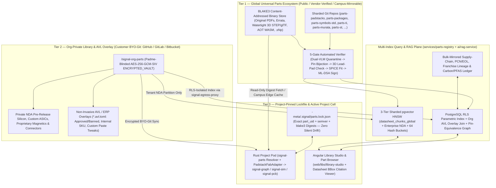
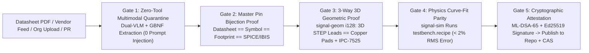

# 18 — Universal Component, Datasheet, Symbol, Padstack & 3D Asset Repository (`signal-universal-parts`)

> **Scope:** Defines Signal's unified, **universal component & datasheet management architecture** uniting manufacturer datasheets, errata, PCNs, parametric metadata, master pin tables, multi-standard symbols, reusable parametric padstacks, IPC-7351 footprints, watertight 3D STEP/glTF packages, pinmux/register maps, and pure-Rust `ElectronicModule` physics bindings into one content-addressed, cryptographically verified ecosystem shared seamlessly across Global Public catalogs, Organization-Private BYO-Git overlays, and Project-pinned lockfiles.

---

## 1. Architectural Vision: One Universal Source of Truth (Zero Library Drift)

Legacy EDA suites fragment every electronic component across 6–8 disconnected, vendor-locked files (`.SchLib`, `.PcbLib`, `.step`, `.lib` SPICE, `.ibs` IBIS, static PDF datasheets, and ERP spreadsheets). A single mismatched pin number, stale pad aperture, or silently mutated shared library ruins hardware prototypes and breaks reproducibility.

**Signal replaces fragmented component libraries with a Universal, Content-Addressed Digital-Twin Repository (`signal-universal-parts`):**
1. **Single Master Pin Table (`pins.json`):** Every schematic symbol pin, PCB padstack instance, 3D STEP metallic lead, SPICE/IBIS simulation port, and MCU/FPGA firmware pinmux channel binds to the **exact same immutable `pin_uid`**—making pinout drift structurally impossible.
2. **First-Class Reusable Primitives (Zero Duplication):** Symbols (`IEEE/ANSI` + `IEC 60617`), Parametric Padstacks (`PadstackDef`), and Physical Package Bodies (`PackageDef`) are independent, deduplicated, BLAKE3 content-addressed primitives shared across millions of parts.
3. **3-Tier Federated Resolution (Global Universal → Org Private BYO-Git → Project Pin):** Every student and enterprise accesses 10M+ globally verified public parts immediately, while Enterprises overlay private AVL/pricing rules and host confidential NDA silicon strictly inside their own encrypted BYO-Git repository—with **zero leakage back to Global** and **zero silent mutation of existing projects**.
4. **Sharded Git + BLAKE3 CAS Storage (Zero 2 TB Monolith):** Human-reviewable canonical manifests (metadata, pins, symbols, padstacks, footprints, curves) live in **manufacturer/category-sharded Git repos** (`< 50 MB` each), while heavy binaries (original PDF datasheets, errata, B-Rep STEP meshes, AOT `.wasm` modules) live in a **BLAKE3 Content-Addressed Store (`cas.signal.parts`)**.



---

## 2. Sharded Repository Layout & Content-Addressed Separation

Putting millions of parts and gigabytes of PDFs into a single Git repository causes multi-hour clones and Git packfile collapse. Signal cleanly splits **structured canonical definitions (Git)** from **immutable binary blobs (BLAKE3 CAS)**:

```text
signal-universal-parts/                       # Logical Federation (Sharded Git Repos + BLAKE3 CAS)
├── parts-padstacks/                          # Global reusable parametric padstacks (SMD, BGA, QFN, PTH, Microvia, Fiducial)
│   └── padstacks/<family>/<padstack_uid>.padstack.toml
├── parts-packages/                           # Global JEDEC/IEC physical bodies + parametric 3D STEP generator specs
│   └── packages/<family>/<package_code>.package.toml
├── parts-symbols-std/                        # Reusable IEEE/ANSI + IEC 60617 semantic symbols (R, C, L, MOSFET, OpAmp, etc.)
│   └── symbols/<category>/<symbol_uid>.symbol.toml
├── parts-footprints-std/                     # IPC-7351 Least/Nominal/Most land patterns referencing padstack_uids
│   └── footprints/<family>/<footprint_uid>.footprint.toml
├── parts-mfr-<vendor>/                       # Per-manufacturer sharded repos (e.g., parts-mfr-ti, parts-mfr-murata, parts-mfr-st)
│   └── parts/<base_family>/<orderable_mpn>/
│       ├── part.meta.toml                    # Canonical identity, lifecycle, MSL, reflow, carbon/PFAS, trust badge, ML-DSA sig
│       ├── datasheets.json                   # Original PDF/Errata/PCN BLAKE3 refs + page/bbox citation index
│       ├── pins.json                         # SINGLE SOURCE OF TRUTH Master Pin Table (pin_uid, electrical, pkg delay, pinmux)
│       ├── specs.json                        # SI-normalized ratings, condition curves C(V,T,f), thermal R_thetaJC/JB, FIT rates
│       ├── bindings.toml                     # Binds symbol_ref + footprint_ref + package_ref + pin_uid mapping + ElectronicModule
│       └── testbench.recipe.json             # < 10 KB declarative SPICE verification circuit proving < 2% RMS curve parity
└── cas.signal.parts/                         # Immutable BLAKE3 Object Store (CDN + Campus Edge mirrorable)
    └── blake3/<aa>/<bb>/<64-hex-digest>      # Raw PDFs, errata, watertight STEP, glTF LODs, AOT .wasm models, .sNp, IBIS
```

**Organization-Private Overlay Repository (`<customer-namespace>/signal-org-parts`):**
- Uses the **exact same directory & schema structure** inside the customer's own GitHub, GitLab, or Bitbucket org (encrypted under Padmé-padded, path-blinded `AES-256-GCM-SIV` `ENCRYPTED_VAULT`), plus an `overlays/avl/<mfr>/<orderable_mpn>.avl.toml` directory overriding AVL approval state, internal ERP code, cost tiers, or org-specific padstack/paste rules without copying global parts!

---

## 3. Canonical Universal Schemas (Metadata, Datasheets, Symbols, Pads, Footprints & Models)

All coordinates, dimensions, tolerances, and electrical/timing values enforce **explicit SI-unit suffixes** (`_nm`, `_ps`, `_fs`, `_uv`, `_na`, `_uw`, `_mkelvin`, `_hz`, `_mohm`) and **ES2020 `bigint` (`[jstype = JS_STRING]`)** for 100% of 64-bit integer fields!

### 3.1 Universal Component Identity & Metadata (`part.meta.toml` + `datasheets.json` + `specs.json`)
| Field Group | Universal Fields Defined |
|---|---|
| **Global Identity** | `part_uid` (`urn:sigpart:<mfr>:<orderable_mpn>:<pkg>:<die_rev>`), `base_family_mpn`, `orderable_mpn`, `manufacturer_id` + CAGE code, `packaging` (`TAPE_REEL` / `TRAY` / `TUBE`), `taxonomy_path`, `semver`, `spdx_license`, `must_encrypt_taint`. |
| **Lifecycle & Compliance** | `lifecycle_status` (`ACTIVE` / `NRND` / `EOL` / `OBSOLETE`), `pcn_refs[]`, `errata_refs[]`, `qualifications[]` (`AEC-Q100`, `AEC-Q200`, `MIL-PRF`, `ISO-13485`), `msl_level` (`1–6`), `reflow_peak_mkelvin`, `rohs`, `reach`, `pfas_free`, `conflict_mineral_free`, `embodied_co2e_grams`. |
| **Datasheet Citations** | `documents[]` (`doc_type`: `DATASHEET` / `ERRATA` / `PCN` / `APP_NOTE`, `rev`, `date_utc`, `blake3`, `sha256`, `page_count`). Every extracted parameter carries `citation: { doc_blake3, page, bbox_norm: [x0, y0, x1, y1] }` for 1-click PDF highlight jump! |
| **Condition-Parameterized Specs** | `abs_max_ratings` (SI bounds), `recommended_operating`, **multi-dimensional condition curves** (`C(V_bias, T, f)`, `Rds_on(V_gs, T_j)`, `B-H` core loss, `Z(f)`, `SOA` pulse polygons), compact thermal network (`r_theta_jc_mk_per_mw`, `r_theta_jb_mk_per_mw`, `psi_jt`, `c_th`), and reliability FIT rates (`IEC 62380` / `SN 29500`). |
| **Trust & Integrity** | `trust_badge` (`BRONZE_PARSED` / `SILVER_SIM_MATCHED` / `GOLD_ATTESTED`), `three_way_step_verified: bool`, `spice_rms_error_ppm`, `ml_dsa_65_ed25519_sig`. |

### 3.2 Master Pin Table (`pins.json` — The Unbreakable Cross-Domain Anchor)
Every domain view binds strictly to immutable `pin_uid` entries inside `pins.json`:
- `pin_uid` (stable UUIDv7), `pin_number` (`"1"`, `"A1"`, `"EP"`), `pin_name`, `electrical_type` (`POWER_IN`, `POWER_OUT`, `PASSIVE`, `INPUT`, `OUTPUT`, `BIDIR`, `OPEN_DRAIN`, `OPEN_COLLECTOR`, `TRI_STATE`, `NO_CONNECT`, `RF_PORT`, `OPTICAL_PORT`, `THERMAL_PAD`).
- **SI / Package / ESD Physics:** `voltage_domain`, `abs_max_v_uv`, `max_current_na`, `esd_hbm_uv`, `pkg_flight_delay_fs` (`bigint` — feeds `FEAT-015` silicon-to-silicon flight-time tuning!), `pkg_r_mohm`, `pkg_l_ph`, `pkg_c_ff`.
- **Swap, Diff-Pair & Firmware Pinmux:** `pin_swap_group`, `gate_swap_unit`, `diff_pair_mate_pin_uid`, `alternate_functions[]` (MCU/FPGA peripheral mux definitions feeding `FEAT-055` SAT pinmux solver!), and `register_map_ref` (SystemRDL / CMSIS-SVD).

### 3.3 Universal Semantic Symbol Architecture (`universal-symbol.schema.json`)
- **Dual-Standard Rendering from One Definition:** Stores semantic primitives (`body_shapes`, `pin_stubs`, `polarity_markers`, `field_anchors`) with native style variants for **IEEE/ANSI (US)**, **IEC 60617 (International)**, and **De Morgan logic equivalents** — switching global schematic standard never breaks a single wire!
- **Multi-Unit Balanced Splitting (`FEAT-072`):** Large SoCs/BGAs/FPGAs partition logically into units (`Power`, `DDR5_CH0`, `PCIe_Gen6`, `Analog`, `GPIO_BankA`) while guaranteeing 100% bijective coverage of `pins.json`.
- **Exact Grid & Bindings:** Exact `i64` nm coordinates on canonical `1.27 mm` (`50 mil`) / `2.54 mm` (`100 mil`) grids; binds every graphical pin strictly to `pin_uid` and Okabe-Ito color-blind-safe semantic glyphs.

### 3.4 Universal Parametric Padstack Architecture (`universal-padstack.schema.json`)
**Pads are first-class, reusable, versioned parametric primitives — NEVER copy-pasted polygon soup!**

| Padstack Sub-Section | Exact Universal Parameters (`i64` nm / `bigint` SI Units) |
|---|---|
| **Geometry Primitives** | `padstack_uid`, `blake3`, `pad_class` (`SMD`, `BGA_NSMD`, `BGA_SMD`, `QFN_THERMAL`, `PTH`, `NPTH`, `MICROVIA`, `FIDUCIAL`, `EDGE_FINGER`, `MOUNTING_BOSS`), shapes: `Circle`, `Rect`, `RoundedRect(r_nm)`, `Oblong`, `DShape`, `Octagon`, `CustomPoly(Vec<(i64,i64)>)`, `SegmentedWindowPane`. |
| **Multi-Layer Copper Stack** | `top_copper`, `inner_signal_default` + `inner_layer_overrides[]`, `bottom_copper`, `inner_plane_connection` (`THERMAL_RELIEF { spoke_count, spoke_width_nm, gap_nm, angle_mdeg }` / `DIRECT_FLOOD` / `ANTIPAD(shape)`), `teardrop_profile`. |
| **Solder Mask & Paste Stencil** | `solder_mask_mode` (`NSMD` vs `SMD`), `mask_expansion_nm` (or per-edge), `solder_paste_mode` (`AUTO_SHRINK` / `WINDOWPANE_GRID { rows, cols, coverage_pct }` / `STEP_STENCIL_UM` / `NONE`), automated **IPC-7525 area-ratio validation (`>= 0.66`)**. |
| **Drill, Plating & HDI Fill** | `hole_type` (`NONE`, `PTH`, `NPTH`, `SLOTTED_PTH`, `LASER_MICROVIA`, `BLIND`, `BURIED`), `finished_hole_nm`, `drill_tol_plus_nm`, `drill_tol_minus_nm`, `plating_thickness_nm`, `ipc4761_via_fill_type` (`I–VII`), `backdrill_antipad_nm`, `counterbore_nm` / `countersink_mdeg`. |
| **Fab-Profile Dynamic Adaptation** | Optional `fab_adaptation_rules` allowing `PadstackFabAdapter` to adjust annular ring, mask sliver web, and paste shrink automatically to the active board's `*.fabprofile.toml` while preserving audit provenance! |

### 3.5 Universal Footprint & Watertight 3D Package Architecture (`universal-footprint.schema.json`)
- **IPC-7351 Density Tiers Built In:** Every standard land pattern supports **`MOST` (Density A — rugged/hand-solder)**, **`NOMINAL` (Density B — general)**, and **`LEAST` (Density C — ultra-high-density HDI)** profiles with canonical **IPC-7351 Zero-Orientation** and Pick-and-Place centroid origin!
- **Padstack Instances & Manufacturing Layers:** Every land is a `PadInstance { pin_uid, padstack_uid, x_nm, y_nm, rot_mdeg, layer_side }` paired with `silkscreen` (auto-clipped clear of solder mask!), `assembly_outline`, `courtyard`, `no_coat_keepout` (`FEAT-066`), `glue_dot`, `fiducials[]`, and **exact 3D metallic lead contact boxes**.
- **Watertight 3D Package Body (`packages/` + CAS):** Stores exact JEDEC/IEC mechanical envelope tolerances (`min`/`nom`/`max` nm), parametric B-Rep generator parameters (`FEAT-071`), watertight `STEP` (`blake3`), and multi-LOD GPU meshes (`glTF`/`wgpu`) used directly in 3D PCB rendering, enclosure clearance (`FEAT-061`), and thermal heatsink contact (`FEAT-029`).

### 3.6 Multi-Physics & Behavioral Model Bindings (`bindings.toml`)
Links one component seamlessly to all simulation & firmware domains:
- Pure-Rust `ElectronicModule` crate/struct parameterization (with tolerance PDF & aging coefficients).
- AOT-compiled, `ML-DSA`-signed Verilog-A `.wasm` (`signal-module-sdk`), multi-dialect SPICE `.subckt`, passive Vector-Fitted Touchstone `.sNp`, IBIS / child-MicroVM `IBIS-AMI` `.so`, SystemVerilog/VHDL model, and verified reference schematic snippet (`FEAT-079`).

---

## 4. Automated 5-Gate Verification Pipeline & Trust Promotion (`BRONZE` → `SILVER` → `GOLD`)

Every new or revised component (from manufacturer feeds, community PRs, or enterprise private uploads) passes through an isolated, zero-network verification pipeline (`signal-verify-worker`):



| Trust Tier | Automated Requirements Passed | Allowed Usage Policy |
|---|---|---|
| **`BRONZE_PARSED`** | Gates 1 + 2 passed (Quarantined Dual-VLM consensus + 100% Pin Bijection); behavioral curve unverified. | Allowed in `EXPLORER` / `MAKER` / early concept drafts (clearly badged Amber in UI). |
| **`SILVER_SIM_MATCHED`** | Gates 1 + 2 + 3 + 4 passed (3D STEP leads intersect exact pads, IPC-7525 paste ratio valid, Rust SPICE matches datasheet curves `< 2%` RMS error). | Default minimum threshold for Commercial `PRO` & Autonomous AI Agent synthesis. |
| **`GOLD_ATTESTED`** | Gates 1–5 passed + Manufacturer cryptographic feed signature OR Enterprise Component Librarian Step-Up 2FA `ML-DSA` attestation. | Mandatory default for `SILICON_SCALE`, Automotive (`AEC-Q`), Medical (`ISO 13485`), Aerospace & SFTP Tape-Out/Fab releases. |

---

## 5. Dual Implementation Blueprint (Pure Rust + Node.js Control Plane + Angular UI)

### 5.1 Pure-Rust Engine Side (`engine/crates/signal-parts`)
A new dedicated **Tier-2 Rust crate (`engine/crates/signal-parts`, `#![forbid(unsafe_code)]`)** integrated cleanly into `signal-graph`, `signal-component`, `signal-geom`, `signal-pcb`, and `signal-pod`:
- **`UniversalPartStore` & `ThreeTierResolver`:** Resolves `part_uid` deterministically across `ProjectLockfile -> OrgByoGitOverlay -> GlobalCasCache`, merging Org AVL overrides (`Preferred`/`Banned`, internal SKU, custom paste apertures) in microseconds with zero disk writes inside the pod.
- **`PadstackFabAdapter`:** Evaluates `PadstackDef` against the active project's `FabCapabilityProfile` (`*.fabprofile.toml`), computing exact copper/mask/paste/antipad polygons in `i64` nm (`i128` boolean predicates) and emitting real-time IPC-7525 stencil ratio & annular-ring DRC metrics.
- **`ThreeWayStepPadVerifier`:** Projects watertight 3D STEP metallic terminal bounding hulls onto `FootprintDef` padstacks in exact `i128` coordinates, proving 100% lead-to-pad registration, zero inter-pin bridges, and Pin-1 polarity alignment!
- **`MasterPinBijectionChecker`:** Verifies exhaustive 1-to-1 pin bindings across `pins.json`, `SymbolDef` units, `FootprintDef` pad instances, `ElectronicModule` ports, and firmware pinmux tables.
- **`PartLockfileManager`:** Maintains `<project>-meta/.signal/parts.lock.json` inside Dual-Fenced `Super-Commit`s and computes structured `PartRevisionDiff` deltas (`FEAT-078`) when newer global revisions publish.

### 5.2 Node.js Control Plane Side (`services/parts-registry`)
A new stateless Node.js 22 service (`services/parts-registry`) sitting alongside `project-catalog` and `ai/rag-service`:
- **Parametric & Hybrid Search API:** Executes sub-50ms SI-normalized SQL filters combined with `ai/rag-service` 3-Tier `pgvector` HNSW search and bulk-mirrored supply-chain/carbon/franchise-lineage joins (returning `bigint`-safe JSON via `[jstype = JS_STRING]`).
- **Org AVL & Private Library Governance:** `@RequireOrgAdmin` + Step-Up 2FA endpoints for managing Org AVL statuses (`PREFERRED`/`APPROVED`/`NRND_WARN`/`BANNED`), Org-private `signal-org-parts` BYO-Git connection, Cross-Project "Where-Used" scans (`FEAT-075`), and Datasheet Drift Notifications (`FEAT-078`).
- **Read-Only Global CAS & Campus Edge Mirroring:** Serves BLAKE3-signed global manifests/meshes via regional CDN and publishes signed delta bundles to `$300` **`Signal Campus Edge`** appliances (`FEAT-120`) for offline-resilient developing-nation schools/universities!

### 5.3 Angular 19/20+ UI Side (`web/libs/library-studio`)
Extends `web/libs/library-studio` with clean Zoneless Signals components strictly obeying Zero-Leak DLP & `HudOverlayPrimitive`:
1. **`UniversalPartBrowserComponent`:** Faceted parametric filter bar (SI unit pills, Trust Badge filter, In-Stock, AEC-Q, PFAS-Free, Org AVL badge) + virtualized result grid (`cdk-virtual-scroll`) + instant 4-tab live preview card (**Symbol [IEEE/IEC]** | **Footprint [Least/Nom/Most] & Padstacks** | **3D Package** | **Condition Curves & Datasheet**).
2. **`MasterPinTableEditorComponent`:** Unified spreadsheet where editing a pin name, electrical type, swap group, or package flight delay (`bigint` fs) immediately reflects across the linked Symbol units, Footprint pad assignments, and MCU Pinmux matrix!
3. **`PadstackSculptorComponent` (`FEAT-076`):** Interactive multi-layer padstack cross-section & top-down editor for copper shapes, thermal-relief spokes, anti-pads, drill/back-drill tolerances, and QFN windowpane paste apertures with live IPC-7525 area-ratio gauge!
4. **`ThreeWayAlignmentViewerComponent`:** Interactive translucent 3D overlay inspecting physical STEP leads seated directly on copper pads & solder-paste openings with automated green/red contact badges.
5. **`DatasheetCitationViewerComponent`:** Zero-Leak streamed PDF viewer (zero browser download/print!) that auto-scrolls and highlights the exact `(page, bbox_norm)` bounding box whenever an engineer clicks *any* parameter, AbsMax rating, or AI citation!
6. **`OrgAvlAndDriftConsoleComponent` (`FEAT-075`, `FEAT-078`):** Component Librarian console managing Org AVL states, "Where-Used" blast radius across org projects, and side-by-side Datasheet/Footprint Rev A → Rev B diff approvals.

---

## 6. Security, Licensing & Complete Project Isolation Guarantees

| Security / Governance Axis | Enforcement in Universal Parts Architecture |
|---|---|
| **Zero Customer IP Contamination** | Tier 1 Global repo & `cas.signal.parts` accept ONLY public/vendor/open-hardware artifacts. Tier 2 Org-Private NDA parts live EXCLUSIVELY in the customer's encrypted BYO-Git (`<org>/signal-org-parts`) and their RLS-isolated `pgvector` enterprise partition (`<= 500`/cluster). |
| **Zero-Leak DLP on Private Datasheets & 3D STEP** | Under Enterprise Zero-Leak mode, Org-Private PDFs, symbols, footprints, and 3D STEP packages render strictly server-side into `Zstd-QOI`/WebP tiles with Tardos + Constellation watermarks — zero browser downloads or `IndexedDB` caching! |
| **Parser Bomb & Prompt-Injection Immunity** | All uploaded PDFs, STEP meshes, IBIS files, and legacy `.kicad_mod`/`.PcbLib` imports execute in zero-network sandboxes (`<= 20:1` decompression cap, `0` XXE, depth `<= 64`) with Dual-VLM Zero-Tool Quarantine + `GBNF`. |
| **SPDX & Export-Control Hygiene** | Every universal part carries an explicit `spdx_license` and optional `export_control_class` (`EAR99` / `ITAR`), automatically validated by Signal's SPDX Policy Gate and Sovereign Jurisdiction Pinning before placement or SFTP release! |
| **Cryptographic Reproducibility** | Every placed component is pinned by immutable `blake3` digests and `ML-DSA-65 + Ed25519` signatures inside `<project>-meta/.signal/parts.lock.json` — guaranteeing a board opened 10 years later builds bit-for-bit identically! |
