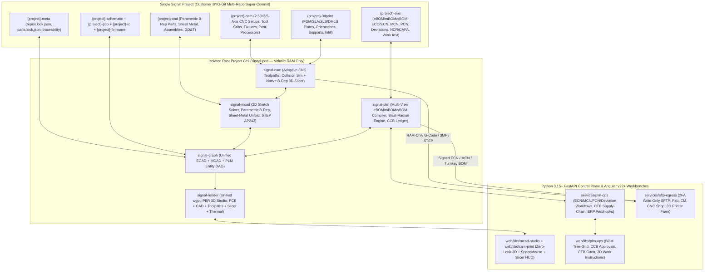
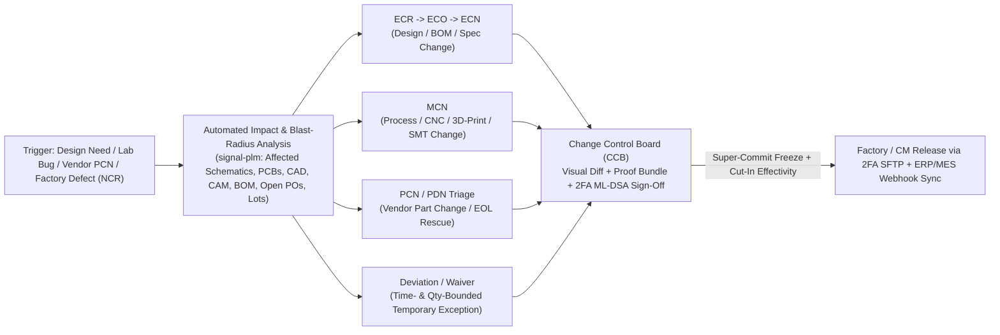

# 19 — Integrated Mechanical CAD/CAM, 3D Printing, Unified 3D Visualization & Native PLM / Supply-Chain Operations

> **Scope:** Expands **Signal** into a true **End-to-End Hardware Product Operating System**—integrating parametric **Mechanical CAD (`CAD_MCAD`)**, subtractive **CNC CAM (`CAM_CNC`)**, additive **3D Printing (`PRINT_3D`)**, unified photorealistic **3D Visualization**, and complete native **PLM, Change Control (`ECN`/`ECO`, `MCN`, `PCN`, `Deviation`/`Waiver`, `NCR`/`CAPA`), Multi-View BOM (`eBOM`/`mBOM`/`sBOM`), Supply-Chain (`CTB`/RFQ), and Factory Operations (`PLM_OPS`)** as first-class Sub-Project types inside every Signal Project.

---

## 1. Architectural Vision: Zero Silos From Transistor to Shipped Product

Hardware companies waste months translating data across separate ECAD (Altium/Cadence), MCAD (SolidWorks/NX), CAM/Slicers (Fusion/PrusaSlicer/Materialise), PLM (Arena/Agile/Windchill), and ERP/Supply-Chain spreadsheets. Every handoff creates broken enclosures, stale BOMs, unapproved factory part swaps, and untracked deviations.

**Signal eliminates every silo inside ONE unified encrypted cloud Project:**
1. **Live Parametric ECAD ↔ MCAD ↔ CAM ↔ 3D-Print Lockstep:** Moving a USB-C connector or mounting hole on `<project>-pcb` immediately updates the parametric enclosure cutout in `<project>-cad`, regenerates the CNC pocket toolpath in `<project>-cam` or sliced build plate in `<project>-3dprint`, updates the mechanical+electrical `mBOM` in `<project>-ops`, and commits all repositories atomically in ONE **Dual-Fenced Two-Phase `Super-Commit`**!
2. **Native PLM & Operations Automatically Built Into Every Project:** Multi-level **eBOM/mBOM/sBOM**, **ECR/ECO/ECN**, **MCN**, **PCN/PDN**, **Deviations/Waivers**, **NCR/CAPA**, **Clear-to-Build (CTB)** shortage analytics, **First Article Inspection (FAI)**, and **Interactive 3D Assembly Work Instructions** are native graph-connected objects—never bolted-on spreadsheets!
3. **100% Pure-Rust Geometry/Slicing + Zero-Leak SFTP Delivery:** Parametric B-Rep modeling, CNC toolpaths, 3D slicing, and PLM blast-radius calculations run deterministically in Rust inside the isolated Project Cell; all manufacturing files (`STEP AP242`, `DXF`, `G-code`, `3MF`, `Turnkey CM RFQ`, `ECN/MCN Packages`) stream strictly in volatile RAM to **Step-Up 2FA Authorized write-only `russh` SFTP** (zero Enterprise browser downloads!).

---

## 2. New First-Class Project / Sub-Project Types & BYO-Git Repositories

All 4 new disciplines plug cleanly into Signal's existing Multi-Type Project & Lazy BYO-Git Repo model ([`01`](./01-product-vision-and-features.md), [`13`](./13-vcs-git-server-and-storage-analysis.md)):

| Sub-Project Type | BYO-Git Repository | Canonical Contents (Padmé-Blinded `ENCRYPTED_VAULT` Default) |
|---|---|---|
| **`CAD_MCAD`** | `<project>-cad` *(or `<project>-cad-enclosure`)* | Parametric sketch & B-Rep feature trees (`*.mcad.sig`), sheet-metal K-factor bends, assembly mate graphs, GD&T PMI annotations, drawing sheets, and ECAD-to-MCAD live anchor bindings (`MECHANICAL_REF` retained for external read-only STEP refs). |
| **`CAM_CNC`** | `<project>-cam` | Machining setups (WCS, raw billet stock, vice/clamp fixtures), parametric tool cribs (endmills, drills, taps, feeds/speeds), deterministic toolpath recipes (`*.cam.sig`), signed post-processor profiles, and setup inspection sheets. |
| **`PRINT_3D`** | `<project>-3dprint` | Multi-plate build layouts (`*.3dp.sig`), printer/material profiles (FDM, SLA/DLP, SLS/MJF, DMLS metal), orientation vectors, painted support/infill modifiers, embedded-PCB pause layers, and thermal/overhang DFM reports. |
| **`PLM_OPS`** | `<project>-ops` | Multi-view BOM specs (`ebom.toml`, `mbom.toml`, `sbom.spdx.json`), immutable signed change records (`eco/`, `ecn/`, `mcn/`, `pcn/`, `deviations/`, `ncr-capa/`), 3D assembly work instructions, FAI (`AS9102`) plans, and factory cut-in logs. |

---

## 3. Parametric Mechanical CAD, CAM, 3D Printing & Unified 3D Visualization (`engine/` + `web/`)

### 3.1 Parametric 3D Mechanical CAD (`engine/crates/signal-mcad` + `web/libs/mcad-studio`)
- **Pure-Rust Constraint Sketcher & B-Rep Solid Kernel (`#![forbid(unsafe_code)]`):**
  - Exact `i64` nm coordinate anchoring + `i128`/Shewchuk predicates + Levenberg-Marquardt/Dogleg 2D geometric constraint solver (`Coincident`, `Tangent`, `Concentric`, `Parallel`, `Perpendicular`, `Symmetric`, `Equal`, parametric formulas linked to PCB/enclosure variables!).
  - Full feature-history parametric B-Rep solid operations (`Extrude`, `Revolve`, `Sweep`, `Loft`, `Fillet`/`Chamfer`, `Shell`, `Draft` angle check for injection molding, `Boolean Union/Subtract/Intersect`, `Linear/Circular Pattern`, `Hole/Thread Wizard`).
  - **Sheet-Metal Engine:** Configurable K-factor / bend-allowance tables, flanges, hems, gussets, louvers, relief cuts, and exact 2D flat-pattern unfolding (`DXF` via SFTP).
  - **Assembly Kinematics & Live ECAD Co-Design:** Rigid, revolute (hinge), slider, cylindrical, and gear mates with live collision detection; bi-directional parametric references to `signal-pcb` board outlines, mounting holes, connector ports, display bezels, and heatsink interfaces—plus coupled thermal FVM (`signal-power-integrity`) and modal vibration (`signal-dfm`) meshing!
- **Angular UI (`web/libs/mcad-studio`):** Feature-history rollback scrubber, 2D constraint HUD with degrees-of-freedom (`DOF`) color indicators, interactive drag-extrude/fillet handles (`HudOverlayPrimitive`), `WebHID` 6-DOF SpaceMouse support, dynamic X/Y/Z cross-section sliders, and exploded-assembly animator.

### 3.2 Subtractive CNC CAM (`engine/crates/signal-cam` + `web/libs/cam-print`)
- **Pure-Rust CAM Kernel:**
  - **2.5D, 3-Axis, `3+2` Indexed & 5-Axis Toolpaths:** Adaptive high-speed trochoidal clearing (constant tool engagement), pocket/contour, 3D parallel/scallop/radial/pencil finishing, helical boring, rigid tapping, chamfering, and 2D laser/waterjet/plasma nesting with kerf compensation.
  - **Physics & Safety Verification:** Voxel/dexel stock-removal simulation comparing remaining stock vs. nominal B-Rep (`±10 µm` gouge/rest-material heatmap!), tool-holder/spindle/vice BVH collision detection, cutting-force & chip-load (`SFM`/`IPT`) calculators, and deterministic signed post-processors (`Haas`, `Fanuc`, `Siemens 840D`, `Heidenhain`, `GRBL`, `LinuxCNC`).
- **Angular UI (`web/libs/cam-print` — CAM Mode):** Interactive setup/WCS triad, searchable carbide/HSS tool crib, live animated toolpath + material-removal playback scrubber, red/blue gouge-and-rest-stock heatmap, and exact cycle-time & machine-rate should-cost estimator!

### 3.3 Additive Manufacturing & 3D Printing (`engine/crates/signal-cam` + `web/libs/cam-print`)
- **Pure-Rust Direct-B-Rep Slicer Kernel:**
  - Slices directly from exact `signal-mcad` B-Rep solids (zero lossy STL tessellation stepping!) across **FDM/FFF, SLA/DLP Resin, SLS/MJF Polymer Powder, and DMLS/SLM Metal**.
  - **Intelligent Print Physics & Hybrid Electronics Printing:** Automated part orientation optimizing overhang/support volume and anisotropic Z-layer tensile strength, organic tree/soluble/sintered-metal supports, volumetric gyroid/cubic/lightning infill, variable layer height, scarf seams, trapped-resin/powder drain-hole checker, DMLS thermal-distortion flags, and **Embedded-Electronics Pause-Insert Layers** (pausing mid-print to seat Signal PCBs, nuts, magnets, or copper coils!).
  - **Delivery:** Emits verified `3MF` / machine `G-code` / `SLM/CLI` build files with exact filament/resin/powder mass (`g`), cost, and print-time telemetry—transmitted strictly via 2FA Authorized SFTP (or local shop-floor SFTP bridge in `MAKER`/`Campus` tiers!).
- **Angular UI (`web/libs/cam-print` — 3D Print Mode):** Multi-printer build-plate auto-arranger, overhang/thin-wall/bridge risk heatmap, brush-based support/seam enforcer/blocker painting, interactive 3D layer + toolhead playback scrubber, and filament/resin/metal cost breakdown HUD.

### 3.4 Unified Cross-Discipline 3D Visualization Studio (`signal-render`)
Every Signal Project shares **one unified `wgpu` 3D PBR & Engineering Viewport** capable of rendering all layers together simultaneously:
- Transparent/exploded CAD enclosures + metallic CNC heatsinks + 3D-printed brackets + multi-board rigid-flex PCBs (with real copper/silkscreen/STEP components) + 3D wire harnesses + thermal/EM/creepage/gouge/overhang heatmaps!
- Runs seamlessly under both **Enterprise Zero-Leak Mode** (Dual-Plane `Zstd-QOI`/WebP + hardware video + Tardos/Constellation watermarks) and **Standard Ephemeral WebGPU** (`EXPLORER`/`MAKER`/Local Mac).

---

## 4. Native PLM, Design-Change Governance, Supply-Chain & Operations (`engine/crates/signal-plm` + `services/plm-ops` + `web/libs/plm-ops`)

Every change control, BOM, supply-chain, and factory operations workflow is **automatically built into every Signal Project**—enforcing full cryptographic traceability (`ML-DSA-65 + Ed25519` + Step-Up 2FA + Fail-Closed 3x Quorum Audit Outbox) without external PLM tools:

### 4.1 Unified Multi-View Bill of Materials (`eBOM` ↔ `mBOM` ↔ `sBOM` ↔ `Costed BOM`)
- **Engineering BOM (`eBOM`):** Auto-compiled live from `SCHEMATIC` + `PCB` + `IC` + `CAD_MCAD` (enclosures, fasteners, gaskets, heatsinks, adhesives, labels) + `HARNESS` (wires, crimps, sleeves) — zero manual spreadsheets!
- **Manufacturing BOM (`mBOM`):** Restructures `eBOM` into factory assembly stages/sub-assemblies (SMT Top, SMT Bottom, Wave/Selective, Box-Build Mechanical, Final Test, Retail Packaging), including consumables (solder paste, conformal coating, thermal grease, shipping cartons), approved alternates (`AML`/`AVL`), scrap attrition rates, and factory routing steps.
- **Software BOM (`sBOM`):** Automatically compiles `SPDX 3.0` / `CycloneDX` manifests across `FIRMWARE`, `BIOS`, `FPGA` IP cores, and `SOFTWARE` crates/packages with live CVE posture links from `vcs-auditor`.
- **Costed & Carbon BOM:** Live rolled-up unit cost across volume tiers (`10` / `100` / `1k` / `10k` / `100k` — combining bulk-mirrored distributor pricing + `signal-dfm` PCB/CNC/3D-print should-cost!) + embodied carbon ($\text{kgCO}_2\text{e}$) and RoHS/REACH/PFAS compliance rollup.

### 4.2 Complete Change-Management State Machines (Automatic Cross-Domain Traceability)

| Change / Ops Entity | Exact Fields, Rules & Automation Built Into Platform |
|---|---|
| **`ECR` / `ECO` / `ECN` (Engineering Change Request / Order / Notice)** | Immutable state machine (`Draft -> Impact -> CCB Review -> Approved -> Released -> Implemented -> Verified`). Auto-links exact `jj` branch, side-by-side ECAD + MCAD + BOM visual diff, simulation/DRC proof bundle, effectivity (`Immediate` / `Cut-In Date` / `Serial #` / `Run-Out Existing Stock`), inventory disposition (`Use-As-Is` / `Rework` / `Scrap` / `Return`), and auto-publishes signed **ECN** bulletins to CM/factory stakeholders! |
| **`MCN` (Manufacturing Change Notice)** | Governs factory/process changes (SMT stencil/reflow recipe, PCB panelization, CNC fixture/toolpath/post-processor, 3D-print material/layer profile, test fixture, alternate factory site). Automatically verifies whether form-fit-function is impacted (escalating to mandatory `ECO` if design specs shift!) and binds to `CAM_CNC` / `PRINT_3D` / `FabCapabilityProfile` commits. |
| **`PCN` / `PDN` (Part Change Notice & End-of-Life Triage)** | Auto-ingested from `services/parts-registry` mirrored vendor feeds (`18-*`) → runs instant **Cross-Project Where-Used Blast-Radius Scan** across all org projects → creates tracked `PCN` triage tickets with risk classification (`Major: Die/Fab/Material` vs `Minor: Marking/Reel`), triggers AI **Zero-Spin BOM Rescue** alternates + requalification SPICE/thermal runs, and spawns linked `ECO`s or `Deviations`! |
| **`Deviation` / `Waiver` (Temporary Controlled Concession)** | Strictly bounded temporary exception authorizing a build with an alternate part, relaxed tolerance, or cosmetic concession. **Hard Platform Enforcement:** MUST specify `scope` (`lot_id` / `serial_range`), `max_quantity`, `expires_at_utc`, risk assessment, and QA + Eng Lead Step-Up 2FA `ML-DSA` sign-offs—**automatically blocks factory SFTP releases the instant `qty` or `expires_at` is reached!** |
| **`NCR` & `CAPA` (Non-Conformance & Corrective/Preventive Action)** | Tracks incoming inspection failures, factory yield drops, CNC/3D-print rejects, and field RMAs using structured 8D root-cause workflows (`Containment -> Root Cause -> Corrective Action -> Preventive Action -> Effectiveness Check`), linking directly to `signal-twin` lab captures and spawning traceable `ECO`/`MCN` fixes. |

### 4.3 Native Supply-Chain, Procurement & Factory Operations Hub (`services/plm-ops` + `web/libs/plm-ops`)
- **Live Clear-to-Build (`CTB`) & Shortage Cockpit:** Enter target build quantity (`e.g., 2,500 EVT/PVT units`) → cross-references `mBOM` + approved `AVL` alternates + mirrored franchise distributor stock/lead times + synced ERP on-hand inventory to produce real-time **CTB %**, **Long-Lead-Time Critical-Path Gantt**, **Single-Source Risk Alerts**, and **Excess & Obsolete (`E&O`) Exposure**!
- **Turnkey CM RFQ & Build-Package Orchestrator:** Generates complete, locked, `ML-DSA`-signed turnkey manufacturing packages (Gerber/IPC-2581 + `STEP AP242` + `DXF` flat patterns + `G-code`/`3MF` + `mBOM` + `CPL` + `FAI AS9102` checklist + active `ECN`/`MCN`/`Deviation` cover sheet) delivered *exclusively* via **Step-Up 2FA Authorized SFTP** to approved CMs, PCB fabs, CNC machine shops, and 3D-print farms!
- **Interactive 3D Step-by-Step Factory Assembly Work Instructions:** Authors live visual box-build / torque-sequence / harness-routing steps bound directly to `CAD_MCAD` + `PCB` 3D exploded views—updating automatically when an `ECO` or `MCN` moves a screw or connector, viewable on shop-floor tablets via time-boxed Zero-Leak read-only sessions (`FEAT-119`)!
- **Bidirectional ERP / MES / QMS Integration (`signal-egress-proxy`):** Signed webhook & REST connectors syncing released `mBOM`s, `ECN`/`MCN` cut-ins, part numbers, and on-hand stock with enterprise ERP/MES systems (`SAP`, `Oracle NetSuite`, `Odoo`, `Infor`) strictly through socket-pinned anti-SSRF egress proxies with zero raw design-file leakage!

---

## 5. Dual-Stack Implementation Map & Contracts

| Layer | New Modules / Contracts Added | Key Responsibilities & Guardrails |
|---|---|---|
| **Rust `1.100+` Engine (`engine/crates/`)** | `signal-mcad`, `signal-cam`, `signal-plm` | `#![forbid(unsafe_code)]`, exact `i64`/`i128` nm geometry, deterministic `0.5-ULP` solver/slicer math, watertight `STEP AP242` / `G-code` / `3MF` generation in RAM, multi-view `eBOM`/`mBOM`/`sBOM` compiler, blast-radius analyzer, cryptographic CCB ledger. |
| **Python `3.15+` FastAPI Control Plane (`services/`)** | `services/plm-ops` | Stateless FastAPI (`Granian 2.8+`, `Pydantic v2`) service enforcing `Depends(require_*)` uniform-`404`, PostgreSQL `19+` RLS (`NOBYPASSRLS`), Step-Up 2FA CCB sign-offs, Fail-Closed 3x Quorum Tier-0 Audit Outbox on every `ECO`/`ECN`/`MCN`/`PCN`/`Deviation`/`NCR` state transition, CTB engine, and ERP webhooks via Rust `signal-egress-proxy`. |
| **Angular `v22+` ONLY Frontend (`web/libs/`)** | `libs/mcad-studio`, `libs/cam-print`, `libs/plm-ops` | Zoneless Signals standalone workbenches, `bigint` nm dimensions, `HudOverlayPrimitive` 3D/sketch/slicer HUDs, SpaceMouse `WebHID`, virtualized `cdk-virtual-scroll` BOM/CCB grids, 3D interactive work instructions, zero browser disk persistence or downloads! |
| **Canonical Contracts (`contracts/`)** | `mcad_cam_print.proto`, `plm_ops.proto`, 7 JSON schemas (`mcad-feature-tree`, `cam-print-job`, `mbom-structure`, `mcn-change-notice`, `pcn-triage`, `deviation-waiver`, `ncr-capa`) | Mandatory SI-unit suffixes (`_nm`, `_mdeg`, `_um_per_s`, `_grams`), `[jstype = JS_STRING]` / ES2020 `bigint` / exact Python `int` on all 64-bit integer fields, `<= 1 MB` chunked mesh/toolpath/BOM streaming, golden fixtures & stateful transcripts. |
