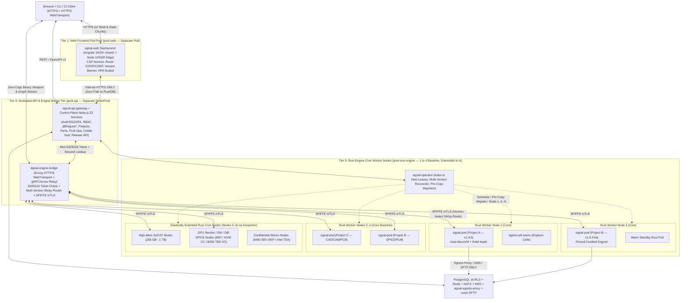
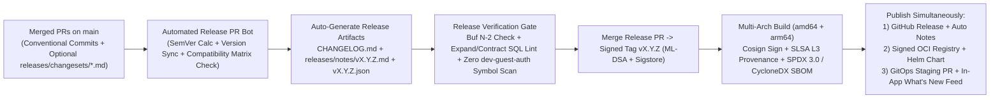

# 20 — Platform Version Management, Automated Releases, Monorepo Build/Deploy & 3-Tier Extensible K8s Topology

> **Scope:** Defines Signal's complete **Platform Version Management & Automated Release Notes pipeline**, **Monorepo-Native Default Build / Local Run / Deploy toolchain** (`justfile`, multi-arch Docker, Helm, Karpenter, GitOps), and hardened **3-Tier Kubernetes Pod & Extensible Worker Node Topology** separating the **Angular + Node Web Pod**, the **Dedicated API Gateway & Engine Bridge Tier**, and the **1–4 Baseline (Elastically Extensible to `N`) Rust Core Engine Kubernetes Worker Nodes**.

---

## 1. Architectural Analysis & Key Improvements

Carefully analyzing the separation of **Web (Angular + Node)**, **Dedicated API Bridge**, and **1–4 Extensible Rust Engine Kubernetes Worker Nodes** alongside automated platform versioning reveals **7 subtle distributed-systems traps** that Signal resolves by design:

| # | Architectural Risk Analyzed | Signal's Hardened Architectural Solution |
|---|---|---|
| **1** | **Noisy-Neighbor Starvation:** Co-locating Angular/Node UI pods, API services, and heavy Rust SPICE/B-Rep/CAM pods causes CPU throttling & `OOMKill` cascades during simulations. | **3 Strict K8s Node Pools + Taints/Tolerations:** `pool-web` (Angular + Node UI pod), `pool-api` (Dedicated API + Engine Bridge), and `pool-rust-engine` (`1–4` baseline extensible to `N`, tainted `signal.io/workload=rust-engine:NoSchedule`). |
| **2** | **API Bridge Becoming a 120 FPS Data Bottleneck or SPOF:** Routing raw 120 FPS pixel tiles/waveforms through a single Node.js HTTP/JSON proxy causes V8 GC jitter (`20–80 ms`) and disconnects all engineers on reboot. | **Dual-Path HA Dedicated API Tier (`pool-api`, `min 2` replicas in prod):** Stateless **Node.js 22 `signal-api-gateway`** handles REST/Auth/RBAC/Tickets while native **Envoy `signal-engine-bridge`** handles zero-copy HTTP/3 WebTransport/gRPC/Arrow streams over SPIFFE mTLS (`< 1 ms` overhead, `120 s` graceful drain). |
| **3** | **Single-Node (`1`) Deadlock vs Multi-Node (`2–4+`) Skew:** Strict anti-affinity deadlocks 1-node starter/local clusters, while unspread scheduling stacks pods onto Node 1 in 4-node clusters. | **Adaptive Topology Spread + Elastic Scale (`1 -> 4 -> N`):** `ScheduleAnyway` fallback when `nodeCount == 1`, strict spread when `nodeCount >= 2`; Karpenter auto-scales at `70%` RAM with eStargz/SOCI lazy pulls (`< 45 s` new node + `< 5 s` pod start) and **3-Phase Pre-Copy Live Migration (`< 150 ms`)**. |
| **4** | **Breaking "1 Project = 1 Security Cell" on `1–4` Worker Nodes:** Confusing "1–4 worker nodes" with sharing one Rust process across tenants would violate isolation. | **Worker Nodes Host Isolated Project Cells:** Each of the `1–4 -> N` Rust worker nodes schedules isolated per-project **`signal-pod` (Kata/gVisor MicroVMs)** or **`< 8 MB` `signal-cell-wasm`** cells—preserving dedicated DEKs, SPIFFE SVIDs, RAM-only `tmpfs`, and 100% Cilium lateral drop. |
| **5** | **Silent Physics Drift Breaking Certified Tape-Outs:** Auto-upgrading Rust pods overnight can shift floating-point sign-off hashes on frozen aerospace/medical projects. | **`physics_determinism_epoch` + Per-Project Engine Pinning:** Projects pin a certified `engine_version` in `.signal/platform.lock.json`; `signal-operator` & `signal-engine-bridge` run **Multi-Version Rust Pods simultaneously** across `1–4 -> N` nodes within an **`N-2` wire compatibility window**. |
| **6** | **Angular Chunk-Load Crash & DB Skew on Rolling Upgrade:** Replacing UI pods deletes lazy chunks needed by open tabs; dropping DB columns crashes draining API pods. | **3-Release Hashed Chunk Retention + Expand-and-Contract DB Migrations:** CDN/origin retains `N-3` hashed chunks (`72h`) with a non-disruptive **"Save & Reload"** banner; CI enforces Expand-and-Contract migrations with pre-upgrade advisory-lock jobs. |
| **7** | **Dev-Flag Leak or Local-vs-Cloud Build Drift:** Monorepo default builds could ship `dev-guest-auth` or diverge between macOS ARM64 and Linux K8s. | **Single Root `justfile` + Pinned Toolchains + Release Binary Gate:** One monorepo command surface drives local dev, multi-arch Docker (`amd64`/`arm64`), and K8s Helm deploy; release CI runs symbol inspection (`dev-guest-auth` forbidden) + **Cosign + SLSA L3 + SBOM** enforced by Kyverno. |

---

## 2. 3-Tier Kubernetes Pod & Extensible Rust Engine Worker Node Topology

Signal enforces strict physical, network, and scheduling isolation across **three independent Kubernetes deployment tiers** (collapsing cleanly to 1 local `k3d`/`OrbStack` node for `just dev-k8s`, scaling from **1–4 Rust Engine Worker Nodes** out of the box, and extending elastically to **`N` General + High-Memory + GPU + Confidential Silicon Rust Core Nodes** with zero API or UI changes):



### 2.1 Zero-Trust Cilium eBPF 3-Tier Network Policy Matrix

| Source Pod / Tier | Allowed Destinations (Strict Allowlist) | Explicitly Denied (100% eBPF Drop) |
|---|---|---|
| **Tier 1: `signal-web` (Angular + Node Pod)** | `signal-api-gateway` (internal HTTPS/mTLS) ONLY | **Zero access** to `pool-rust-engine`, PostgreSQL, Redis, NATS, KMS, BYO-Git, or SFTP. |
| **Tier 2A: `signal-api-gateway` + Node Services** | PostgreSQL (RLS), Redis, NATS, `signal-operator`, `signal-egress-proxy`, `ai/orchestrator`, `signal-sftp-egress` | Never dials unauthenticated arbitrary IPs or bypasses `signal-egress-proxy`. |
| **Tier 2B: `signal-engine-bridge` (API-to-Rust Connector)** | Active `signal-pod` / `signal-cell-wasm` pods on `pool-rust-engine` (SPIFFE mTLS + valid Ed25519 ticket) + Redis read-only lease cache | Zero access to PostgreSQL, KMS secrets, or customer BYO-Git. |
| **Tier 3: `signal-pod` (Rust Engine Worker Nodes `1..4..N`)** | Ingress ONLY from `signal-engine-bridge`; Egress ONLY to `signal-egress-proxy` (with `X-Signal-Fencing-Token`), KMS/Vault, scoped NATS, ephemeral Crash WAL, and `signal-sftp-egress` | **100% Pod ↔ Pod lateral traffic dropped** (even on the same Rust worker node!), zero direct internet egress, zero access to `signal-web` or Postgres. |

### 2.2 Extensible Rust Engine Core Node Profiles (`signal.io/pool=rust-engine`)

Extending Rust Core Engine capacity from **`1` → `4` → `N` worker nodes** requires **zero code or API redeployments**—simply label new Kubernetes nodes or adjust Karpenter/Helm `nodePool` limits:

| Node Profile Label (`signal.io/tier`) | Default Baseline | Extensible Scale (`max`) | Workload Placement (`ProjectSession` CRD) |
|---|---|---|---|
| **`core-standard`** | `1–4` Worker Nodes (`8–32 vCPU`, `32–128 GB RAM`) | Elastically extensible (`4 -> 500+` nodes) | Interactive Schematics, PCB, MCAD, CNC CAM, 3D Slicing, PLM, Quick SPICE (`< 25k` nodes), and `< 8 MB` `signal-cell-wasm` cells. |
| **`core-highmem`** *(optional extension)* | `0` (scale-from-zero) | Extensible (`0 -> 100+` nodes, `256 GB–1 TB RAM`) | Multi-billion-transistor IC/SoC layouts, huge 3D multi-board assemblies, full-chip DRC/LVS. |
| **`core-gpu`** *(optional extension)* | `0–1` (`L4`/`A100`/`H100`/`B200`) | Extensible (`0 -> 200+` GPU nodes) | Server-side Zero-Leak `wgpu` rendering, `cuDSS` GPU SPICE, Saltation-Adjoint sizing, 3D EM, PINN surrogates. |
| **`core-confidential`** *(optional extension)* | `0` (scale-from-zero) | Extensible (`SEV-SNP` / `TDX` + `H100 CC` / `B200 TEE-I/O`) | Defense, aerospace, and foundry `CONFIDENTIAL_SILICON` projects requiring hardware-attested encrypted RAM/VRAM. |

---

## 3. Complete Platform Version Management & Automated Release Notes

Every Signal release is **monorepo-coordinated, cryptographically signed, wire-compatibility-verified, and automatically documented**—with zero manual changelog editing:



### 3.1 Canonical Versioning & Compatibility Governance (`VERSION` + `releases/`)
- **Single Platform Version (`VERSION`):** Strict SemVer `MAJOR.MINOR.PATCH` (plus `-rc.N` pre-releases and `-lts` long-term support branches for enterprise hardware sign-offs). Automated tooling synchronizes `VERSION` into `engine/Cargo.toml` (`workspace.package.version`), `web/package.json`, `services/package.json`, and `infra/k8s/helm/signal/Chart.yaml`.
- **Machine-Readable Compatibility Matrix (`releases/compatibility.json`):** Every release embeds:
  - `platform_version` & `released_at_utc`
  - `contract_api_version` (`signal/v1`, enforced by `buf breaking --against` across `N-2` minor versions)
  - `supported_engine_versions` (e.g., `["1.2.x", "1.3.x", "1.4.x"]` — guaranteeing the API Bridge & Angular UI work seamlessly with pinned LTS Rust pods!)
  - `physics_determinism_epoch` (monotonically incremented whenever solver math, BSIM models, DRC predicates, or CAM/slicer tolerances change, triggering prominent Release Note alerts & pre-upgrade regression diff gates!)
  - `file_format_version` & `schema_migration_head` (strict Expand-and-Contract zero-downtime Postgres migration bounds)
  - `artifacts`: immutable `sha256` OCI image digests for `signal-web`, `signal-api`, `signal-engine-bridge`, `signal-pod`, `signal-operator`, `signal-sftp-egress`, and `signal-ai-*`.
- **Per-Project Engine Pinning (`<project>-meta/.signal/platform.lock.json`):** Enterprise projects can subscribe to `STABLE`, `LTS`, or **pin an exact certified `signal-pod` version + `sha256` digest** so tape-out proof hashes never drift; `signal-operator` pulls and runs the pinned digest on `pool-rust-engine` while `signal-engine-bridge` routes seamlessly!

### 3.2 Automated Release Notes & In-App "What's New" System
- **Strict PR Metadata (`commitlint` CI gate):** Every commit uses Conventional Commits (`feat(pcb):`, `feat(mcad):`, `fix(sim):`, `perf(render):`, `sec(auth):`, `ops(k8s):`, `feat(contracts)!:`); major features may also add a concise Markdown snippet in `releases/changesets/<pr>.md`.
- **Automatic Structured Categorization:** On every release, Signal's release compiler produces **both** human-readable **`releases/notes/vX.Y.Z.md`** (appended to root **`CHANGELOG.md`** and published verbatim to **GitHub Releases**) **and** structured **`releases/notes/vX.Y.Z.json`** grouped cleanly into:
  1. **Highlights & New Features** (ECAD / IC / CAD-CAM / 3D-Print / PLM-Ops / AI)
  2. **Physics & Solver Determinism Notice** (flags `physics_determinism_epoch` changes & regression impact)
  3. **API, Contract & File-Format Migration Notes** (zero-downtime upgrade guidance)
  4. **Security & Compliance Fixes** (CVEs, ASVS/PQC updates, SBOM link)
  5. **Verified OCI Image Digests & Rollback Command** (`helm rollback` / GitOps revert hash)
- **Built-In In-App Release Feed:** `GET /api/v1/platform/releases` serves `releases/notes/*.json` to the Angular IDE, showing a subtle version badge (`v1.4.0`), role-filtered **"What's New"** drawer, and non-disruptive **"New Version Ready — Save & Reload"** prompt when `X-Signal-Web-Version` advances!

---

## 4. Monorepo-Native Default Build, Local Run & Deploy (`justfile` + `infra/`)

Building, testing, running locally, cutting versioned releases, and deploying to Kubernetes are **100% native defaults inside the single Signal monorepo**—zero external deployment repos or undocumented scripts:

### 4.1 Unified Monorepo Root Command Surface (`justfile` + `pnpm` Aliases)

| Command | Default Behavior (Works Identically on Mac Apple Silicon, Linux & CI) |
|---|---|
| **`just dev`** *(default local run)* | Auto-detects host RAM (`<= 16 GB` → `dev:lite` `< 1.5 GB RAM`; `>= 32 GB` → `dev:full` Docker ARM64) + Local Ollama/MLX (`deterministic_mock` fallback) + `Guest @ Signal Design, Inc.` (zero-bypass RBAC/PQC). |
| **`just dev-k8s`** | Boots local `k3d`/`OrbStack` cluster running the **exact 3-tier K8s topology** (`signal-web` pod + `signal-api` & `signal-engine-bridge` pod + `1–4` simulated Rust worker nodes) via monorepo Helm `values-local.yaml`. |
| **`just build`** | Canonical full-stack build in dependency order: `contracts/` (`buf` + `signal-proto` + TS `bigint` codegen) → `engine/` (`cargo build`) → `services/` → `web/` → `ai/`. |
| **`just build-images`** | Builds deterministic multi-arch (`linux/amd64`, `linux/arm64`) OCI images from `infra/docker/Dockerfile.{web,api,bridge,rust-pod,operator,ai}` using `cargo-chef` + `pnpm deploy` caching (`--no-default-features` forbidding `dev-guest-auth`). |
| **`just test`** / **`just check`** | Runs full Definition-of-Done gate: `buf lint/breaking`, `contracts/fixtures` + `transcripts`, Rust `fmt`/`clippy -D warnings`/`nextest`/`cargo deny`/`cargo vet`, Angular/Node `lint`/`typecheck`/`vitest`/`pnpm audit`, Helm `lint` + `kubeconform`, and `dev-guest-auth` binary symbol scan. |
| **`just release-preview`** | Computes next SemVer from commits/changesets, validates `releases/compatibility.json`, and prints draft `releases/notes/vX.Y.Z.md` locally before merging. |
| **`just deploy-local-k8s`** | Builds local images & runs `helm upgrade --install signal infra/k8s/helm/signal -f values-local.yaml` with pre-upgrade DB migration hook & readiness checks. |
| **`just deploy <env>`** | Renders & validates GitOps release overlay (`infra/k8s/gitops/overlays/{dev,staging,prod}/`) pinned by immutable `sha256` digests for **ArgoCD + Argo Rollouts** progressive Canary (`10% -> 50% -> 100%`) with automatic Prometheus SLO rollback! |

### 4.2 Default Monorepo Build, Release & Deploy Layout

```text
signal/
├── VERSION                         # Canonical platform SemVer (synced to Cargo, pnpm, Helm)
├── CHANGELOG.md                    # Auto-maintained chronological release changelog
├── justfile                        # Single default root entrypoint: dev, dev-k8s, build, test, release, deploy
├── rust-toolchain.toml / .nvmrc    # Pinned reproducible Rust & Node.js 22 toolchains
├── .github/workflows/
│   ├── pr-gate.yml                 # Contracts, Rust, Angular, Node, Helm lint, commitlint, lavapipe shader CI
│   ├── release.yml                 # Automated Release PR, SemVer bump, Release Notes, signed tag, SLSA L3 + Cosign + SBOM
│   └── deploy-gitops.yml           # Updates digest-pinned GitOps overlays -> Argo Rollouts Canary + Auto-Rollback
├── releases/
│   ├── manifest.json               # Current release metadata, SBOM URIs & immutable OCI image digests
│   ├── compatibility.json          # N-2 Web/API/Rust/Contract matrix + physics_determinism_epoch
│   ├── changesets/                 # Optional human-curated highlight snippets consumed during release
│   └── notes/                      # Auto-generated immutable vX.Y.Z.md + vX.Y.Z.json (served to Angular IDE)
└── infra/
    ├── docker/                     # Multi-arch reproducible Dockerfiles (web, api, engine-bridge, rust-pod, operator, ai)
    ├── local/                      # Default local dev harness (dev:lite, dev:full, dev:k8s, MockGit, MockSFTP, DevKMS)
    ├── k8s/
    │   ├── helm/signal/            # Unified Umbrella Helm Chart (web, api-bridge, rust-engine, ai, data)
    │   │   ├── values.yaml         # Base defaults (separate web pod, separate api bridge, 1-4 extensible Rust nodes)
    │   │   ├── values-local.yaml   # Single-host k3d/OrbStack local K8s parity
    │   │   ├── values-starter.yaml # Starter Production: HA Web + HA API Bridge + 1-4 Rust Core Worker Nodes
    │   │   └── values-enterprise.yaml # Enterprise: N extensible Rust CPU/HighMem/GPU/Confidential nodes + SEV-SNP
    │   ├── karpenter/              # Declarative extensible NodePools (core-standard, core-highmem, core-gpu, core-confidential)
    │   ├── policies/               # Cilium 3-tier eBPF policies, Kyverno Cosign/SBOM/non-root gates, Kata RuntimeClass
    │   └── gitops/overlays/        # ArgoCD / Argo Rollouts declarative overlays (dev, staging, prod-us, prod-eu)
    ├── terraform/                  # Reproducible 3-pool K8s cluster bootstrap (pool-web, pool-api, pool-rust-engine)
    └── campus-edge/                # Air-gapped / university appliance bundle
```

---

## 5. Contracts & Cross-Lane Rollout Integration

- **Canonical Contracts (`contracts/` — Spec `10`):**
  - `contracts/proto/signal/v1/platform_release.proto` (`PlatformReleaseService`: `GetPlatformVersion`, `NegotiateEngineCompatibility`, `ListReleaseNotes`, `RunPreUpgradeRegressionCheck`) + `contracts/schemas/release-manifest.schema.json` + `contracts/schemas/platform-lockfile.schema.json`.
- **Dual-Lane Phase 0 Ownership (Zero Conflicts):**
  - **Shared Governed Zone (`contract/*`):** `VERSION`, `justfile`, `.github/workflows/`, `releases/`, `contracts/proto/signal/v1/platform_release.proto`, `infra/local/**`.
  - **Lane A — Antigravity (`ag/*`):** `infra/docker/Dockerfile.{rust-pod,operator}`, `infra/k8s/**` (Umbrella Helm chart, 3-tier Cilium policies, Karpenter extensible Rust `NodePool`s, Kyverno Cosign/SBOM gates), and `signal-operator` multi-version reconciler.
  - **Lane B — Cursor (`cursor/*`):** `infra/docker/Dockerfile.{web,api}`, `services/api-gateway` version-skew + `GET /api/v1/platform/releases` endpoint, and Angular **"What's New"** drawer + non-disruptive reload toast.
