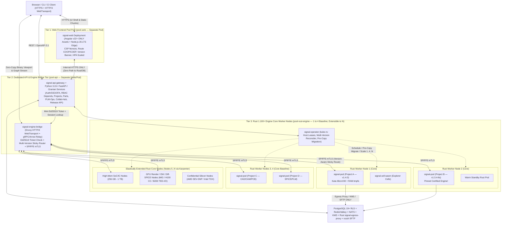
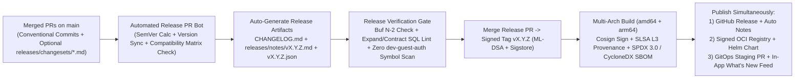
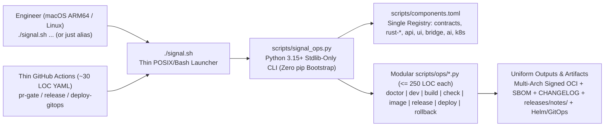

# 20 — Platform Version Management, Automated Releases, Monorepo Build/Deploy & 3-Tier Extensible K8s Topology

> **Scope:** Defines Signal's complete **Platform Version Management & Automated Release Notes pipeline**, **Monorepo-Native Default Build / Local Run / Deploy toolchain** (`justfile`, multi-arch Docker, Helm, Karpenter, GitOps), and hardened **3-Tier Kubernetes `1.37+` Pod & Extensible Worker Node Topology** separating the **Angular `v22+` + Node `26 LTS+` Web Pod**, the **Dedicated Python `3.15+` FastAPI API & Envoy Engine Bridge Tier**, and the **1–4 Baseline (Elastically Extensible to `N`) Rust `1.100+` Core Engine Kubernetes Worker Nodes**.

---

## 1. Architectural Analysis & Key Improvements

Carefully analyzing the separation of **Web (Angular `v22+` + Node `26 LTS+` edge)**, **Dedicated FastAPI + Envoy API Bridge**, and **1–4 Extensible Rust `1.100+` Engine Kubernetes Worker Nodes** alongside automated platform versioning reveals **7 subtle distributed-systems traps** that Signal resolves by design:

| # | Architectural Risk Analyzed | Signal's Hardened Architectural Solution |
|---|---|---|
| **1** | **Noisy-Neighbor Starvation:** Co-locating UI edge pods, API services, and heavy Rust SPICE/B-Rep/CAM pods causes CPU throttling & `OOMKill` cascades during simulations. | **3 Strict K8s `1.37+` Node Pools + Taints/Tolerations:** `pool-web` (Angular `v22+` + Node `26 LTS+` UI pod), `pool-api` (Dedicated Python `3.15+` FastAPI/Granian API + Envoy Bridge), and `pool-rust-engine` (`1–4` baseline extensible to `N`, Rust `1.100+`, tainted `signal.io/workload=rust-engine:NoSchedule`). |
| **2** | **API Bridge Becoming a 120 FPS Data Bottleneck or SPOF:** Routing raw 120 FPS pixel tiles/waveforms through a control-plane JSON proxy causes serialization jitter and disconnects all engineers on reboot. | **Dual-Path HA Dedicated API Tier (`pool-api`, `min 2` replicas in prod):** Stateless **Python `3.15+` FastAPI (`Granian 2.8+`, `Pydantic v2`) `signal-api-gateway`** handles REST/Auth/RBAC/Tickets/PLM/Collab while native **Envoy `signal-engine-bridge`** handles zero-copy HTTP/3 WebTransport/gRPC/Arrow streams over SPIFFE mTLS (`< 1 ms` overhead, `120 s` graceful drain). |
| **3** | **Single-Node (`1`) Deadlock vs Multi-Node (`2–4+`) Skew:** Strict anti-affinity deadlocks 1-node starter/local clusters, while unspread scheduling stacks pods onto Node 1 in 4-node clusters. | **Adaptive Topology Spread + Elastic Scale (`1 -> 4 -> N`):** `ScheduleAnyway` fallback when `nodeCount == 1`, strict spread when `nodeCount >= 2`; Karpenter auto-scales at `70%` RAM with eStargz/SOCI lazy pulls (`< 45 s` new node + `< 5 s` pod start) and **3-Phase Pre-Copy Live Migration (`< 150 ms`)**. |
| **4** | **Breaking "1 Project = 1 Security Cell" on `1–4` Worker Nodes:** Confusing "1–4 worker nodes" with sharing one Rust process across tenants would violate isolation. | **Worker Nodes Host Isolated Project Cells:** Each of the `1–4 -> N` Rust `1.100+` worker nodes schedules isolated per-project **`signal-pod` (Kata/gVisor MicroVMs)** or **`< 8 MB` `signal-cell-wasm`** cells—preserving dedicated DEKs, SPIFFE SVIDs, RAM-only `tmpfs`, and 100% Cilium lateral drop. |
| **5** | **Silent Physics Drift Breaking Certified Tape-Outs:** Auto-upgrading Rust pods overnight can shift floating-point sign-off hashes on frozen aerospace/medical projects. | **`physics_determinism_epoch` + Per-Project Engine Pinning:** Projects pin a certified `engine_version` in `.signal/platform.lock.json`; `signal-operator` & `signal-engine-bridge` run **Multi-Version Rust Pods simultaneously** across `1–4 -> N` nodes within an **`N-2` wire compatibility window**. |
| **6** | **Angular Chunk-Load Crash & DB Skew on Rolling Upgrade:** Replacing UI pods deletes lazy chunks needed by open tabs; dropping DB columns crashes draining API pods. | **3-Release Hashed Chunk Retention + Expand-and-Contract DB Migrations:** CDN/origin retains `N-3` hashed chunks (`72h`) with a non-disruptive **"Save & Reload"** banner; CI enforces Expand-and-Contract PostgreSQL `19+` migrations with pre-upgrade advisory-lock jobs. |
| **7** | **Dev-Flag Leak or Local-vs-Cloud Build Drift:** Monorepo default builds could ship `dev-guest-auth` or diverge between macOS ARM64 and Linux K8s. | **Single Root `justfile` + Pinned Toolchains + Release Binary Gate:** One monorepo command surface drives local dev, multi-arch Docker (`amd64`/`arm64`), and K8s Helm deploy; release CI runs symbol inspection (`dev-guest-auth` forbidden) + **Cosign + SLSA L3 + SBOM** enforced by Kyverno. |

---

## 2. 3-Tier Kubernetes `1.37+` Pod & Extensible Rust `1.100+` Engine Worker Node Topology

Signal enforces strict physical, network, and scheduling isolation across **three independent Kubernetes `1.37+` deployment tiers** (collapsing cleanly to 1 local `k3d`/`OrbStack` node for `just dev-k8s`, scaling from **1–4 Rust `1.100+` Engine Worker Nodes** out of the box, and extending elastically to **`N` General + High-Memory + GPU + Confidential Silicon Rust Core Nodes** with zero API or UI changes):



### 2.1 Zero-Trust Cilium eBPF 3-Tier Network Policy Matrix

| Source Pod / Tier | Allowed Destinations (Strict Allowlist) | Explicitly Denied (100% eBPF Drop) |
|---|---|---|
| **Tier 1: `signal-web` (Angular `v22+` + Node `26` Pod)** | `signal-api-gateway` (internal HTTPS/mTLS) ONLY | **Zero access** to `pool-rust-engine`, PostgreSQL `19+`, Redis, NATS, KMS, BYO-Git, or SFTP. |
| **Tier 2A: `signal-api-gateway` + FastAPI Services** | PostgreSQL `19+` (RLS), Redis/Valkey, NATS, `signal-operator`, Rust `signal-egress-proxy`, `ai/orchestrator`, Rust `signal-sftp-egress` | Never dials unauthenticated arbitrary IPs or bypasses `signal-egress-proxy`. |
| **Tier 2B: `signal-engine-bridge` (API-to-Rust Connector)** | Active `signal-pod` / `signal-cell-wasm` pods on `pool-rust-engine` (SPIFFE mTLS + valid Ed25519 ticket) + Redis read-only lease cache | Zero access to PostgreSQL, KMS secrets, or customer BYO-Git. |
| **Tier 3: `signal-pod` (Rust `1.100+` Worker Nodes `1..4..N`)** | Ingress ONLY from `signal-engine-bridge`; Egress ONLY to `signal-egress-proxy` (with `X-Signal-Fencing-Token`), KMS/Vault, scoped NATS, ephemeral Crash WAL, and `signal-sftp-egress` | **100% Pod ↔ Pod lateral traffic dropped** (even on the same Rust worker node!), zero direct internet egress, zero access to `signal-web` or Postgres. |

### 2.2 Extensible Rust Engine Core Node Profiles (`signal.io/pool=rust-engine`)

Extending Rust Core Engine capacity from **`1` → `4` → `N` worker nodes** requires **zero code or API redeployments**—simply label new Kubernetes nodes or adjust Karpenter/Helm `nodePool` limits:

| Node Profile Label (`signal.io/tier`) | Default Baseline | Extensible Scale (`max`) | Workload Placement (`ProjectSession` CRD) |
|---|---|---|---|
| **`core-standard`** | `1–4` Worker Nodes (`8–32 vCPU`, `32–128 GB RAM`) | Elastically extensible (`4 -> 500+` nodes) | Interactive Schematics, PCB, MCAD, CNC CAM, 3D Slicing, PLM, Quick SPICE (`< 25k` nodes), and `< 8 MB` `signal-cell-wasm` cells. |
| **`core-highmem`** *(optional extension)* | `0` (scale-from-zero) | Extensible (`0 -> 100+` nodes, `256 GB–1 TB RAM`) | Multi-billion-transistor IC/SoC layouts, huge 3D multi-board assemblies, full-chip DRC/LVS. |
| **`core-gpu`** *(optional extension)* | `0–1` (`L4`/`A100`/`H100`/`B200`) | Extensible (`0 -> 200+` GPU nodes) | Server-side Zero-Leak `wgpu` rendering, `cuDSS` GPU SPICE, Saltation-Adjoint sizing, 3D EM, PINN surrogates. |
| **`core-confidential`** *(optional extension)* | `0` (scale-from-zero) | Extensible (`SEV-SNP` / `TDX` + `H100 CC` / `B200 TEE-I/O`) | Defense, aerospace, and foundry `CONFIDENTIAL_SILICON` projects requiring hardware-attested encrypted RAM/VRAM. |

---

## 3. Complete Platform Version Management & Automated Release Notes

Every Signal release is **monorepo-coordinated, cryptographically signed, wire-compatibility-verified, and automatically documented**—with zero manual changelog editing:



### 3.1 Canonical Versioning & Compatibility Governance (`VERSION` + `releases/`)
- **Single Platform Version (`VERSION`):** Strict SemVer `MAJOR.MINOR.PATCH` (plus `-rc.N` pre-releases and `-lts` long-term support branches for enterprise hardware sign-offs). Automated tooling synchronizes `VERSION` into `engine/Cargo.toml` (`workspace.package.version`), `web/package.json`, root `pyproject.toml` (Python `3.15+` `services/` + `ai/` workspace), and `infra/k8s/helm/signal/Chart.yaml`.
- **Machine-Readable Compatibility Matrix (`releases/compatibility.json`):** Every release embeds:
  - `platform_version` & `released_at_utc`
  - `contract_api_version` (`signal/v1`, enforced by `buf breaking --against` across `N-2` minor versions)
  - `supported_engine_versions` (e.g., `["1.2.x", "1.3.x", "1.4.x"]` — guaranteeing the API Bridge & Angular UI work seamlessly with pinned LTS Rust pods!)
  - `physics_determinism_epoch` (monotonically incremented whenever solver math, BSIM models, DRC predicates, or CAM/slicer tolerances change, triggering prominent Release Note alerts & pre-upgrade regression diff gates!)
  - `file_format_version` & `schema_migration_head` (strict Expand-and-Contract zero-downtime Postgres `19+` migration bounds)
  - `artifacts`: immutable `sha256` OCI image digests for `signal-web`, `signal-api`, `signal-engine-bridge`, `signal-pod`, `signal-operator`, `signal-egress-proxy`, `signal-sftp-egress`, and `signal-ai-*`.
- **Per-Project Engine Pinning (`<project>-meta/.signal/platform.lock.json`):** Enterprise projects can subscribe to `STABLE`, `LTS`, or **pin an exact certified `signal-pod` version + `sha256` digest** so tape-out proof hashes never drift; `signal-operator` pulls and runs the pinned digest on `pool-rust-engine` while `signal-engine-bridge` routes seamlessly!

### 3.2 Automated Release Notes & In-App "What's New" System
- **Strict PR Metadata (`commitlint` CI gate):** Every commit uses Conventional Commits (`feat(pcb):`, `feat(mcad):`, `fix(sim):`, `perf(render):`, `sec(auth):`, `ops(k8s):`, `feat(contracts)!:`); major features may also add a concise Markdown snippet in `releases/changesets/<pr>.md`.
- **Automatic Structured Categorization:** On every release, Signal's release compiler produces **both** human-readable **`releases/notes/vX.Y.Z.md`** (appended to root **`CHANGELOG.md`** and published verbatim to **GitHub Releases**) **and** structured **`releases/notes/vX.Y.Z.json`** grouped cleanly into:
  1. **Highlights & New Features** (ECAD / IC / CAD-CAM / 3D-Print / PLM-Ops / Collab / AI)
  2. **Physics & Solver Determinism Notice** (flags `physics_determinism_epoch` changes & regression impact)
  3. **API, Contract & File-Format Migration Notes** (zero-downtime upgrade guidance)
  4. **Security & Compliance Fixes** (CVEs, ASVS/PQC updates, SBOM link)
  5. **Verified OCI Image Digests & Rollback Command** (`helm rollback` / GitOps revert hash)
- **Built-In In-App Release Feed:** `GET /api/v1/platform/releases` serves `releases/notes/*.json` to the Angular `v22+` IDE, showing a subtle version badge (`v1.4.0`), role-filtered **"What's New"** drawer, and non-disruptive **"New Version Ready — Save & Reload"** prompt when `X-Signal-Web-Version` advances!

---

## 4. Unified Common Build, CI/CD, Release & Deploy CLI (`./signal.sh` + `scripts/signal_ops.py`)

For a **small engineering team** maintaining Rust `1.100+` pods, Python `3.15+` FastAPI APIs, Angular `v22+` UI, AI services, Envoy bridges, and 3-tier Kubernetes `1.37+` manifests, duplicating build/deploy logic across CI YAML files, Makefiles, and per-service scripts creates brittle release toil. Signal standardizes **100% of build, test, image, release, deploy, and rollback operations** behind **ONE single monorepo executable**—run identically on developer laptops AND in CI/CD:



### 4.1 Why `./signal.sh` (Bash Shim) + `scripts/signal_ops.py` (Stdlib Python `3.15+`) + `components.toml`
- **Local == CI (Zero YAML Script Drift):** `.github/workflows/{pr-gate,release,deploy-gitops}.yml` remain tiny (`~25–45 LOC`) declarative triggers that ONLY invoke `./signal.sh <verb> --json`. Any CI failure reproduces locally in one command—never debug buried GitHub Actions shell scripts.
- **Zero Bootstrap Dependencies & Cross-OS Parity:** `scripts/signal_ops.py` and `scripts/ops/*.py` use **Python `3.15+` standard library ONLY** (`tomllib`, `argparse`, `subprocess`, `json`, `hashlib`, `concurrent.futures`)—zero `pip install` needed to run CI/CD, eliminating macOS BSD vs. Linux GNU `sed`/`date`/`sha256sum` incompatibilities while reusing the exact Python `3.15+` toolchain the team already maintains.
- **Single Declarative Component Registry (`scripts/components.toml`):** Every buildable and deployable Signal unit (`contracts`, `rust-pod`, `rust-operator`, `rust-egress-proxy`, `rust-sftp-egress`, `rust-cell-wasm`, `api`, `ui`, `bridge`, `ai`, `k8s`) is declared in ONE TOML manifest (path, K8s tier, Dockerfile, build/check commands, OCI image name, dependency order). Adding a future service or Rust binary requires **one 6-line `[[component]]` stanza**—`build`, `check`, multi-arch `image`, Cosign/SBOM signing, `releases/manifest.json` digest pinning, `deploy`, and `rollback` include it automatically!
- **Optional `justfile` Convenience Wrapper:** Root `justfile` stays a 1-line-per-recipe alias delegating 100% to `./signal.sh` (`just build` → `./signal.sh build`) so CI containers and minimal shells never require `just` installed.
- **Small-Team Safety Guardrails:** Global `--dry-run`, `--json` (GitHub Actions Step Summaries), and `--changed` (git-diff impacted-only PR builds) flags on all verbs; enforces clean working tree + signed tag before `--env staging|prod`; masks secrets; and unit-tests every ops module under `scripts/tests/` via `pytest` + `ruff` + `pyright --strict` + `bandit`.

### 4.2 Unified Command Surface (`./signal.sh <verb>` — `just <verb>` Aliases Identical)

| Command (`./signal.sh ...`) | What It Runs Uniformly Across Rust Engine, FastAPI API, Angular UI, AI & K8s |
|---|---|
| **`./signal.sh doctor`** | Verifies Nov 2026 toolchain minimums (`rustc >= 1.100`, `node >= 26`, `pnpm >= 11`, `python3 >= 3.15`, `uv`, `buf`, `docker`, `helm`, `cosign`) and prints exact 1-line remediation if missing. |
| **`./signal.sh dev [lite\|full\|k8s]`** | Starts local dev stack on macOS/Linux: auto-detects host RAM (`lite` `< 1.5 GB RAM` / `full` ARM64 Compose) or deploys exact 3-tier local K8s (`k8s` via `values-local.yaml`) with `Guest @ Signal Design, Inc.` & local Ollama/MLX (`deterministic_mock` fallback). |
| **`./signal.sh build [--target all\|<comp,...>] [--changed]`** | Deterministic topological build with unified `SIGNAL_VERSION` & `SIGNAL_GIT_SHA`: `contracts` (`buf` + `signal-proto` + Python + TS `bigint`) → `rust-*` (`cargo build`) → `api`/`ai` (`uv sync`) → `ui` (`pnpm build`). `--changed` scopes PR CI to modified components + dependents. |
| **`./signal.sh check [--target all\|<comp,...>] [--changed]`** | Single Definition-of-Done PR & release gate: `buf lint/breaking`, `contracts/fixtures` + `transcripts`, Rust `fmt`/`clippy -D warnings`/`nextest`/`cargo deny`/`cargo vet`, Python `uv run ruff`/`pyright`/`pytest`/`bandit`/`pip-audit` (including `scripts/`), Angular `pnpm lint`/`typecheck`/`vitest`/`pnpm audit --ignore-scripts`, Helm `lint` + `kubeconform`, and `dev-guest-auth` release symbol scan. |
| **`./signal.sh image [--target all\|<comp,...>] [--arch amd64,arm64] [--push] [--sign]`** | Builds deterministic multi-arch OCI images from `scripts/components.toml` (`cargo-chef` + `uv` + `pnpm deploy`, forbidding `dev-guest-auth`), attaches **Cosign signature + SLSA L3 provenance + SPDX 3.0 / CycloneDX SBOM**, and writes immutable `sha256` digests to `releases/manifest.json`. |
| **`./signal.sh release <preview\|cut\|publish> [--bump auto\|patch\|minor\|major] [--physics-epoch-bump]`** | One-command small-team release lifecycle: calculates SemVer from Conventional Commits + `releases/changesets/*.md`, syncs `VERSION` into `Cargo.toml`, `pyproject.toml`, `web/package.json`, `Chart.yaml`, verifies `N-2` Buf wire window & Expand-and-Contract SQL, generates `CHANGELOG.md` + `releases/notes/vX.Y.Z.{md,json}` + `releases/compatibility.json`, signs tag `vX.Y.Z`, and publishes GitHub Release. |
| **`./signal.sh deploy --env <local\|dev\|staging\|prod> [--version vX.Y.Z] [--dry-run]`** | Verifies signed `sha256` digests in `releases/manifest.json` + clean git state, runs pre-upgrade PostgreSQL `19+` Expand-and-Contract migration check, applies Helm (`local`/`dev`) or updates digest-pinned GitOps overlay (`staging`/`prod` → **ArgoCD + Argo Rollouts** canary `10% -> 50% -> 100%` with auto SLO rollback), and confirms readiness across `pool-web`, `pool-api`, and `pool-rust-engine`. |
| **`./signal.sh rollback --env <local\|dev\|staging\|prod> [--to vX.Y.Z]`** | Instant 1-command safe rollback to a prior verified release manifest (`N-2` wire-safe + `N-3` UI chunk-safe) with automated post-rollback health probes—zero panic `helm`/`git` guesswork during incidents. |

### 4.3 Default Monorepo Build, Script, Release & Deploy Layout

```text
signal/
├── VERSION                         # Canonical platform SemVer (synced to Cargo, pyproject.toml, web/package.json, Helm)
├── CHANGELOG.md                    # Auto-maintained chronological release changelog
├── signal.sh                       # Thin POSIX/Bash entrypoint (calls scripts/signal_ops.py — Local == CI!)
├── justfile                        # Optional developer alias wrapper (1-line delegation to ./signal.sh)
├── rust-toolchain.toml / .nvmrc / .python-version # Pinned Rust 1.100+, Node.js 26 LTS+, Python 3.15+ toolchains
├── scripts/                        # Unified Build, Check, Image, Release, Deploy & Rollback Engine (Python 3.15+ stdlib)
│   ├── components.toml             # Single declarative registry for ALL components (contracts, rust-*, api, ui, bridge, ai, k8s)
│   ├── signal_ops.py               # CLI router (--target, --changed, --dry-run, --json, --env)
│   ├── ops/                        # Modular ops units (<= 250 LOC each; zero third-party deps)
│   │   ├── registry.py             # Loads components.toml, resolves dependency DAG & git --changed impact graph
│   │   ├── doctor.py               # Verifies pinned Nov 2026 toolchains & local/CI prerequisites
│   │   ├── dev.py                  # Launches dev:lite, dev:full, or dev:k8s cleanly on macOS & Linux
│   │   ├── build.py                # Topological build (contracts -> rust -> api/ai -> ui) with uniform VERSION/SHA
│   │   ├── check.py                # Unified DoD lint/typecheck/test/audit/helm/dev-guest-auth symbol verification
│   │   ├── image.py                # Multi-arch Buildx + Cosign + SLSA L3 + SBOM + releases/manifest.json digest writer
│   │   ├── release.py              # SemVer calc, VERSION sync, N-2/SQL check, CHANGELOG + releases/notes/ + tag publish
│   │   ├── deploy.py               # Verified digest deploy (Helm local/dev, GitOps Argo Rollouts staging/prod + readiness)
│   │   └── rollback.py             # Safe 1-command rollback to verified prior release manifest + health check
│   └── tests/                      # Unit & dry-run contract tests (pytest scripts/tests/)
├── .github/workflows/              # Thin (~25-45 LOC) declarative triggers calling ONLY ./signal.sh!
│   ├── pr-gate.yml                 # Runs: ./signal.sh check --changed --json (plus lavapipe WGSL parity)
│   ├── release.yml                 # Runs: ./signal.sh release cut && ./signal.sh image --push --sign && ./signal.sh release publish
│   └── deploy-gitops.yml           # Runs: ./signal.sh deploy --env <staging|prod> --version <tag> --json
├── releases/
│   ├── manifest.json               # Current release metadata, SBOM URIs & immutable OCI image digests
│   ├── compatibility.json          # N-2 Web/API/Rust/Contract matrix + physics_determinism_epoch
│   ├── changesets/                 # Optional human-curated highlight snippets consumed during release
│   └── notes/                      # Auto-generated immutable vX.Y.Z.md + vX.Y.Z.json (served to Angular IDE)
└── infra/
    ├── docker/                     # Multi-arch reproducible Dockerfiles (web, api, engine-bridge, rust-pod, operator, ai)
    ├── local/                      # Default local dev harness (dev:lite, dev:full, dev:k8s, MockGit, MockSFTP, DevKMS)
    ├── k8s/
    │   ├── helm/signal/            # Unified Umbrella Helm Chart (web, api-bridge, rust-engine, ai, data)
    │   │   ├── values.yaml         # Base defaults (separate web pod, separate api bridge, 1-4 extensible Rust nodes)
    │   │   ├── values-local.yaml   # Single-host k3d/OrbStack local K8s parity
    │   │   ├── values-starter.yaml # Starter Production: HA Web + HA API Bridge + 1-4 Rust Core Worker Nodes
    │   │   └── values-enterprise.yaml # Enterprise: N extensible Rust CPU/HighMem/GPU/Confidential nodes + SEV-SNP
    │   ├── karpenter/              # Declarative extensible NodePools (core-standard, core-highmem, core-gpu, core-confidential)
    │   ├── policies/               # Cilium 3-tier eBPF policies, Kyverno Cosign/SBOM/non-root gates, Kata RuntimeClass
    │   └── gitops/overlays/        # ArgoCD / Argo Rollouts declarative overlays (dev, staging, prod-us, prod-eu)
    ├── terraform/                  # Reproducible 3-pool K8s cluster bootstrap (pool-web, pool-api, pool-rust-engine)
    └── campus-edge/                # Air-gapped / university appliance bundle
```

---

## 5. Contracts & Cross-Lane Rollout Integration

- **Canonical Contracts (`contracts/` — Spec `10`):**
  - `contracts/proto/signal/v1/platform_release.proto` (`PlatformReleaseService`: `GetPlatformVersion`, `NegotiateEngineCompatibility`, `ListReleaseNotes`, `RunPreUpgradeRegressionCheck`) + `contracts/schemas/release-manifest.schema.json` + `contracts/schemas/platform-lockfile.schema.json`.
- **Dual-Lane Phase 0 Ownership (Zero Conflicts):**
  - **Shared Governed Zone (`contract/*`):** `VERSION`, `signal.sh`, `scripts/**`, `justfile`, `.github/workflows/`, `releases/`, `contracts/proto/signal/v1/platform_release.proto`, `infra/local/**`.
  - **Lane A — Antigravity (`ag/*`):** `infra/docker/Dockerfile.{rust-pod,operator,bridge}`, `infra/k8s/**` (Umbrella Helm chart, 3-tier Cilium policies, Karpenter extensible Rust `NodePool`s, Kyverno Cosign/SBOM gates), and `signal-operator` multi-version reconciler.
  - **Lane B — Cursor (`cursor/*`):** `infra/docker/Dockerfile.{web,api}`, `services/api-gateway` version-skew + `GET /api/v1/platform/releases` endpoint, and Angular **"What's New"** drawer + non-disruptive reload toast.
