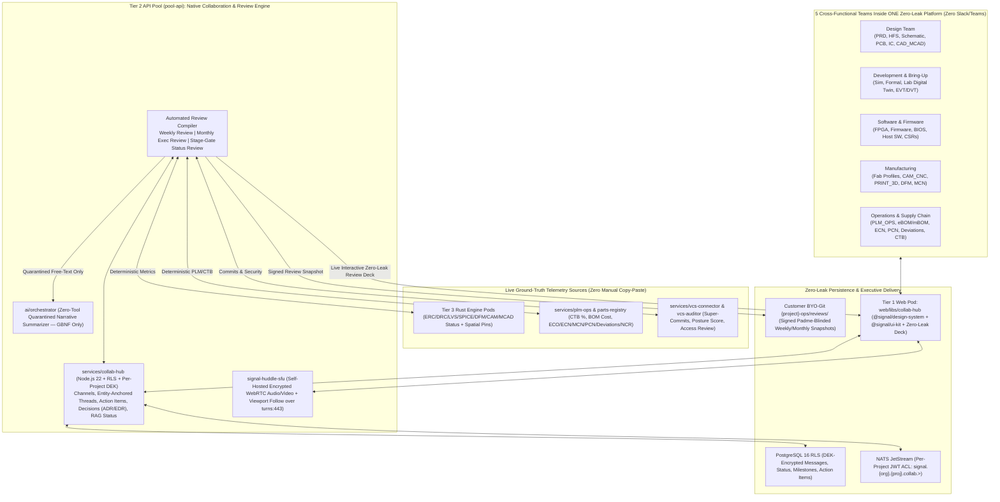

# 21 — Unified Cross-Team Collaboration Space, Project Status & Automated Review Engine

> **Scope:** Defines Signal's built-in, Zero-Leak **Cross-Functional Collaboration Space** uniting **Design, Development/Bring-Up, Software/Firmware, Manufacturing, and Operations/Supply-Chain** teams inside the platform itself—alongside live **Project Status & Milestone Governance** and automated **Weekly Review, Monthly Executive Review, and Stage-Gate Project Status Review** generation, eliminating disconnected, IP-leaking external tools (Slack, Microsoft Teams, ad-hoc status spreadsheets, and manual slide decks).

---

## 1. Architectural Vision: One Zero-Leak Company Hub From Schematic to Factory Floor

Hardware companies lose massive velocity—and constantly leak crown-jewel IP—when teams coordinate across **Microsoft Teams, Slack, email, Jira, and manual PowerPoint status decks**:
1. Engineers paste unwatermarked screenshots of schematics, PCB layouts, BOM pricing, and vendor errata into third-party chat SaaS, shattering Zero-Leak DLP.
2. Design, Software, Manufacturing, and Operations fall out of sync (e.g., a connector pinout or enclosure rib shifts in CAD while firmware and factory teams keep working from last week's chat thread).
3. Tech leads and program managers waste hours every Friday and month-end manually copy-pasting DRC counts, BOM shortages, and milestone RAG statuses into slide decks that are stale the moment they are presented.

**Signal embeds the entire company's hardware collaboration, status tracking, and executive review cadence directly into the encrypted platform:**
- **Zero External Chat / Status Tools Needed:** Channels, threaded discussions, `@entity` live links, encrypted voice/video/viewport huddles, action items, blockers, and decisions live natively inside each Signal Project and Organization Portfolio.
- **100% Live Ground-Truth Status & Automated Reviews:** Weekly Reviews, Monthly Executive Reviews, and Milestone Status Reviews compile **deterministically** from live Rust engine verification metrics, BYO-Git `Super-Commit`s, PLM `ECO`/`ECN`/`MCN`/`PCN`/`Deviation`/`CTB` ledgers, and action-item boards—with quarantined AI synthesis for concise executive narratives!
- **Zero-Leak & Per-Repo RBAC Enforced Everywhere:** Chat, huddles, and generated reviews obey Signal's exact **Provider-Synced Per-Repo RBAC (`REPO_ACCESS_ENTRY`)**, **Hybrid PQC per-project DEK encryption**, **PostgreSQL RLS (`NOBYPASSRLS`)**, and **Zero-Download DLP**!

---

## 2. Cross-Team Collaboration Space (`services/collab-hub` + `web/libs/collab-hub`)

Every Signal Project and Organization ships with a structured, distraction-free collaboration workspace tailored specifically to hardware product execution:

### 2.1 Scoped Cross-Functional Channels & Entity-Anchored Threads
- **Auto-Provisioned Project Channels (RBAC-Bound to Repo Scopes):**
  - `#project-status` — Milestones, RAG health changes, cross-team blockers, and published Weekly/Monthly Reviews.
  - `#design-ecad-mcad` — Schematic, PCB, IC, and parametric `CAD_MCAD` enclosure/thermal collaboration.
  - `#dev-bringup-sim` — SPICE/Formal/3D-EM verification, EVT/DVT lab bring-up, and `signal-twin` oscilloscope captures.
  - `#software-firmware` — FPGA RTL, embedded firmware, BIOS/UEFI, register map (`SystemRDL`) and pinmux handoffs.
  - `#manufacturing-cam-fab` — Fab capability profiles, `CAM_CNC` fixtures/toolpaths, `PRINT_3D` plates, DFM/panelization, and `MCN` factory cut-ins.
  - `#ops-plm-supply` — `eBOM`/`mBOM`, `ECO`/`ECN`, vendor `PCN`/EOL rescues, `Deviation`/`Waiver` triage, `NCR`/`CAPA`, and `CTB` shortages.
  - `#ccb-approvals` — Formal Change Control Board sign-offs, 4-eyes checks, and 2FA release readiness threads.
- **Organization Portfolio Channels (`/org/:org_slug/collab`):** Cross-project functional hubs (e.g., `#org-supply-chain`, `#org-dfm-standards`, `#org-exec-reviews`) enforcing strict per-viewer project visibility intersection so engineers never see unauthorized project names or KPIs!
- **Live `@entity` Anchors (Zero Static IP Screenshots!):**
  - Messages embed typed deep-links directly to live Signal graph objects: `@req:REQ-042`, `@net:VDD_3V3`, `@comp:U14`, `@pcb:L3(12400000nm,45100000nm)`, `@cad:housing.boss_2`, `@cam:setup1.op4`, `@ecn:ECN-019`, `@pcn:PCN-008`, `@bom:U14`, `@commit:SuperCommit#9a4f`.
  - Clicking an anchor opens the exact layer, 3D camera angle, simulation cursor, or ECN diff side-by-side inside the IDE.
  - **Spatial Canvas Thread Sync:** Every spatial pin placed on a Schematic, PCB, IC, or 3D CAD viewport (`libs/review`) automatically creates/mirrors a synchronized thread inside `#design-ecad-mcad` or `#manufacturing-cam-fab` with zero duplicate tracking!

### 2.2 Built-In Zero-Leak Audio/Video Huddles & Synchronized Viewport Follow
- **Self-Hosted Encrypted WebRTC SFU (`signal-huddle-sfu`):** Runs inside Signal's jurisdiction-pinned cluster over `turns:443` / UDP with DTLS-SRTP media encryption—eliminating Microsoft Teams/Zoom links!
- **"Follow My Viewport" Over Raw OS Screen-Share:** Inside a huddle, clicking **Present Viewport** streams the presenter's camera matrix, active layer/cross-section plane, and laser pointer directly to participants' own Zero-Leak viewports (preserving each viewer's individual Tardos/Constellation watermark and per-repo RBAC masking—never broadcasting unwatermarked screens!).
- **Action-Item & Decision Capture:** One-click **"Convert Message to Action Item"**, **"Escalate to Blocker"**, **"Record Decision (`EDR`)"**, or **"Spawn `ECR`/`ECO`/`MCN`"** directly from any chat message, preserving cryptographic links back to the originating discussion!

---

## 3. Native Project Status, Stage-Gate Control Tower & Execution Tracking

Signal maintains complete program status directly inside each Project and rolls it up across the Organization Portfolio—replacing Jira status boards, Smartsheet trackers, and manual Excel sheets:

| Status Artifact | Native Fields & Platform Automation |
|---|---|
| **Project Stage-Gate & RAG Health** | Current lifecycle phase (`CONCEPT` → `ARCH` → `EVT` → `DVT` → `PVT` → `MP` → `SUSTAINING`), overall + per-team RAG health (`GREEN` \| `AMBER` \| `RED` — requiring explicit blocker link + mitigation owner whenever `AMBER`/`RED`!), target tape-out / MP dates, and schedule variance (`days_delta`). |
| **Live Engineering & Ops Scorecard (Auto-Computed)** | Zero manual data entry: pulls real-time counts from Rust Pods, `plm-ops`, `parts-registry`, and `vcs-auditor`: `REQ` verified %, open ERC/DRC/LVS/Creepage/DFM/CAM violations, simulation/formal pass %, firmware/pinmux sync status, sBOM CVE posture, `CTB %` for next build, rolled-up BOM unit cost vs. target, open `ECO`/`ECN`/`MCN`/`PCN`/`NCR` counts, active `Deviation` expiry alerts, and Security Posture Score (`0–100`). |
| **Cross-Team Dependencies & Blockers** | Typed producer→consumer handoff links across the 5 teams (e.g., `Design: Freeze PCB Connector Outline` → `Manufacturing: Release CNC Enclosure Toolpath`; `Design: Finalize Pinmux` → `Software: Ship EVT Bring-Up Firmware`) with automatic slip propagation warnings! |
| **Action Items & Escalations** | Lightweight, engineering-native tasks (`owner_user_id`, `team_discipline`, `priority`, `due_at_utc`, `linked_entity_ref`, `status: OPEN \| IN_PROGRESS \| BLOCKED \| DONE`) with automated overdue nudges inside `#project-status`—no separate ticketing tool needed! |
| **Engineering Decision Log (`ADR` / `EDR`)** | Immutable decision register recording major technical/commercial calls (`context`, `options_considered`, `decision`, `approvers`, linked `Super-Commit` / `ECO` / proof bundle) so new team members never re-litigate closed choices. |

---

## 4. Direct Automated Review Generation (Weekly, Monthly & Project Status Reviews)

Signal **directly generates, renders, snapshots, and signs** all recurring company reviews straight from live platform state—turning a 4-hour Friday/month-end manual slide-deck chore into a **10-second verified review**:

| Review Cadence / Type | Trigger & Audience | Auto-Generated Sections (100% Ground-Truth Backed) |
|---|---|---|
| **1. Weekly Cross-Team Engineering Review (`WEEKLY_REVIEW`)** | Scheduled weekly (e.g., Fri 16:00 org TZ) or 1-click on-demand; Design, Dev, SW, Mfg & Ops leads. | **(a)** Overall & per-team RAG health delta vs. prior week; **(b)** Completed milestones & merged `Super-Commit` highlights across ECAD, MCAD, CAM, 3D-Print, FW & PLM; **(c)** Live DRC/ERC/Sim/DFM/CTB week-over-week trend sparklines; **(d)** Newly opened & resolved `ECO`/`ECN`/`MCN`/`PCN`/`Deviation`/`NCR` items; **(e)** Cross-team blockers, slipped dependencies & overdue Action Items; **(f)** Next-week committed deliverables. |
| **2. Monthly Executive & Operations Review (`MONTHLY_REVIEW`)** | Scheduled 1st business day of month or on-demand; VP Eng, COO, CFO, Operations & Program Directors. | **(a)** 30-day Portfolio RAG & Milestone Burn-Up across all authorized Org projects; **(b)** BOM Should-Cost & Embodied Carbon ($\text{kgCO}_2\text{e}$) trajectory vs. target; **(c)** Supply-Chain `CTB %`, Long-Lead Critical Path & Vendor `PCN`/EOL Risk Heatmap; **(d)** Manufacturing Yield, `NCR`/`CAPA` Pareto & `MCN` stability; **(e)** Security & Compliance Posture (`vcs-auditor` trend, Access Review attestations); **(f)** Cloud FinOps Compute Spend (`FEAT-116`) & cross-project Portfolio DAG risks (`FEAT-118`). |
| **3. Project Status / Stage-Gate Review (`PROJECT_STATUS_REVIEW`)** | On-demand or before Phase-Gate exit (`EVT`/`DVT`/`PVT`/`Tape-Out`/`MP`); CCB, Program Leads, Exec Sponsors & (optional) Zero-Leak External Customers (`FEAT-119`). | **(a)** Interactive **Zero-Leak Live Review Deck** (`FEAT-109`) embedding live zoomable 2D/3D CAD/PCB views & waveforms; **(b)** Automated **Exit-Criteria Gate Checklist** (`100%` `REQ` traced, `0` critical DRC/LVS/SOA, `CTB >= 98%`, `0` expired `Deviation`s, `Access Review` attested); **(c)** Immutable Proof Bundle digests; **(d)** Live **CCB / Exec Sign-Off Panel** recording Step-Up 2FA `ML-DSA-65 + Ed25519` gate approval! |

### 4.1 Deterministic Telemetry + Quarantined AI Narrative Compilation (Zero Hallucinated Metrics!)
1. **100% Deterministic Numeric Metrics:** Every number, percentage, cost, violation count, commit count, and schedule variance is computed **strictly via deterministic SQL/Rust queries** (`services/collab-hub` + `services/plm-ops` + `signal-pod` snapshots)—an LLM is **NEVER** allowed to calculate or fabricate review metrics!
2. **Quarantined Narrative Synthesis (Prompt-Injection Safe):** Optional executive bullet summaries of free-text chat threads and blockers run strictly through Signal's **Zero-Tool Quarantine LLM (`GBNF` structured JSON output)** with clickable citations back to the exact message ID / `Super-Commit` / `ECO`—so an adversarial comment can never hijack tools or invent false status claims.
3. **Immutable Signed Archival in Customer BYO-Git:** Finalized reviews commit as immutable signed JSON + Markdown records into `<project>-ops/reviews/{weekly,monthly,status}/<period>.sig.json` (Padmé-blinded `AES-256-GCM-SIV` in `ENCRYPTED_VAULT`)—providing a permanent, auditable history of every Weekly, Monthly, and Stage-Gate review with **zero external file downloads** (official archival sharing to external board/customer SFTP runs exclusively via Step-Up 2FA write-only `russh` SFTP!).

---

## 5. Security, Per-Repo RBAC Isolation & 3-Tier K8s Architecture

| Architectural Layer | Exact Security & Isolation Design (Zero Slack-Style Leaks!) |
|---|---|
| **3-Tier K8s Placement (`20-*`)** | **`services/collab-hub`** (stateless Node.js 22) and **`signal-huddle-sfu`** (encrypted WebRTC media relay) run in **Tier 2 (`pool-api`)**—keeping **Tier 3 Rust Engine Worker Nodes (`pool-rust-engine`, `1–4 -> N`)** 100% focused on physics/CAD compute with zero chat load. |
| **Per-Project Encryption & RLS** | Every message body, thread reply, decision note, and review narrative is encrypted with the **Project's Hybrid PQC-wrapped DEK** (`HKDF` subkey `collab-v1`) and stored in **PostgreSQL 16 with mandatory RLS (`NOBYPASSRLS`)**. Real-time fan-out uses per-project **NATS JetStream JWT/NKey ACL subjects (`signal.{org}.{proj}.collab.>`)**. |
| **Per-Repo RBAC Masking (Zero Privilege Escalation!)** | Every channel, `@entity` anchor, and review section declares `required_repo_scopes[]` (e.g., `#software-firmware` requires read access on `<project>-firmware` or `<project>-fpga`). Checked live against `REPO_ACCESS_ENTRY` (uniform `404` for unauthorized projects; `[Restricted]` redaction for out-of-scope sub-project anchors—so a PCB contractor NEVER reads IC/BIOS chat or executive BOM margins!). |
| **Zero Raw File Uploads / Downloads in Chat** | Chat strictly forbids arbitrary binary file upload/download attachments that bypass DLP; engineers link canonical BYO-Git entities, `signal-parts` components, or watermarked Zero-Leak viewport snapshots. Copy/paste honors Signal's **Encrypted Cloud Clipboard**. |
| **Fail-Closed Tier-0 Audit** | Executive Stage-Gate Sign-Offs (`PROJECT_STATUS_REVIEW` exit approvals), channel RBAC policy edits, and external review link grants commit synchronously to the **3x Quorum Tier-0 Audit Outbox** (`503` fail-closed if unavailable) → pseudonymous RFC-3161 WORM Merkle ledger! |

---

## 6. Contracts, Clean Angular UI & Dual-Lane Implementation Map

| Layer | Modules & Contracts Added | Governing Standards |
|---|---|---|
| **Canonical Contracts (`contracts/`)** | `contracts/proto/signal/v1/collab_review.proto` (`CollabReviewService`: `PostAnchoredMessage`, `StartHuddleSession`, `UpsertProjectStatus`, `GeneratePeriodicReview`, `SignOffStageGateReview`), OpenAPI `/v1/orgs/{org_slug}/collab/*` & `/v1/orgs/{org_slug}/projects/{id}/reviews/*`, plus `project-status-review.schema.json` & `collab-channel-policy.schema.json`. | SI suffixes, ES2020 `bigint` (`[jstype = JS_STRING]`), `Idempotency-Key`, zero `/export` or `/download` routes (`10-*`). |
| **Node.js Control Plane (`services/`)** | **`services/collab-hub`** (stateless Node.js 22 service in `pool-api`: channels, entity-anchored threads, action items, decision log, live RAG status aggregator, deterministic Weekly/Monthly/Status review generator, and `signal-huddle-sfu` token broker). | `@Require*` uniform-`404`, `withRlsTx` (`NOBYPASSRLS`), Step-Up 2FA for Stage-Gate approvals, Fail-Closed 3x Quorum Audit Outbox (`06-*`, `15-*`). |
| **Angular Frontend (`web/libs/collab-hub`)** | Lazy-loaded 23rd workbench (`web/libs/collab-hub/`) hosting Team Channels, Entity-Anchored Thread Drawer, Encrypted Huddle Bar, Program Status Control Tower, Cross-Team Dependency Board, Action Items / Decision Log, and Interactive **Weekly / Monthly / Project Status Review Studio**! | Strictly follows [`ANGULAR_UI_STYLE_GUIDE.md`](../docs/engineering/ANGULAR_UI_STYLE_GUIDE.md): separate `.component.ts` / `.component.html` (`<= 150 LOC`, max nesting `<= 2`, zero `@if`-soup) / `.logic.ts` / `.model.ts`, using ONLY centralized `@signal/design-system` & `@signal/ui-kit` components (`sig-panel`, `sig-card`, `sig-data-grid`, `sig-status-pill`, `sig-stepper-timeline`) with ZERO per-component CSS! |
| **Rust Engine Integration (`engine/`)** | Lightweight read-only telemetry hooks (`signal-pod` / `signal-plm` / `signal-graph` spatial-pin bridge) feeding exact ERC/DRC/LVS/SPICE/MCAD/CAM/BOM metrics into `ReviewCompiler` and syncing viewport camera pointers during Huddles. | `#![forbid(unsafe_code)]`, read-only ECS snapshots, zero chat traffic inside physics threads (`03-*`, `19-*`). |
