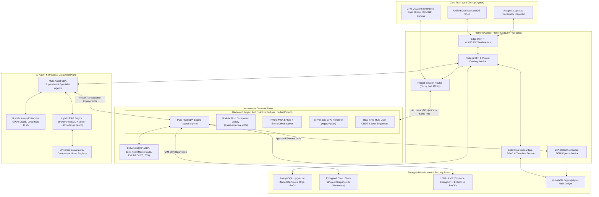

# Signal — Master Architecture Index

**Project Name:** Signal  
**Default Development Organization:** Signal Design, Inc.  
**Status:** Complete Architecture & Blueprint (Pre-Implementation)  
**Primary Stack:** Pure Rust Core Engine (Kubernetes Stateful Pods) • Node.js Control Plane & BFF • Angular Web Platform • GPU-Accelerated Rendering, Simulation & AI Agents  

---

## 1. Executive Vision

**Signal** is a ground-up reimagining of Electronic Design Automation (EDA) for the AI era.

Legacy EDA suites suffer from four structural failures:
1. **Fragmentation:** Hardware companies split Product Requirements (PRD), Hardware Functional Specifications (HFS), Schematics, PCBs, ICs/ASICs, FPGAs, Embedded Firmware, BIOS/UEFI, and verification artifacts across 6–12 disconnected tools with broken traceability.
2. **Local-File IP Leakage:** Design files live on engineer laptops, enabling accidental leaks, unauthorized exports, version drift, and painful IT licensing.
3. **Opaque, Bolt-On Automation:** Traditional solvers and CAD tools are 30-year-old monoliths where AI is bolted on as a shallow chat widget rather than deeply integrated into the physics and layout core.
4. **Black-Box Component Models:** Component behavior, tolerances, parasitics, thermal stress, and datasheet constraints are scattered across fragile SPICE text decks and static PDFs.

**Signal solves all four simultaneously:**
- **Unified Single-Application Engineering Graph:** One cloud platform and one versioned project graph uniting PRD, HFS, Schematics, PCB, IC/Chip, Packaging, FPGA, Firmware, BIOS, Software, Verification, and Manufacturing.
- **Zero-Trust Cloud-Only IP Protection:** Zero local design files, full envelope encryption at rest and in transit, no download/export/print/screenshot workflows, and **2FA-gated Authorized SFTP** as the sole manufacturing/sharing egress channel.
- **Modular Pure-Rust Core Engine in Kubernetes:** Every passive and active electronic component is a first-class, composable **Rust module** with typed ports, tolerances, parasitics, thermal models, and stress limits—executed inside a dedicated Kubernetes pod per active project, with deterministic sticky routing so multiple collaborators and AI agents operate live on the exact same engine instance.
- **AI-Agent-First Engineering + Universal Datasheet RAG:** Autonomous multi-agent workflows grounded in a continuously curated Universal Datasheet Database (Hybrid RAG) and validated in real time against Signal's Rust physics/DRC/LVS engines.

---

## 2. Core Architectural Pillars

---

## 3. Complete Document Catalog

Read in sequence for a top-down understanding, or jump to your assigned implementation lane:

1. **[`01-product-vision-and-features.md`](./01-product-vision-and-features.md)**  
   Complete functional scope of Signal as a full EDA suite (Schematic, Simulation, PCB, IC/ASIC, Packaging, FPGA, Firmware, BIOS, PRD/HFS, BOM/Compliance) and AI-Agent-First workflows.
2. **[`02-system-architecture.md`](./02-system-architecture.md)**  
   End-to-end cloud architecture, technology choices, monorepo layout, communication protocols, data flows, and non-functional SLAs.
3. **[`03-rust-eda-engine.md`](./03-rust-eda-engine.md)**  
   Deep technical architecture of the pure-Rust EDA engine: the **Component-as-a-Rust-Module** architecture (port-based acausal MNA + signal-flow hybrid), in-memory design graph, SPICE/multi-physics solvers, PCB/IC geometry kernels, and GPU rendering.
4. **[`04-kubernetes-runtime-and-collaboration.md`](./04-kubernetes-runtime-and-collaboration.md)**  
   Kubernetes stateful pod-per-project lifecycle, warm pools, sticky routing of multiple concurrent users to the exact same Rust engine pod, real-time CRDT synchronization, hibernation, and GPU worker bursting.
5. **[`05-ai-agent-and-datasheet-rag.md`](./05-ai-agent-and-datasheet-rag.md)**  
   Multi-agent EDA orchestration, closed-loop speculative design-and-simulate sandbox, Universal Datasheet Database ingestion pipeline, Hybrid RAG retrieval, and LLM/GPU routing (cloud, VPC, and local Mac LLM).
6. **[`06-frontend-angular-and-nodejs-bff.md`](./06-frontend-angular-and-nodejs-bff.md)**  
   Angular web IDE architecture, dual-mode GPU canvas (Enterprise Zero-Leak Pixel Stream vs. Standard WebGPU), multi-domain editors, and Node.js BFF/control-plane microservices.
7. **[`07-security-encryption-dlp-and-sftp.md`](./07-security-encryption-dlp-and-sftp.md)**  
   Zero-trust security posture, envelope encryption (AES-256-GCM + BYOK), RAM-only pod execution, anti-export/anti-screenshot/anti-print enforcement, forensic watermarking, and 2FA-mandatory Authorized SFTP delivery.
8. **[`08-identity-enterprise-and-project-model.md`](./08-identity-enterprise-and-project-model.md)**  
   Individual accounts, approval-gated Enterprise onboarding, **GitHub/GitLab/Bitbucket Org & Repo-driven user auth**, **Org & Project Admin Access Review Console**, multi-repo multi-type Project model (`<project>-meta` + `<project>-<type>`), extensible metadata, cross-domain traceability, and Project Templates.
9. **[`09-local-development-environment.md`](./09-local-development-environment.md)**  
   macOS Apple Silicon developer environment, default Local LLM integration (Ollama/MLX), hard-guarded local `Guest` user under `Signal Design, Inc.`, local K8s emulation, and local mock SFTP testing.
10. **[`10-api-and-data-contracts.md`](./10-api-and-data-contracts.md)**  
    Contract-first schemas (gRPC/Protobuf, REST, WebSocket/WebTransport, Rust `ElectronicModule` trait interfaces, Datasheet & SFTP manifest schemas).
11. **[`11-implementation-roadmap.md`](./11-implementation-roadmap.md)**  
    Phased execution roadmap (Phase 0 through GA), exit criteria, verification benchmarks, and technical risk register with mitigations.
12. **[`12-multi-ide-collaboration.md`](./12-multi-ide-collaboration.md)**  
    Deadlock-free engineering protocol enabling **Antigravity** and **Cursor** to develop Signal simultaneously without merge collisions, shared-file deadlocks, or contract drift.
13. **[`13-vcs-git-server-and-storage-analysis.md`](./13-vcs-git-server-and-storage-analysis.md)**  
    Single unified **Customer-Owned BYO-Git** architecture supporting **GitHub**, **GitLab**, and **Bitbucket** via `GitProviderAdapter`—mapping **1 Project → `<project>-meta` + neatly prefixed `<project>-<type>` repos**, provider Org/Repo user authorization + Admin Access Review, RAM-only multi-repo `gitoxide`/`jj-lib` sync, `ENCRYPTED_VAULT` mode, Git LFS / BYO-S3, and the **Periodic Multi-Provider Security Auditor**.
14. **[`14-universal-scale-accessibility-and-expandability.md`](./14-universal-scale-accessibility-and-expandability.md)**  
    "Zero-Floor, Infinite-Ceiling" architecture spanning developing-nation student/hobbyist accessibility (`Explorer` / `Maker` modes, low-bandwidth transport, multilingual AI Tutor, Open Silicon) up to 100B-transistor GPU/ASIC multi-pod federation and future multi-physics plugins (Photonics, Quantum, MEMS).

---

## 4. Key Terminology & Glossary

| Term | Meaning in Signal |
|---|---|
| **Project** | Top-level unified product container in Signal backed inside the customer's Git Org/Group/Workspace by `<project>-meta` plus one cleanly prefixed repository per added Sub-Project type (`<project>-prd`, `<project>-schematic`, `<project>-pcb`, `<project>-ic-*`, `<project>-firmware`, `<project>-bios`, etc.). |
| **Sub-Project / Domain Module** | A typed engineering discipline inside a Project (e.g., `PCB`, `IC_ANALOG`, `FPGA`, `FIRMWARE`, `PRD`, `HFS`) backed by its own prefixed Git repo (`<project>-<type>[-<instance>]`) and linked via the unified in-pod Design Graph. |
| **Electronic Module** | A self-contained, parameterized Rust module representing an electronic passive, active, IC, or subcircuit with typed ports, physics equations, tolerances, parasitics, thermal model, and SOA limits. |
| **Project Pod** | A dedicated Kubernetes pod running `signal-engine` for one loaded Project. Mounts `<project>-meta` and child `<project>-<type>` repos into RAM-only `tmpfs`, enforcing per-user repo RBAC across all concurrent collaborators and AI agents. |
| **BYO-Git (`signal-git-sync` + `vcs-auditor`)** | Signal's unified Customer-Owned VCS model across **GitHub**, **GitLab**, and **Bitbucket** where Org/Repo user lists govern Project/Sub-Project visibility (reviewable by Org & Project Admins), `ENCRYPTED_VAULT` protects against local clone leaks, and `services/vcs-auditor` scans continuously for vulnerabilities & access drift. |
| **Zero-Leak Mode** | Enterprise DLP mode where the Rust engine renders viewports server-side on GPU and streams watermarked encrypted video/tiles so raw design data never enters the browser. |
| **Authorized SFTP Target** | A 2FA-verified, SSH-key-authenticated, host-pinned SFTP server registered by an Enterprise Admin or Individual user—the ONLY permitted egress path for Signal design deliverables. |
| **Universal Datasheet DB** | Signal's structured + vector + graph knowledge base of electronic component datasheets, curves, pinouts, models, and errata powering Hybrid RAG for AI Agents. |
| **MNA** | Modified Nodal Analysis — the mathematical foundation of SPICE circuit simulation solving coupled KCL/KVL nonlinear differential-algebraic equations. |
| **PDK** | Process Design Kit — foundry-supplied rules, transistor models, PCELLs, and DRC/LVS decks required for IC/chip design. |
