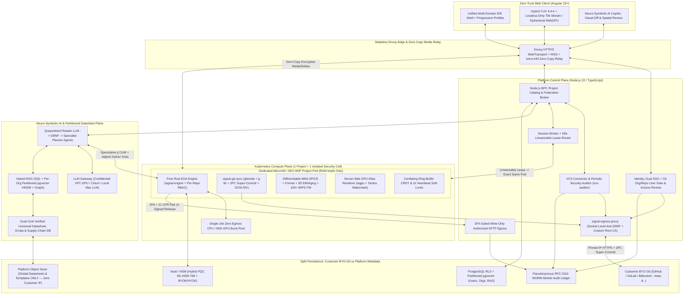

# Signal — Master Architecture Index

**Project Name:** Signal  
**Default Development Organization:** Signal Design, Inc.  
**Status:** Complete Architecture & Blueprint (Pre-Implementation)  
**Primary Stack:** Pure Rust Core Engine (Kubernetes Stateful Pods) • Node.js Control Plane & BFF • Angular Web Platform • GPU-Accelerated Rendering, Simulation & AI Agents  

---

## 1. Executive Vision

**Signal** is a ground-up reimagining of Electronic Design Automation (EDA) for the AI era.

Legacy EDA suites suffer from four structural failures:
1. **Fragmentation:** Hardware companies split Product Requirements (PRD), Hardware Functional Specifications (HFS), Schematics, PCBs, ICs/ASICs, FPGAs, Embedded Firmware, BIOS/UEFI, and verification artifacts across 6–12 disconnected tools with broken traceability.
2. **Local-File IP Leakage:** Design files live on engineer laptops, enabling accidental leaks, unauthorized exports, version drift, and painful IT licensing.
3. **Opaque, Bolt-On Automation:** Traditional solvers and CAD tools are 30-year-old monoliths where AI is bolted on as a shallow chat widget rather than deeply integrated into the physics and layout core.
4. **Black-Box Component Models:** Component behavior, tolerances, parasitics, thermal stress, and datasheet constraints are scattered across fragile SPICE text decks and static PDFs.

**Signal solves all four simultaneously:**
- **Unified Single-Application Engineering Graph + Multi-Repo BYO-Git:** One cloud platform and one versioned project graph uniting PRD, HFS, Schematics, PCB, IC/Chip, Packaging, FPGA, Firmware, BIOS, Software, Verification, Post-Silicon Digital Twin, and Manufacturing—persisted exclusively in the customer's own **GitHub, GitLab, or Bitbucket** namespace (`<project>-meta` + `<project>-<type>` repositories) with **Two-Phase Cross-Repo `Super-Commit` atomicity** and **zero permanent Signal file custody**.
- **Zero-Trust, Post-Quantum & Confidential-Silicon IP Protection:** Zero local design files, **Hybrid Post-Quantum (`ML-KEM-768 + X25519`, `ML-DSA-65 + Ed25519`)** + **Entity-Chunked Convergent `AES-256-GCM-SIV`** encryption, `CONFIDENTIAL_SILICON` encrypted-RAM VMs & MIG GPUs, no download/export/print/screenshot workflows (`YUV 4:4:4` + lossless tile streaming + Tardos collusion-resistant watermarks), and **2FA-gated Authorized SFTP** as the sole manufacturing egress channel.
- **Modular Pure-Rust Differentiable & Multi-Physics Engine in Kubernetes:** Every passive and active component is a first-class, composable **Rust `ElectronicModule`**—executed inside a dedicated, microVM-isolated Kubernetes pod per active project with linearizable Lease fencing, **Differentiable Adjoint SPICE (`signal-diff-sim`)**, **Formal Verification (`signal-formal`)**, **3D EM/224G/CPO Photonics (`signal-em3d`)**, and **15-Year Reliability Aging (`signal-aging`)**.
- **Neuro-Symbolic AI-Agent-First Engineering + Universal Datasheet RAG:** Autonomous multi-agent workflows combining LLM topology reasoning (protected by **Dual-LLM Prompt-Injection Quarantine** and **`GBNF` grammar decoding**) with exact Rust Adjoint gradient sizing and **Dual-VLM verified Universal Datasheet Hybrid RAG**.

---

## 2. Core Architectural Pillars

---

## 3. Complete Document Catalog

Read in sequence for a top-down understanding, or jump to your assigned implementation lane:

1. **[`01-product-vision-and-features.md`](./01-product-vision-and-features.md)**  
   Complete functional scope of Signal as an industry-first AI-EDA suite: Schematic, Differentiable SPICE, Formal Verification, High-Speed 224G PCB, 3D EM/Thermal/Aging, IC/ASIC (IEEE 1801 UPF + DFT), Co-Packaged Optics (CPO), FPGA, Firmware/BIOS Co-Sim, Post-Silicon Digital Twin, Clean-Room Legacy CAD/Sketch Import, k-Anonymous Live Supply-Chain & Carbon/PFAS Passports, and 21 CFR Part 11 sign-offs.
2. **[`02-system-architecture.md`](./02-system-architecture.md)**  
   End-to-end cloud architecture, split Customer BYO-Git vs. Platform storage boundary, Envoy HTTP/3 WebTransport & `turns:443` zero-copy edge relay, Sovereign Jurisdiction pinning, monorepo blueprint (including `benchmarks/` & `contracts/fixtures/`), and SLAs.
3. **[`03-rust-eda-engine.md`](./03-rust-eda-engine.md)**  
   Deep technical architecture of the pure-Rust EDA engine: `ElectronicModule` trait, Ruiz-equilibrated / exact `q(v)`/`Φ(i)` charge-conserving MNA SPICE, Adjoint Differentiable SPICE (`signal-diff-sim`), PINN surrogates (`signal-surrogate`), Formal solver (`signal-formal`), 3D EM (`signal-em3d`), 15-yr Aging (`signal-aging`), `i128`/Shewchuk overflow-proof & curved Euler/Bézier geometry (`signal-geom`), `0.5-ULP` cross-ISA determinism, and `YUV 4:4:4` + lossless dirty-tile GPU rendering.
4. **[`04-kubernetes-runtime-and-collaboration.md`](./04-kubernetes-runtime-and-collaboration.md)**  
   Kubernetes stateful pod-per-project lifecycle, linearizable K8s `Lease` fencing, K8s In-Place Vertical Pod Resize + `< 150 ms` Live Pod Migration, In-Pod Memory Governor, hierarchical cancellation, conflating CRDT ring buffers, Hardware-Isolated NVIDIA MIG & `CONFIDENTIAL_SILICON` pods, and burst worker orchestration.
5. **[`05-ai-agent-and-datasheet-rag.md`](./05-ai-agent-and-datasheet-rag.md)**  
   Neuro-symbolic multi-agent orchestration (LLM topology + Rust Adjoint Pareto sizing), Dual-LLM prompt-injection quarantine, `GBNF` grammar-constrained decoding, Dual-VLM verified Universal Datasheet & Silicon Errata ingestion (`BRONZE`/`SILVER`/`GOLD`), physically partitioned `pgvector` HNSW Hybrid RAG, and k-anonymous BOM intelligence.
6. **[`06-frontend-angular-and-nodejs-bff.md`](./06-frontend-angular-and-nodejs-bff.md)**  
   Angular 19+ Signals IDE shell, hybrid `YUV 4:4:4` + lossless dirty-tile Zero-Leak viewport, Single Composited Multi-Pane GPU Atlas, accessibility (Okabe-Ito + stipple patterns, KiCad/Altium/Virtuoso/Vim keymaps, SI unit pills), Visual Diff & Spatial Review (`libs/visual-diff`, `libs/review`), Encrypted Cloud Clipboard, and stateless Node.js 22 control plane.
7. **[`07-security-encryption-dlp-and-sftp.md`](./07-security-encryption-dlp-and-sftp.md)**  
   Zero-trust security posture, Hybrid Post-Quantum (`ML-KEM-768 + X25519`, `ML-DSA-65 + Ed25519`) + convergent `AES-256-GCM-SIV` encryption, `CONFIDENTIAL_SILICON` hardware attestation, Tardos collusion-resistant forensic watermarks, replay-proof Step-Up 2FA, disposable write-only `russh` SFTP workers, and GDPR-safe pseudonymous RFC-3161 WORM Merkle logs.
8. **[`08-identity-enterprise-and-project-model.md`](./08-identity-enterprise-and-project-model.md)**  
   Dual-Identity SAML + GitHub/GitLab/Bitbucket OAuth PKCE user auth, `ORG_NAMESPACE` & `USER_NAMESPACE` onboarding, 2-of-3 Super Admin Quorum Break-Glass, uniform `404` anti-enumeration, Org & Project Admin Access Review Console (with contractor `expires_at` TTL), multi-repo multi-type Projects, SPDX license gates, and 21 CFR Part 11 sign-offs.
9. **[`09-local-development-environment.md`](./09-local-development-environment.md)**  
   macOS Apple Silicon developer environment (`pnpm dev:lite` `< 1.5 GB RAM` + `pnpm dev:full` native `linux/arm64` + `dev:k8s`), `GBNF`-constrained Local LLM default (Ollama/MLX), zero-bypass `Guest @ Signal Design, Inc.` seeded in `local-git-mock`, and active PQC/convergent encryption parity.
10. **[`10-api-and-data-contracts.md`](./10-api-and-data-contracts.md)**  
    Build-time-only contract codegen, SI-unit-suffixed Protobuf (`_nm`, `_uv`, `_ps`, `N-1` wire compatibility), `<= 1 MB` chunked Arrow waveform streaming, `Idempotency-Key` REST mutations, UPF & `Super-Commit` schemas, and cross-language conformance fixtures (`contracts/fixtures/`).
11. **[`11-implementation-roadmap.md`](./11-implementation-roadmap.md)**  
    Phased execution roadmap (Phase 0 through GA), `benchmarks/` golden SPICE/EM/geometry suites, exit criteria, and comprehensive technical risk register.
12. **[`12-multi-ide-collaboration.md`](./12-multi-ide-collaboration.md)**  
    Deadlock-free engineering protocol enabling **Antigravity** and **Cursor** to develop Signal simultaneously with build-time codegen, SI conformance fixtures, 24h stale-claim expiry, and `cargo vet`/`cargo deny` supply-chain gates.
13. **[`13-vcs-git-server-and-storage-analysis.md`](./13-vcs-git-server-and-storage-analysis.md)**  
    Unified **Customer-Owned BYO-Git** across **GitHub**, **GitLab**, and **Bitbucket** (`ORG_NAMESPACE` & `USER_NAMESPACE`, immutable `provider_repo_id`), **Entity-Chunked Convergent `AES-256-GCM-SIV` `ENCRYPTED_VAULT`**, **Two-Phase Cross-Repo `Super-Commit` (`repos.lock.json`)**, `MUST_ENCRYPT` taint gate, 70/30 rate-limit budgeting, `<= 72h` outage continuity journal, and `services/vcs-auditor`.
14. **[`14-universal-scale-accessibility-and-expandability.md`](./14-universal-scale-accessibility-and-expandability.md)**  
    "Zero-Floor, Infinite-Ceiling" architecture: developing-nation student accessibility (`EXPLORER` / `MAKER`, volatile `<= 60 s` RAM reconnect buffer, declarative `< 10 KB` sim recipes, multilingual AI Tutor) up to 100B-transistor GPU/ASIC zero-lateral-movement federation (`*.lef.sig` + `signal-federation-broker`), CPO curved photonics, and signed WASM multi-physics plugins.
15. **[`15-application-security-and-project-isolation.md`](./15-application-security-and-project-isolation.md)**  
    Dedicated **Application Security (OWASP ASVS L3)** and **Complete Project Isolation ("1 Project = 1 Isolated Security Cell")** blueprint covering Hybrid PQC, `CONFIDENTIAL_SILICON` SEV-SNP/TDX + Hardware MIG GPUs, socket-pinned `signal-egress-proxy`, uniform `404` BOLA guards, Dual-LLM quarantine, physically partitioned `pgvector` HNSW indexes, parser bomb caps, `SecretBox<T>` redaction, and `cargo vet` SDLC gates.
16. **[`16-architectural-audit-flaws-and-futuristic-innovations.md`](./16-architectural-audit-flaws-and-futuristic-innovations.md)**  
    Comprehensive adversarial engineering audit cataloging **112 architectural flaws (`F-001`–`F-112`)** resolved across all layers plus **12 industry-first futuristic AI-EDA innovations (`I-01`–`I-12`)** with exact cross-document traceability.

---

## 4. Key Terminology & Glossary

| Term | Meaning in Signal |
|---|---|
| **Project** | Top-level unified product container in Signal backed inside the customer's Git Namespace (`ORG_NAMESPACE` or `USER_NAMESPACE`) by `<project>-meta` plus one cleanly prefixed repository per added Sub-Project type (`<project>-prd`, `<project>-schematic`, `<project>-pcb`, `<project>-ic-*`, `<project>-firmware`, `<project>-bios`, etc.) bound by immutable `provider_repo_id`. |
| **Sub-Project / Domain Module** | A typed engineering discipline inside a Project (e.g., `PCB`, `IC_ANALOG`, `FPGA`, `FIRMWARE`, `PRD`, `HFS`) backed by its own prefixed Git repo (`<project>-<type>[-<instance>]`) and linked via the unified in-pod Design Graph. |
| **Two-Phase `Super-Commit`** | Signal's cross-repository atomic commit protocol (`refs/signal/txn/<id>` prepare → signed `.signal/repos.lock.json` coordinator manifest in `<project>-meta` → Git `CAS` branch advance) ensuring schematic, PCB, IC, and firmware repos never drift out of sync. |
| **Electronic Module** | A self-contained, parameterized Rust module (`ElectronicModule`) representing an electronic passive, active, IC, photonic, or subcircuit block with typed multi-physics ports, exact `q(v)`/`Φ(i)` state conservation, analytical/autodiff Jacobians, tolerances, parasitics, thermal self-heating, and SOA watchdogs. |
| **Differentiable SPICE (`signal-diff-sim`)** | Signal's neuro-symbolic Adjoint Sensitivity (`∂Loss/∂p`) circuit solver enabling exact gradient-based multi-corner PVT Pareto component sizing in seconds rather than LLM trial-and-error guessing. |
| **Project Pod (`CONFIDENTIAL_SILICON`)** | A dedicated, microVM-isolated (Kata/gVisor or AMD SEV-SNP / Intel TDX + Hardware MIG / Confidential GPU) Kubernetes pod running `signal-engine` for one loaded Project under a linearizable K8s `Lease`. |
| **BYO-Git (`signal-git-sync` + `vcs-auditor`)** | Signal's unified Customer-Owned VCS model across **GitHub**, **GitLab**, and **Bitbucket** where Org/Repo user lists govern Project/Sub-Project visibility, **Entity-Chunked Convergent `AES-256-GCM-SIV` `ENCRYPTED_VAULT`** preserves 95%+ Git dedup while blocking local clone leaks, and `services/vcs-auditor` scans continuously for vulnerabilities & access drift. |
| **Hybrid PQC (`ML-KEM-768` + `ML-DSA-65`)** | NIST FIPS-203/204 Post-Quantum Cryptography combined with classical `X25519`/`Ed25519` protecting 20-year semiconductor IP, `Super-Commit` manifests, and 21 CFR Part 11 sign-offs against "Harvest Now, Decrypt Later" quantum adversaries. |
| **Zero-Leak Mode** | Enterprise DLP mode where the Rust engine renders viewports server-side into a single GPU atlas and streams hybrid `YUV 4:4:4` + lossless dirty-tile frames with Tardos collusion-resistant forensic watermarks so raw geometry never enters the browser. |
| **Authorized SFTP Target** | A 2FA-verified, SSH-key-authenticated, host-pinned SFTP server pushed to exclusively via disposable write-only `russh` pods (`.tmp.part` → SHA-256 verify → `rename`)—the ONLY permitted manufacturing egress path. |
| **Universal Datasheet DB** | Signal's Dual-VLM verified (`BRONZE`/`SILVER`/`GOLD`), Silicon-Errata-linked structured + partitioned `pgvector` + graph knowledge base powering grounded Hybrid RAG for AI Agents. |
| **MNA** | Modified Nodal Analysis — the mathematical foundation of SPICE circuit simulation solving coupled KCL/KVL nonlinear differential-algebraic equations. |
| **PDK** | Process Design Kit — foundry-supplied rules, transistor models, PCELLs, and DRC/LVS decks required for IC/chip design. |
