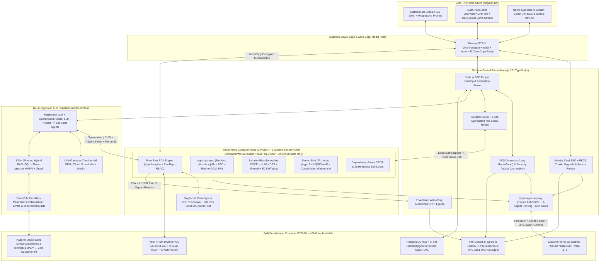

# Signal — Master Architecture Index

**Project Name:** Signal  
**Default Development Organization:** Signal Design, Inc.  
**Status:** Complete Architecture & Blueprint (Pre-Implementation)  
**Primary Stack:** Pure Rust Core Engine (Kubernetes Stateful Pods) • Node.js Control Plane & BFF • Angular Web Platform • GPU-Accelerated Rendering, Simulation & AI Agents  

---

## 1. Executive Vision

**Signal** is a ground-up reimagining of Electronic Design Automation (EDA) for the AI era.

Legacy EDA suites suffer from four structural failures:
1. **Fragmentation:** Hardware companies split Product Requirements (PRD), Hardware Functional Specifications (HFS), Schematics, PCBs, ICs/ASICs, FPGAs, Embedded Firmware, BIOS/UEFI, and verification artifacts across 6–12 disconnected tools with broken traceability.
2. **Local-File IP Leakage:** Design files live on engineer laptops, enabling accidental leaks, unauthorized exports, version drift, and painful IT licensing.
3. **Opaque, Bolt-On Automation:** Traditional solvers and CAD tools are 30-year-old monoliths where AI is bolted on as a shallow chat widget rather than deeply integrated into the physics and layout core.
4. **Black-Box Component Models:** Component behavior, tolerances, parasitics, thermal stress, and datasheet constraints are scattered across fragile SPICE text decks and static PDFs.

**Signal solves all four simultaneously:**
- **Unified Single-Application Engineering Graph + Multi-Repo BYO-Git:** One cloud platform and one versioned project graph uniting PRD, HFS, Schematics, PCB, IC/Chip, Packaging, FPGA, Firmware, BIOS, Software, Verification, Post-Silicon Digital Twin, ECO/ECN, and Manufacturing—persisted exclusively in the customer's own **GitHub, GitLab, or Bitbucket** namespace (`<project>-meta` + lazily materialized `<project>-<type>` repositories) with **Dual-Fenced Two-Phase Cross-Repo `Super-Commit` atomicity** and **zero permanent Signal file custody**.
- **Zero-Trust, Post-Quantum & Confidential-Silicon IP Protection:** Zero local design files, **Hybrid Post-Quantum (`ML-KEM-768 + X25519`, `ML-DSA-65 + Ed25519`)** + **Padmé-Padded, Path-Blinded (`blobs/*.sigv`), Merkle-Bound RFC 8452 `AES-256-GCM-SIV`** encryption, `CONFIDENTIAL_SILICON` encrypted-RAM VMs & Exclusive Hopper `H100 CC` / Blackwell `B200+ TEE-I/O` Confidential MIG GPUs, no download/export/print/screenshot workflows (Dual-Plane `Zstd-QOI`/WebP + hardware video streaming + Tardos pixel & Topological Constellation watermarks), and **2FA-gated Authorized SFTP** as the sole manufacturing/partner egress channel.
- **Modular Pure-Rust Differentiable & Multi-Physics Engine in Kubernetes:** Every passive and active component is a first-class, composable **Rust `ElectronicModule`**—executed inside a dedicated Project Cell (`< 8 MB` Wasmtime `EXPLORER` isolate auto-promoting to a Kata/SEV-SNP MicroVM Pod) with Host-Aggregated K8s Lease + Egress-Proxy fencing, **Saltation-Exact & `Revolve`-Checkpointed Differentiable Adjoint SPICE (`signal-diff-sim`)**, **Formal Verification (`signal-formal`)**, **3D EM/224G/Baseband-Envelope CPO Photonics (`signal-em3d`)**, and **15-Year Reliability Aging (`signal-aging`)**.
- **Neuro-Symbolic AI-Agent-First Engineering + Universal Datasheet RAG:** Autonomous multi-agent workflows combining LLM topology reasoning (protected by **Multimodal VLM + Dual-LLM Prompt-Injection Quarantine**, **`GBNF` grammar decoding**, and **Merge-Time Proof Re-Verification**) with exact Rust Adjoint gradient sizing and **Dual-VLM verified, Condition-Parameterized Universal Datasheet Hybrid RAG**.

---

## 2. Core Architectural Pillars

---

## 3. Complete Document Catalog

Read in sequence for a top-down understanding, or jump to your assigned implementation lane:

1. **[`01-product-vision-and-features.md`](./01-product-vision-and-features.md)**  
   Complete functional scope of Signal as an industry-first AI-EDA suite: Schematic, Differentiable SPICE, Formal Verification, High-Speed 224G PCB, Signed Fab Capability Profiles (`*.fabprofile.toml`), Minimal-Perturbation PCB & Spare-Cell Metal-Only IC ECO + ECN Governance, 3D EM/Thermal/Aging, IC/ASIC (IEEE 1801 UPF + Pelgrom/LVF + IEEE 1735 + DFT), Co-Packaged Optics (CPO), FPGA, Firmware/BIOS Co-Sim, Post-Silicon Digital Twin, Clean-Room Legacy CAD/Sketch Import, Mirrored + Chaff-Padded Supply-Chain & Carbon/PFAS Passports, and 2FA-SFTP Regulatory/MCAD Partner Bundles.
2. **[`02-system-architecture.md`](./02-system-architecture.md)**  
   End-to-end cloud architecture, split Customer BYO-Git vs. Platform storage boundary, Envoy HTTP/3 WebTransport & `turns:443` zero-copy edge relay, Strictly In-Jurisdiction Paired-Region DR, monorepo blueprint (`signal-proto`, `signal-cell-wasm`, `benchmarks/`, `contracts/transcripts/`), and SLAs.
3. **[`03-rust-eda-engine.md`](./03-rust-eda-engine.md)**  
   Deep technical architecture of the pure-Rust EDA engine: `ElectronicModule` trait, Ruiz-equilibrated / exact `q(v)`/`Φ(i)` MNA SPICE (hybrid CPU `KLU`/`CKTSO` + GPU `cuDSS`), Filippov Saltation + `Revolve` Adjoint Differentiable SPICE (`signal-diff-sim`), Two-Stage PSS/HB & Cryo-CMOS, AOT Cranelift/`WASM-SIMD` Verilog-A + child-MicroVM `OSDI`/`IBIS-AMI` + HSM IEEE 1735, PINN surrogates, Formal solver, Baseband-Envelope CPO & 3D EM (`signal-em3d`), 15-yr Aging, Pelgrom/LVF/Halo IC & ECO kernels, `i128`/Shewchuk curved geometry (`signal-geom`), and Dual-Plane `Zstd-QOI`/WebP + Constellation-Watermarked GPU rendering.
4. **[`04-kubernetes-runtime-and-collaboration.md`](./04-kubernetes-runtime-and-collaboration.md)**  
   Kubernetes stateful Project Cell lifecycle: `< 8 MB` Wasmtime `EXPLORER` isolates auto-promoting to Kata/SEV-SNP MicroVMs, Host-Aggregated K8s Node Leases + Dual-Gate External Fencing (`signal-egress-proxy` `412` drop + `<project>-meta` CAS), 3-Phase Pre-Copy `< 150 ms` Live Migration, Live External `git push` Rebase, BYOK-only Continuity WAL, dependency-aware CRDTs, and Exclusive Hopper `H100 CC` vs. Blackwell `B200 TEE-I/O` Confidential MIG orchestration.
5. **[`05-ai-agent-and-datasheet-rag.md`](./05-ai-agent-and-datasheet-rag.md)**  
   Neuro-symbolic multi-agent orchestration (LLM topology + Saltation/PSS Rust Adjoint Pareto sizing), Multimodal VLM + Dual-LLM prompt-injection quarantine, `GBNF` grammar-constrained decoding, Merge-Time Proof Re-Verification, Dual-VLM Condition-Parameterized Universal Datasheet & Silicon Errata DB (`C(V,T,f)`, copper-coupled `R_thetaJC/JB`), 3-Tier Sharded `pgvector` HNSW Hybrid RAG, and Bulk-Mirrored + Chaff-Padded BOM intelligence.
6. **[`06-frontend-angular-and-nodejs-bff.md`](./06-frontend-angular-and-nodejs-bff.md)**  
   Angular 19+ Signals IDE shell, Capability-Probed Dual-Plane `Zstd-QOI`/WebP + Hardware `HEVC 4:4:4` / Dual-Luma `AV1/H.264` Zero-Leak viewport, Route-Partitioned `COOP`/`COEP` + `SameSite=Lax -> __Host- Strict` OAuth/SAML cookie upgrade, ES2020 `bigint` 64-bit contract safety, Visual Diff & Spatial Review (`libs/visual-diff`, `libs/review`), Encrypted Cloud Clipboard, and stateless Node.js 22 control plane with Fail-Closed 3x Quorum Tier-0 Audit Outbox.
7. **[`07-security-encryption-dlp-and-sftp.md`](./07-security-encryption-dlp-and-sftp.md)**  
   Zero-trust security posture, Hybrid Post-Quantum (`ML-KEM-768 + X25519`, `ML-DSA-65 + Ed25519`) + 2-level `HKDF` keyring + unified Padmé-padded, path-blinded (`blobs/*.sigv`), `.signal/vault.merkle.sig`-bound RFC 8452 `AES-256-GCM-SIV` vault, Hopper vs. Blackwell Confidential GPU attestation, Tardos pixel + Topological Constellation watermarks, Attested Browser + Pan-Scrape freeze, replay-proof Step-Up 2FA, disposable write-only `russh` SFTP workers, and Fail-Closed Tier-0 Quorum → pseudonymous RFC-3161 WORM Merkle logs.
8. **[`08-identity-enterprise-and-project-model.md`](./08-identity-enterprise-and-project-model.md)**  
   Dual-Identity SAML + GitHub/GitLab/Bitbucket OAuth PKCE user auth (with seamless top-level cookie upgrade), `ORG_NAMESPACE` & `USER_NAMESPACE` onboarding, Strictly In-Jurisdiction Paired-Region DR, 2-of-3 Super Admin Quorum Break-Glass, uniform `404` anti-enumeration, Org & Project Admin Access Review Console, Lazy `<project>-<type>` Repo Materialization (`<= 40/min`), Signed Fab Capability Profiles, ECN Sign-Offs, and 21 CFR Part 11 sign-offs.
9. **[`09-local-development-environment.md`](./09-local-development-environment.md)**  
   macOS Apple Silicon developer environment (`pnpm dev:lite` `< 1.5 GB RAM`, `< 2 s` incr Rust builds via `signal-proto` + `sccache`/`lld`, + `pnpm dev:full` native `linux/arm64` + `dev:k8s`), headless `lavapipe` software-Vulkan WGSL parity CI, `GBNF`-constrained Local LLM default (Ollama/MLX + `deterministic_mock` offline fallback), and zero-bypass `Guest @ Signal Design, Inc.` seeded in `local-git-mock`.
10. **[`10-api-and-data-contracts.md`](./10-api-and-data-contracts.md)**  
    Build-time-only contract codegen, SI-unit-suffixed Protobuf (`_nm`, `_uv`, `_ps`) with mandatory ES2020 `bigint` (`jstype = JS_STRING` / `longAsBigint: true`) 64-bit integer safety, `<= 1 MB` chunked Arrow waveform streaming, `Idempotency-Key` REST mutations, Condition-Parameterized Datasheet, `FabCapabilityProfile`, `EcnChangeOrder`, UPF & `Super-Commit` schemas, static `contracts/fixtures/`, and stateful `contracts/transcripts/*.jsonl`.
11. **[`11-implementation-roadmap.md`](./11-implementation-roadmap.md)**  
    Phased execution roadmap (Phase 0 through GA), `benchmarks/` golden SPICE/EM/geometry suites, exit criteria, and comprehensive technical risk register covering all Wave 1 + Wave 2 mitigations.
12. **[`12-multi-ide-collaboration.md`](./12-multi-ide-collaboration.md)**  
    Deadlock-free engineering protocol enabling **Antigravity** and **Cursor** to develop Signal simultaneously with shared `signal-proto` build-time codegen, `bigint` SI conformance fixtures, stateful `contracts/transcripts/`, 24h stale-claim expiry, and `cargo vet`/`cargo deny` supply-chain gates.
13. **[`13-vcs-git-server-and-storage-analysis.md`](./13-vcs-git-server-and-storage-analysis.md)**  
    Unified **Customer-Owned BYO-Git** across **GitHub**, **GitLab**, and **Bitbucket** (`ORG_NAMESPACE` & `USER_NAMESPACE`, immutable `provider_repo_id`, lazy repo pacer), **Padmé-Padded, Path-Blinded, Merkle-Bound RFC 8452 `AES-256-GCM-SIV` `ENCRYPTED_VAULT`**, **Dual-Fenced Two-Phase Cross-Repo `Super-Commit` (`repos.lock.json`)**, blobless `--filter=blob:none` clones + `64 KB` streaming LFS, live external `git push` auto-rebase, BYOK-only Continuity WAL, and `services/vcs-auditor`.
14. **[`14-universal-scale-accessibility-and-expandability.md`](./14-universal-scale-accessibility-and-expandability.md)**  
    "Zero-Floor, Infinite-Ceiling" architecture: developing-nation student accessibility (`< 8 MB` Wasmtime `EXPLORER` isolates, volatile `<= 60 s` RAM reconnect buffer, declarative `< 10 KB` sim recipes, multilingual AI Tutor) up to 100B-transistor GPU/ASIC zero-lateral-movement federation (`*.lef.sig`, `*.halo.gds.sig` + `signal-federation-broker`), Baseband-Envelope CPO photonics, Cryo-CMOS, and signed WASM multi-physics plugins.
15. **[`15-application-security-and-project-isolation.md`](./15-application-security-and-project-isolation.md)**  
    Dedicated **Application Security (OWASP ASVS L3)** and **Complete Project Isolation ("1 Project = 1 Isolated Security Cell")** blueprint covering Hybrid PQC + 2-level `HKDF`, Exclusive `H100 CC` vs. Blackwell `B200 TEE-I/O` Confidential MIG, socket-pinned + epoch-fencing `signal-egress-proxy`, uniform `404` BOLA guards, Multimodal VLM + Dual-LLM quarantine, 3-Tier Sharded `pgvector` HNSW indexes, child-MicroVM `OSDI`/`IBIS-AMI` sandboxes, Fail-Closed Tier-0 Quorum Audit Outbox, and `cargo vet` SDLC gates.
16. **[`16-architectural-audit-flaws-and-futuristic-innovations.md`](./16-architectural-audit-flaws-and-futuristic-innovations.md)**  
    Comprehensive two-wave adversarial & first-principles engineering audit cataloging **148 architectural flaws (`F-001`–`F-148`)** resolved across mathematics, GPU silicon, cryptography, consensus, browser codecs, EDA sign-off, and unit economics, plus **12 industry-first futuristic AI-EDA innovations (`I-01`–`I-12`)**.
17. **[`17-extended-feature-specifications-ui-and-rust.md`](./17-extended-feature-specifications-ui-and-rust.md)**  
    Complete dual **Angular 19+ UI (`web/libs/*`) & Pure-Rust Engine (`engine/crates/*`)** specification for **120 next-generation features (`FEAT-001`–`FEAT-120`)** above and beyond baseline specs across 12 domains: smart schematic ergonomics, high-speed/RF/flex PCB, custom magnetics/PDN/creepage/BMS/FOC, EMC/ESD/FMEDA/Rad-Hard, advanced IC/BSPDN/DPA hardware security, FPGA/firmware/battery/DSP, 3D harness/panelization/fatigue/should-cost, library/curve-fitter studio, bench instruments/Shmoo/TDR, multi-monitor/SpaceMouse UX, autonomous AI Pareto/Red-Team co-design, and breadboard/classroom/`Signal Campus Edge`.

---

## 4. Key Terminology & Glossary

| Term | Meaning in Signal |
|---|---|
| **Project** | Top-level unified product container in Signal backed inside the customer's Git Namespace (`ORG_NAMESPACE` or `USER_NAMESPACE`) by `<project>-meta` plus lazily materialized prefixed repositories per added Sub-Project type (`<project>-prd`, `<project>-schematic`, `<project>-pcb`, `<project>-ic-*`, `<project>-firmware`, `<project>-bios`, etc.) bound by immutable `provider_repo_id`. |
| **Sub-Project / Domain Module** | A typed engineering discipline inside a Project (e.g., `PCB`, `IC_ANALOG`, `FPGA`, `FIRMWARE`, `PRD`, `HFS`) backed by its own prefixed Git repo (`<project>-<type>[-<instance>]`) and linked via the unified in-pod Design Graph. |
| **Two-Phase `Super-Commit`** | Signal's Dual-Fenced cross-repository atomic commit protocol (`X-Signal-Fencing-Token` enforced at `signal-egress-proxy` → `refs/signal/txn/<id>` prepare → signed `.signal/repos.lock.json` CAS commit in `<project>-meta` FIRST → member branch advance) ensuring schematic, PCB, IC, and firmware repos never split-brain or drift out of sync. |
| **Electronic Module** | A self-contained, parameterized Rust module (`ElectronicModule`) representing an electronic passive, active, IC, photonic, or subcircuit block with typed multi-physics ports, exact `q(v)`/`Φ(i)` state conservation, analytical/autodiff Jacobians, Pelgrom/PVT variation, parasitics, thermal self-heating, and SOA watchdogs. |
| **Differentiable SPICE (`signal-diff-sim`)** | Signal's neuro-symbolic Adjoint Sensitivity (`∂Loss/∂p`) circuit solver using **Filippov Saltation Matrices** at switching boundaries, **`Revolve` $O(\log N_t)$ Binomial Checkpointing**, and Two-Stage PSS/HB warm-start for exact gradient-based multi-corner PVT Pareto sizing. |
| **Project Cell (`signal-cell-wasm` / `CONFIDENTIAL_SILICON`)** | Signal's dedicated per-project compute unit: `< 8 MB` Wasmtime isolate for free `EXPLORER` circuits (auto-promoting live on scale-up) or Kata/gVisor / AMD SEV-SNP / Intel TDX MicroVM + Exclusive `H100 CC` or Blackwell `B200 TEE-I/O` Confidential MIG GPU under a Host-Aggregated K8s `Lease`. |
| **BYO-Git (`signal-git-sync` + `vcs-auditor`)** | Signal's unified Customer-Owned VCS model across **GitHub**, **GitLab**, and **Bitbucket** where Org/Repo user lists govern visibility, **Padmé-Padded, Path-Blinded (`blobs/*.sigv`), `.signal/vault.merkle.sig`-Bound RFC 8452 `AES-256-GCM-SIV` `ENCRYPTED_VAULT`** preserves Git dedup while defeating length/filename/rollback leaks, and `services/vcs-auditor` scans continuously for drift. |
| **Hybrid PQC (`ML-KEM-768` + `ML-DSA-65`)** | NIST FIPS-203/204 Post-Quantum Cryptography combined with classical `X25519`/`Ed25519` and a 2-level `HKDF` hierarchy protecting 20-year semiconductor IP, `Super-Commit` manifests, and 21 CFR Part 11 sign-offs against "Harvest Now, Decrypt Later" quantum adversaries. |
| **Zero-Leak Mode** | Enterprise DLP mode where the Rust engine renders viewports server-side into a GPU atlas and streams **Dual-Plane `Zstd-QOI`/WebP `RGBA8` dirty tiles + hardware-probed `HEVC 4:4:4` / Dual-Luma `AV1/H.264` motion video** with both Tardos pixel and **Topological/Geometric Constellation** forensic watermarks so raw geometry never enters the browser. |
| **Authorized SFTP Target** | A 2FA-verified, SSH-key-authenticated, host-pinned SFTP server pushed to exclusively via disposable write-only `russh` pods (`.tmp.part` → SHA-256 verify → `rename`)—the ONLY permitted manufacturing, regulatory, or partner MCAD egress path. |
| **Universal Datasheet DB** | Signal's Dual-VLM verified (`BRONZE`/`SILVER`/`GOLD`), Condition-Parameterized (`C(V,T,f)`), Silicon-Errata-linked structured + 3-Tier Sharded `pgvector` + graph knowledge base powering grounded Hybrid RAG for AI Agents. |
| **MNA** | Modified Nodal Analysis — the mathematical foundation of SPICE circuit simulation solving coupled KCL/KVL nonlinear differential-algebraic equations. |
| **PDK** | Process Design Kit — foundry-supplied rules, transistor models, IEEE 1735 / `OSDI` models, PCELLs, and DRC/LVS decks required for IC/chip design. |
