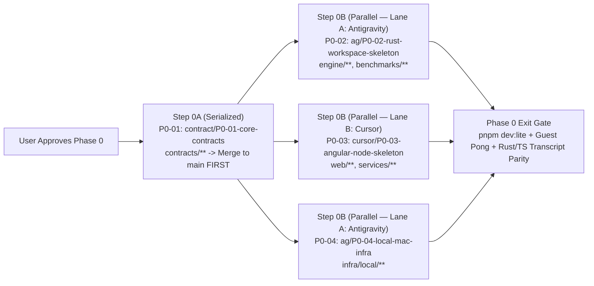

# Signal — Phase 0 Launch Playbook (Architecture → Coding Transition)

> **Purpose:** Exact, deadlock-free sequence for transitioning **Signal** from completed Architecture (`architecture/01..17`) into **Phase 0 Implementation** with **Antigravity** (Lane A) and **Cursor** (Lane B) building simultaneously at full velocity.

---

## 1. Pre-Flight Readiness Checklist (Before Lifting Phase-0 Gate)

Confirm all 5 readiness items before the user gives the `"Start Phase 0"` green light:
- [x] All 17 architecture specifications (`01`–`17` + `README.md`) verified with `0` audit or link issues.
- [x] `AGENTS.md` kept concise (`< 12 KB`, zero truncation) and synchronized with `.cursor/rules/*.mdc`.
- [x] All 14 cross-IDE Agent Skills published under `.agents/skills/*/SKILL.md` (natively discovered by both Antigravity & Cursor).
- [x] Local Mac repo synced: `git -C ~/Developer/signal pull --rebase origin main`.
- [ ] **Explicit User Approval:** User explicitly approves starting Phase 0 (`P0-01`).

---

## 2. Step-by-Step Phase 0 Execution Order

### Step 0A — `P0-01` Serialized Contract Freeze (Must Land on `main` First)
- **Branch:** `contract/P0-01-core-contracts` (touched paths: `contracts/**` ONLY)
- **Skill to Activate:** `signal-contract-first`
- **Deliverables:**
  1. `contracts/buf.yaml` + `contracts/buf.gen.yaml` (build-time codegen only; `.gitignore` generated outputs).
  2. Core `contracts/proto/signal/v1/*.proto` (`session`, `design_graph`, `vcs_sync`, `component`, `simulation`, `render_stream`, `sftp_release`) with explicit SI-unit suffixes (`_nm`, `_ps`, `_uv`, `_na`, `_hz`) and `[jstype = JS_STRING]` on 100% of 64-bit integer fields.
  3. `contracts/openapi/control-plane.v1.yaml` (URL-scoped `/org/:org_slug`, `Idempotency-Key`, zero `/export` or `/download` routes).
  4. Core JSON schemas under `contracts/schemas/` (`datasheet-record`, `super-commit-manifest`, `fab-capability-profile`, `sftp-release-manifest`).
  5. Golden cross-language serialization vectors (`contracts/fixtures/*.json`) + stateful handshake transcript (`contracts/transcripts/session_hydrate_and_edit.jsonl`).
- **Exit Gate:** `buf lint`, `buf breaking`, JSON schema validation, and clean merge to `main`.

### Step 0B — Simultaneous Zero-Conflict Implementation (3 Disjoint Branches)

| Task | Owner | Branch | Disjoint Paths | Skills to Activate | Exit Gate |
|---|---|---|---|---|---|
| **`P0-02`** | **Antigravity** | `ag/P0-02-rust-workspace-skeleton` | `engine/**`, `benchmarks/**` | `signal-rust-crate-architect`, `signal-token-efficient-editing`, `signal-verification-and-pr-gate` | `signal-proto` + `cargo-hakari` + `#![forbid(unsafe_code)]` crates compile cleanly (`cargo clippy -D warnings`, `cargo test`, `cargo deny`, `cargo vet`), `dev-guest-auth` compile-time release guard verified, `contracts/fixtures/` + `transcripts/` replay passes in Rust! |
| **`P0-03`** | **Cursor** | `cursor/P0-03-angular-node-skeleton` | `web/**`, `services/**` | `signal-angular-workbench`, `signal-nodejs-bff-control-plane`, `signal-zero-leak-canvas-and-dlp`, `signal-verification-and-pr-gate` | Angular 19/20+ Zoneless shell boots at `/org/:org_slug/project/:proj_slug`, lazy route stubs for core + extended `web/libs/*`, `bigint` build-time TS contract codegen, ESLint DLP/bigint rules active, Node.js 22 stateless services + `@Require*` uniform-`404` + Fail-Closed Audit Outbox stub pass `pnpm lint/typecheck/test` + `contracts/fixtures/` replay! |
| **`P0-04`** | **Antigravity** | `ag/P0-04-local-mac-infra` | `infra/local/**` | `signal-local-mac-dev`, `signal-security-isolation-audit` | `pnpm dev:lite` boots in `< 30 s` (`< 1.5 GB RAM`) on Apple Silicon, `local-git-mock` seeds `local-guest-0001` in `REPO_ACCESS_ENTRY` with active PQC/GCM-SIV encryption, `signal-egress-proxy` + DevKMS + Mock SFTP + Ollama/MLX/`deterministic_mock` health checks green! |

---

## 3. Phase 0 Final Acceptance Test (Mac + Cloud Parity)

Phase 0 is marked `DONE` on `coordination/TASK_BOARD.md` ONLY when all 4 criteria pass simultaneously:
1. One bootstrap command launches `pnpm dev:lite` on macOS Apple Silicon (`< 30 s`, `< 1.5 GB RAM`, `< 2 s` incremental Rust rebuild).
2. Browser opens as `Guest @ Signal Design, Inc.` (verified via real RBAC + encrypted `local-git-mock` vault — zero bypassed security paths!) and receives live `pong` from both `signal-pod` (Rust) and `ai/llm-gateway` (Ollama/MLX or `deterministic_mock`).
3. Release-build CI gate proves `dev-guest-auth` fails compilation if enabled alongside production flags.
4. Antigravity (`ag/*`) and Cursor (`cursor/*`) both merge parallel PRs cleanly to `main` with zero file conflicts and updated single-writer journals.
