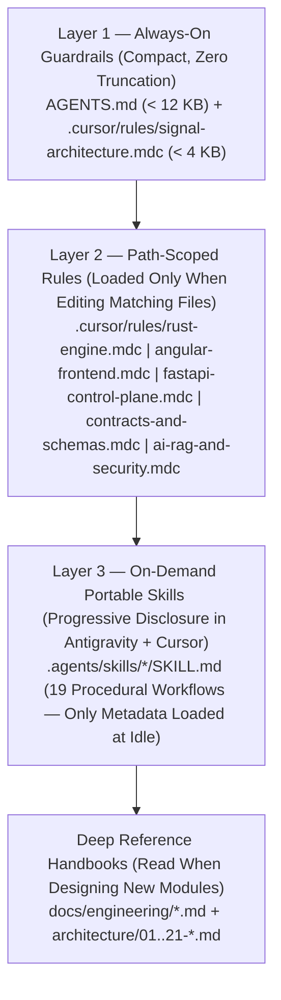

# Signal — Engineering Operating System (`docs/engineering/`)

> **Purpose:** Bridges Signal's 21 architecture specifications ([`architecture/`](../../architecture/README.md)) into disciplined, high-velocity, **token-efficient Phase 0+ coding** shared seamlessly by **Antigravity**, **Cursor**, and human engineers on Signal's latest 2026 stack (**Angular `v22+` ONLY**, **Rust `1.100+`**, **Python `3.15+` FastAPI/Granian**, **Node.js `26 LTS+`**, **PostgreSQL `19+`**, **Kubernetes `1.37+`**).

---

## 1. Three-Layer AI Context & Guardrail Architecture (Zero Waste, Zero Drift)

To maximize both **human maintainability** and **AI token efficiency** across Antigravity and Cursor, Signal separates instructions into three distinct layers:

| Layer | Location | Loaded By | Token Strategy |
|---|---|---|---|
| **Always-On Core** | [`AGENTS.md`](../../AGENTS.md), [`.cursor/rules/signal-architecture.mdc`](../../.cursor/rules/signal-architecture.mdc) | Antigravity + Cursor (every turn) | Hard red lines & lookup pointers only; strictly `< 12 KB` / `< 4 KB` to prevent context truncation. |
| **Path-Scoped Rules** | `.cursor/rules/*.mdc` (5 glob-scoped files) | Cursor (auto-attached by `globs`) & Antigravity (via `AGENTS.md` lookup) | Rust rules never pollute Angular or FastAPI turns; frontend rules never pollute backend turns. |
| **Portable Agent Skills** | [`.agents/skills/`](../../.agents/skills/README.md) (`19` `SKILL.md` folders) | **Both Antigravity AND Cursor** natively via the Open Agent Skills standard | Progressive disclosure: idle skills cost ~30 tokens of frontmatter; full instructions load strictly when matched. |
| **Deep Handbooks** | `docs/engineering/*.md` (`6` guides) | Humans + Agents on demand | Complete style guides, module layouts, checklists, and Phase 0 launch playbooks. |

---

## 2. Engineering Handbook Catalog

1. **[`TOKEN_EFFICIENCY_AND_CLEAN_CODE.md`](./TOKEN_EFFICIENCY_AND_CLEAN_CODE.md)**  
   Universal codebase hygiene: `<= 300 LOC` file budgets, 3-line module headers, public API barrel boundaries, 2–3 sentence dev replies, anti-hallucination protocol, ripgrep-first discovery, targeted test loops, and clean commit discipline.
2. **[`RUST_ENGINEERING_GUIDE.md`](./RUST_ENGINEERING_GUIDE.md)**  
   **Rust `1.100+` (2024 Edition)** workspace architecture (`engine/`), `#![forbid(unsafe_code)]`, crate DAG, `signal-proto` + `cargo-hakari`, `ElectronicModule` / `SignalFeatureKernel` idioms, `i128`/Shewchuk geometry, `0.5-ULP` determinism, `SecretBox<T>`, Cargo cooldowns, and `cargo vet`/`deny` CI gates.
3. **[`ANGULAR_ENGINEERING_GUIDE.md`](./ANGULAR_ENGINEERING_GUIDE.md)**  
   **Angular `v22+` ONLY** (TypeScript `6.0+`, **Node.js `26 LTS+`** Tier 1 edge, `pnpm 11+`) Zoneless & Signals-first architecture (`web/`), Standalone components, Signal Forms, `input()`/`output()`/`computed()`/`@if`/`@for`/`@defer`, `web/libs/*` public `index.ts` boundaries, ES2020 `bigint` safety, `HudOverlayPrimitive` Zero-Leak overlays, Trusted Types + CSP, and WCAG 2.2 AA accessibility.
4. **[`ANGULAR_UI_STYLE_GUIDE.md`](./ANGULAR_UI_STYLE_GUIDE.md)**  
   Mandatory Angular `v22+` UI Style Guide & Standardized Component Ecosystem: strict `.component.ts`/`.component.html`/`.logic.ts`/`.model.ts` separation, zero inline `template:`/`styles:`, anti-spaghetti HTML template laws (`<= 150 LOC`, max nesting `<= 2`, zero copy-pasted `@if`/`@else` sections), centralized `@signal/design-system` (tokens + `.sig-*` primitives) and `@signal/ui-kit` reusable components (`sig-*`), strict `@sig-style-exception` policy, and ESLint/Stylelint CI enforcement.
5. **[`FASTAPI_ENGINEERING_GUIDE.md`](./FASTAPI_ENGINEERING_GUIDE.md)**  
   **Python `3.15+` + FastAPI (`0.165+`) + Rust-powered Granian (`2.8+`) + Pydantic v2 (`2.14+`)** Control-Plane API architecture (`services/`, unified `uv` workspace with `ai/`), strict 4-layer layout, fail-closed `Depends(require_*)` + startup route-auth introspection gate, uniform `404`, PostgreSQL `19+` `with_rls_tx` (`NOBYPASSRLS`), 3x Quorum Audit Outbox, optional `PyO3` Rust hotspot bridge, and `ruff`/`pyright`/`pytest`/`bandit`/`pip-audit` gates.
6. **[`PHASE0_LAUNCH_PLAYBOOK.md`](./PHASE0_LAUNCH_PLAYBOOK.md)**  
   Exact step-by-step execution runbook to transition from Architecture into Phase 0 coding (`P0-01` serialized contract freeze → parallel `P0-02` Antigravity Rust `1.100+` + `P0-03` Cursor Angular `v22+` / Python `3.15+` FastAPI + `P0-04` Unified `./signal.sh` CI/CD CLI & 3-Tier Local/K8s `1.37+` Harness).
7. **[`../../plan/README.md`](../../plan/README.md) — 9-Phase Modular Execution Plan & Single-Writer Tickable TODO Ledgers (`plan/`)**  
   Splits the entire platform into 9 phase plans (`phase-0`–`phase-8`), a 100% Zero-Miss Feature Traceability Matrix ([`00-FEATURE-TRACEABILITY-MATRIX.md`](../../plan/00-FEATURE-TRACEABILITY-MATRIX.md)), and 3 single-writer tickable TODO ledgers ([`TODO-LEDGER-SHARED-CONTRACTS.md`](../../plan/TODO-LEDGER-SHARED-CONTRACTS.md), [`TODO-LEDGER-ANTIGRAVITY-LANE-A.md`](../../plan/TODO-LEDGER-ANTIGRAVITY-LANE-A.md), [`TODO-LEDGER-CURSOR-LANE-B.md`](../../plan/TODO-LEDGER-CURSOR-LANE-B.md)) covering `108` disjoint micro-tasks.

---

## 3. Complete Cross-IDE Skill Matrix (`.agents/skills/`)

| Skill (`SKILL.md`) | Primary Lane | Trigger / Use When |
|---|---|---|
| `signal-session-start` | Both | Starting any new Antigravity or Cursor session before touching files |
| `signal-token-efficient-editing` | Both | Navigating, refactoring, or editing code with minimal token spend, 2–3 sentence replies & anti-hallucination |
| `signal-contract-first` | Shared (Serialized) | Creating or modifying `.proto`, OpenAPI 3.1, JSON schemas, `fixtures/`, or `transcripts/*.jsonl` |
| `signal-rust-crate-architect` | Lane A (Rust) | Creating a Rust `1.100+` crate/module, defining error types, `SecretBox`, or `Cargo.toml` dependencies |
| `signal-rust-physics-and-geometry` | Lane A (Rust) | Implementing `ElectronicModule`, SPICE/Adjoint/EM/Power/EMC solvers, or `signal-geom` math |
| `signal-universal-parts-registry` | Both | Building Universal Datasheet/Component repos, Master Pin Tables, IEEE/IEC Symbols, Parametric Padstacks & 3-Tier AVL |
| `signal-cad-cam-plm-ops` | Both | Building Mechanical CAD, CNC CAM, 3D Printing, 3D Visualization, eBOM/mBOM/sBOM, ECN/ECO/MCN/PCN/Deviations & Ops |
| `signal-collab-and-status-reviews` | Both | Building Zero-Leak 5-Team Collaboration channels/huddles, live Project Status Control Tower & Automated Weekly/Monthly/Status Reviews |
| `signal-angular-workbench` | Lane B (UI) | Building Angular `v22+` ONLY Zoneless Signals components, stores, or `web/libs/*` workbenches |
| `signal-angular-ui-style-system` | Lane B (UI) | Enforcing `.component.ts`/`.html`/`.logic.ts`/`.model.ts` split, zero `@if`-soup, & centralized `@signal/design-system` + `@signal/ui-kit` styles |
| `signal-zero-leak-canvas-and-dlp` | Both (UI + Render) | Implementing Dual-Plane `Zstd-QOI`/WebP streaming, `HudOverlayPrimitive`, watermarks, or DLP |
| `signal-fastapi-control-plane` | Lane B (API) | Building stateless Python `3.15+` FastAPI (`Granian 2.8+`, `Pydantic v2`) services, `Depends` uniform-`404`, Postgres `19+` RLS, or Audit Outbox |
| `signal-byo-git-and-vault` | Both | Working on GitHub/GitLab/Bitbucket adapters, Padmé-blinded `AES-256-GCM-SIV`, or 2PC `Super-Commit` |
| `signal-security-isolation-audit` | Both | Reviewing PRs or building security-sensitive boundaries (RLS, PQC, MicroVM/MIG, eBPF, SFTP) |
| `signal-ai-neuro-symbolic-rag` | Both | Building AI specialists (Python `3.15+`), `GBNF` gateway, Dual-LLM/VLM quarantine, or 3-Tier `pgvector` RAG |
| `signal-local-mac-dev` | Both | Running or updating Mac Apple Silicon `dev:lite`/`dev:full`/`dev:k8s`, `lavapipe` CI, or `dev-guest-auth` |
| `signal-release-deploy-topology` | Both | Managing platform SemVer/auto release notes, monorepo `justfile`/Docker/Helm/GitOps, & 3-tier K8s `1.37+` (`1–4` extensible Rust nodes) |
| `signal-verification-and-pr-gate` | Both | Running pre-commit verification, formatting, linting, tests, supply-chain vet, and PR prep |
| `signal-cross-ide-handoff` | Both | Handing work between Antigravity and Cursor, logging blockers, or reclaiming stale claims |
