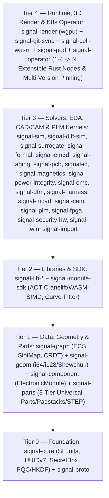

# Signal — Rust Engineering & Clean Architecture Guide (`engine/`)

> **Applies To:** All Rust crates under `engine/crates/*` and golden physics suites under `benchmarks/`.  
> **Governing Specs:** [`architecture/03-rust-eda-engine.md`](../../architecture/03-rust-eda-engine.md), [`architecture/15-application-security-and-project-isolation.md`](../../architecture/15-application-security-and-project-isolation.md), [`architecture/17-extended-feature-specifications-ui-and-rust.md`](../../architecture/17-extended-feature-specifications-ui-and-rust.md), [`architecture/18-universal-component-and-datasheet-repository.md`](../../architecture/18-universal-component-and-datasheet-repository.md), [`architecture/19-cad-cam-3d-printing-and-plm-operations.md`](../../architecture/19-cad-cam-3d-printing-and-plm-operations.md), [`architecture/20-versioning-release-monorepo-build-and-k8s-topology.md`](../../architecture/20-versioning-release-monorepo-build-and-k8s-topology.md).

---

## 1. Edition, Workspace Hygiene & Fast Incremental Builds

- **Toolchain:** Rust **2024 Edition** (`rust-version` pinned via `rust-toolchain.toml`), workspace-inherited `edition`, `license`, and `lints` in `engine/Cargo.toml` (version synced from root `VERSION` via `justfile`).
- **Single Shared Protobuf Crate:** ALL `tonic`/`prost` codegen runs **once** inside `engine/crates/signal-proto`—never duplicate `build.rs` proto codegen across domain crates.
- **Workspace Hack & Linker Speed:** Maintain `engine/crates/workspace-hack` via `cargo-hakari` + configure `sccache` and `lld`/`mold` so macOS Apple Silicon incremental rebuilds stay `< 2 s`.
- **Strict Acyclic Crate DAG:** Dependencies MUST flow strictly downward—never create circular crate edges or let core physics crates depend on `signal-pod`, `tonic`, or `wgpu`!



---

## 2. Safety, Security & Zero-Panic Guardrails

1. **`#![forbid(unsafe_code)]` Default:** Every crate root (`lib.rs`) MUST declare `#![forbid(unsafe_code)]`. Audited SIMD/GPU/FFI leaves live in tiny isolated micro-crates requiring `// SAFETY:` proofs, Miri checks, and fuzz targets.
2. **Zero Panics on Untrusted Data:** Never use `.unwrap()`, `.expect()`, or unchecked slice indexing `[i]` on user, network, Git, CAD-import, or parser inputs. Use `?`, `.get(i)`, `checked_add`/`saturating_*`, and explicit typed errors.
3. **Never Link LLVM or `dlopen` in `signal-pod`:** Keep `signal-pod` 100% LLVM-free. Compile Verilog-A AOT via Cranelift/`WASM-SIMD` in `signal-verify-worker`; run binary `IBIS-AMI`/`OSDI` strictly inside zero-network child `Firecracker`/`gVisor` IPC sandboxes.
4. **Secret Hygiene (`SecretBox<T>` + `ZeroizeOnDrop`):** Wrap all DEKs, PATs/OAuth tokens, PDK payloads, and confidential net/entity names in `secrecy::SecretBox<T>` with `zeroize::ZeroizeOnDrop`. Implement custom `Debug` that redacts secret fields; never pass secrets to `tracing` spans!
5. **Typed Error Discipline:**
   - Library crates (`signal-core`, `signal-sim`, `signal-geom`, etc.): use `thiserror::Error` with explicit, stable, actionable enum variants (never stringly-typed errors or `anyhow` in public library APIs!).
   - Binary entrypoints (`signal-pod`, `signal-operator`): may map domain errors to gRPC `tonic::Status` with sanitized user messages and structured error codes.

---

## 3. Clean Domain Patterns & Deterministic Numerics

### 3.1 Strongly-Typed Newtypes & SI Units (Zero Unit-Confusion Bugs)
- Never pass bare `f64` or `i64` across public APIs when representing physical quantities or IDs.
- Use zero-cost `#[repr(transparent)]` newtypes: `Nanometers(i64)`, `Picoseconds(i64)`, `MicroVolts(i64)`, `NanoAmps(i64)`, `MilliKelvin(i64)`, `SignalEntityId(Uuid)`, `NetId(SlotKey)`, `FencingEpoch(u64)`.
- For `signal-geom`: store compact `i64` nm coordinates, **always promote intermediate cross-products/determinants to `i128` or Shewchuk adaptive predicates** so `> 3 m` backplanes never overflow.

### 3.2 `0.5-ULP` Cross-ISA Determinism (`ARM64 Mac == x86_64 Linux`)
- Use pure-Rust `core_math` for transcendental functions (`exp`, `ln`, `sin`, `cos`, `pow`) in all physics/stamping paths.
- Disable floating-point FMA contraction where bit-exact parity is required; use canonical sorted CSR indices and deterministic binary-tree `rayon` reductions (never nondeterministic `HashMap` iteration order—use `BTreeMap` or `IndexMap` / sorted `Vec`!).
- Seed every stochastic algorithm (Monte Carlo, Pelgrom mismatch, Tardos watermarks) with per-`SignalEntityId` `ChaCha20Rng`.

### 3.3 `ElectronicModule` & `SignalFeatureKernel` Clean Decomposition
- Split every solver/kernel crate cleanly into:
  - `types.rs` — strongly-typed inputs/outputs & SI-unit structs (no logic).
  - `error.rs` — `thiserror` error enum.
  - `model.rs` / `stamping.rs` — pure, side-effect-free physics math (`stamp_dc`, `stamp_transient`, `stamp_adjoint_and_saltation`).
  - `kernel.rs` — ECS graph adapter reading read-only snapshots from `signal-graph` and emitting transactional `GraphOp` patches or Apache Arrow `RecordBatch`es.
  - `lib.rs` — concise crate header, `#![forbid(unsafe_code)]`, and minimal `pub use` re-exports.
- Enforce **exact charge `q(v)` / flux `Φ(i)` conservation**, **Ruiz equilibration** + `f128` refinement on ill-conditioned MNA matrices (`cond > 1e12`), **Filippov Saltation + `Revolve` $O(\log N_t)$ checkpointing** for switching adjoints, and **CPU `KLU`/`CKTSO` (`< 25k`) ↔ GPU `cuDSS` (`>= 25k`)** workload dispatch.

### 3.4 Async & Concurrency Hygiene
- Never block `tokio` async worker threads with CPU-bound SPICE/DRC/FEM/crypto work—offload compute to dedicated `rayon` pools or `tokio::task::spawn_blocking` guarded by the In-Pod Memory Governor and hierarchical `CancellationToken`s.
- Prefer immutable snapshots, lock-free ring buffers, or `Arc<RwLock<_>>` held for microseconds (never hold a `Mutex`/`RwLock` across `.await`!).

---

## 4. Mandatory Rust Verification Gate (Before Every Commit/PR)

```bash
cargo fmt --all -- --check
cargo clippy --workspace --all-targets -- -D warnings
cargo test --workspace
cargo deny check
cargo vet
```
*(During tight inner loops, scope to `-p <crate>` first; run full workspace + `benchmarks/` golden NGSPICE/Sky130/geometry parity tests before opening a PR.)*
