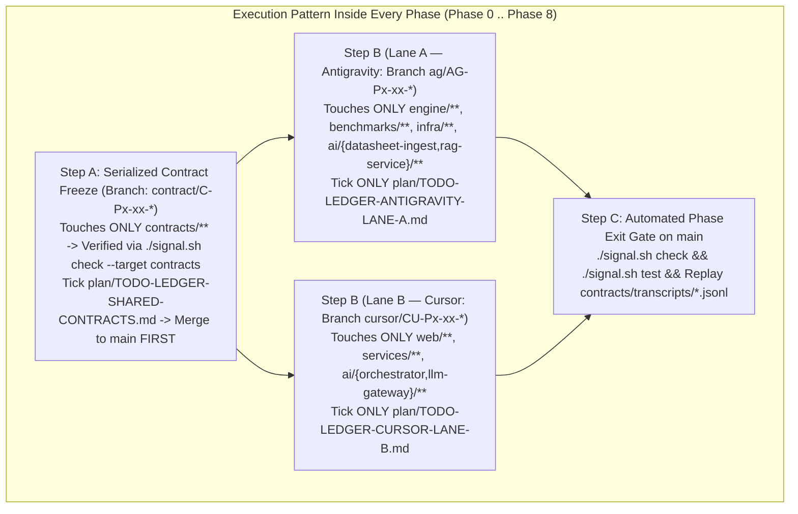

# Signal — Master Multi-Phase Development Plan & Parallel Execution System (`plan/`)

> **Applies To:** Engineering Team, **Antigravity (Lane A)**, and **Cursor (Lane B)**  
> **Governing Rules & Skills:** [`AGENTS.md`](../AGENTS.md) • [`.cursor/rules/*.mdc`](../.cursor/rules/signal-architecture.mdc) • [`.agents/skills/*/SKILL.md`](../.agents/skills/README.md) • [`docs/engineering/*`](../docs/engineering/README.md)  
> **Architecture Baseline:** All **21 Architecture Specifications ([`architecture/01..21`](../architecture/README.md))**, **120 Extended Features (`FEAT-001`–`FEAT-120`)**, **148 Resolved Audit Flaws (`F-001`–`F-148`)**, and **12 AI-EDA Innovations (`I-01`–`I-12`)**.

---

## 1. How This Multi-Day Plan Works (Zero-Conflict Parallel Execution)

Because **Signal** is a massive, multi-domain cloud platform (Pure **Rust `1.100+`** EDA/MCAD/CAM/3D-Print/PLM Engine + Stateless **Python `3.15+` FastAPI / Granian** Control Plane + **Angular `v22+` ONLY** Zoneless Web IDE + Neuro-Symbolic AI/RAG + **3-Tier Kubernetes `1.37+`**), the entire implementation is partitioned into **9 sequential phases (`Phase 0` – `Phase 8`)** and **110+ atomic, path-disjoint micro-tasks**.

### Why Antigravity & Cursor Never Step on Each Other
1. **Contract-First Synchronization (`Step A`):** Before any parallel Rust or Angular/FastAPI coding starts in a phase, the phase's serialized contract tasks (`C-Px-*`, touching `contracts/**` ONLY) merge to `main`. Both IDEs then rebase (`git fetch origin --prune && git rebase origin/main`) and build against frozen Protobuf/OpenAPI/JSON-Schema types and golden `contracts/fixtures/` + `contracts/transcripts/*.jsonl`.
2. **Strictly Disjoint `touched_paths` (`paths(AG) ∩ paths(CU) = ∅`):** Every micro-task declares explicit directory globs. No `AG-Px-*` task ever shares a file or directory with any concurrent `CU-Px-*` task.
3. **Three Single-Writer Tickable TODO Ledgers (Zero Checkbox Merge Conflicts!):**
   - **[`plan/TODO-LEDGER-SHARED-CONTRACTS.md`](./TODO-LEDGER-SHARED-CONTRACTS.md):** Ticked (`- [ ]` → `- [x]`) **ONLY** inside serialized `contract/*` PRs (`C-P0-01` .. `C-P8-01`).
   - **[`plan/TODO-LEDGER-ANTIGRAVITY-LANE-A.md`](./TODO-LEDGER-ANTIGRAVITY-LANE-A.md):** Ticked (`- [ ]` → `- [x]`) **ONLY by Antigravity** inside `ag/*` PRs (`AG-P0-01` .. `AG-P8-04`), paired with [`coordination/agents/antigravity.md`](../coordination/agents/antigravity.md). Cursor reads this file **read-only**.
   - **[`plan/TODO-LEDGER-CURSOR-LANE-B.md`](./TODO-LEDGER-CURSOR-LANE-B.md):** Ticked (`- [ ]` → `- [x]`) **ONLY by Cursor** inside `cursor/*` PRs (`CU-P0-01` .. `CU-P8-04`), paired with [`coordination/agents/cursor.md`](../coordination/agents/cursor.md). Antigravity reads this file **read-only**.

---

## 2. Mandatory Clean-Code, Skill & Guardrail Protocol (Every Single Task)

Every task in `Phase 0` through `Phase 8` MUST follow these non-negotiable rules ([`AGENTS.md`](../AGENTS.md) §4–§7 & [`TOKEN_EFFICIENCY_AND_CLEAN_CODE.md`](../docs/engineering/TOKEN_EFFICIENCY_AND_CLEAN_CODE.md)):

| Rule Category | Mandatory Enforcement on Every Micro-Task |
|---|---|
| **1. Session-Start Ritual (`signal-session-start`)** | Run `git fetch origin --prune && git status -sb`; read [`coordination/TASK_BOARD.md`](../coordination/TASK_BOARD.md), peer journal (`cursor.md` or `antigravity.md` read-only), [`coordination/handoffs/`](../coordination/handoffs/README.md), and the phase plan file; verify zero `touched_paths` overlap; create branch `contract/<id>-<slug>`, `ag/<id>-<slug>`, or `cursor/<id>-<slug>` from `origin/main`. |
| **2. Activate Listed Skills First** | Every micro-task card lists its required `.agents/skills/*/SKILL.md` skills. Load those skills before writing code. |
| **3. Strict File & Function Modularity** | Target `80–250 LOC` per file (**hard split threshold `> 350 LOC`**); functions `<= 40–60 LOC`; nesting depth `<= 3`; max `4` parameters (use typed parameter structs/models beyond 4); mandatory 3-line `Module / Invariants / Spec` header at top of every source file. |
| **4. Rust `1.100+` Clean Code (`engine/**`)** | Rust 2024 Edition (`rust-version = "1.100"`), `#![forbid(unsafe_code)]`, shared `signal-proto` + `cargo-hakari`, typed `thiserror` enums, zero `.unwrap()`/`.expect()` on untrusted input, `SecretBox<T>` (`ZeroizeOnDrop`), `0.5-ULP` `core_math`, `i128`/Shewchuk geometry, Cargo dependency cooldowns + `cargo vet`/`cargo deny`. Follow [`RUST_ENGINEERING_GUIDE.md`](../docs/engineering/RUST_ENGINEERING_GUIDE.md). |
| **5. Angular `v22+` ONLY Clean Code & Standardized UI (`web/**`)** | Angular `>= 22.0.0`, TypeScript `6.0+` strict, Node.js `26 LTS+`, `pnpm 11+`, Zoneless (`provideZonelessChangeDetection()`), Standalone, `OnPush`, Signal Forms & Signals (`input()`/`output()`/`computed()`). **Strict 4-File Split:** `.component.ts` (`<= 120 LOC`, zero inline `template:`/`styles:`), `.component.html` (`<= 150 LOC`, nesting `<= 2`, **zero `@if`-soup or copy-pasted HTML sections**), `.logic.ts` (`<= 250 LOC` pure functions + unit tests), `.model.ts`. **Zero component-local `.css`/`.scss`** outside `@signal/design-system` & `@signal/ui-kit` unless `/* @sig-style-exception: <reason> */`. Follow [`ANGULAR_ENGINEERING_GUIDE.md`](../docs/engineering/ANGULAR_ENGINEERING_GUIDE.md) & [`ANGULAR_UI_STYLE_GUIDE.md`](../docs/engineering/ANGULAR_UI_STYLE_GUIDE.md). |
| **6. Python `3.15+` FastAPI Clean Code (`services/**`, `ai/**`)** | Python `>= 3.15.2`, FastAPI `0.165+`, Rust `Granian 2.8+`, Rust `Pydantic v2 (2.14+)`, `uv`, 4-layer separation (`router.py` → `schemas.py` → `service.py` → `repository.py`), fail-closed `Depends(require_*)` verified by startup route-auth introspection gate, uniform `404` (`raise_not_found()`), PostgreSQL `19+` `with_rls_tx` (`NOBYPASSRLS`), `SecretStr`, Fail-Closed 3x Quorum Tier-0 Audit Outbox, zero physics/geometry in Python. Follow [`FASTAPI_ENGINEERING_GUIDE.md`](../docs/engineering/FASTAPI_ENGINEERING_GUIDE.md). |
| **7. Unified CI/CD & Verification (`signal-verification-and-pr-gate`)** | All builds, checks, images, releases, and deploys run through **`./signal.sh`** (`scripts/signal_ops.py` + `scripts/components.toml`). A task may ONLY be ticked `[x]` in its TODO ledger after `./signal.sh check --changed` (or domain gate) exits with code `0`. |
| **8. Anti-Hallucination & 2–3 Sentence Dev Replies** | Verify every path, symbol, `.proto` field, and dependency via `rg`/`view_file` before coding. Reply in **2–3 sentences max** (`Issue/Task -> Fix/Implementation -> Observed Verification Exit 0`). |

---

## 3. Complete Plan Directory Map (`14` Modular Plan & Ledger Documents)

| File | Scope & Purpose | Tasks Covered |
|---|---|---|
| **[`00-FEATURE-TRACEABILITY-MATRIX.md`](./00-FEATURE-TRACEABILITY-MATRIX.md)** | **100% Zero-Miss Traceability Matrix** mapping all `21` Specs, `31` Rust crates, `11` FastAPI services, `23` Angular workbenches, `120` `FEAT-001..120`, `148` `F-001..148`, and `12` `I-01..12` to exact task IDs | Full Platform Audit |
| **[`phase-0-foundation-contracts-and-cicd.md`](./phase-0-foundation-contracts-and-cicd.md)** | **Phase 0:** Monorepo skeleton, `bigint` SI-unit Protobuf/OpenAPI/Schemas, unified `./signal.sh` + `scripts/signal_ops.py` CI/CD CLI, 3-Tier K8s `1.37+` Helm chart, Mac `dev:lite`/`dev:k8s`, Angular `v22+` design system/shell & FastAPI skeleton | `C-P0-01..03`, `AG-P0-01..05`, `CU-P0-01..05` (`13` tasks) |
| **[`phase-1-rust-spice-core-and-schematic-ide.md`](./phase-1-rust-spice-core-and-schematic-ide.md)** | **Phase 1:** Rust `signal-core`/`geom`/`graph`/`component`, Ruiz `KLU`↔`cuDSS` MNA SPICE, Filippov Saltation + `Revolve` Adjoint `signal-diff-sim`, Dual-Plane `Zstd-QOI` canvas, Schematic IDE & Arrow Waveform/Virtual Bench studio | `C-P1-01..02`, `AG-P1-01..06`, `CU-P1-01..06` (`14` tasks) |
| **[`phase-2-k8s-cells-byo-git-parts-and-identity.md`](./phase-2-k8s-cells-byo-git-parts-and-identity.md)** | **Phase 2:** 3-Tier K8s Project Cells (`1–4 -> N` Rust worker nodes, `< 8 MB` WASM, Leases, `< 150 ms` Live Migration), BYO-Git Padmé Vault + 2PC `Super-Commit`, 3-Tier Universal Parts Repo (`18-*`), Provider Auth & Access Review | `C-P2-01..02`, `AG-P2-01..06`, `CU-P2-01..06` (`14` tasks) |
| **[`phase-3-ai-agents-quarantine-and-hybrid-rag.md`](./phase-3-ai-agents-quarantine-and-hybrid-rag.md)** | **Phase 3:** Dual-VLM Condition-Parameterized Datasheet Ingestion, Multimodal Zero-Tool Quarantine, 3-Tier Sharded `pgvector` Hybrid RAG, Mirrored BOM Rescue, `signal-formal`, `signal-surrogate`, Legacy Importers & 10 AI Workbenches | `C-P3-01`, `AG-P3-01..05`, `CU-P3-01..05` (`11` tasks) |
| **[`phase-4-pcb-224g-si-pi-power-emc-and-sftp.md`](./phase-4-pcb-224g-si-pi-power-emc-and-sftp.md)** | **Phase 4:** Full PCB Layout/PNS Router, 224G SI/PI & GPU 3D EM, Custom Magnetics, Power Studio, EMC/ESD/FMEDA/WCCA/Rad-Hard/Aging, Panel/DFA/Fatigue/Should-Cost, Zero-Leak Constellation Stream & Step-Up 2FA `russh` SFTP Release | `C-P4-01..02`, `AG-P4-01..07`, `CU-P4-01..06` (`15` tasks) |
| **[`phase-5-cad-cam-3d-printing-and-plm-ops.md`](./phase-5-cad-cam-3d-printing-and-plm-ops.md)** | **Phase 5:** Parametric B-Rep Mechanical CAD (`CAD_MCAD`), Multi-Board & Wire-Harness 3D, Subtractive 5-Axis CNC (`CAM_CNC`), Direct-B-Rep 3D Printing (`PRINT_3D`), and Native PLM/Operations (`eBOM`/`mBOM`, `ECN`/`MCN`/`PCN`/`Deviation`/`NCR`/`CTB`) | `C-P5-01..02`, `AG-P5-01..05`, `CU-P5-01..05` (`12` tasks) |
| **[`phase-6-ic-asic-fpga-firmware-bios-and-twin.md`](./phase-6-ic-asic-fpga-firmware-bios-and-twin.md)** | **Phase 6:** Analog/Digital IC & RTL-to-GDSII (`gm/Id`, BSPDN, CTS, STA, Metal ECO, UCIe Chiplets, UPF, DFT, IEEE 1735, Baseband CPO, 4K Cryo), HW Security (DPA/TVLA/IFT), FPGA Studio, Firmware/BIOS Co-Sim & Lab Digital Twin | `C-P6-01..02`, `AG-P6-01..06`, `CU-P6-01..05` (`13` tasks) |
| **[`phase-7-collab-space-status-and-auto-reviews.md`](./phase-7-collab-space-status-and-auto-reviews.md)** | **Phase 7:** Built-In Zero-Leak 5-Team Collaboration Space (`Design`, `Dev`, `Software`, `Manufacturing`, `Ops`), `@entity` threads, encrypted WebRTC/viewport huddles, Project Status Control Tower & Automated Weekly/Monthly/Stage-Gate Reviews (`21-*`) | `C-P7-01`, `AG-P7-01..02`, `CU-P7-01..04` (`7` tasks) |
| **[`phase-8-academy-finops-compliance-and-ga.md`](./phase-8-academy-finops-compliance-and-ga.md)** | **Phase 8:** Signal Academy Labs & LTI Auto-Grader, Open-Silicon Shuttle Wizard, Air-Gapped `Signal Campus Edge`, WASM Plugin/Policy-as-Code Studio, Enterprise FinOps, Portfolio Blast-Radius Graph & ASVS-L3/SOC2/ITAR GA Sign-Off | `C-P8-01`, `AG-P8-01..04`, `CU-P8-01..04` (`9` tasks) |
| **[`TODO-LEDGER-SHARED-CONTRACTS.md`](./TODO-LEDGER-SHARED-CONTRACTS.md)** | **Single-Writer Tickable Ledger — Serialized Contract Freeze (`contract/*` PRs ONLY)** | `16` Contract Tasks (`C-P0..P8`) |
| **[`TODO-LEDGER-ANTIGRAVITY-LANE-A.md`](./TODO-LEDGER-ANTIGRAVITY-LANE-A.md)** | **Single-Writer Tickable Ledger — Antigravity Lane A (`ag/*` PRs ONLY)** | `46` Lane A Tasks (`AG-P0..P8`) |
| **[`TODO-LEDGER-CURSOR-LANE-B.md`](./TODO-LEDGER-CURSOR-LANE-B.md)** | **Single-Writer Tickable Ledger — Cursor Lane B (`cursor/*` PRs ONLY)** | `46` Lane B Tasks (`CU-P0..P8`) |
