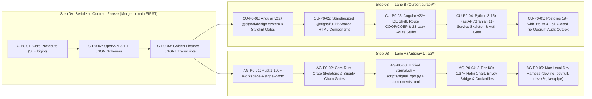

# Phase 0 Plan — Monorepo Foundation, `bigint` Contracts, Unified `./signal.sh` CI/CD & 3-Tier K8s/Local Harness

> **Phase Goal:** Establish the complete monorepo foundation, canonical `bigint` SI-unit contracts (`contracts/`), unified small-team build/CI/CD/release/deploy CLI (`./signal.sh` + `scripts/signal_ops.py` + `scripts/components.toml`), 3-Tier Kubernetes `1.37+` Umbrella Helm Chart (`infra/k8s/`), macOS Apple Silicon `< 1.5 GB RAM` local dev harness (`infra/local/`), Pure-Rust `1.100+` workspace skeleton (`engine/`), Angular `v22+` ONLY centralized design system/UI kit/IDE shell (`web/`), and stateless Python `3.15+` FastAPI/Granian Control-Plane skeleton (`services/`).  
> **Governing Specs:** [`02`](../architecture/02-system-architecture.md), [`06`](../architecture/06-frontend-angular-and-fastapi-control-plane.md), [`09`](../architecture/09-local-development-environment.md), [`10`](../architecture/10-api-and-data-contracts.md), [`12`](../architecture/12-multi-ide-collaboration.md), [`20`](../architecture/20-versioning-release-monorepo-build-and-k8s-topology.md) • **Playbook:** [`PHASE0_LAUNCH_PLAYBOOK.md`](../docs/engineering/PHASE0_LAUNCH_PLAYBOOK.md)  
> **Ledgers to Tick:** [`TODO-LEDGER-SHARED-CONTRACTS.md`](./TODO-LEDGER-SHARED-CONTRACTS.md) • [`TODO-LEDGER-ANTIGRAVITY-LANE-A.md`](./TODO-LEDGER-ANTIGRAVITY-LANE-A.md) • [`TODO-LEDGER-CURSOR-LANE-B.md`](./TODO-LEDGER-CURSOR-LANE-B.md)

---

## 1. Execution Wave Order (Zero-Conflict Parallelism)

---

## 2. Step 0A — Serialized Contract Freeze (`contracts/**` ONLY)

### `C-P0-01` — Buf Workspace & Core SI-Unit `bigint` Protobuf Contracts
- **Branch:** `contract/C-P0-01-core-protobufs` | **Owner:** Either (Serialized) | **Touched Paths:** `contracts/buf.yaml`, `contracts/buf.gen.yaml`, `contracts/proto/signal/v1/**`
- **Skills:** `signal-session-start`, `signal-contract-first`, `signal-token-efficient-editing`, `signal-verification-and-pr-gate`
- **Deliverables:**
  1. `contracts/buf.yaml` + `contracts/buf.gen.yaml` configured for build-time-only codegen (`prost`/`tonic` for Rust `1.100+`, `pydantic`/`grpcio` for Python `3.15+`, `@protobuf-ts` with `longAsBigint: true` for TypeScript `6.0+`).
  2. Foundational `.proto` files under `contracts/proto/signal/v1/`: `session.proto`, `design_graph.proto`, `vcs_sync.proto`, `component.proto`, `universal_parts.proto`, `mcad_cam_print.proto`, `plm_ops.proto`, `platform_release.proto`, `collab_review.proto`, `simulation.proto`, `render_stream.proto`, `sftp_release.proto`.
  3. **Invariants (`F-101`, `F-104`, `F-107`, `F-109`, `F-144`):** Explicit SI suffixes (`_nm`, `_ps`, `_fs`, `_uv`, `_na`, `_hz`, `_mk`) on all physical fields; `[jstype = JS_STRING]` on **100% of `int64`/`uint64`/`sint64`/`fixed64` fields**; `<= 1 MB` chunked server-streaming envelopes for waveforms/tiles.
- **Verify & Tick:** `buf lint && buf format -d --exit-code` → Tick `C-P0-01` in [`TODO-LEDGER-SHARED-CONTRACTS.md`](./TODO-LEDGER-SHARED-CONTRACTS.md).

### `C-P0-02` — Canonical OpenAPI 3.1 (`control-plane.v1.yaml`) & JSON Schemas
- **Branch:** `contract/C-P0-02-openapi-and-schemas` | **Owner:** Either (Serialized) | **Touched Paths:** `contracts/openapi/**`, `contracts/schemas/**`
- **Skills:** `signal-contract-first`, `signal-security-isolation-audit`, `signal-verification-and-pr-gate`
- **Deliverables:**
  1. `contracts/openapi/control-plane.v1.yaml`: URL-scoped `/api/v1/orgs/{org_slug}/...`, mandatory `Idempotency-Key` header on state-mutating `POST`/`PUT`/`PATCH`, uniform `404` error responses, Platform Releases API (`/api/v1/platform/releases`), Universal Parts API, PLM/Ops API, Collab/Reviews API, and **zero `/export`, `/download`, or `/print` routes** (`F-084`, `F-097`, `F-102`).
  2. JSON Schemas (`Draft 2020-12`) under `contracts/schemas/`: `datasheet-record.schema.json`, `universal-part-manifest.schema.json`, `mcad-feature-tree.schema.json`, `mbom-structure.schema.json`, `release-manifest.schema.json`, `platform-lockfile.schema.json`, `project-status-review.schema.json`, `collab-channel-policy.schema.json`, `super-commit-manifest.schema.json`, `fab-capability-profile.schema.json`, `sftp-release-manifest.schema.json`.
- **Verify & Tick:** Validate OpenAPI 3.1 + JSON schemas → Tick `C-P0-02` in [`TODO-LEDGER-SHARED-CONTRACTS.md`](./TODO-LEDGER-SHARED-CONTRACTS.md).

### `C-P0-03` — Golden `bigint` Cross-Language Fixtures & Stateful JSONL Transcripts
- **Branch:** `contract/C-P0-03-fixtures-and-transcripts` | **Owner:** Either (Serialized) | **Touched Paths:** `contracts/fixtures/**`, `contracts/transcripts/**`
- **Skills:** `signal-contract-first`, `signal-verification-and-pr-gate`
- **Deliverables:**
  1. `contracts/fixtures/*.json`: Golden serialization vectors including extreme 64-bit values (`> 2^53 - 1`, e.g., `"9007199254740993"` nm/fs) proving zero precision loss across Rust `i64`, Python `int`, and TypeScript `bigint` (`F-144`).
  2. `contracts/transcripts/session_hydrate_and_edit.jsonl`: Stateful multi-step handshake replay (`OpenSession` → `HydrateRepos` → `ApplyGraphOp` → `RenderDirtyTile` → `SuperCommit` → `FencingEpochBump`) (`F-145`).
- **Verify & Tick:** Validate JSON/JSONL syntax against schemas → Tick `C-P0-03` in [`TODO-LEDGER-SHARED-CONTRACTS.md`](./TODO-LEDGER-SHARED-CONTRACTS.md).

---

## 3. Step 0B — Lane A: Antigravity Parallel Tasks (`ag/*`)

### `AG-P0-01` — Rust `1.100+` Workspace, `signal-proto` Single-Build Codegen & `cargo-hakari`
- **Branch:** `ag/AG-P0-01-rust-workspace-and-proto` | **Owner:** Antigravity | **Touched Paths:** `rust-toolchain.toml`, `engine/Cargo.toml`, `engine/crates/signal-proto/**`, `engine/crates/workspace-hack/**`
- **Skills:** `signal-rust-crate-architect`, `signal-contract-first`, `signal-token-efficient-editing`
- **Deliverables:**
  1. `rust-toolchain.toml` pinned to `1.100.0` (2024 Edition) + `engine/Cargo.toml` with workspace-wide `#![forbid(unsafe_code)]` lint table and `sccache`/`lld` fast-build config (`F-143`).
  2. `engine/crates/signal-proto`: Compiles all `contracts/proto/signal/v1/*.proto` **once** for the entire workspace (`< 2 s` incremental builds) and passes golden `contracts/fixtures/*.json` round-trip tests.
- **Verify & Tick:** `cargo test -p signal-proto && cargo clippy -p signal-proto -- -D warnings` → Tick `AG-P0-01` in [`TODO-LEDGER-ANTIGRAVITY-LANE-A.md`](./TODO-LEDGER-ANTIGRAVITY-LANE-A.md).

### `AG-P0-02` — Core Rust Crate Skeletons, `dev-guest-auth` Compile Guard & Supply-Chain Vetting
- **Branch:** `ag/AG-P0-02-rust-crate-skeletons` | **Owner:** Antigravity | **Touched Paths:** `engine/crates/{signal-core,signal-geom,signal-graph,signal-component,signal-parts,signal-sim,signal-diff-sim,signal-git-sync,signal-cell-wasm,signal-pod,signal-operator,signal-egress-proxy,signal-sftp-egress,signal-mcad,signal-cam,signal-plm}/**`, `engine/deny.toml`, `engine/supply-chain/**`, `benchmarks/**`
- **Skills:** `signal-rust-crate-architect`, `signal-security-isolation-audit`, `signal-verification-and-pr-gate`
- **Deliverables:**
  1. Clean modular crate skeletons (`<= 250 LOC`/file, 3-line header, `thiserror` error types, `#![forbid(unsafe_code)]`) for the initial workspace crates plus `benchmarks/` harness (`F-110`).
  2. Compile-time guard in `signal-core`/`signal-pod`: `#[cfg(all(feature = "dev-guest-auth", not(debug_assertions)))] compile_error!("dev-guest-auth forbidden in release builds!");` (`F-095`).
  3. `engine/deny.toml` + Cargo dependency cooldown config + `cargo vet` store (`F-091`).
- **Verify & Tick:** `cargo clippy --workspace --all-targets -- -D warnings && cargo test --workspace` → Tick `AG-P0-02` in [`TODO-LEDGER-ANTIGRAVITY-LANE-A.md`](./TODO-LEDGER-ANTIGRAVITY-LANE-A.md).

### `AG-P0-03` — Unified Common Build, CI/CD, Release, Deploy & Rollback CLI (`./signal.sh` + `scripts/`)
- **Branch:** `ag/AG-P0-03-unified-signal-ops-cli` | **Owner:** Antigravity | **Touched Paths:** `VERSION`, `CHANGELOG.md`, `signal.sh`, `justfile`, `scripts/**`, `releases/**`, `.github/workflows/**`
- **Skills:** `signal-release-deploy-topology`, `signal-token-efficient-editing`, `signal-verification-and-pr-gate`
- **Deliverables:**
  1. Root `VERSION` (`0.1.0`), `CHANGELOG.md`, `releases/{manifest.json,compatibility.json}`, and thin POSIX/Bash `./signal.sh` delegating to stdlib-only Python `3.15+` `scripts/signal_ops.py` + `scripts/components.toml` + modular `scripts/ops/{registry,doctor,dev,build,check,image,release,deploy,rollback}.py` (`<= 250 LOC` each, zero third-party bootstrap deps) + `justfile` 1-line aliases (`20-*`).
  2. Thin (`~25–45 LOC`) `.github/workflows/{pr-gate,release,deploy-gitops}.yml` calling ONLY `./signal.sh <verb> --json`, plus unit/dry-run tests under `scripts/tests/`.
- **Verify & Tick:** `./signal.sh doctor && ./signal.sh release preview --dry-run && pytest scripts/tests/ -q` → Tick `AG-P0-03` in [`TODO-LEDGER-ANTIGRAVITY-LANE-A.md`](./TODO-LEDGER-ANTIGRAVITY-LANE-A.md).

### `AG-P0-04` — 3-Tier Kubernetes `1.37+` Umbrella Helm Chart, Envoy Engine Bridge & Multi-Arch Dockerfiles
- **Branch:** `ag/AG-P0-04-k8s-helm-and-docker` | **Owner:** Antigravity | **Touched Paths:** `infra/docker/**`, `infra/k8s/**`
- **Skills:** `signal-release-deploy-topology`, `signal-security-isolation-audit`, `signal-verification-and-pr-gate`
- **Deliverables:**
  1. Multi-arch (`linux/amd64`, `linux/arm64`) `infra/docker/Dockerfile.{web,api,bridge,rust-pod,operator,ai}` (`--no-default-features` forbidding `dev-guest-auth`).
  2. Umbrella Helm Chart `infra/k8s/helm/signal/` (`values.yaml`, `values-local.yaml`, `values-starter.yaml`, `values-enterprise.yaml`) enforcing **Tier 1 (`pool-web`: Angular `v22+` + Node `26 LTS+` `signal-web` pod)**, **Tier 2 (`pool-api`: HA FastAPI/Granian `signal-api` + Envoy `signal-engine-bridge`)**, and **Tier 3 (`pool-rust-engine`: `1–4` baseline extensible to `N` Rust `1.100+` worker nodes with adaptive 1-node fallback)**, plus Karpenter `NodePool`s, Cilium 3-tier eBPF 100% lateral-drop policies, and Kyverno Cosign/SBOM gates (`20-*`).
- **Verify & Tick:** `./signal.sh check --target k8s` (`helm lint` + template validation) → Tick `AG-P0-04` in [`TODO-LEDGER-ANTIGRAVITY-LANE-A.md`](./TODO-LEDGER-ANTIGRAVITY-LANE-A.md).

### `AG-P0-05` — macOS Apple Silicon Local Dev Harness (`dev:lite`, `dev:full`, `dev:k8s` & `lavapipe` CI)
- **Branch:** `ag/AG-P0-05-local-mac-dev-harness` | **Owner:** Antigravity | **Touched Paths:** `infra/local/**`
- **Skills:** `signal-local-mac-dev`, `signal-security-isolation-audit`, `signal-verification-and-pr-gate`
- **Deliverables:**
  1. `infra/local/` harness for `./signal.sh dev [lite|full|k8s]`: `< 1.5 GB RAM` `dev:lite` launcher, native `linux/arm64` Docker Compose (`PostgreSQL 19+` + `pgvector`, Redis/Valkey, NATS JetStream, MinIO, DevKMS with active Hybrid PQC, `local-git-mock :8085`, `MockSFTP :2222`), and split `infra/local/env/<subsystem>.env.example` templates (`09-*`, `F-105`, `F-106`).
  2. Pre-seeded `Guest @ Signal Design, Inc.` (`local-guest-0001` & contractor `local-pcb-contractor-0002` inside `local-git-mock` `REPO_ACCESS_ENTRY`), Ollama/MLX + `deterministic_mock` fallback, and headless `lavapipe` software-Vulkan WGSL parity harness (`F-095`, `F-143`).
- **Verify & Tick:** `./signal.sh dev lite --dry-run && ./signal.sh check --changed` → Tick `AG-P0-05` in [`TODO-LEDGER-ANTIGRAVITY-LANE-A.md`](./TODO-LEDGER-ANTIGRAVITY-LANE-A.md).

---

## 4. Step 0B — Lane B: Cursor Parallel Tasks (`cursor/*`)

### `CU-P0-01` — Angular `v22+` ONLY Workspace, Centralized `@signal/design-system` & ESLint/Stylelint Gates
- **Branch:** `cursor/CU-P0-01-angular-v22-design-system` | **Owner:** Cursor | **Touched Paths:** `.nvmrc`, `web/package.json`, `web/pnpm-workspace.yaml`, `web/tsconfig.base.json`, `web/eslint.config.mjs`, `web/.stylelintrc.json`, `web/libs/design-system/**`
- **Skills:** `signal-angular-ui-style-system`, `signal-angular-workbench`, `signal-token-efficient-editing`
- **Deliverables:**
  1. `.nvmrc` (`26.13.0`), `web/package.json` (**Angular `>= 22.0.0` ONLY**, TypeScript `6.0+` strict, `pnpm 11+`, zero `zone.js`), and build-time `pnpm codegen` (`@protobuf-ts` `longAsBigint: true` passing `contracts/fixtures/*.json` `bigint` tests).
  2. `web/libs/design-system` (`@signal/design-system`): Semantic `--sig-*` CSS tokens, Dark/High-Contrast/Okabe-Ito color-blind-safe themes (`F-070`), typography (`Inter` + `JetBrains Mono` `tabular-nums`), and `.sig-*` CSS primitives.
  3. **Automated Clean-UI CI Gates (`ANGULAR_UI_STYLE_GUIDE.md`):** ESLint + Angular Template Analyzer rules enforcing `.component.html <= 150 LOC`, nesting depth `<= 2`, zero inline `template:`/`styles:`, and Stylelint rule **forbidding component-local `.css`/`.scss` files** outside `libs/design-system` & `libs/ui-kit` unless headed by `/* @sig-style-exception: <reason> */`.
- **Verify & Tick:** `pnpm --dir web lint && pnpm --dir web typecheck` → Tick `CU-P0-01` in [`TODO-LEDGER-CURSOR-LANE-B.md`](./TODO-LEDGER-CURSOR-LANE-B.md).

### `CU-P0-02` — Standardized `@signal/ui-kit` Shared HTML Component Ecosystem
- **Branch:** `cursor/CU-P0-02-angular-ui-kit` | **Owner:** Cursor | **Touched Paths:** `web/libs/ui-kit/**`
- **Skills:** `signal-angular-ui-style-system`, `signal-angular-workbench`, `signal-verification-and-pr-gate`
- **Deliverables:**
  1. Build the reusable `<sig-*>` component ecosystem inside `web/libs/ui-kit` using the strict **4-file component anatomy** (`.component.ts <= 120 LOC`, `.component.html <= 150 LOC`, `.logic.ts <= 250 LOC`, `.model.ts`):
     - `sig-panel`, `sig-split-pane`, `sig-toolbar`, `sig-drawer`, `sig-modal`, `sig-tabs`, `sig-button`, `sig-icon-button`, `sig-segmented-control`, `sig-si-input` (disambiguates `m` milli vs `M`/`Meg` Mega, `F-075`), `sig-badge`, `sig-status-pill`, `sig-data-grid` (`cdk-virtual-scroll`, `F-069`), `sig-tree-view`, `sig-property-inspector`, `sig-empty-state`, `sig-skeleton`, `sig-step-up-2fa-dialog`.
- **Verify & Tick:** `pnpm --dir web lint && pnpm --dir web test --run` → Tick `CU-P0-02` in [`TODO-LEDGER-CURSOR-LANE-B.md`](./TODO-LEDGER-CURSOR-LANE-B.md).

### `CU-P0-03` — Angular `v22+` Zoneless IDE Shell, Route `COOP`/`COEP`, What's New Drawer & 23 Lazy Route Stubs
- **Branch:** `cursor/CU-P0-03-angular-ide-shell` | **Owner:** Cursor | **Touched Paths:** `web/apps/signal-web/**`, `web/libs/{canvas-core,schematic,sim-viewer,pcb,magnetics,power-studio,emc-lab,safety-wcca,ic,fpga-studio,code-ide,bringup-lab,harness-3d,dfm-panel,library-studio,specs,ai-copilot,visual-diff,review,sftp-release,academy,admin,mcad-studio,cam-print,plm-ops,collab-hub}/**`
- **Skills:** `signal-angular-workbench`, `signal-angular-ui-style-system`, `signal-zero-leak-canvas-and-dlp`, `signal-verification-and-pr-gate`
- **Deliverables:**
  1. `web/apps/signal-web` Zoneless shell (`provideZonelessChangeDetection()`), URL-scoped `/org/:org_slug/project/:proj_slug` context store (`F-097`), Node.js `26 LTS+` SSR/CSP-nonce edge server with **Route-Partitioned `COOP`/`COEP`** (`/org/:org_slug/project/*` isolated; `/auth/*` `unsafe-none` + `__Host-` PKCE cookie upgrade, `F-127`), Progressive UI Profile selector (`EXPLORER`/`MAKER`/`PRO`), and In-App **"What's New"** release drawer + `N-3` chunk reload banner (`20-*`).
  2. Clean 4-file lazy-loaded entry skeletons for `canvas-core` and all `23` domain workbench libraries under `web/libs/*` with zero local `.Storage`/`IndexedDB` design persistence and zero `/export`/`/download` routes.
- **Verify & Tick:** `pnpm --dir web lint && pnpm --dir web typecheck && pnpm --dir web test --run` → Tick `CU-P0-03` in [`TODO-LEDGER-CURSOR-LANE-B.md`](./TODO-LEDGER-CURSOR-LANE-B.md).

### `CU-P0-04` — Python `3.15+` FastAPI/Granian 11-Service Skeleton & Startup `Depends(require_*)` Uniform-`404` Gate
- **Branch:** `cursor/CU-P0-04-fastapi-control-plane-skeleton` | **Owner:** Cursor | **Touched Paths:** `.python-version`, `pyproject.toml`, `uv.lock`, `services/{common,api-gateway,identity-org,project-catalog,parts-registry,plm-ops,collab-hub,vcs-connector,vcs-auditor,session-broker,sftp-egress}/**`
- **Skills:** `signal-fastapi-control-plane`, `signal-security-isolation-audit`, `signal-token-efficient-editing`
- **Deliverables:**
  1. `.python-version` (`3.15`), unified `pyproject.toml` (`uv` workspace, FastAPI `0.165+`, Rust `Granian 2.8+`, Rust `Pydantic v2 2.14+`, `ruff`, `pyright --strict`, `bandit`, `pip-audit`).
  2. `services/common/`: Fail-closed `Depends(require_org_role(...))` & `Depends(require_repo_access(...))` guards, **startup route-auth introspection gate (`assert_all_routes_guarded(app)`)** that aborts startup if any non-health route lacks an auth dependency, uniform `404` helper (`raise_not_found()`, `F-084`), `Idempotency-Key` middleware (`F-102`), `SecretStr` redaction filter (`F-088`), and `Int64Str` Pydantic type passing `contracts/fixtures/*.json` (`F-144`).
  3. 4-layer (`router.py`/`schemas.py`/`service.py`/`repository.py`, `<= 250 LOC`/file) skeletons for the 10 stateless services above, including `GET /api/v1/platform/releases` in `api-gateway` (`20-*`).
- **Verify & Tick:** `uv run ruff check services/ && uv run pyright services/ && uv run pytest services/ -q` → Tick `CU-P0-04` in [`TODO-LEDGER-CURSOR-LANE-B.md`](./TODO-LEDGER-CURSOR-LANE-B.md).

### `CU-P0-05` — PostgreSQL `19+` `with_rls_tx` (`NOBYPASSRLS`) & Fail-Closed 3x Quorum Tier-0 Audit Outbox
- **Branch:** `cursor/CU-P0-05-postgres19-rls-and-audit-outbox` | **Owner:** Cursor | **Touched Paths:** `services/common/db/**`, `services/audit-service/**`
- **Skills:** `signal-fastapi-control-plane`, `signal-security-isolation-audit`, `signal-verification-and-pr-gate`
- **Deliverables:**
  1. `services/common/db/rls.py`: Async SQLAlchemy `2.0+` / `asyncpg` context manager `with_rls_tx(session, ctx)` setting transaction-local `SET LOCAL app.current_org_id`, `app.current_user_id`, and `app.verified_repo_ids` under a `NOBYPASSRLS` role (`15-*`).
  2. `services/audit-service/`: **Fail-Closed 3x Replicated Raft/Postgres Tier-0 Audit Outbox** (`F-147`: blocks SFTP/BYOK/Break-Glass/Access-Review mutations if synchronous quorum write fails) + GDPR-safe pseudonymous `actor_hmac` (`F-100`) + 60s RFC-3161 + `ML-DSA-65` Merkle WORM flusher (`F-087`).
- **Verify & Tick:** `uv run ruff check services/ && uv run pyright services/ && uv run bandit -r services/ -ll && uv run pytest services/ -q` → Tick `CU-P0-05` in [`TODO-LEDGER-CURSOR-LANE-B.md`](./TODO-LEDGER-CURSOR-LANE-B.md).
